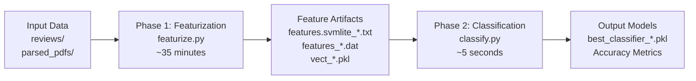
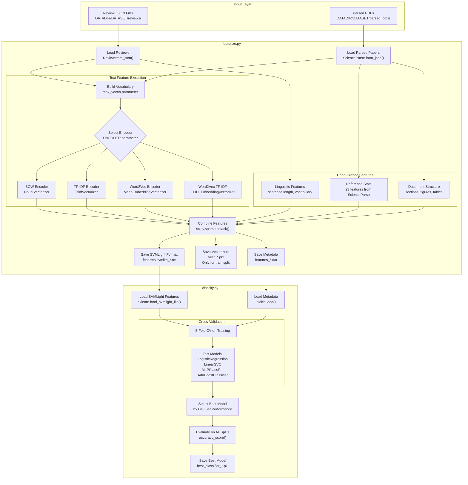
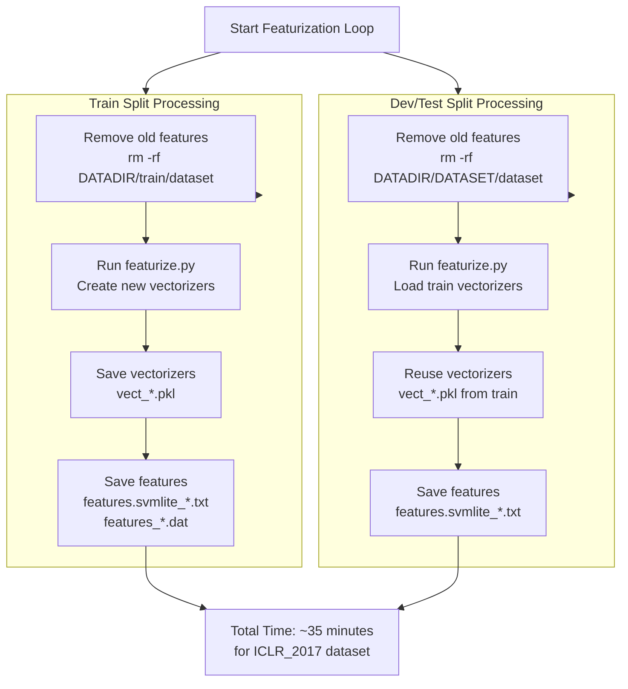

<!-- source: DeepWiki mcp.deepwiki.com · repo allenai/PeerRead · page 5 Acceptance Classification Pipeline · fetched 2026-10-26 -->

# Acceptance Classification Pipeline

<details>
<summary>Relevant source files</summary>

The following files were used as context for generating this wiki page:

- [code/README.md](code/README.md)
- [code/accept_classify/run_classify.sh](code/accept_classify/run_classify.sh)
- [code/accept_classify/run_featurize_classify.sh](code/accept_classify/run_featurize_classify.sh)

</details>


## Purpose and Scope

The Acceptance Classification Pipeline is a machine learning system that predicts whether academic papers will be accepted or rejected based on their content and peer reviews. This pipeline implements a feature engineering approach, extracting both lexical and hand-crafted features from papers and reviews, then training linear classifiers to make binary accept/reject predictions.

This page provides a comprehensive overview of the pipeline's architecture, execution flow, and configuration. For detailed documentation of:
- Feature extraction mechanisms and feature types, see [Feature Extraction](#5.1)
- Text encoding strategies (BOW, TF-IDF, Word2Vec), see [Text Encoding Methods](#5.2)
- Classifier training and model selection procedures, see [Classification and Model Selection](#5.3)

## Pipeline Overview

The acceptance classification pipeline consists of two sequential phases executed through the main script `run_featurize_classify.sh`:



**Diagram: High-Level Pipeline Flow**

The pipeline processes three data splits (train, dev, test) independently during featurization, but maintains consistency through shared vectorizer artifacts created during training.

Sources: [code/README.md:6-19](), [code/accept_classify/run_featurize_classify.sh:1-41]()

## Entry Point and Script Structure

The primary entry point is `run_featurize_classify.sh`, which orchestrates the entire pipeline through a series of bash script operations:

| Script | Purpose | Execution Time | Key Functions |
|--------|---------|----------------|---------------|
| `run_featurize_classify.sh` | Main orchestration script | ~35 min total | Coordinates featurization and classification |
| `featurize.py` | Feature extraction | ~35 min on ICLR_2017 | Generates feature vectors and vectorizer artifacts |
| `classify.py` | Model training and evaluation | ~5 sec on ICLR_2017 | Cross-validation, model selection, evaluation |
| `sent2vec.py` | Embedding utilities | N/A (imported) | Text encoding and embedding vectorizers |

Sources: [code/README.md:14](), [code/accept_classify/run_featurize_classify.sh:1-41]()

## Detailed Architecture

The following diagram maps the pipeline's architecture to specific code entities:



**Diagram: Code-Level Architecture Mapping**

Sources: [code/accept_classify/run_featurize_classify.sh:14-26](), [code/accept_classify/run_featurize_classify.sh:30-38](), [code/README.md:17-18]()

## Execution Flow

### Configuration Parameters

The pipeline is controlled by five key parameters defined in `run_featurize_classify.sh`:

```bash
DATADIR=../../data/iclr_2017  # Dataset directory
MAX_VOCAB=30000               # Vocabulary size limit (or False for unlimited)
ENCODER=w2v                   # Text encoder: {bow, tfidf, w2v, w2v-tfidf, None}
HAND=True                     # Include hand-crafted features: {True, False}
FEATDIR=dataset               # Feature output subdirectory
```

Sources: [code/accept_classify/run_featurize_classify.sh:4-9]()

### Phase 1: Feature Extraction

The featurization phase processes each data split (train, dev, test) through the following workflow:



**Diagram: Featurization Execution Flow**

The key distinction is that the **train split creates and saves vectorizers**, while **dev and test splits reuse the train vectorizers** to ensure consistent feature spaces across all splits. This is implemented through the vectorizer pickle file parameter passed to `featurize.py`.

Sources: [code/accept_classify/run_featurize_classify.sh:14-27]()

### Phase 2: Classification

After featurization completes, the classification phase trains models on the extracted features:

| Step | Operation | Input Files | Output |
|------|-----------|-------------|--------|
| 1 | Load train features | `train/dataset/features.svmlite_*.txt`<br/>`train/dataset/features_*.dat` | Feature matrices and labels |
| 2 | Cross-validation | Train features | Model performance scores |
| 3 | Model selection | Dev features: `dev/dataset/features.svmlite_*.txt` | Best model identifier |
| 4 | Final evaluation | All three splits | Train/Dev/Test accuracies |
| 5 | Save model | Best model | `train/dataset/best_classifier_*.pkl` |

Sources: [code/accept_classify/run_featurize_classify.sh:30-38](), [code/README.md:18]()

## Feature Naming Convention

The pipeline uses a consistent naming convention for all generated artifacts. File names incorporate the configuration parameters to distinguish between different experimental settings:

**Pattern:** `{filename}_{MAX_VOCAB}_{ENCODER}_{HAND}.{extension}`

**Examples:**
- `features.svmlite_30000_w2v_True.txt` - SVMLight feature file with 30K vocab, Word2Vec encoding, hand features enabled
- `vect_30000_w2v_True.pkl` - Vectorizer pickle with same configuration
- `best_classifier_30000_w2v_True.pkl` - Best classifier model
- `features_30000_w2v_True.dat` - Feature metadata (labels, paper IDs)

This naming scheme allows multiple configurations to coexist in the same directory and enables systematic experimentation with different parameter combinations.

Sources: [code/accept_classify/run_featurize_classify.sh:20-24](), [code/accept_classify/run_featurize_classify.sh:32-36]()

## Input Data Requirements

The pipeline expects a specific directory structure for each data split:

```
DATADIR/
├── train/
│   ├── reviews/              # JSON files, one per paper
│   ├── parsed_pdfs/          # ScienceParse JSON output
│   └── dataset/              # Created by pipeline (features)
├── dev/
│   ├── reviews/
│   ├── parsed_pdfs/
│   └── dataset/
└── test/
    ├── reviews/
    ├── parsed_pdfs/
    └── dataset/
```

**Input File Formats:**
- **Reviews:** JSON files conforming to the `Review` class schema (see [Data Models](#7.1))
- **Parsed PDFs:** JSON files conforming to the `ScienceParse` class schema, generated by Science Parse tool (see [External Dependencies](#9))

Sources: [code/accept_classify/run_featurize_classify.sh:18-20]()

## Output Artifacts

The pipeline generates three types of output artifacts per configuration:

### 1. Feature Files (All Splits)

**Location:** `{DATADIR}/{train,dev,test}/dataset/`

- `features.svmlite_*.txt` - Feature vectors in SVMLight format (sparse matrix representation)
  - Format: `<label> <index>:<value> <index>:<value> ...`
  - One line per paper
  - Binary labels: 1 (accept) or -1 (reject)

### 2. Vectorizer Artifacts (Train Only)

**Location:** `{DATADIR}/train/dataset/`

- `vect_*.pkl` - Serialized sklearn vectorizers (CountVectorizer, TfidfVectorizer, or embedding vectorizers)
- `features_*.dat` - Metadata pickle containing:
  - Feature labels/names
  - Paper IDs
  - Accept/reject labels
  - Additional metadata for debugging

### 3. Model Files (Train Only)

**Location:** `{DATADIR}/train/dataset/`

- `best_classifier_*.pkl` - Trained sklearn classifier (selected via cross-validation)

Sources: [code/accept_classify/run_featurize_classify.sh:20-24](), [code/accept_classify/run_featurize_classify.sh:32-36]()

## Command-Line Usage

### Running the Full Pipeline

The simplest way to execute the pipeline is through the main script:

```bash
cd ./code/accept_classify/
./run_featurize_classify.sh
```

This runs with default configuration on the ICLR 2017 dataset. To modify parameters, edit the variables at the top of `run_featurize_classify.sh`.

### Running Individual Components

Users can also execute featurization and classification separately:

**Featurization Only:**
```bash
python featurize.py \
  <review_dir> \
  <parsed_pdf_dir> \
  <output_dir> \
  <metadata_file> \
  <vectorizer_file> \
  <max_vocab> \
  <encoder_type> \
  <use_hand_features>
```

**Classification Only:**
```bash
python classify.py \
  <train_features> \
  <dev_features> \
  <test_features> \
  <output_model_path> \
  <metadata_file>
```

Sources: [code/accept_classify/run_featurize_classify.sh:18-24](), [code/accept_classify/run_featurize_classify.sh:32-37](), [code/README.md:8-18]()

## Performance Characteristics

Based on the ICLR 2017 dataset (approximately 427 papers):

| Phase | Time | Notes |
|-------|------|-------|
| Featurization (train) | ~12 minutes | Creates vectorizers, processes all papers |
| Featurization (dev) | ~1 minute | Reuses vectorizers, fewer papers |
| Featurization (test) | ~1 minute | Reuses vectorizers, fewer papers |
| **Total Featurization** | **~35 minutes** | Includes Word2Vec loading time |
| Classification | ~5 seconds | Cross-validation + model selection |
| **Total Pipeline** | **~35 minutes** | Dominated by featurization |

The featurization phase is computationally expensive primarily due to:
1. Loading large Word2Vec embedding files (when `ENCODER=w2v`)
2. Text preprocessing and vocabulary building
3. Extracting hand-crafted features from parsed PDFs
4. Sparse matrix operations for feature combination

Sources: [code/README.md:14]()

## Key Design Decisions

### Vectorizer Reuse Strategy

The pipeline creates vectorizers only during train split processing and reuses them for dev/test splits. This design ensures:

1. **Consistent feature spaces** - All splits use identical vocabulary and feature indices
2. **No information leakage** - Dev/test data doesn't influence vocabulary or vectorizer parameters
3. **Efficient processing** - Vectorizers are expensive to create but cheap to reuse

The implementation passes the train vectorizer path to `featurize.py` for dev/test splits:

```bash
# Train creates new vectorizer
python featurize.py ... None ... # vectorizer_file = None (or train path)

# Dev/test reuse train vectorizer  
python featurize.py ... $DATADIR/train/$FEATDIR/vect_*.pkl ...
```

Sources: [code/accept_classify/run_featurize_classify.sh:20-24]()

### Feature Combination Approach

The pipeline combines multiple feature types into a single feature matrix:
- **Text features** from selected encoder (bow/tfidf/w2v/w2v-tfidf)
- **Hand-crafted features** (23 features from ScienceParse)

These are concatenated using `scipy.sparse.hstack()` to create a unified feature representation that preserves sparsity when applicable.

### SVMLight Format Choice

The pipeline uses SVMLight format for feature storage rather than numpy arrays or other formats because:
1. **Sparse representation** - Efficient storage for high-dimensional sparse features (especially BOW/TF-IDF)
2. **Standard format** - Compatible with many ML tools and libraries
3. **Human readable** - Text format allows manual inspection and debugging

Sources: [code/README.md:17]()

## Related Components

This pipeline integrates with several other system components:

- **Data Preparation Pipeline** ([Section 4](#4)) - Provides the split directory structure and parsed PDFs
- **Feature Extraction** ([Section 5.1](#5.1)) - Detailed documentation of feature types and extraction logic
- **Text Encoding Methods** ([Section 5.2](#5.2)) - Deep dive into BOW, TF-IDF, Word2Vec implementations
- **Classification and Model Selection** ([Section 5.3](#5.3)) - Model training, cross-validation, and evaluation details
- **Data Models** ([Section 7.1](#7.1)) - `Review` and `ScienceParse` data structures
- **Data Helper Utilities** ([Section 7.2](#7.2)) - Embedding loading and text processing utilities

---

