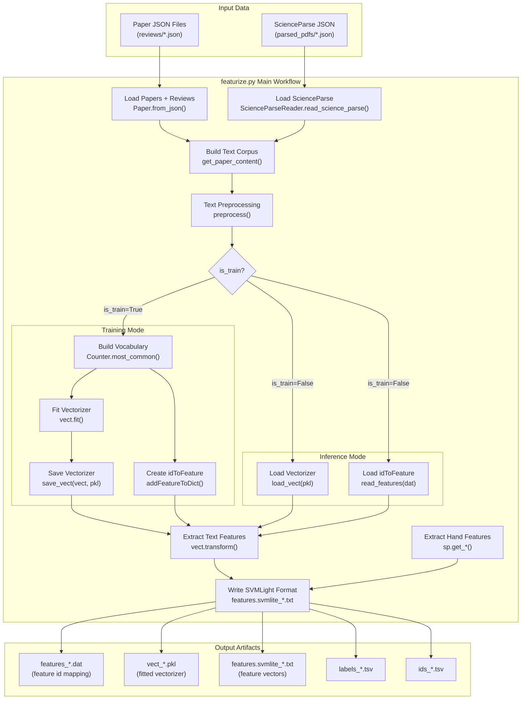
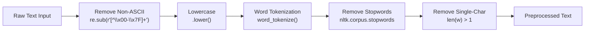
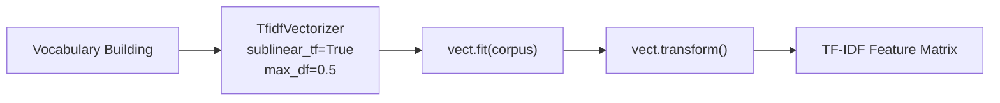
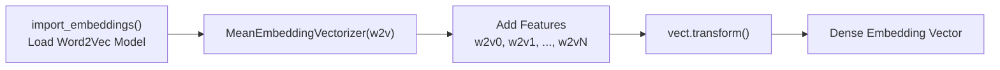
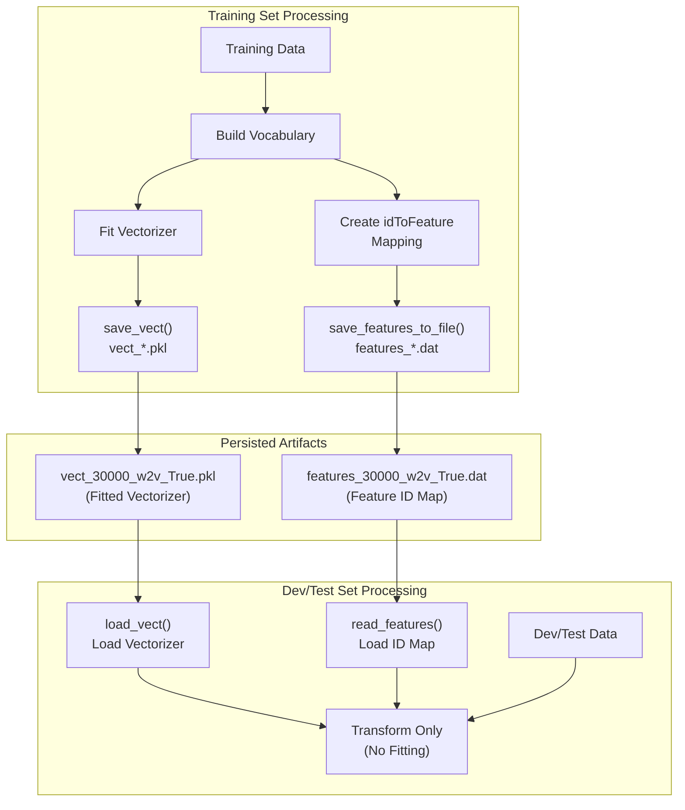
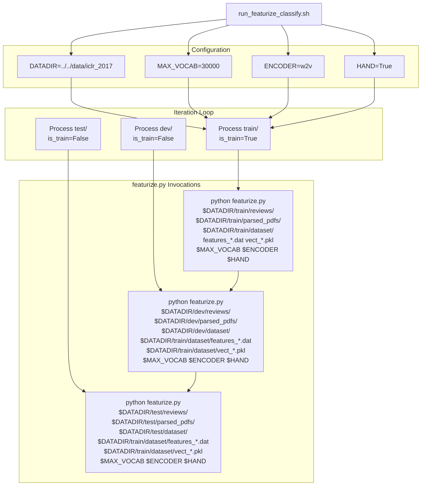
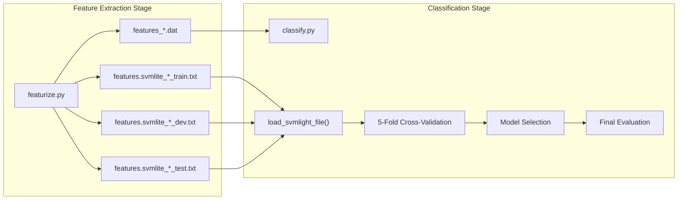
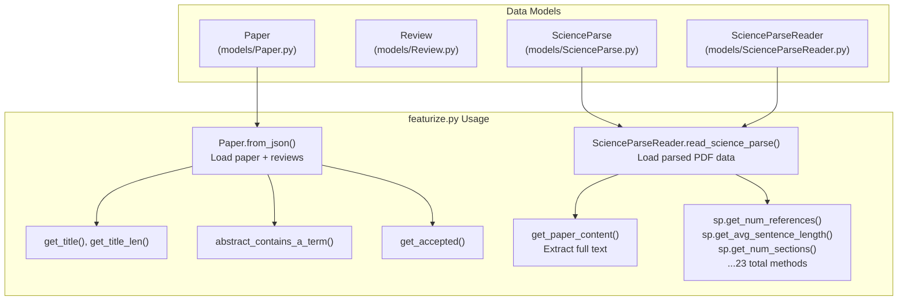

<!-- source: DeepWiki mcp.deepwiki.com · repo allenai/PeerRead · page 5.1 Feature Extraction · fetched 2026-10-26 -->

# Feature Extraction

<details>
<summary>Relevant source files</summary>

The following files were used as context for generating this wiki page:

- [code/accept_classify/featurize.py](code/accept_classify/featurize.py)
- [code/accept_classify/run_featurize_classify.sh](code/accept_classify/run_featurize_classify.sh)

</details>


## Purpose and Scope

This page documents the feature extraction system for the acceptance classification pipeline. The `featurize.py` script transforms raw papers and reviews into numerical feature vectors suitable for machine learning classifiers. It implements both text-based encoding strategies (bag-of-words, TF-IDF, Word2Vec) and hand-crafted features derived from document structure and metadata.

For information about the classification stage that consumes these features, see [Classification and Model Selection](#5.3). For details on the specific text encoding implementations, see [Text Encoding Methods](#5.2).

Sources: [code/accept_classify/featurize.py:1-382]()

## System Overview

The feature extraction system operates in two distinct modes: **training mode** (for the training set) and **inference mode** (for dev/test sets). In training mode, it builds vocabularies and fits vectorizers on the training data, then persists these artifacts. In inference mode, it loads pre-built vectorizers to ensure consistent feature spaces across all data splits.



**Diagram: Feature Extraction Workflow** - Shows the dual-mode operation where training mode creates and persists vocabularies/vectorizers, while inference mode reuses them for consistent feature spaces.

Sources: [code/accept_classify/featurize.py:75-373]()

## Command-Line Interface

The `featurize.py` script expects 9 command-line arguments that control the feature extraction process:

| Argument Position | Parameter Name | Description | Example Value |
|------------------|----------------|-------------|---------------|
| 1 | `paper_json_dir` | Directory containing review JSON files | `../../data/iclr_2017/train/reviews/` |
| 2 | `scienceparse_dir` | Directory containing parsed PDF JSONs | `../../data/iclr_2017/train/parsed_pdfs/` |
| 3 | `out_dir` | Output directory for features | `../../data/iclr_2017/train/dataset/` |
| 4 | `feature_output_file` | Feature ID mapping file path | `features_30000_w2v_True.dat` |
| 5 | `vect_file` | Vectorizer pickle file path | `vect_30000_w2v_True.pkl` |
| 6 | `max_vocab_size` | Maximum vocabulary size or `False` | `30000` or `False` |
| 7 | `encoder` | Text encoding method or `False` | `bow`, `bowtfidf`, `w2v`, `w2vtfidf`, `False` |
| 8 | `hand` | Enable hand-crafted features or `False` | `True` or `False` |

The script automatically detects whether to operate in training or inference mode based on the existence of the `feature_output_file`:

- **Training mode**: If `feature_output_file` does not exist, the script builds vocabularies and vectorizers from scratch
- **Inference mode**: If `feature_output_file` exists, the script loads pre-built artifacts

Sources: [code/accept_classify/featurize.py:75-106](), [code/accept_classify/run_featurize_classify.sh:1-41]()

## Text Preprocessing Pipeline

All text undergoes a standardized preprocessing pipeline before feature extraction:



**Diagram: Text Preprocessing Steps** - Sequential transformations applied to all text content.

The `preprocess()` function [code/accept_classify/featurize.py:59-72]() applies these transformations:

1. **Non-ASCII removal**: Strips characters outside the ASCII range
2. **Lowercasing**: Converts all text to lowercase
3. **Tokenization**: Uses NLTK's `word_tokenize()` for word segmentation
4. **Stopword removal**: Removes English stopwords using NLTK's stopword list
5. **Length filtering**: Removes single-character tokens

The preprocessed text is then used to build the corpus vocabulary [code/accept_classify/featurize.py:145-154]().

Sources: [code/accept_classify/featurize.py:59-72](), [code/accept_classify/featurize.py:145-154]()

## Text Encoding Strategies

The system supports four text encoding methods controlled by the `encoder` parameter:

### Bag-of-Words (BOW)

Uses `sklearn.feature_extraction.text.CountVectorizer` to create binary or count-based term vectors.


**Diagram: BOW Encoding Pipeline**

Implementation: [code/accept_classify/featurize.py:167-191]()

### TF-IDF (bowtfidf)

Uses `sklearn.feature_extraction.text.TfidfVectorizer` for term frequency-inverse document frequency weighting.



**Diagram: TF-IDF Encoding Pipeline**

Implementation: [code/accept_classify/featurize.py:188-191]()

### Word2Vec Mean (w2v)

Uses `MeanEmbeddingVectorizer` from `sent2vec.py` to average pre-trained word embeddings.



**Diagram: Word2Vec Mean Encoding Pipeline**

Implementation: [code/accept_classify/featurize.py:194-213]()

### Word2Vec TF-IDF (w2vtfidf)

Uses `TFIDFEmbeddingVectorizer` to weight word embeddings by their TF-IDF scores before averaging.

Implementation: [code/accept_classify/featurize.py:194-213]()

Sources: [code/accept_classify/featurize.py:163-216]()

## Hand-Crafted Features

When `hand=True`, the system extracts 23 hand-crafted features derived from the ScienceParse output. These features capture document structure, citation patterns, and linguistic characteristics:

### Feature Categories

| Category | Feature Name | Description | Source Method |
|----------|-------------|-------------|---------------|
| **Citation Statistics** | `get_most_recent_reference_year` | Year of most recent citation (normalized to 2000) | `sp.get_most_recent_reference_year()` |
| | `get_num_references` | Total number of references | `sp.get_num_references()` |
| | `get_num_recent_references` | Number of references from recent years | `sp.get_num_recent_references(2017)` |
| | `get_num_refmentions` | Number of reference mentions in text | `sp.get_num_refmentions()` |
| | `get_avg_length_reference_mention_contexts` | Average context length around citations | `sp.get_avg_length_reference_mention_contexts()` |
| **Abstract Keywords** | `abstract_contains_deep` | Presence of "deep" in abstract | `p.abstract_contains_a_term("deep")` |
| | `abstract_contains_neural` | Presence of "neural" in abstract | `p.abstract_contains_a_term("neural")` |
| | `abstract_contains_embedding` | Presence of "embedding" in abstract | `p.abstract_contains_a_term("embedding")` |
| | `abstract_contains_outperform` | Presence of "outperform" in abstract | `p.abstract_contains_a_term("outperform")` |
| | `abstract_contains_novel` | Presence of "novel" in abstract | `p.abstract_contains_a_term("novel")` |
| | `abstract_contains_state_of_the_art` | Presence of "state of the art" | `p.abstract_contains_a_term("state of the art")` |
| | `abstract_contains_state-of-the-art` | Presence of "state-of-the-art" | `p.abstract_contains_a_term("state-of-the-art")` |
| **Document Structure** | `get_num_ref_to_figures` | Number of figure references | `sp.get_num_ref_to_figures()` |
| | `get_num_ref_to_tables` | Number of table references | `sp.get_num_ref_to_tables()` |
| | `get_num_ref_to_sections` | Number of section references | `sp.get_num_ref_to_sections()` |
| | `get_num_ref_to_equations` | Number of equation references | `sp.get_num_ref_to_equations()` |
| | `get_num_ref_to_theorems` | Number of theorem references | `sp.get_num_ref_to_theorems()` |
| | `get_num_sections` | Total number of sections | `sp.get_num_sections()` |
| | `get_contains_appendix` | Whether paper contains appendix | `sp.get_contains_appendix()` |
| **Linguistic Features** | `get_num_uniq_words` | Number of unique words | `sp.get_num_uniq_words()` |
| | `get_avg_sentence_length` | Average sentence length | `sp.get_avg_sentence_length()` |
| | `proportion_of_frequent_words` | Ratio of high-frequency words | `sp.get_frequent_words_proportion()` |
| **Metadata** | `get_title_length` | Length of paper title | `p.get_title_len()` |
| | `get_num_authors` | Number of authors | `sp.get_num_authors()` |

```mermaid
graph TB
    ScienceParse["ScienceParse Object<br/>(sp)"]
    Paper["Paper Object<br/>(p)"]
    
    subgraph "Citation Features"
        RefYear["get_most_recent_reference_year"]
        NumRefs["get_num_references"]
        RecentRefs["get_num_recent_references"]
        RefMentions["get_num_refmentions"]
        AvgContext["get_avg_length_reference_mention_contexts"]
    end
    
    subgraph "Abstract Keywords"
        Deep["abstract_contains_deep"]
        Neural["abstract_contains_neural"]
        Embedding["abstract_contains_embedding"]
        Outperform["abstract_contains_outperform"]
        Novel["abstract_contains_novel"]
        SOTA1["abstract_contains_state_of_the_art"]
        SOTA2["abstract_contains_state-of-the-art"]
    end
    
    subgraph "Structure Features"
        Figures["get_num_ref_to_figures"]
        Tables["get_num_ref_to_tables"]
        Sections["get_num_ref_to_sections"]
        Equations["get_num_ref_to_equations"]
        Theorems["get_num_ref_to_theorems"]
        NumSections["get_num_sections"]
        Appendix["get_contains_appendix"]
    end
    
    subgraph "Linguistic Features"
        UniqWords["get_num_uniq_words"]
        SentLen["get_avg_sentence_length"]
        FreqWords["proportion_of_frequent_words"]
    end
    
    subgraph "Metadata"
        TitleLen["get_title_length"]
        NumAuthors["get_num_authors"]
    end
    
    ScienceParse --> RefYear
    ScienceParse --> NumRefs
    ScienceParse --> RecentRefs
    ScienceParse --> RefMentions
    ScienceParse --> AvgContext
    
    Paper --> Deep
    Paper --> Neural
    Paper --> Embedding
    Paper --> Outperform
    Paper --> Novel
    Paper --> SOTA1
    Paper --> SOTA2
    
    ScienceParse --> Figures
    ScienceParse --> Tables
    ScienceParse --> Sections
    ScienceParse --> Equations
    ScienceParse --> Theorems
    ScienceParse --> NumSections
    ScienceParse --> Appendix
    
    ScienceParse --> UniqWords
    ScienceParse --> SentLen
    ScienceParse --> FreqWords
    
    Paper --> TitleLen
    ScienceParse --> NumAuthors
```



**Diagram: Hand-Crafted Feature Extraction** - Shows how features are derived from Paper and ScienceParse objects.

Sources: [code/accept_classify/featurize.py:234-260](), [code/accept_classify/featurize.py:289-363]()

## Feature Persistence and Reusability

The system implements a sophisticated persistence model to ensure consistent feature spaces across train/dev/test splits:



**Diagram: Feature Persistence Model** - Training set creates reusable artifacts that dev/test sets consume.

### Persistence Functions

The system provides functions for saving and loading vectorizers and feature mappings:

**Vectorizer Persistence**:
- `save_vect(vect, ofile)` [code/accept_classify/featurize.py:37-38](): Serializes sklearn vectorizer using pickle
- `load_vect(ifile)` [code/accept_classify/featurize.py:40-41](): Deserializes vectorizer from pickle file

**Feature Mapping Persistence**:
- `save_features_to_file(idToFeature, file)` [code/accept_classify/featurize.py:30-35](): Writes feature ID mapping as TSV
- `read_features(ifile)` [code/accept_classify/featurize.py:21-28](): Reads feature ID mapping from TSV

### Mode Detection Logic

The script determines the operating mode based on file existence [code/accept_classify/featurize.py:95-106]():

```python
is_train = True
vect = None
idToFeature = None
if os.path.isfile(feature_output_file):
    is_train = False
    idToFeature = read_features(feature_output_file)
    if encoder:
        print('Loading vector file from...',vect_file)
        vect = load_vect(vect_file)
else:
    print('Loading vector file from scratch..')
    idToFeature = dict()
```

Sources: [code/accept_classify/featurize.py:21-41](), [code/accept_classify/featurize.py:95-106]()

## Output Files

The feature extraction process generates multiple output files with naming conventions that encode the configuration:

### Naming Convention

All output files follow the pattern: `{basename}_{max_vocab}_{encoder}_{hand}.{extension}`

Example: `features.svmlite_30000_w2v_True.txt`

### File Types

| File Name Pattern | Description | Format |
|------------------|-------------|---------|
| `features.svmlite_*.txt` | Feature vectors in SVMLight format | `label feat_id:value feat_id:value ...` |
| `features_*.dat` | Feature ID to name mapping | `id\tfeature_name\n` |
| `vect_*.pkl` | Serialized sklearn vectorizer | Python pickle binary |
| `labels_*.tsv` | Binary acceptance labels | `0` or `1` per line |
| `ids_*.tsv` | Paper ID to title mapping | `id\ttitle\n` |
| `corpus.pkl` | Preprocessed corpus words | Python pickle binary |

### SVMLight Format Structure

The SVMLight format is a sparse representation where only non-zero features are stored [code/accept_classify/featurize.py:271-365]():

```
<label> <feature_id>:<value> <feature_id>:<value> ... \n
```

Example:
```
1 45:0.823 127:1.0 289:0.456 5001:35 5002:12 5003:1 ...
```

Where:
- `1` = accepted paper
- `45:0.823` = feature ID 45 (e.g., a TF-IDF word weight) has value 0.823
- `5001:35` = feature ID 5001 (e.g., `get_num_references`) has value 35

Sources: [code/accept_classify/featurize.py:108-110](), [code/accept_classify/featurize.py:264-373]()

## Execution via Shell Script

The `run_featurize_classify.sh` script orchestrates the complete feature extraction workflow:



**Diagram: Shell Script Execution Flow** - Shows how the script iterates through datasets and passes configuration.

### Key Script Features

1. **Sequential Processing**: Processes train, dev, test in order [code/accept_classify/run_featurize_classify.sh:14-26]()
2. **Artifact Reuse**: Dev and test reference training artifacts via path arguments [code/accept_classify/run_featurize_classify.sh:22-24]()
3. **Directory Cleanup**: Removes existing output directory before processing [code/accept_classify/run_featurize_classify.sh:17]()
4. **Timing Information**: Reports runtime for featurization and classification stages [code/accept_classify/run_featurize_classify.sh:13,27,30,38]()

Sources: [code/accept_classify/run_featurize_classify.sh:1-41]()

## Integration with Classification Pipeline

The feature extraction stage produces inputs for the classification stage:



**Diagram: Pipeline Integration** - Feature extraction outputs feed directly into classification.

The shell script chains these stages together [code/accept_classify/run_featurize_classify.sh:30-38]():

```bash
python classify.py \
    $DATADIR/train/$FEATDIR/features.svmlite_${MAX_VOCAB}_${ENCODER}_${HAND}.txt \
    $DATADIR/dev/$FEATDIR/features.svmlite_${MAX_VOCAB}_${ENCODER}_${HAND}.txt \
    $DATADIR/test/$FEATDIR/features.svmlite_${MAX_VOCAB}_${ENCODER}_${HAND}.txt \
    $DATADIR/train/$FEATDIR/best_classifer_${MAX_VOCAB}_${ENCODER}_${HAND}.pkl \
    $DATADIR/train/$FEATDIR/features_${MAX_VOCAB}_${ENCODER}_${HAND}.dat
```

Sources: [code/accept_classify/run_featurize_classify.sh:30-38]()

## Data Model Dependencies

The feature extraction system depends on three core data models:



**Diagram: Data Model Dependencies** - Shows how featurize.py interacts with Paper and ScienceParse objects.

### Model Import Statements

[code/accept_classify/featurize.py:15-19]():
```python
sys.path.insert(1,os.path.join(sys.path[0],'..'))
from models.Review import Review
from models.Paper import Paper
from models.ScienceParse import ScienceParse
from models.ScienceParseReader import ScienceParseReader
```

### Key Model Methods Used

**Paper Object Methods**:
- `Paper.from_json(filename)` - Load paper and reviews from JSON
- `get_title()` - Get paper title
- `get_title_len()` - Get title character count
- `abstract_contains_a_term(term)` - Check for keyword presence
- `get_accepted()` - Get acceptance status (label)
- `get_reviews()` - Get associated Review objects

**ScienceParse Object Methods**:
- `get_paper_content()` - Get full paper text
- `get_num_references()` - Citation count
- `get_most_recent_reference_year()` - Latest citation year
- `get_num_sections()` - Section count
- `get_avg_sentence_length()` - Average sentence length
- 18+ additional structural and linguistic methods

Sources: [code/accept_classify/featurize.py:15-19](), [code/accept_classify/featurize.py:122-126](), [code/accept_classify/featurize.py:266-363]()

---

