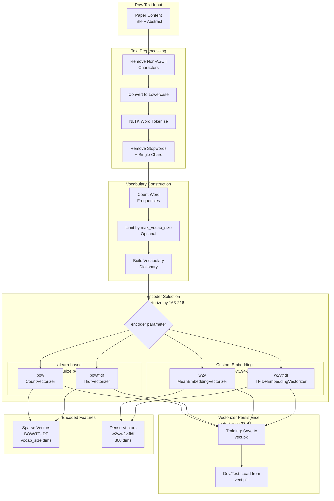
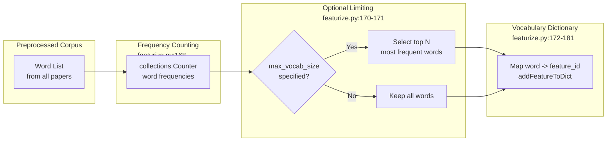
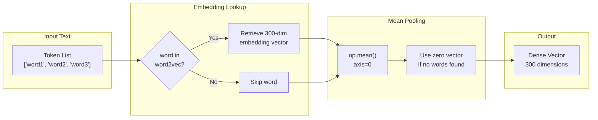
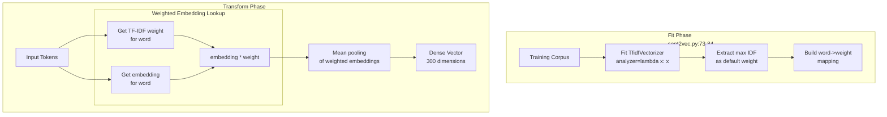
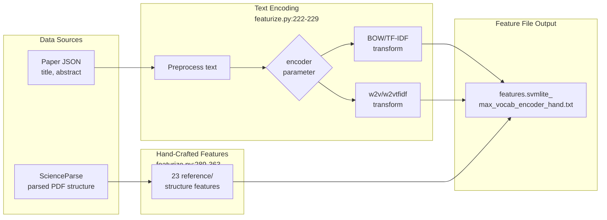

<!-- source: DeepWiki mcp.deepwiki.com · repo allenai/PeerRead · page 5.2 Text Encoding Methods · fetched 2026-10-26 -->

# Text Encoding Methods

<details>
<summary>Relevant source files</summary>

The following files were used as context for generating this wiki page:

- [code/accept_classify/featurize.py](code/accept_classify/featurize.py)
- [code/accept_classify/sent2vec.py](code/accept_classify/sent2vec.py)

</details>


## Purpose and Scope

This page documents the text encoding strategies used in the acceptance classification pipeline to convert paper content into numerical feature vectors. The system supports four encoding methods: **Bag of Words (BOW)**, **TF-IDF**, **Word2Vec Mean (w2v)**, and **Word2Vec TF-IDF weighted (w2vtfidf)**. These methods transform preprocessed text from paper titles and abstracts into fixed-dimensional vectors suitable for machine learning classification.

For information about the broader feature extraction pipeline that incorporates these encoders alongside hand-crafted features, see [Feature Extraction](#5.1). For details on how these features are used in classification, see [Classification and Model Selection](#5.3).

---

## Encoding Architecture Overview

The encoding system follows a three-stage pipeline: preprocessing, vocabulary building, and vectorization. During training, vocabularies and vectorizers are created and persisted to disk. During evaluation (dev/test), these artifacts are loaded to ensure consistent feature spaces.



**Diagram: Text encoding pipeline from raw paper content to vectorized features**

Sources: [code/accept_classify/featurize.py:59-217](), [code/accept_classify/sent2vec.py:1-95]()

---

## Text Preprocessing

All text undergoes standardized preprocessing before encoding. The `preprocess` function normalizes text to ensure consistent tokenization across different papers.

### Preprocessing Steps

| Step | Function | Purpose |
|------|----------|---------|
| Non-ASCII Removal | Regex substitution | Remove special characters outside ASCII range |
| Lowercasing | `str.lower()` | Normalize case for vocabulary matching |
| Tokenization | `nltk.word_tokenize` | Split text into word tokens |
| Stopword Removal | NLTK stopwords list | Remove common English words |
| Short Word Filtering | Length check | Remove single-character tokens |

### Implementation

The preprocessing logic is implemented in [code/accept_classify/featurize.py:59-72]():

```python
def preprocess(input, only_char=False, lower=False, stop_remove=False, stemming=False):
  input = re.sub(r'[^\x00-\x7F]+',' ', input)
  if lower: input = input.lower()
  if only_char:
    tokenizer = RegexpTokenizer(r'\w+')
    tokens = tokenizer.tokenize(input)
    input = ' '.join(tokens)
  tokens = word_tokenize(input)
  if stop_remove:
    tokens = [w for w in tokens if not w in stopwords.words('english')]
  tokens = [w for w in tokens if len(w) > 1]
  return " ".join(tokens)
```

During feature extraction, papers are preprocessed with `only_char=True`, `lower=True`, and `stop_remove=True` at [code/accept_classify/featurize.py:147]().

Sources: [code/accept_classify/featurize.py:59-72](), [code/accept_classify/featurize.py:147]()

---

## Vocabulary Construction

After preprocessing, the system builds a vocabulary from the training corpus. This vocabulary can optionally be limited by the `max_vocab_size` parameter to control feature dimensionality.

### Vocabulary Building Process



**Diagram: Vocabulary construction from preprocessed corpus**

### Vocabulary Persistence

The vocabulary is stored in two formats:

1. **Feature mapping file** (`features.dat`): Maps feature names to numeric IDs
2. **Vectorizer pickle** (`vect.pkl`): Contains the fitted scikit-learn or custom vectorizer

The system determines whether to create or load vocabularies based on file existence at [code/accept_classify/featurize.py:98-106]():

- **Training mode** (`is_train=True`): Creates new vocabulary and vectorizer
- **Evaluation mode** (`is_train=False`): Loads existing vocabulary and vectorizer

Sources: [code/accept_classify/featurize.py:98-106](), [code/accept_classify/featurize.py:168-182]()

---

## Scikit-learn Based Encoders

The system provides two sklearn-based encoding methods that produce sparse feature vectors based on token frequencies.

### Bag of Words (BOW)

The `bow` encoder uses `CountVectorizer` to create binary or count-based features for vocabulary words.

**Implementation:** [code/accept_classify/featurize.py:186]()

```python
vect = CountVectorizer(max_df=0.5, analyzer='word', 
                       stop_words='english', vocabulary=vocabulary)
```

**Parameters:**
- `max_df=0.5`: Ignores terms appearing in >50% of documents
- `analyzer='word'`: Operates at word level
- `stop_words='english'`: Additional stopword filtering
- `vocabulary`: Pre-built vocabulary dictionary

### TF-IDF

The `bowtfidf` encoder uses `TfidfVectorizer` to weight terms by their inverse document frequency.

**Implementation:** [code/accept_classify/featurize.py:188-189]()

```python
vect = TfidfVectorizer(sublinear_tf=True, max_df=0.5, analyzer='word',
                       stop_words='english', vocabulary=vocabulary)
```

**Parameters:**
- `sublinear_tf=True`: Uses `1 + log(tf)` instead of raw term frequency
- Other parameters same as BOW

### Feature Extraction

Both sklearn encoders transform text into sparse vectors at [code/accept_classify/featurize.py:229]():

```python
all_titles_features = vect.transform(all_titles)
```

The sparse features are then written in SVMLight format at [code/accept_classify/featurize.py:276-280]():

```python
nz = title_tfidf.nonzero()[1]
for word_id in sorted(nz):
    outSvmLiteFile.write(str(word_id)+":"+ str(title_tfidf[0,word_id])+" ")
```

Sources: [code/accept_classify/featurize.py:167-191](), [code/accept_classify/featurize.py:229](), [code/accept_classify/featurize.py:276-280]()

---

## Word2Vec-based Encoders

The system provides two custom vectorizers that use pre-trained word embeddings to create dense feature representations.

### Embedding Loading

Pre-trained embeddings are loaded using Gensim at [code/accept_classify/sent2vec.py:11-21]():

```python
def import_embeddings(filename="../../data/word2vec/glove.840B.300d.w2v.txt", 
                      binary=False):
  if sys.version_info[0] < 3:
    w2v = gensim.models.Word2Vec.load_word2vec_format(filename, binary=binary)
  else:
    w2v = gensim.models.KeyedVectors.load_word2vec_format(filename, binary=binary)
  return w2v
```

The default embeddings are GloVe 840B with 300 dimensions.

### Mean Embedding Vectorizer (w2v)

The `MeanEmbeddingVectorizer` averages word embeddings for all words in the input text.

**Class Definition:** [code/accept_classify/sent2vec.py:23-51]()



**Diagram: MeanEmbeddingVectorizer transformation process**

**Implementation Details:**
- Dimensionality: 300 (embedding dimension)
- Vocabulary filtering: Optional via `word_counter` parameter
- Fallback: Zero vector if no words have embeddings

### TF-IDF Weighted Embedding Vectorizer (w2vtfidf)

The `TFIDFEmbeddingVectorizer` weights word embeddings by their TF-IDF scores before averaging.

**Class Definition:** [code/accept_classify/sent2vec.py:55-92]()



**Diagram: TFIDFEmbeddingVectorizer training and transformation**

**Key Differences from w2v:**
- Requires `fit()` call on training corpus to compute IDF weights
- Uses `defaultdict` with max IDF as fallback for unseen words
- Weights emphasize rare terms more heavily

### Feature Extraction

Word2Vec encoders are initialized at [code/accept_classify/featurize.py:204-205]():

```python
w2v = import_embeddings()
vect = MeanEmbeddingVectorizer(w2v,word_counter) if encoder=='w2v' 
       else TFIDFEmbeddingVectorizer(w2v,word_counter)
```

For `w2vtfidf`, fitting occurs at [code/accept_classify/featurize.py:211-212]():

```python
if encoder == 'w2vtfidf':
    vect.fit([p for p in paper_content_corpus])
```

Features are written as dense vectors at [code/accept_classify/featurize.py:282-283]():

```python
for word_id in range(vect.dim):
    outSvmLiteFile.write(str(word_id)+":"+ str(title_tfidf[word_id])+" ")
```

Sources: [code/accept_classify/featurize.py:194-213](), [code/accept_classify/featurize.py:282-283](), [code/accept_classify/sent2vec.py:23-92]()

---

## Encoder Comparison

The following table summarizes the characteristics of each encoding method:

| Encoder | Vectorizer Class | Dimensionality | Sparsity | Training Required | External Data |
|---------|-----------------|----------------|----------|-------------------|---------------|
| `bow` | `CountVectorizer` | `len(vocabulary)` | Sparse | Vocabulary building | No |
| `bowtfidf` | `TfidfVectorizer` | `len(vocabulary)` | Sparse | Vocabulary + IDF computation | No |
| `w2v` | `MeanEmbeddingVectorizer` | 300 | Dense | Vocabulary filtering | Word2Vec embeddings |
| `w2vtfidf` | `TFIDFEmbeddingVectorizer` | 300 | Dense | Vocabulary filtering + IDF | Word2Vec embeddings |

### Typical Dimensionality

Without vocabulary limiting:
- **BOW/TF-IDF**: 10,000-50,000 dimensions (vocabulary size)
- **w2v/w2vtfidf**: 300 dimensions (embedding size)

With `max_vocab_size=5000`:
- **BOW/TF-IDF**: 5,000 dimensions
- **w2v/w2vtfidf**: 300 dimensions (unchanged)

Sources: [code/accept_classify/featurize.py:167-216](), [code/accept_classify/sent2vec.py:40](), [code/accept_classify/sent2vec.py:71]()

---

## Vectorizer Persistence and Reuse

The system ensures consistent feature spaces across train/dev/test splits by persisting and reusing vectorizers.

### Training Phase

During training (`is_train=True`), vectorizers are created and saved:

**Feature ID Mapping:** [code/accept_classify/featurize.py:137-139]()
```python
def addFeatureToDict(fname):
    id = len(idToFeature)
    idToFeature[fname] = id
```

**Vectorizer Serialization:** [code/accept_classify/featurize.py:37-38]()
```python
def save_vect(vect, ofile):
    pkl.dump(vect, open(ofile, "wb"))
```

Saved at [code/accept_classify/featurize.py:191](), [code/accept_classify/featurize.py:213]().

### Evaluation Phase

During evaluation (`is_train=False`), artifacts are loaded:

**Feature ID Loading:** [code/accept_classify/featurize.py:21-28]()
```python
def read_features(ifile):
    idToFeature = dict()
    with open(ifile,"rb") as ifh:
        for l in ifh:
            e = l.rstrip().decode("utf-8").split("\t")
            if len(e) == 2:
                idToFeature[e[1]] = e[0]
    return idToFeature
```

**Vectorizer Deserialization:** [code/accept_classify/featurize.py:40-41]()
```python
def load_vect(ifile):
    return pkl.load(open(ifile, "rb"))
```

Loaded at [code/accept_classify/featurize.py:102-103]().

### Consistency Enforcement

For sklearn encoders, the pre-built vocabulary ensures only training vocabulary words are used at [code/accept_classify/featurize.py:178-181]():

```python
fid = get_feature_id(w)
if fid is not None:
    vocabulary[w] = fid
```

For Word2Vec encoders, vocabulary filtering limits embeddings to training words at [code/accept_classify/featurize.py:199-201]().

Sources: [code/accept_classify/featurize.py:21-41](), [code/accept_classify/featurize.py:98-106](), [code/accept_classify/featurize.py:178-181]()

---

## Integration with Feature Extraction Pipeline

Text encoders generate only one component of the final feature vector. They are combined with hand-crafted features to create the complete representation.



**Diagram: Integration of text encoders with hand-crafted features**

### File Naming Convention

Output files include encoding parameters in their names:

```
features.svmlite_{max_vocab_size}_{encoder}_{hand}.txt
```

Examples:
- `features.svmlite_5000_bowtfidf_True.txt` - TF-IDF with 5000 vocab, hand features
- `features.svmlite_False_w2v_True.txt` - Word2Vec mean, no vocab limit, hand features
- `features.svmlite_10000_bow_False.txt` - BOW with 10000 vocab, no hand features

Sources: [code/accept_classify/featurize.py:108-110](), [code/accept_classify/featurize.py:222-286]()

---

## Usage Example

The encoder is selected via command-line arguments to `featurize.py`:

```bash
python featurize.py \
    train/reviews \
    train/parsed_pdfs \
    train/dataset \
    train/dataset/features.dat \
    train/dataset/vect.pkl \
    5000 \
    bowtfidf \
    True
```

**Arguments:**
1. `train/reviews` - Paper JSON directory
2. `train/parsed_pdfs` - ScienceParse directory
3. `train/dataset` - Output directory
4. `train/dataset/features.dat` - Feature mapping file
5. `train/dataset/vect.pkl` - Vectorizer pickle file
6. `5000` - max_vocab_size (or `False` for unlimited)
7. `bowtfidf` - Encoder type (`bow`, `bowtfidf`, `w2v`, `w2vtfidf`, or `False`)
8. `True` - Include hand-crafted features (`True` or `False`)

Sources: [code/accept_classify/featurize.py:75-89]()

---

