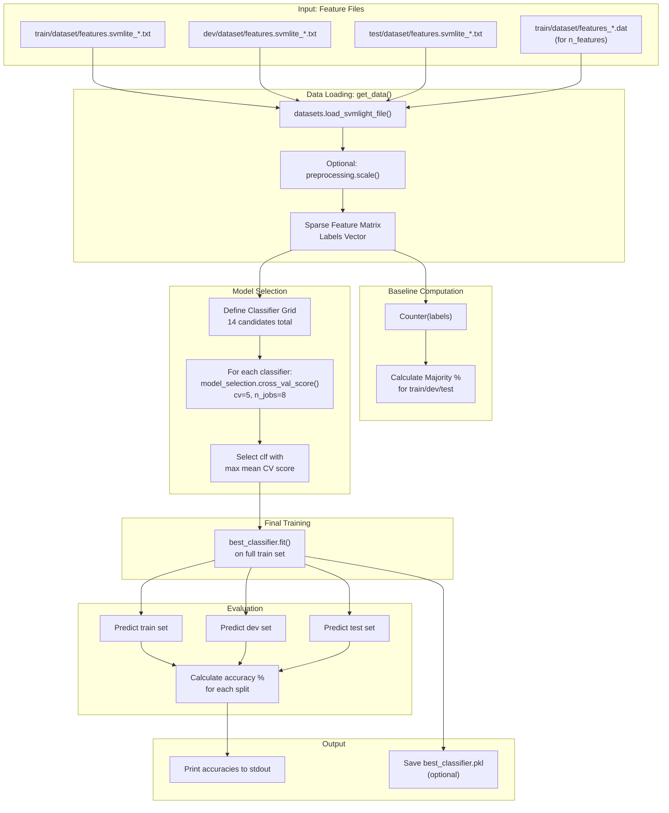
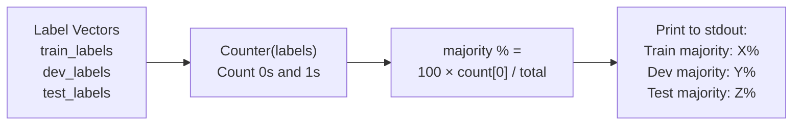
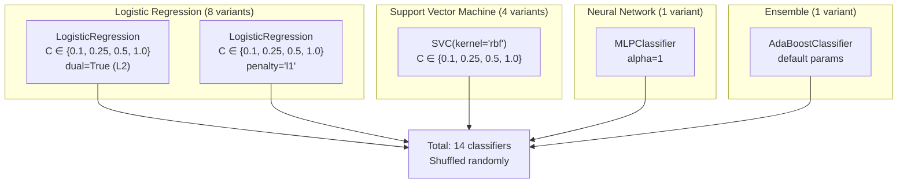
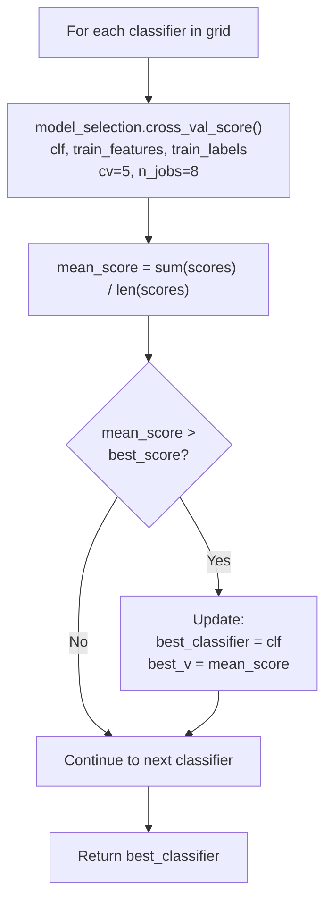
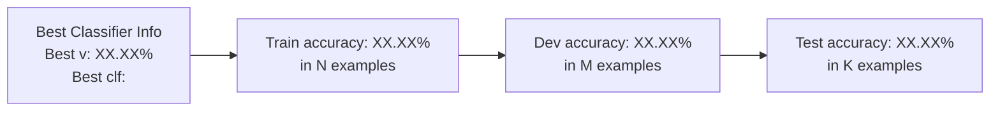
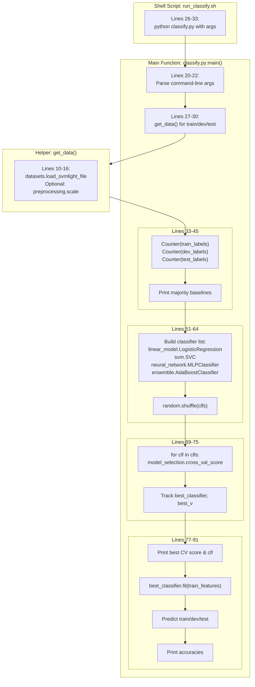

<!-- source: DeepWiki mcp.deepwiki.com · repo allenai/PeerRead · page 5.3 Classification and Model Selection · fetched 2026-10-26 -->

# Classification and Model Selection

<details>
<summary>Relevant source files</summary>

The following files were used as context for generating this wiki page:

- [code/accept_classify/classify.py](code/accept_classify/classify.py)
- [code/accept_classify/run_classify.sh](code/accept_classify/run_classify.sh)

</details>


## Purpose and Scope

This page documents the classification stage of the Acceptance Classification Pipeline, implemented in [code/accept_classify/classify.py](). This module loads pre-computed feature vectors, performs extensive model selection via cross-validation, and evaluates the best classifier on train/dev/test splits. 

This page focuses specifically on the **model training and evaluation** phase. For feature extraction that precedes this step, see [Feature Extraction](#5.1). For text encoding strategies, see [Text Encoding Methods](#5.2).

---

## Overview

The classification system implements a comprehensive model selection strategy that searches across multiple algorithm families and hyperparameters. The workflow consists of:

1. Loading pre-computed features in SVMLight format
2. Computing majority class baselines for reference
3. Defining a search space of candidate classifiers
4. Selecting the best model via 5-fold cross-validation on training data
5. Evaluating the selected model on train/dev/test sets
6. Persisting the best classifier for future use

**Sources:** [code/accept_classify/classify.py:1-94]()

---

## Classification Workflow

The following diagram illustrates the end-to-end classification process, showing how data flows from feature files through model selection to final evaluation:



**Sources:** [code/accept_classify/classify.py:10-94]()

---

## Input Data Format

The classification system expects features in SVMLight format, produced by the featurization stage. The `get_data()` function handles loading:

| Parameter | Type | Description |
|-----------|------|-------------|
| `features_if` | str | Path to SVMLight format feature file |
| `scale` | bool | Whether to apply standard scaling (default: False) |
| `n_features` | int | Total number of features (required for consistency) |

The function returns a tuple of `(features, labels)` where:
- `features`: scipy sparse matrix or numpy array (if scaled)
- `labels`: numpy array of binary labels (0=reject, 1=accept)

**Key Implementation:**
```
[code/accept_classify/classify.py:10-16]()
```

The `n_features` parameter is critical for ensuring consistent feature dimensions across train/dev/test splits. It is computed by counting lines in the feature data file [code/accept_classify/classify.py:27]().

**Sources:** [code/accept_classify/classify.py:10-16](), [code/accept_classify/classify.py:27-30]()

---

## Baseline Computation

Before model training, the system computes majority class baselines to provide a reference point for evaluation. This is implemented using `collections.Counter` to count label distributions:



The majority baseline represents the accuracy achieved by always predicting the most common class. A good classifier must substantially exceed this baseline.

**Sources:** [code/accept_classify/classify.py:33-45]()

---

## Classifier Search Space

The system defines a comprehensive grid of 14 candidate classifiers spanning multiple algorithm families. The search space is intentionally diverse to identify the best-performing approach without prior assumptions.

### Classifier Candidates



### Hyperparameter Grid

| Algorithm | Parameter | Values | Variants |
|-----------|-----------|--------|----------|
| Logistic Regression (L2) | C | 0.1, 0.25, 0.5, 1.0 | 4 |
| Logistic Regression (L1) | C | 0.1, 0.25, 0.5, 1.0 | 4 |
| SVM (RBF kernel) | C | 0.1, 0.25, 0.5, 1.0 | 4 |
| MLP Classifier | alpha | 1 | 1 |
| AdaBoost | default | - | 1 |

The classifiers are shuffled randomly [code/accept_classify/classify.py:63]() to avoid any ordering bias in the search process.

**Sources:** [code/accept_classify/classify.py:51-64]()

---

## Model Selection Strategy

The system uses **5-fold cross-validation** on the training set to estimate each classifier's generalization performance. The best classifier is selected based on maximum mean CV score.

### Cross-Validation Process



**Key Parameters:**
- **cv=5**: Uses 5-fold stratified cross-validation
- **n_jobs=8**: Parallelizes across 8 CPU cores for efficiency
- **Scoring**: Default accuracy metric (proportion of correct predictions)

The cross-validation loop iterates through all 14 classifiers [code/accept_classify/classify.py:69-75](), tracking the classifier with the highest mean CV accuracy.

**Sources:** [code/accept_classify/classify.py:66-77]()

---

## Final Training and Evaluation

After selecting the best classifier via cross-validation, the system performs final training and comprehensive evaluation:

### Training

The selected classifier is trained on the **full training set** (not just CV folds):

```python
best_classifier.fit(train_features, train_labels)
```

**Sources:** [code/accept_classify/classify.py:78]()

### Evaluation Protocol

The trained classifier is evaluated on all three data splits:

| Split | Purpose | Metric |
|-------|---------|--------|
| **Train** | Verify model fit, detect overfitting | Accuracy % |
| **Dev** | Development set performance (not used for selection here) | Accuracy % |
| **Test** | Final held-out performance | Accuracy % |

For each split, the system:
1. Generates predictions using `clf.predict()`
2. Compares predictions to ground truth labels
3. Computes accuracy as: `100.0 × (correct predictions) / (total examples)`
4. Prints results with example counts

### Evaluation Output Format



**Sources:** [code/accept_classify/classify.py:77-91]()

---

## Running Classification

The classification script is typically invoked via the shell wrapper [code/accept_classify/run_classify.sh]() after feature extraction is complete.

### Command-Line Interface

```bash
python classify.py \
  <train_features.svmlite> \
  <dev_features.svmlite> \
  <test_features.svmlite> \
  <output_classifier.pkl> \
  <features.dat>
```

### Arguments

| Position | Argument | Description |
|----------|----------|-------------|
| 1 | train_features | Path to training set SVMLight features |
| 2 | dev_features | Path to dev set SVMLight features |
| 3 | test_features | Path to test set SVMLight features |
| 4 | output_pkl | Path to save best classifier (currently unused in code) |
| 5 | features_dat | Path to feature data file (for n_features count) |

**Example from run_classify.sh:**
```bash
python classify.py \
  $DATADIR/train/$FEATDIR/features.svmlite_False_w2v_True.txt \
  $DATADIR/dev/$FEATDIR/features.svmlite_False_w2v_True.txt \
  $DATADIR/test/$FEATDIR/features.svmlite_False_w2v_True.txt \
  $DATADIR/train/$FEATDIR/best_classifer_False_w2v_True.pkl \
  $DATADIR/train/$FEATDIR/features_False_w2v_True.dat
```

**Sources:** [code/accept_classify/classify.py:19-22](), [code/accept_classify/run_classify.sh:28-33]()

---

## Complete Workflow Mapping

The following diagram maps the classification workflow to specific code entities:



**Sources:** [code/accept_classify/classify.py:1-94](), [code/accept_classify/run_classify.sh:26-33]()

---

## Output and Results

### Console Output

The classification script prints comprehensive results to stdout:

1. **Dataset Statistics:**
   - Label distribution (Counter) and feature shape for train/dev/test
   - Example: `Counter({0: 105, 1: 60}) (165, 5023)`

2. **Majority Baselines:**
   - Percentage of majority class in each split
   - Example: `Train majority: 63.636, Dev majority: 62.5, Test majority: 65.0`

3. **Classifier Search:**
   - Total number of classifiers evaluated
   - Example: `Total number of classifiers 14`

4. **Best Model Selection:**
   - Best cross-validation score and classifier type
   - Example: `Best v: 68.181, Best clf: LogisticRegression(C=0.5, penalty='l1')`

5. **Final Accuracies:**
   - Train/dev/test accuracies with example counts
   - Example: `Train accuracy: 70.30 in 165 examples`
   - Example: `Dev accuracy: 68.75 in 16 examples`
   - Example: `Test accuracy: 69.23 in 26 examples`

### Model Persistence

While the script accepts an output path for saving the best classifier [code/accept_classify/classify.py:21](), the current implementation does not include code to persist the model. The trained classifier exists only in memory during script execution.

To save the model for future use, you would need to add:
```python
import pickle
with open(args[4], 'wb') as f:
    pickle.dump(best_classifier, f)
```

**Sources:** [code/accept_classify/classify.py:19-91]()

---

## Key Design Decisions

### Why 5-Fold Cross-Validation?

The system uses 5-fold CV [code/accept_classify/classify.py:70]() rather than other validation strategies because:
- Provides robust performance estimates with limited data
- Balances bias-variance tradeoff better than single train/dev split
- Computationally feasible with n_jobs=8 parallelization

### Why This Classifier Mix?

The search space includes:
- **Linear models** (Logistic Regression): Fast, interpretable, effective for text classification
- **Kernel methods** (RBF SVM): Captures non-linear decision boundaries
- **Neural networks** (MLP): Flexible function approximation
- **Ensembles** (AdaBoost): Combines multiple weak learners

This diversity ensures the system finds effective solutions across different feature representations (BOW, TF-IDF, Word2Vec).

### Scaling Considerations

The `scale` parameter [code/accept_classify/classify.py:12]() is set to `False` by default because:
- Feature scaling is less critical for tree-based and linear models with regularization
- TF-IDF and count features have meaningful magnitudes
- Sparse feature matrices are memory-efficient; converting to dense for scaling increases memory footprint

**Sources:** [code/accept_classify/classify.py:10-16](), [code/accept_classify/classify.py:51-70]()

---

