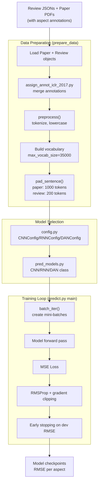
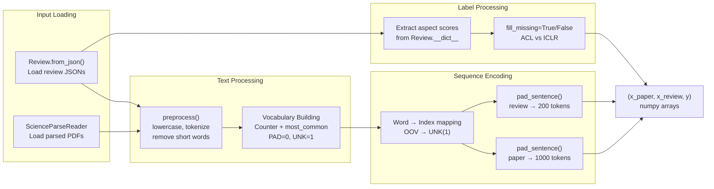
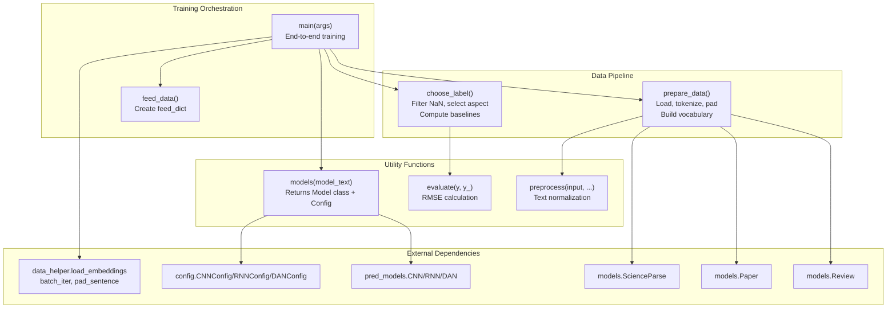
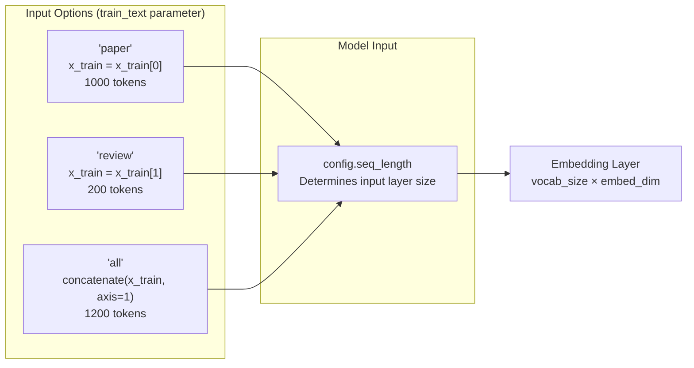
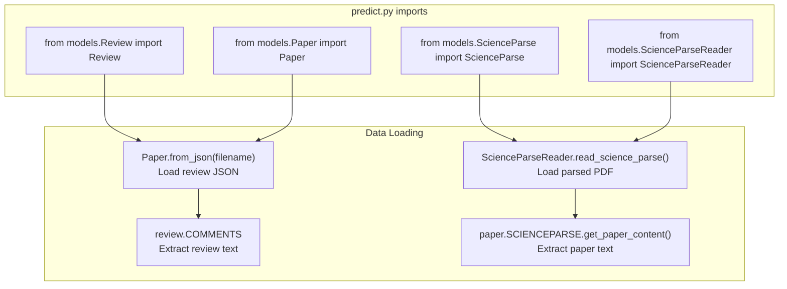

<!-- source: DeepWiki mcp.deepwiki.com · repo allenai/PeerRead · page 6 Aspect Prediction Pipeline · fetched 2026-10-26 -->

# Aspect Prediction Pipeline

<details>
<summary>Relevant source files</summary>

The following files were used as context for generating this wiki page:

- [code/README.md](code/README.md)
- [code/aspect_predict/predict.py](code/aspect_predict/predict.py)
- [code/aspect_predict/run_predict.sh](code/aspect_predict/run_predict.sh)

</details>


## Purpose and Scope

The Aspect Prediction Pipeline is a deep learning system that predicts fine-grained aspect scores from peer review comments and paper content. Given a review text and optionally the paper being reviewed, the pipeline predicts numerical scores (1-5 scale) for up to 9 different review aspects such as RECOMMENDATION, CLARITY, ORIGINALITY, and IMPACT.

This page provides an overview of the complete aspect prediction workflow, from data preparation through model training and evaluation. For detailed information about specific components, see:

- For aspect annotation format and data merging: [Aspect Annotations](#6.1)
- For neural network architectures (CNN, RNN, DAN): [Neural Network Models](#6.2)
- For training procedures and evaluation metrics: [Training and Evaluation](#6.3)

For the alternative acceptance classification pipeline that uses feature engineering and linear models, see [Acceptance Classification Pipeline](#5).

## Pipeline Overview

The Aspect Prediction Pipeline operates as a supervised regression system that learns to map review text (and optionally paper text) to numerical aspect scores. The pipeline differs from the acceptance classification pipeline by using neural networks instead of feature engineering, and by predicting continuous scores rather than binary accept/reject decisions.

**Sources:** [code/README.md:21-37](), [code/aspect_predict/predict.py:1-3]()

### High-Level Workflow



**Sources:** [code/aspect_predict/predict.py:56-199](), [code/aspect_predict/predict.py:244-460]()

## Input and Output Specification

### Input Requirements

The pipeline requires three types of input data:

| Input Type | Location | Format | Purpose |
|------------|----------|--------|---------|
| Review JSONs | `{train,dev,test}/reviews_annotated/` | JSON files (Review objects) | Review text with aspect scores |
| Paper PDFs | `{train,dev,test}/parsed_pdfs/` | JSON (ScienceParse output) | Parsed paper content |
| Aspect Annotations | Root dataset directory | `annotation_full.tsv` | Aspect score annotations |

The aspect annotations must be merged with reviews before training. For ICLR 2017 data, this is done by `assign_annot_iclr_2017.py`.

**Sources:** [code/aspect_predict/predict.py:83-106](), [code/README.md:36]()

### Output Artifacts

| Artifact | Location | Description |
|----------|----------|-------------|
| Model checkpoints | `./ckpts/{timestamp}/` | TensorFlow saved models |
| Vocabulary | `{dataset}/vocab.{dataset}.{vocab_size}` | Word-to-index mappings |
| Trained results | `./trained_results/{timestamp}/` | Experiment metadata |
| Evaluation metrics | Console output | RMSE per aspect + baselines |

**Sources:** [code/aspect_predict/predict.py:309-349]()

## Running the Pipeline

### Shell Script Execution

The primary interface for running the pipeline is `run_predict.sh`, which iterates over all aspect labels:

```bash
cd ./code/aspect_predict/
./run_predict.sh
```

The script executes `predict.py` for each of the 9 aspect labels (0-8) with configurable parameters.

**Sources:** [code/README.md:21-28](), [code/aspect_predict/run_predict.sh:1-15]()

### Direct Python Execution

For more control, invoke `predict.py` directly:

```bash
python predict.py <data_dir> <train_text> <model> <label>
```

**Command-line Arguments:**

| Position | Name | Options | Description |
|----------|------|---------|-------------|
| 1 | `data_dir` | Path | Dataset directory (e.g., `../../data/iclr_2017`) |
| 2 | `train_text` | `"all"`, `"review"`, `"paper"` | Input text source |
| 3 | `model` | `"dan"`, `"rnn"`, `"cnn"` | Neural architecture |
| 4 | `label` | `0-8` | Aspect index to predict |

**Sources:** [code/aspect_predict/predict.py:244-251](), [code/README.md:25-28]()

### Configuration in run_predict.sh

The shell script defines default configuration variables:

```bash
DATADIR="../../data/iclr_2017"  # Dataset path
LABELS=(0 1 2 3 4 5 6 7 8)      # All 9 aspects
TRAIN_TEXT="all"                 # Use paper + review
MODEL="dan"                      # Deep Averaging Network
```

**Sources:** [code/aspect_predict/run_predict.sh:2-7]()

## Data Preparation Flow

The `prepare_data()` function orchestrates the transformation from raw data to training-ready tensors:



**Sources:** [code/aspect_predict/predict.py:56-199]()

### Aspect Label Handling

The pipeline handles different aspect sets for different datasets:

| Dataset | Aspect Count | Aspects | Fill Missing |
|---------|--------------|---------|--------------|
| ICLR | 9 | RECOMMENDATION, SUBSTANCE, APPROPRIATENESS, MEANINGFUL_COMPARISON, SOUNDNESS_CORRECTNESS, ORIGINALITY, CLARITY, IMPACT, RECOMMENDATION_ORIGINAL | False |
| ACL | 9 | RECOMMENDATION, SUBSTANCE, APPROPRIATENESS, MEANINGFUL_COMPARISON, SOUNDNESS_CORRECTNESS, ORIGINALITY, CLARITY, IMPACT, REVIEWER_CONFIDENCE | True |

When `fill_missing=True`, missing aspect values are imputed with the column mean.

**Sources:** [code/aspect_predict/predict.py:69-80](), [code/aspect_predict/predict.py:189-194]()

## Main Components and Responsibilities

### predict.py Function Map

The main script is organized into distinct functional units:



**Sources:** [code/aspect_predict/predict.py:29-242]()

### Function Responsibilities

| Function | Lines | Purpose |
|----------|-------|---------|
| `models()` | [29-33]() | Maps model name string to Model class and Config class |
| `preprocess()` | [36-49]() | Tokenizes and normalizes text (lowercase, stopword removal, length filtering) |
| `evaluate()` | [52-53]() | Computes RMSE between predictions and ground truth |
| `prepare_data()` | [56-199]() | Loads all data splits, builds vocabulary, encodes sequences, extracts labels |
| `choose_label()` | [203-241]() | Filters data for specific aspect, removes NaN, computes baseline metrics |
| `main()` | [244-460]() | Orchestrates training loop, model creation, checkpointing, evaluation |

**Sources:** [code/aspect_predict/predict.py:1-460]()

## Training Text Options

The pipeline supports three modes for combining paper and review text:



**Sources:** [code/aspect_predict/predict.py:289-304]()

## Baseline Computation

The `choose_label()` function computes two baseline predictions for comparison:

| Baseline | Strategy | Calculation |
|----------|----------|-------------|
| Mean | Predict training set mean for all examples | `np.average(y_aspect)` |
| Majority | Predict most common score for all examples | `Counter(y_aspect).most_common(1)[0][0]` |

These baselines are computed on the training set and evaluated on the test set to measure whether the neural model provides improvement over trivial predictors.

**Sources:** [code/aspect_predict/predict.py:223-241](), [code/aspect_predict/predict.py:274-288]()

## Key Files and Their Roles

| File | Purpose | Key Classes/Functions |
|------|---------|----------------------|
| `predict.py` | Main training script | `main()`, `prepare_data()`, `choose_label()` |
| `pred_models.py` | Neural architectures | `CNN`, `RNN`, `DAN` classes |
| `config.py` | Model hyperparameters | `CNNConfig`, `RNNConfig`, `DANConfig` |
| `data_helper.py` | Data utilities | `load_embeddings()`, `batch_iter()`, `pad_sentence()` |
| `run_predict.sh` | Shell orchestration | Loops over aspects and models |
| `assign_annot_iclr_2017.py` | Data preparation | Merges aspect annotations into reviews |

**Sources:** [code/README.md:31-37]()

## Integration with Data Models

The pipeline integrates with the core data models defined in the parent directory:



**Sources:** [code/aspect_predict/predict.py:21-25](), [code/aspect_predict/predict.py:104-115]()

---

