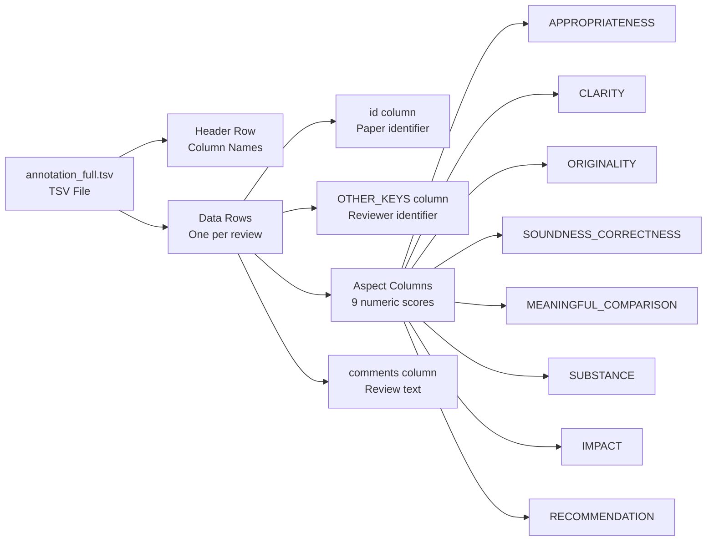
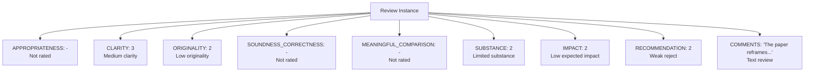
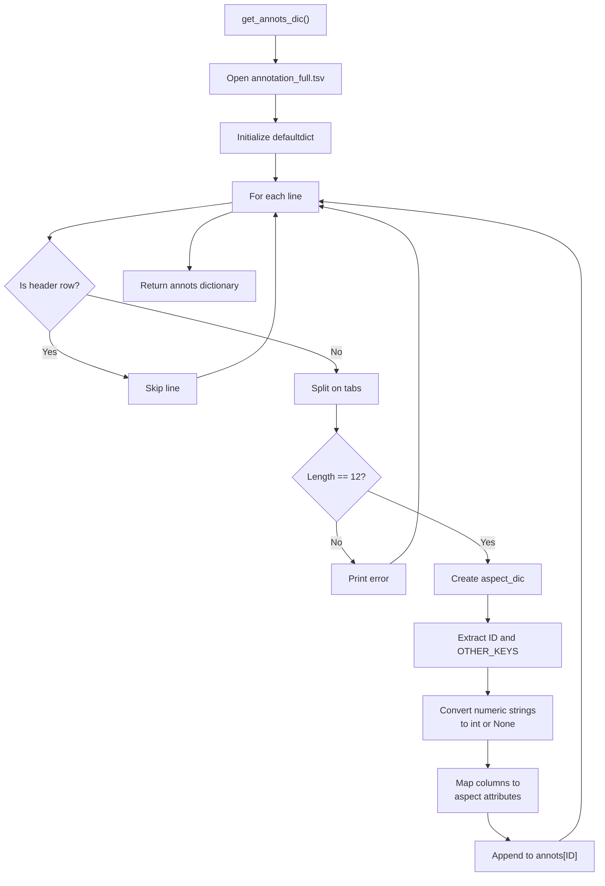
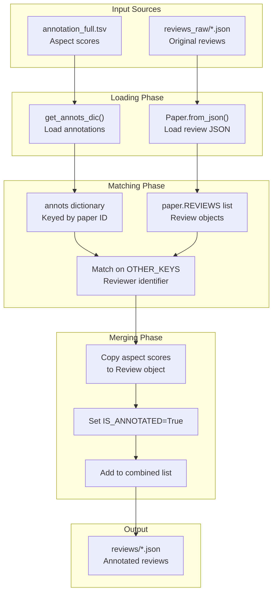
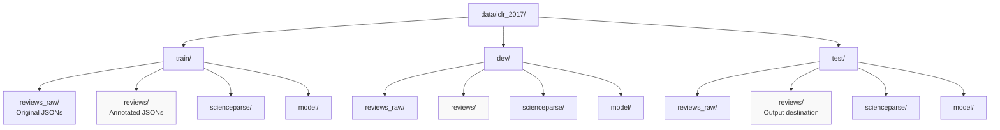
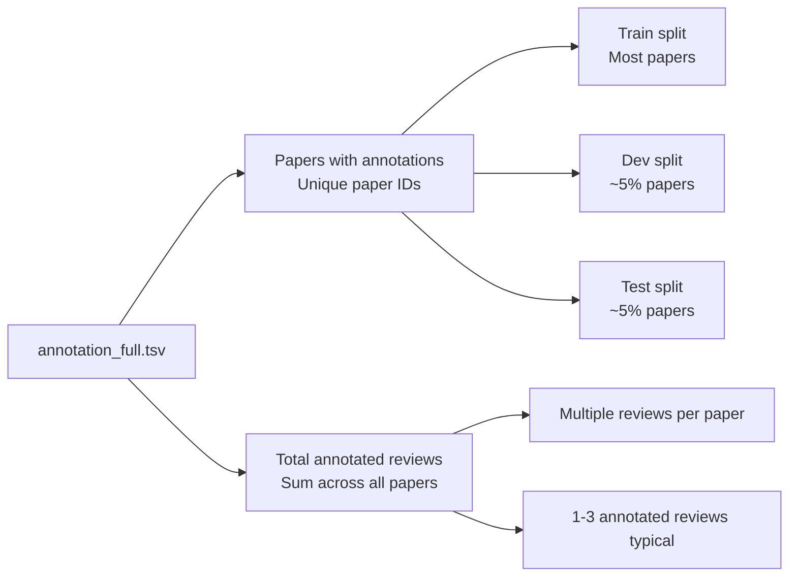
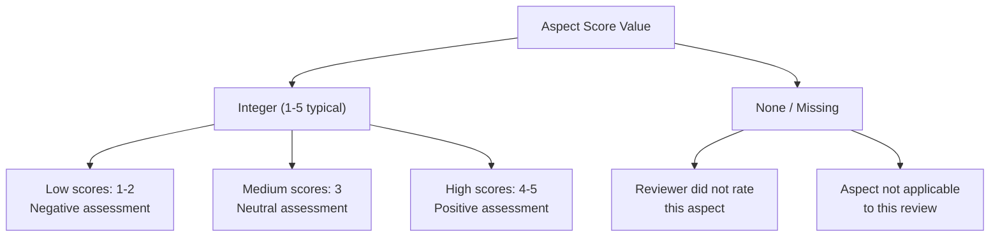

<!-- source: DeepWiki mcp.deepwiki.com · repo allenai/PeerRead · page 6.1 Aspect Annotations · fetched 2026-10-26 -->

# Aspect Annotations

<details>
<summary>Relevant source files</summary>

The following files were used as context for generating this wiki page:

- [code/aspect_predict/annotation_full.tsv](code/aspect_predict/annotation_full.tsv)
- [code/aspect_predict/assign_annot_iclr_2017.py](code/aspect_predict/assign_annot_iclr_2017.py)

</details>


This page documents the aspect annotation system used in the PeerRead dataset for the aspect prediction pipeline (see [Aspect Prediction Pipeline](#6) for the complete system). Aspect annotations provide numeric scores for specific qualities of peer reviews, enabling supervised learning for aspect-based review analysis.

For information about training neural models on these annotations, see [Neural Network Models](#6.2). For the complete prediction workflow, see [Training and Evaluation](#6.3).

---

## Overview

The aspect annotation system provides structured, quantitative assessments of peer reviews across nine dimensions. These annotations are stored in a TSV file and merged with raw review data to create training, development, and test datasets for the aspect prediction models.

**Key Components:**
- `annotation_full.tsv`: Master annotation file containing aspect scores
- `assign_annot_iclr_2017.py`: Script that merges annotations with review JSONs
- Nine aspect categories rated on integer scales
- Support for both annotated and non-annotated reviews

---

## Annotation File Structure

### File Format

The annotation data is stored in [code/aspect_predict/annotation_full.tsv:1-10]() as a tab-separated values file with the following structure:

| Column | Description | Type |
|--------|-------------|------|
| `id` | Paper identifier | String |
| `OTHER_KEYS` | Reviewer identifier (e.g., "ICLR 2017 conference AnonReviewer3") | String |
| `APPROPRIATENESS` | Score for paper's appropriateness to venue | Integer or `-` |
| `CLARITY` | Score for clarity of presentation | Integer or `-` |
| `ORIGINALITY` | Score for novelty of contribution | Integer or `-` |
| `SOUNDNESS_CORRECTNESS` | Score for technical correctness | Integer or `-` |
| `MEANINGFUL_COMPARISON` | Score for comparison with related work | Integer or `-` |
| `SUBSTANCE` | Score for depth of contribution | Integer or `-` |
| `IMPACT` | Score for expected impact | Integer or `-` |
| `RECOMMENDATION` | Overall recommendation score | Integer or `-` |
| `comments` | Free-text review comments | String |

**Note:** Missing aspect scores are denoted by `-` in the file and converted to `None` in the Python data structures.



**Diagram: Annotation File Structure**

Sources: [code/aspect_predict/annotation_full.tsv:1-2]()

---

## Nine Aspect Categories

The annotation system evaluates reviews across nine dimensions, each rated on a discrete integer scale (typically 1-5, though exact ranges may vary):

### 1. APPROPRIATENESS
Evaluates whether the paper topic and approach are suitable for the target venue or conference.

### 2. CLARITY
Measures how well the paper is written and how clearly ideas are communicated.

### 3. ORIGINALITY
Assesses the novelty and uniqueness of the contribution.

### 4. SOUNDNESS_CORRECTNESS
Evaluates technical correctness, validity of proofs, and methodological rigor.

### 5. MEANINGFUL_COMPARISON
Measures the quality and comprehensiveness of comparisons with related work and baselines.

### 6. SUBSTANCE
Assesses the depth and significance of the technical contribution.

### 7. IMPACT
Evaluates the expected influence and importance of the work to the field.

### 8. RECOMMENDATION_UNOFFICIAL
An unofficial overall recommendation score (distinct from the conference's official recommendation).

### 9. Comments Field
While not a numeric aspect, the free-text comments provide context and are used in some prediction tasks.

**Aspect Distribution Example** (from sample data):



**Diagram: Aspect Scores for a Single Review**

Sources: [code/aspect_predict/annotation_full.tsv:2-2]()

---

## Annotation Loading Process

### Loading Function

The `get_annots_dic()` function in [code/aspect_predict/assign_annot_iclr_2017.py:11-46]() reads the TSV file and constructs a dictionary structure:



**Diagram: Annotation Loading Workflow**

**Key Processing Steps:**
1. **Header Detection** [line 17](): Skip the first row containing column names
2. **Validation** [lines 20-22](): Ensure each row has exactly 12 tab-separated tokens
3. **Type Conversion** [lines 29-33](): Convert numeric strings to integers, non-numeric to `None`
4. **Dictionary Construction** [lines 24-45](): Create structured dictionary with aspect names as keys
5. **Grouping** [line 45](): Group multiple reviews by paper ID

Sources: [code/aspect_predict/assign_annot_iclr_2017.py:11-46]()

---

## Merging Annotations with Reviews

### Integration Architecture

The `assign_annot_iclr_2017.py` script merges aspect annotations with original review JSON files:



**Diagram: Annotation Merging Pipeline**

Sources: [code/aspect_predict/assign_annot_iclr_2017.py:49-110]()

### Merging Logic

The merging process [lines 80-96]() works as follows:

1. **Load Original Reviews**: Read review JSON files from `reviews_raw/` directory
2. **Match by Reviewer ID**: For each original review, find corresponding annotation using `OTHER_KEYS` field
3. **Attribute Transfer**: Copy aspect scores from annotation dict to Review object attributes [lines 88-90]()
4. **Flag Annotated Reviews**: Set `IS_ANNOTATED=True` for successfully merged reviews [line 91]()
5. **Preserve Non-Annotated**: Include original reviews even if no annotation exists
6. **Save Combined**: Write merged reviews to `reviews/` directory [line 103]()

**Code Example:**
```python
# Key merging logic from assign_annot_iclr_2017.py:85-96
if r_annotated['OTHER_KEYS'] == r_original.OTHER_KEYS:
    r_combined = r_original
    for k,v in r_annotated.items():
        if k in ['RECOMMENDATION_UNOFFICIAL','SUBSTANCE','APPROPRIATENESS',
                 'MEANINGFUL_COMPARISON','SOUNDNESS_CORRECTNESS',
                 'ORIGINALITY','CLARITY','IMPACT']:
            setattr(r_combined, k, v)
    setattr(r_combined, 'IS_ANNOTATED',True)
```

Sources: [code/aspect_predict/assign_annot_iclr_2017.py:80-96]()

---

## Directory Structure

The annotation merging process operates on the following directory structure:



**Diagram: Directory Layout for Annotation Processing**

**Directory Purposes:**
- `reviews_raw/`: Contains original review JSON files without aspect scores
- `reviews/`: Output directory for merged reviews with aspect annotations
- `scienceparse/`: Parsed PDF metadata (not used in annotation merging)
- `model/`: Directory for saved models (created if needed)

Sources: [code/aspect_predict/assign_annot_iclr_2017.py:56-67]()

---

## Data Statistics

### Annotation Coverage

The annotation file contains reviews from ICLR 2017 conference:



**Diagram: Annotation Dataset Distribution**

The script prints statistics during execution [lines 53, 106]():
- Total papers with annotations
- Total annotated reviews across all papers
- Per-split counts (train/dev/test)

Sources: [code/aspect_predict/assign_annot_iclr_2017.py:49-106]()

---

## Aspect Score Properties

### Missing Values

Not all reviews have scores for all aspects. The system handles missing values as follows:

**In TSV File** [lines 29-33]():
- Missing values represented as `-` character
- Converted to `None` in Python

**In Review Objects**:
- Aspect attributes set to `None` when no score available
- Model training filters examples with missing target aspects (see [Training and Evaluation](#6.3))

### Score Ranges

Based on sample data in [annotation_full.tsv]():
- Most aspects use 1-5 integer scale
- Some aspects may have different ranges
- Score interpretation depends on conference guidelines



**Diagram: Aspect Score Value Space**

Sources: [code/aspect_predict/annotation_full.tsv:1-10](), [code/aspect_predict/assign_annot_iclr_2017.py:29-33]()

---

## Integration with Review Model

The merged aspect scores are stored as attributes on the `Review` object (see [Data Models](#7.1)):

**Review Attributes After Merging:**
- `APPROPRIATENESS`
- `CLARITY`
- `ORIGINALITY`
- `SOUNDNESS_CORRECTNESS`
- `MEANINGFUL_COMPARISON`
- `SUBSTANCE`
- `IMPACT`
- `RECOMMENDATION_UNOFFICIAL`
- `IS_ANNOTATED` (boolean flag)
- `COMMENTS` (text content)
- `OTHER_KEYS` (reviewer identifier used for matching)

The `IS_ANNOTATED` flag distinguishes reviews with aspect scores from those without, allowing the dataset to contain both annotated and non-annotated reviews.

Sources: [code/aspect_predict/assign_annot_iclr_2017.py:85-91]()

---

## Usage in Prediction Pipeline

The annotated reviews serve as training data for the aspect prediction models:

1. **Data Preparation**: The `assign_annot_iclr_2017.py` script must be run after data splitting but before model training
2. **Model Input**: Review text (COMMENTS field) serves as input
3. **Model Targets**: Numeric aspect scores serve as regression targets
4. **Training Filtering**: Examples with missing target aspects are filtered during data preparation in `predict.py`

For complete details on how annotations are used in training, see [Training and Evaluation](#6.3).

Sources: [code/aspect_predict/assign_annot_iclr_2017.py:1-111]()

---

## Running the Annotation Merger

### Execution

To merge annotations with reviews:

```bash
cd code/aspect_predict
python assign_annot_iclr_2017.py
```

**Prerequisites:**
- `annotation_full.tsv` must exist in `code/aspect_predict/`
- Raw review JSONs must exist in `data/iclr_2017/{train,dev,test}/reviews_raw/`
- Data splitting must be complete (see [Data Processing and Splitting](#4.2))

**Output:**
- Annotated review JSONs written to `data/iclr_2017/{train,dev,test}/reviews/`
- Console output showing paper and review counts per split

Sources: [code/aspect_predict/assign_annot_iclr_2017.py:49-110]()

---

## Key Functions Reference

### `get_annots_dic()`

**Location**: [code/aspect_predict/assign_annot_iclr_2017.py:11-46]()

**Purpose**: Load aspect annotations from TSV file into Python dictionary

**Returns**: `defaultdict(list)` mapping paper IDs to lists of aspect dictionaries

**Key Operations**:
- Opens `annotation_full.tsv` with UTF-8 encoding
- Parses tab-separated values
- Converts numeric strings to integers
- Groups reviews by paper ID

### `main()`

**Location**: [code/aspect_predict/assign_annot_iclr_2017.py:49-110]()

**Purpose**: Orchestrate the complete annotation merging process

**Workflow**:
1. Load annotations with `get_annots_dic()`
2. Iterate over train/dev/test splits
3. For each split, load review JSONs from `reviews_raw/`
4. Match and merge annotations with reviews
5. Save merged reviews to `reviews/` directory

Sources: [code/aspect_predict/assign_annot_iclr_2017.py:11-110]()

---

