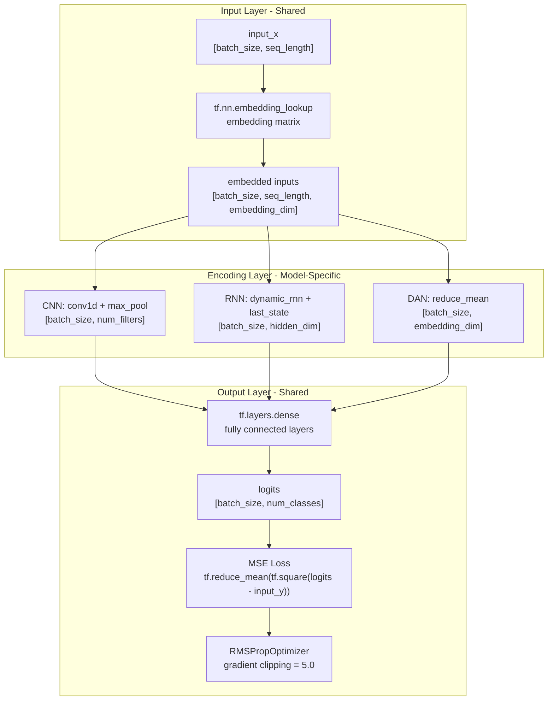
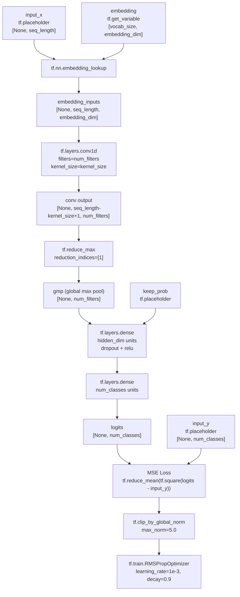
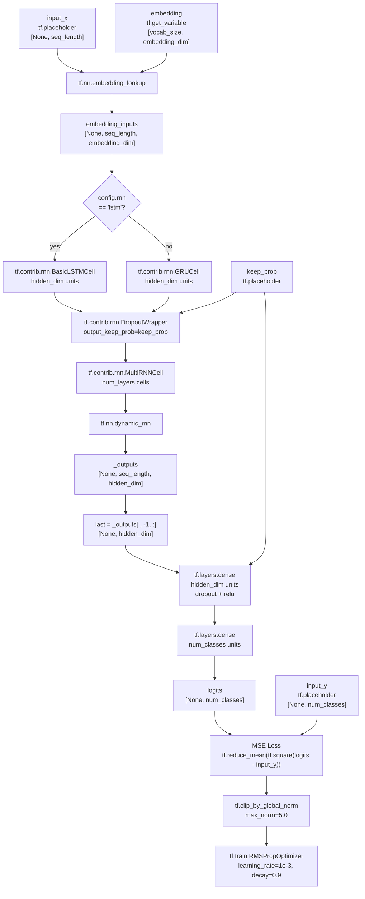
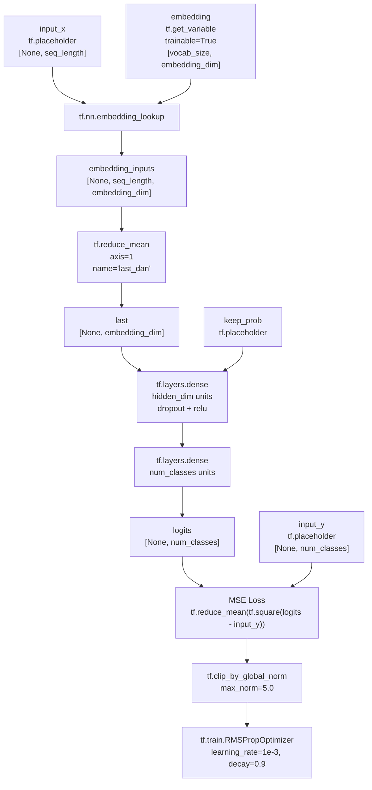
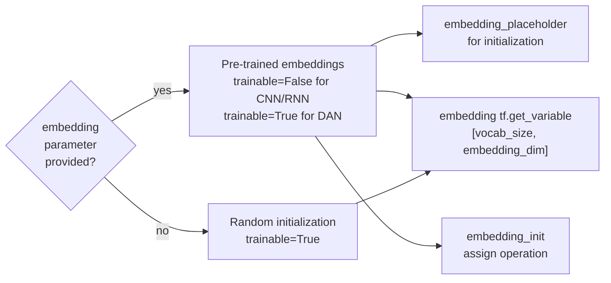

<!-- source: DeepWiki mcp.deepwiki.com · repo allenai/PeerRead · page 6.2 Neural Network Models · fetched 2026-10-26 -->

# Neural Network Models

<details>
<summary>Relevant source files</summary>

The following files were used as context for generating this wiki page:

- [code/aspect_predict/config.py](code/aspect_predict/config.py)
- [code/aspect_predict/pred_models.py](code/aspect_predict/pred_models.py)

</details>


## Purpose and Scope

This page documents the three neural network architectures implemented for aspect prediction in the PeerRead repository: **Convolutional Neural Network (CNN)**, **Recurrent Neural Network (RNN)**, and **Deep Averaging Network (DAN)**. These models predict numerical scores for 9 review aspects from text input.

For information about the aspect annotation data these models predict, see [Aspect Annotations](#6.1). For details on training procedures, evaluation metrics, and running experiments, see [Training and Evaluation](#6.3).

**Sources:** [code/aspect_predict/pred_models.py:1-175](), [code/aspect_predict/config.py:1-48]()

---

## Model Architecture Overview

All three models implement the same high-level task: regression from text sequences to 9 aspect scores. They differ in how they encode the input text before passing it to fully connected layers for prediction.



**Sources:** [code/aspect_predict/pred_models.py:8-175]()

---

## Configuration Classes

Each model has a corresponding configuration class that defines hyperparameters. All three configurations share common parameters but differ in architecture-specific settings.

### Shared Configuration Parameters

| Parameter | Value | Description |
|-----------|-------|-------------|
| `embedding_dim` | 300 | Dimension of word embeddings |
| `seq_length` | 200 | Maximum sequence length (padded/truncated) |
| `num_classes` | 9 | Number of aspect scores to predict |
| `vocab_size` | 20000 | Vocabulary size |
| `hidden_dim` | 100 | Hidden layer dimension |
| `dropout_keep_prob` | 1.0 | Dropout keep probability |
| `learning_rate` | 1e-3 | Learning rate for optimizer |
| `batch_size` | 32 | Training batch size |
| `num_epochs` | 100 | Maximum training epochs |
| `print_per_batch` | 50 | Print frequency (batches) |
| `save_per_batch` | 10 | Checkpoint save frequency (batches) |

**Sources:** [code/aspect_predict/config.py:2-46]()

### Architecture-Specific Parameters

| Model | Class | Specific Parameters |
|-------|-------|---------------------|
| CNN | `CNNConfig` | `num_filters=128`, `kernel_size=5` |
| RNN | `RNNConfig` | `num_layers=1`, `rnn='gru'` (or 'lstm') |
| DAN | `DANConfig` | `num_layers=1` (for output FC layers) |

**Sources:** [code/aspect_predict/config.py:2-46]()

---

## CNN Model Architecture

The `CNN` class implements a convolutional neural network for text classification/regression. It uses 1D convolutions followed by global max pooling to capture local n-gram patterns.

### Architecture Flow



### Key Components

**Embedding Layer** [code/aspect_predict/pred_models.py:96-97]()
- Uses CPU for embedding lookup to reduce GPU memory
- Embeddings can be pre-initialized (trainable=False) or trained from scratch

**Convolutional Layer** [code/aspect_predict/pred_models.py:100]()
- `tf.layers.conv1d` with `num_filters=128` filters
- Kernel size of 5 captures 5-gram patterns
- No explicit activation (linear)

**Global Max Pooling** [code/aspect_predict/pred_models.py:101]()
- `tf.reduce_max` over the sequence dimension (axis 1)
- Produces fixed-size representation: `[batch_size, num_filters]`
- Named `gmp` in the code

**Fully Connected Layers** [code/aspect_predict/pred_models.py:105-110]()
- Variable number of layers controlled by `self.out_layers` (default 1)
- Intermediate layers use dropout and ReLU activation
- Final layer outputs `num_classes` logits without activation

**Sources:** [code/aspect_predict/pred_models.py:71-119](), [code/aspect_predict/config.py:2-16]()

---

## RNN Model Architecture

The `RNN` class implements a recurrent neural network using either LSTM or GRU cells. It processes sequences sequentially and uses the final hidden state for prediction.

### Architecture Flow



### Key Components

**RNN Cell Selection** [code/aspect_predict/pred_models.py:33-43]()
- Supports both `BasicLSTMCell` and `GRUCell`
- Choice controlled by `config.rnn` parameter ('lstm' or 'gru')
- Default configuration uses GRU

**Dropout Wrapper** [code/aspect_predict/pred_models.py:38-43]()
- Applied to each RNN cell's output
- Controlled by `keep_prob` placeholder at runtime

**Multi-Layer RNN** [code/aspect_predict/pred_models.py:49-50]()
- `MultiRNNCell` stacks `num_layers` cells (default 1)
- All cells share the same dropout configuration
- Uses `state_is_tuple=True` for LSTM states

**Dynamic RNN Execution** [code/aspect_predict/pred_models.py:51-52]()
- `tf.nn.dynamic_rnn` handles variable-length sequences efficiently
- Extracts last timestep output: `_outputs[:, -1, :]`
- This becomes the fixed-size sequence encoding

**Sources:** [code/aspect_predict/pred_models.py:8-69](), [code/aspect_predict/config.py:18-32]()

---

## DAN Model Architecture

The `DAN` (Deep Averaging Network) class implements the simplest architecture: averaging word embeddings followed by fully connected layers. Despite its simplicity, it often performs competitively.

### Architecture Flow



### Key Components

**Trainable Embeddings** [code/aspect_predict/pred_models.py:136-138]()
- Unlike CNN and RNN, DAN uses `trainable=True` for embeddings by default
- This allows the model to fine-tune word representations
- Pre-trained embeddings can still be provided as initialization

**Mean Pooling** [code/aspect_predict/pred_models.py:154]()
- `tf.reduce_mean` over sequence dimension (axis 1)
- Creates a simple bag-of-embeddings representation
- Named `last_dan` in the computation graph
- Output shape: `[batch_size, embedding_dim]`

**Simplicity vs Performance Trade-off**
- No recurrence or convolution operations
- Significantly faster to train than CNN or RNN
- Ignores word order but often performs well on aggregate tasks
- Good baseline for comparison

**Sources:** [code/aspect_predict/pred_models.py:123-172](), [code/aspect_predict/config.py:33-46]()

---

## Shared Components Across Models

All three models share identical implementations for several key components.

### Embedding Management



**Embedding Initialization Logic** (identical across all three models):
- CNN: [code/aspect_predict/pred_models.py:82-91]()
- RNN: [code/aspect_predict/pred_models.py:18-27]()
- DAN: [code/aspect_predict/pred_models.py:135-144]()

When `embedding` parameter is provided:
1. Creates `embedding` variable with `trainable=False` (CNN/RNN) or `True` (DAN)
2. Creates `embedding_placeholder` for feeding pre-trained values
3. Creates `embedding_init` assignment operation
4. Pre-trained embeddings are loaded and initialized during training setup

**Sources:** [code/aspect_predict/pred_models.py:18-27](), [code/aspect_predict/pred_models.py:82-91](), [code/aspect_predict/pred_models.py:135-144]()

### Optimization Strategy

All models use identical optimization configuration:

| Component | Implementation | Location |
|-----------|----------------|----------|
| **Loss Function** | Mean Squared Error (MSE) | [pred_models.py:63](), [pred_models.py:113](), [pred_models.py:166]() |
| **Gradient Clipping** | `tf.clip_by_global_norm` with max_norm=5.0 | [pred_models.py:66](), [pred_models.py:116](), [pred_models.py:169]() |
| **Optimizer** | `RMSPropOptimizer` with decay=0.9 | [pred_models.py:67](), [pred_models.py:117](), [pred_models.py:170]() |
| **Learning Rate** | 1e-3 (from config) | [config.py:11](), [config.py:27](), [config.py:41]() |
| **Global Step** | `tf.Variable` for tracking training progress | [pred_models.py:64](), [pred_models.py:114](), [pred_models.py:167]() |

**Gradient Clipping Rationale:**
- Prevents exploding gradients, especially important for RNN
- Max norm of 5.0 constrains the global norm of all gradients
- Applied before optimizer updates

**Sources:** [code/aspect_predict/pred_models.py:62-68](), [code/aspect_predict/pred_models.py:112-118](), [code/aspect_predict/pred_models.py:164-171]()

### Placeholder Inputs

All models define three identical placeholders:

```python
self.input_x = tf.placeholder(tf.int32, [None, self.config.seq_length], name='input_x')
self.input_y = tf.placeholder(tf.float32, [None, self.config.num_classes], name='input_y')
self.keep_prob = tf.placeholder(tf.float32, name='keep_prob')
```

- **input_x**: Token indices for input sequences, shape `[batch_size, seq_length]`
- **input_y**: Target aspect scores, shape `[batch_size, num_classes]` (9 aspects)
- **keep_prob**: Dropout keep probability (1.0 for inference, <1.0 for training)

**Sources:** [code/aspect_predict/pred_models.py:11-13](), [code/aspect_predict/pred_models.py:74-76](), [code/aspect_predict/pred_models.py:126-128]()

---

## Model Selection Guide

### Architectural Comparison

| Model | Strengths | Weaknesses | Best For |
|-------|-----------|------------|----------|
| **CNN** | Fast training, captures local patterns, parallelizable | Fixed n-gram size, no long-range dependencies | Short texts, style detection |
| **RNN** | Handles sequences naturally, captures order, variable length | Slow training, gradient issues, sequential | Long-range dependencies, syntax |
| **DAN** | Fastest training, simple, good baseline | Ignores word order, loses structural info | Large datasets, quick experiments |

### Encoding Layer Outputs

| Model | Encoding Method | Output Dimension | Computational Cost |
|-------|----------------|------------------|-------------------|
| CNN | Conv1D + Global Max Pool | `num_filters` (128) | Medium |
| RNN | Multi-layer RNN + Last State | `hidden_dim` (100) | High |
| DAN | Mean Pooling | `embedding_dim` (300) | Low |

### Configuration Differences

**CNN-Specific Parameters:**
```python
num_filters = 128    # Number of convolutional filters
kernel_size = 5      # Size of convolutional window (5-grams)
```

**RNN-Specific Parameters:**
```python
num_layers = 1       # Number of stacked RNN layers
rnn = 'gru'         # Cell type: 'gru' or 'lstm'
```

**DAN-Specific Parameters:**
```python
num_layers = 1       # Currently only used for output layers
# Note: DAN has trainable=True for embeddings
```

**Sources:** [code/aspect_predict/config.py:2-46](), [code/aspect_predict/pred_models.py:1-175]()

---

## Model Implementation Details

### Common Patterns

All three model classes follow the same implementation pattern:

1. **Constructor** (`__init__`):
   - Accepts `config` object and optional `embedding` parameter
   - Defines placeholders for inputs
   - Sets up embedding management
   - Calls architecture-specific method (`cnn()`, `rnn()`, or `dan()`)

2. **Architecture Method**:
   - Performs embedding lookup on CPU
   - Applies model-specific encoding
   - Adds fully connected output layers
   - Defines loss and optimization

3. **Trainable Attributes**:
   - `self.logits`: Model predictions
   - `self.loss`: MSE loss value
   - `self._train_op`: Training operation
   - `self.global_step`: Training step counter

### TensorFlow Name Scopes

All models use consistent name scopes for organization:

| Name Scope | Purpose | Models |
|------------|---------|--------|
| `"rnn"` | RNN cell and dynamic_rnn operations | RNN only |
| `"cnn"` | Conv1D and max pooling operations | CNN only |
| `"dan"` | Mean pooling operation | DAN only |
| `"score"` | Fully connected output layers | All |
| `"optimize"` | Loss computation and optimizer | All |

These scopes are visible in TensorBoard visualizations and make debugging easier.

**Sources:** [code/aspect_predict/pred_models.py:48](), [code/aspect_predict/pred_models.py:99](), [code/aspect_predict/pred_models.py:153](), [code/aspect_predict/pred_models.py:54](), [code/aspect_predict/pred_models.py:103](), [code/aspect_predict/pred_models.py:156](), [code/aspect_predict/pred_models.py:62](), [code/aspect_predict/pred_models.py:112](), [code/aspect_predict/pred_models.py:164]()

---

## Usage in Training Pipeline

These model classes are instantiated and trained by the [predict.py]() script (see [Training and Evaluation](#6.3)). The typical usage pattern:

```python
# Select configuration based on command-line argument
if model_type == 'cnn':
    config = CNNConfig()
    model = CNN(config, embedding=pretrained_embeddings)
elif model_type == 'rnn':
    config = RNNConfig()
    model = RNN(config, embedding=pretrained_embeddings)
elif model_type == 'dan':
    config = DANConfig()
    model = DAN(config, embedding=pretrained_embeddings)

# Training loop feeds placeholders
feed_dict = {
    model.input_x: batch_x,
    model.input_y: batch_y,
    model.keep_prob: config.dropout_keep_prob
}
_, loss = session.run([model._train_op, model.loss], feed_dict)
```

The `binarize` parameter in constructors (currently unused) was intended for binary classification variants but is not actively used in the aspect prediction task.

**Sources:** [code/aspect_predict/pred_models.py:9](), [code/aspect_predict/pred_models.py:72](), [code/aspect_predict/pred_models.py:124]()

---

