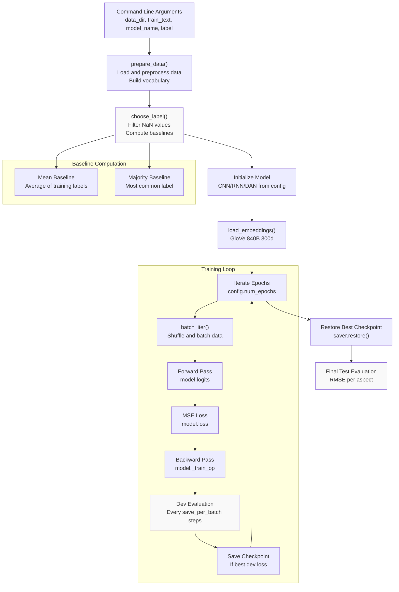
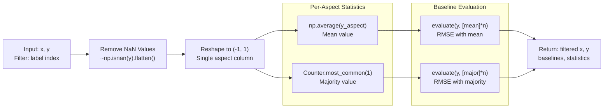
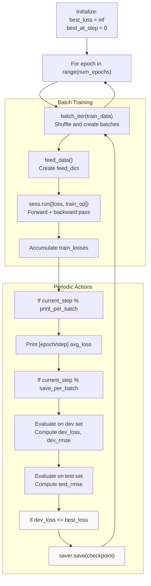
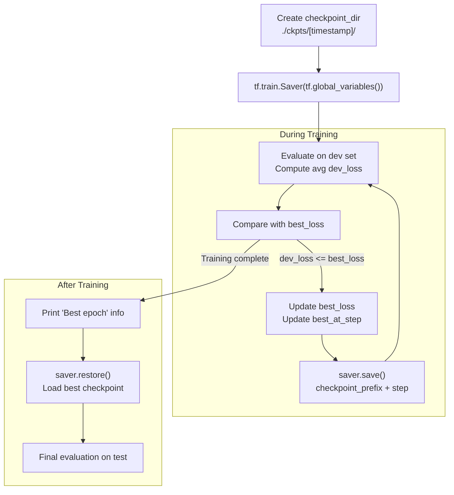
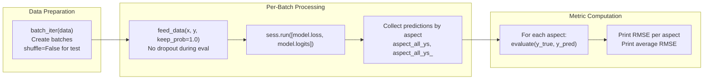
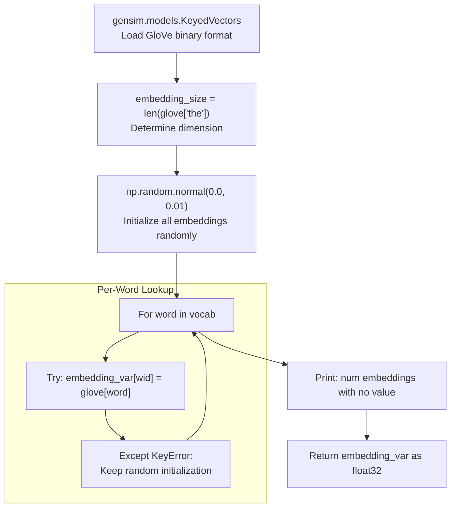

<!-- source: DeepWiki mcp.deepwiki.com · repo allenai/PeerRead · page 6.3 Training and Evaluation · fetched 2026-10-26 -->

# Training and Evaluation

<details>
<summary>Relevant source files</summary>

The following files were used as context for generating this wiki page:

- [code/aspect_predict/data_helper.py](code/aspect_predict/data_helper.py)
- [code/aspect_predict/predict.py](code/aspect_predict/predict.py)
- [code/aspect_predict/run_predict.sh](code/aspect_predict/run_predict.sh)

</details>


## Purpose and Scope

This document explains the training and evaluation procedures for neural network models in the aspect prediction pipeline. It covers the training loop, batch iteration, loss computation, early stopping, model checkpointing, and evaluation metrics used to assess model performance.

For information about the neural network architectures themselves (CNN, RNN, DAN), see [Neural Network Models](#6.2). For details on data preparation and annotation merging, see [Aspect Annotations](#6.1).

---

## Training Workflow Overview

The training process follows a standard supervised learning workflow with early stopping based on development set performance. The main orchestration happens in `predict.py`, which loads data, initializes models, runs the training loop, and performs final evaluation.



**Diagram: End-to-End Training and Evaluation Workflow**

Sources: [code/aspect_predict/predict.py:244-460]()

---

## Baseline Computation

Before training neural models, the system computes two statistical baselines for comparison: **mean baseline** and **majority baseline**. These provide reference points to evaluate whether the neural model is learning meaningful patterns.

### Baseline Calculation Logic

The `choose_label()` function computes baselines from the training set and applies them to test data:

| Baseline Type | Computation | Purpose |
|--------------|-------------|---------|
| **Mean Baseline** | Average of all training labels for each aspect | Predicts the mean value for all test examples |
| **Majority Baseline** | Most common label value in training set | Predicts the mode value for all test examples |

### Implementation Details

The baseline computation happens in [code/aspect_predict/predict.py:203-241]():



**Diagram: Baseline Computation Process**

The function returns six values [code/aspect_predict/predict.py:241]():
1. Filtered `x` (paper and review inputs)
2. Filtered `y` (aspect labels)
3. `evaluate_mean` - RMSE when predicting mean
4. `evaluate_major` - RMSE when predicting majority
5. `mean_aspects` - Mean values per aspect
6. `major_aspects` - Majority values per aspect

### Baseline Results Display

Baselines are printed before training starts [code/aspect_predict/predict.py:284-287]():

```
Majority (Test)
    RECOMMENDATION    0.9234    0.8765
    SUBSTANCE         1.0123    0.9876
    ...
    TOTAL             0.9456    0.9123
```

Sources: [code/aspect_predict/predict.py:203-287]()

---

## Training Loop Architecture

The training loop implements a standard epoch-batch iteration with periodic evaluation and early stopping.

### Loop Structure



**Diagram: Training Loop Control Flow**

### Key Training Parameters

Training is controlled by configuration objects (see [Neural Network Models](#6.2)). Key parameters from [code/aspect_predict/predict.py:315-319]():

| Parameter | Source | Description |
|-----------|--------|-------------|
| `num_epochs` | `config.num_epochs` | Maximum number of training epochs |
| `batch_size` | `config.batch_size` | Mini-batch size for SGD |
| `dropout_keep_prob` | `config.dropout_keep_prob` | Dropout probability during training |
| `print_per_batch` | `config.print_per_batch` | Steps between status prints |
| `save_per_batch` | `config.save_per_batch` | Steps between dev evaluations |

### Batch Iterator

The `batch_iter()` function in [code/aspect_predict/data_helper.py:58-73]() generates mini-batches:

**Functionality:**
- Accepts data array, batch size, and shuffle flag
- Shuffles data if requested using `np.random.permutation()`
- Yields batches of size `batch_size`
- Handles final incomplete batch automatically

**Usage in training** [code/aspect_predict/predict.py:358]():
```python
train_batches = batch_iter(list(zip(x_train, y_train)), config.batch_size)
```

### Feed Dictionary Construction

The `feed_data()` function prepares TensorFlow feed dictionaries [code/aspect_predict/predict.py:326-332]():

```python
def feed_data(x_batch, y_batch, keep_prob):
    feed_dict = {
        model.input_x: x_batch,
        model.input_y: y_batch,
        model.keep_prob: keep_prob
    }
    return feed_dict
```

**Notes:**
- `keep_prob` is set to `config.dropout_keep_prob` during training
- `keep_prob` is set to `1.0` during evaluation (no dropout)

Sources: [code/aspect_predict/predict.py:356-369](), [code/aspect_predict/data_helper.py:58-73]()

---

## Model Checkpointing and Early Stopping

The system implements early stopping based on development set loss, saving checkpoints whenever performance improves.

### Checkpoint Management



**Diagram: Checkpoint Saving and Model Restoration**

### Implementation Details

**Checkpoint Directory Structure** [code/aspect_predict/predict.py:345-349]():
```
./ckpts/[timestamp]/
└── model-[step].data-00000-of-00001
└── model-[step].index
└── model-[step].meta
└── checkpoint
```

**Early Stopping Logic** [code/aspect_predict/predict.py:422-425]():
```python
if np.average(dev_losses) <= best_loss:
    best_loss, best_at_step = np.average(dev_losses), current_step
    path = saver.save(sess, checkpoint_prefix, global_step=current_step)
    print('Best loss %.2f at step %d'%(best_loss , best_at_step))
```

**Model Restoration** [code/aspect_predict/predict.py:429-430]():
```python
print('Best epoch', best_at_step)
saver.restore(sess, checkpoint_prefix + '-' + str(best_at_step))
```

Sources: [code/aspect_predict/predict.py:337-349](), [code/aspect_predict/predict.py:422-430]()

---

## Evaluation Metrics

The system uses **Root Mean Squared Error (RMSE)** as the primary evaluation metric for aspect prediction.

### RMSE Implementation

The `evaluate()` function [code/aspect_predict/predict.py:52-53]() wraps scikit-learn's MSE:

```python
def evaluate(y, y_):
    return math.sqrt(mean_squared_error(y, y_))
```

**Properties:**
- **Scale-sensitive**: RMSE is in the same units as the labels (1-5 scale)
- **Regression metric**: Appropriate for continuous aspect scores
- **Penalty for large errors**: Squared term emphasizes larger deviations

### Evaluation Process



**Diagram: Evaluation Process Flow**

### Evaluation During Training

**Development Set Evaluation** [code/aspect_predict/predict.py:373-396]():
- Runs every `save_per_batch` steps
- Iterates through all dev batches
- Computes RMSE per aspect
- Uses results for early stopping

**Test Set Evaluation** [code/aspect_predict/predict.py:399-419]():
- Runs after each dev evaluation (for monitoring)
- Uses `shuffle=False` to maintain order
- Prints per-aspect RMSE
- Results are for informational purposes only

### Final Evaluation Output

After training completes and the best model is restored, final evaluation [code/aspect_predict/predict.py:432-454]() produces:

```
           RECOMMENDATION    0.8234
              SUBSTANCE      0.7654
        APPROPRIATENESS      0.8123
  MEANINGFUL_COMPARISON      0.9012
 SOUNDNESS_CORRECTNESS      0.7890
           ORIGINALITY      0.8456
              CLARITY      0.7234
               IMPACT      0.8901
                TOTAL      0.8188
```

Sources: [code/aspect_predict/predict.py:52-53](), [code/aspect_predict/predict.py:373-454]()

---

## Running Experiments

Experiments are executed using the `run_predict.sh` shell script, which provides a convenient interface for training multiple models.

### Shell Script Configuration

The script [code/aspect_predict/run_predict.sh:1-16]() defines experiment parameters:

| Variable | Options | Description |
|----------|---------|-------------|
| `DDIR` | Path string | Base data directory |
| `DATADIR` | `iclr_2017`, `acl_2017` | Specific dataset to use |
| `LABELS` | Array of 0-8 | Which aspects to predict (-1 for all) |
| `TRAIN_TEXT` | `all`, `paper`, `review` | Input text source |
| `MODEL` | `cnn`, `rnn`, `dan` | Neural architecture |

### Command Line Interface

The `predict.py` script accepts four positional arguments [code/aspect_predict/predict.py:246-250]():

```bash
python predict.py <data_dir> <train_text> <model_name> <label>
```

**Arguments:**
1. `data_dir` - Path to dataset (e.g., `../../data/iclr_2017`)
2. `train_text` - Input type: `paper`, `review`, or `all`
3. `model_name` - Architecture: `cnn`, `rnn`, or `dan`
4. `label` - Aspect index (0-8) or -1 for all aspects

### Input Text Options

The `train_text` parameter controls which input is used [code/aspect_predict/predict.py:290-304]():

| Option | Input Source | Behavior |
|--------|-------------|----------|
| `paper` | Paper content only | `x_train = x_train[0]` |
| `review` | Review comments only | `x_train = x_train[1]` |
| `all` | Concatenated paper + review | `np.concatenate(x_train, axis=1)` |

### Example Execution

**Train DAN model on ICLR 2017 using all text for RECOMMENDATION aspect:**
```bash
python predict.py ../../data/iclr_2017 all dan 0
```

**Train RNN model on ACL 2017 using review text for all aspects:**
```bash
python predict.py ../../data/acl_2017 review rnn -1
```

### Output Artifacts

Training produces two sets of artifacts:

**1. Checkpoints** [code/aspect_predict/predict.py:345-349]():
```
./ckpts/[timestamp]/
└── model-[step].*  # TensorFlow checkpoint files
```

**2. Trained Results** [code/aspect_predict/predict.py:310-313]():
```
./trained_results/[timestamp]/
└── (Currently unused, directory created but empty)
```

Sources: [code/aspect_predict/run_predict.sh:1-16](), [code/aspect_predict/predict.py:244-313]()

---

## Training Monitoring and Output

### Console Output Format

During training, the system prints progress information at regular intervals:

**Training Progress** [code/aspect_predict/predict.py:368-369]():
```
[epoch/step] avg_loss
[0/100] 2.3456
[0/200] 2.1234
```

**Development Evaluation** [code/aspect_predict/predict.py:396]():
```
[step] dev loss: X.XXXXXX, acc: X.XXXXXX
[500] dev loss: 1.234567, acc: 0.823456
```

**Test Monitoring** [code/aspect_predict/predict.py:419]():
```
[step] test loss: X.XXXX
[500] test loss: 0.8234
```

**Best Model Updates** [code/aspect_predict/predict.py:425]():
```
Best loss XX.XX at step XXXX
Best loss 1.23 at step 1500
```

### Training Statistics

The system tracks and reports:

1. **Dataset sizes** [code/aspect_predict/predict.py:306-307]():
   ```
   x_train: N, x_dev: N, x_test: N
   y_train: N, y_dev: N, y_test: N
   ```

2. **Baseline performance** (see Baseline Computation section above)

3. **Per-epoch progress** with average training loss

4. **Periodic dev/test evaluation** at checkpoint intervals

### Session Configuration

TensorFlow session is configured for GPU usage [code/aspect_predict/predict.py:334-336]():
```python
session_conf = tf.ConfigProto(allow_soft_placement=True, log_device_placement=False)
sess = tf.Session(config=session_conf)
sess.run(tf.global_variables_initializer())
```

**Configuration details:**
- `allow_soft_placement=True` - Automatically place ops on CPU if GPU unavailable
- `log_device_placement=False` - Suppress device placement logging

Sources: [code/aspect_predict/predict.py:334-425]()

---

## Pre-trained Embeddings Integration

The training process supports initialization with pre-trained word embeddings to improve model performance.

### Embedding Loading

The `load_embeddings()` function [code/aspect_predict/data_helper.py:40-55]() handles embedding initialization:



**Diagram: Pre-trained Embedding Loading Process**

### Embedding Configuration

Default embedding path [code/aspect_predict/predict.py:322]():
```python
embedding_mat = load_embeddings(vocab, load="/data/word2vec/glove.840B.300d.w2v.bin")
```

**Embedding specifications:**
- **Source**: GloVe 840B tokens, 300 dimensions
- **Format**: Word2Vec binary format (Gensim compatible)
- **Fallback**: Random initialization for out-of-vocabulary words

### Embedding Initialization in TensorFlow

The loaded embeddings are passed to the model during initialization [code/aspect_predict/predict.py:325-341]():

```python
model = model(config, embedding = embedding_mat)

# Later, after session creation:
if embedding_mat is not None:
    sess.run(
        [model.embedding_init],
        feed_dict={model.embedding_placeholder:embedding_mat})
```

**Process:**
1. Model creates embedding placeholder and initialization op
2. After session initialization, embeddings are loaded via feed dict
3. Embeddings can be trainable or frozen depending on model configuration

Sources: [code/aspect_predict/data_helper.py:40-55](), [code/aspect_predict/predict.py:322-341]()

---

## Summary

The training and evaluation system implements a robust pipeline with the following key features:

| Component | Implementation | Purpose |
|-----------|----------------|---------|
| **Baseline Computation** | Mean and majority predictions | Reference performance metrics |
| **Training Loop** | Epoch-batch iteration with SGD | Model parameter optimization |
| **Early Stopping** | Dev loss monitoring | Prevent overfitting |
| **Checkpointing** | Save best model by dev performance | Model persistence |
| **Evaluation Metric** | RMSE per aspect | Quantify prediction accuracy |
| **Batch Processing** | Shuffled mini-batches | Efficient training |
| **Pre-trained Embeddings** | GloVe initialization | Improved initialization |

The system is designed to be modular and configurable, supporting multiple datasets, architectures, and input configurations through command-line arguments and shell script parameters.

Sources: [code/aspect_predict/predict.py:1-462](), [code/aspect_predict/data_helper.py:1-75](), [code/aspect_predict/run_predict.sh:1-16]()

---

