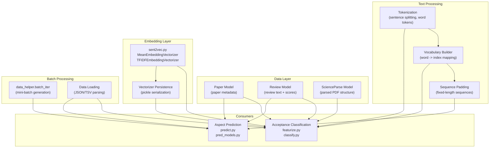
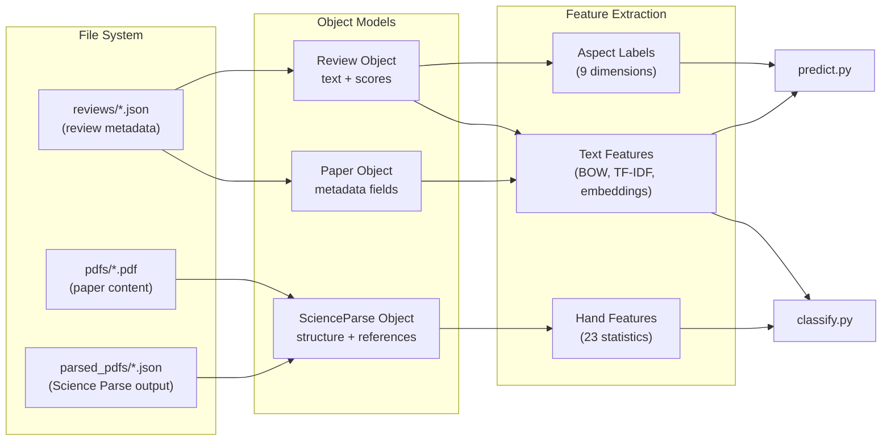
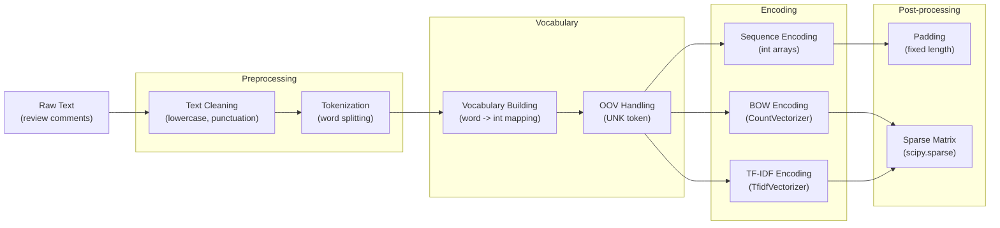
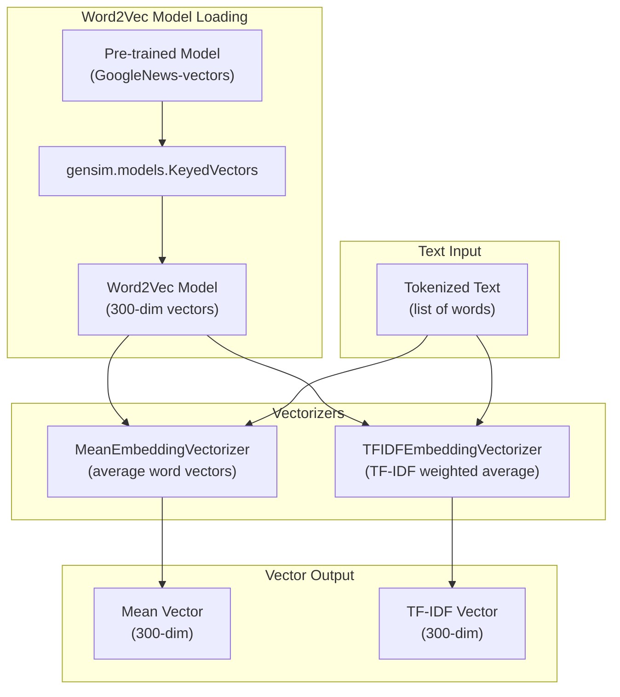
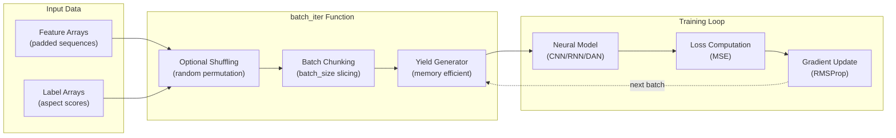
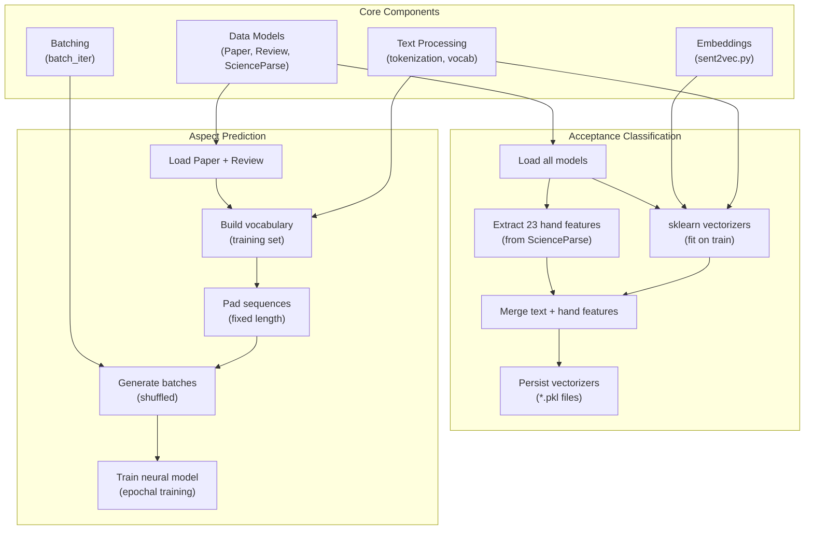
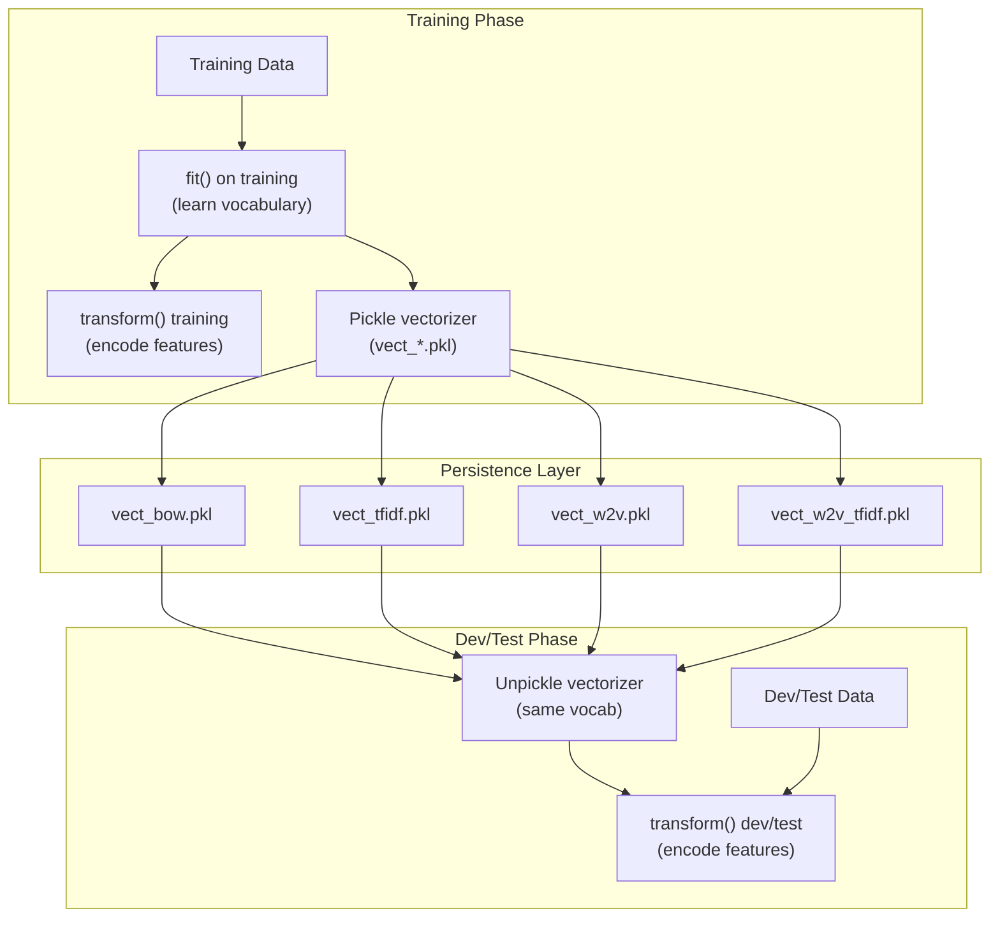
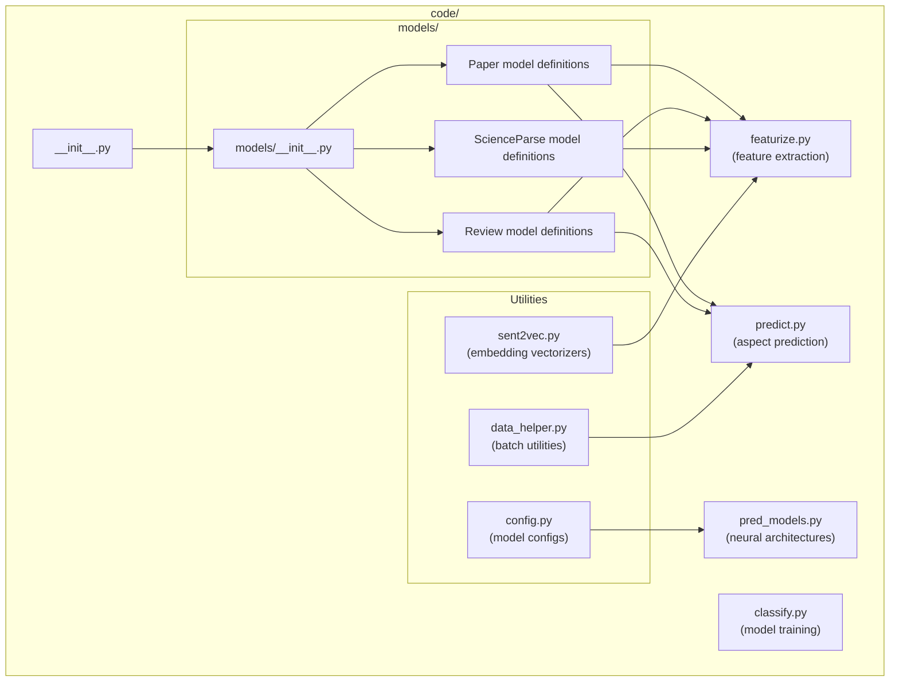

<!-- source: DeepWiki mcp.deepwiki.com · repo allenai/PeerRead · page 7 Core Components · fetched 2026-10-26 -->

# Core Components

Relevant source files

The following files were used as context for generating this wiki page:

- [code/__init__.py](code/__init__.py)
- [code/models/__init__.py](code/models/__init__.py)

## Purpose and Scope

This document provides an overview of the shared infrastructure components used across both the Acceptance Classification and Aspect Prediction pipelines in the PeerRead repository. These components include data models, text processing utilities, embedding management, and helper functions that enable consistent data handling throughout the system.

For detailed documentation of specific components:
- Data structure specifications: see [Data Models](#7.1)
- Utility function implementations: see [Data Helper Utilities](#7.2)

The components documented here form the foundation that both pipelines build upon, ensuring consistent data representation and processing across different modeling approaches.

---

## Component Architecture Overview

The PeerRead system is built on three layers of shared components: data models that represent core entities, text processing utilities that transform raw text into model inputs, and helper functions that manage data flow during training and evaluation.

### High-Level Component Relationships

**Sources:** Diagrams 1, 3, 4 from architecture overview

---

## Data Models

The system defines three primary data structures that represent the core entities in the PeerRead dataset. These models provide a consistent interface for accessing paper and review information across both pipelines.

### Model Responsibilities

| Model | Primary Responsibility | Key Attributes | Used By |
|-------|----------------------|----------------|---------|
| `Paper` | Paper metadata and content | Title, authors, abstract, venue | Both pipelines |
| `Review` | Review text and scores | Comments, ratings, aspects | Both pipelines |
| `ScienceParse` | Structured PDF content | Sections, references, figures | Acceptance classification |

### Data Model Interaction Pattern

**Sources:** [code/models/__init__.py:1](), Diagrams 1, 3, 4

The models are implemented as Python classes or dictionaries that parse JSON files from the dataset. Detailed field specifications are covered in [Data Models](#7.1).

---

## Text Processing Utilities

Text processing utilities provide standardized methods for converting raw text into numerical representations suitable for machine learning models. These utilities are shared across both pipelines but used differently depending on the modeling approach.

### Tokenization and Vocabulary Building

The system uses two approaches to vocabulary management:

**Acceptance Classification Approach:**
- Uses scikit-learn's built-in tokenization within vectorizers
- Vocabulary size determined by `max_vocab_size` parameter
- Vectorizers persisted as pickle files for consistent test-time encoding

**Aspect Prediction Approach:**
- Custom tokenization with NLTK sentence and word tokenizers
- Vocabulary built from training data with minimum frequency thresholds
- Special tokens: `<PAD>`, `<UNK>` for padding and unknown words

### Sequence Processing Pipeline

**Sources:** Diagrams 3, 4 from architecture overview

---

## Embedding Management

The `sent2vec.py` module provides utilities for converting text into dense vector representations using pre-trained Word2Vec embeddings. This component bridges the gap between sparse bag-of-words representations and dense semantic embeddings.

### Embedding Vectorizers

The system implements two custom vectorizers compatible with scikit-learn's transformer interface:

**Sources:** Diagram 3, [code/models/sent2vec.py]()

### Vectorizer Features

| Vectorizer Class | Aggregation Method | Use Case | Output Dimension |
|-----------------|-------------------|----------|------------------|
| `MeanEmbeddingVectorizer` | Arithmetic mean | Simple semantic representation | 300 |
| `TFIDFEmbeddingVectorizer` | TF-IDF weighted mean | Term-importance aware | 300 |

Both vectorizers implement the `fit()` and `transform()` interface, making them compatible with scikit-learn pipelines. They handle out-of-vocabulary words by skipping them during aggregation.

---

## Batch Processing and Data Loading

Data helper utilities manage the flow of data from disk to model inputs, handling batching, shuffling, and format conversions. These utilities are particularly important for the neural network training in the aspect prediction pipeline.

### Batch Iterator Implementation

The `data_helper.batch_iter` function generates mini-batches for training:

**Sources:** Diagram 4, [code/data_helper.py]()

### Data Loading Functions

| Function | Purpose | Input Format | Output Format |
|----------|---------|--------------|---------------|
| `load_papers` | Load paper metadata | JSON files | Paper objects/dicts |
| `load_reviews` | Load review data | JSON files | Review objects/dicts |
| `load_parsed_pdfs` | Load Science Parse output | JSON files | ScienceParse objects/dicts |
| `prepare_data` | Tokenize and build vocab | Raw text | Sequences + vocab dict |
| `batch_iter` | Generate mini-batches | NumPy arrays | Batch tuples |

---

## Cross-Pipeline Usage Patterns

The core components are utilized differently by each pipeline, reflecting their distinct modeling approaches:

### Component Usage Matrix

**Sources:** Diagrams 3, 4, 5

### Pipeline-Specific Patterns

**Acceptance Classification:**
- Loads all three data models (Paper, Review, ScienceParse)
- Creates dense feature vectors through featurization
- Persists fitted vectorizers for test-time consistency
- No batching required (linear models process full matrices)

**Aspect Prediction:**
- Loads only Paper and Review models
- Builds vocabulary from training data
- Uses sequence padding for fixed-length inputs
- Requires batching for mini-batch gradient descent
- Early stopping based on development set performance

---

## Vectorizer Persistence and Reuse

A critical design pattern in the acceptance classification pipeline is the persistence of fitted vectorizers. This ensures that feature spaces remain consistent across train, dev, and test splits.

### Vectorizer Lifecycle

**Sources:** Diagram 3, [code/featurize.py]()

This pattern prevents data leakage by ensuring that vocabulary and IDF statistics are computed only from training data, while dev and test data are encoded using the same learned parameters.

---

## Component Interaction Summary

The following table summarizes how core components integrate with the main pipeline scripts:

| Component | featurize.py | classify.py | predict.py | pred_models.py |
|-----------|-------------|-------------|------------|----------------|
| **Data Models** | Loads all three | Loads features | Loads Paper, Review | Receives preprocessed |
| **Tokenization** | Via sklearn | N/A | Custom NLTK | N/A |
| **Embeddings** | sent2vec vectorizers | N/A | Pre-trained (optional) | Embedding layer |
| **Vocabulary** | Built by vectorizers | N/A | Built from training | Embedding lookup |
| **Batching** | N/A | N/A | batch_iter | Consumes batches |
| **Persistence** | Saves vectorizers | Loads vectorizers | Saves checkpoints | N/A |

**Sources:** [code/featurize.py](), [code/classify.py](), [code/predict.py](), [code/pred_models.py](), Diagrams 3, 4

---

## Module Organization

The core components are organized into the following module structure:

**Sources:** [code/__init__.py:1](), [code/models/__init__.py:1]()

The `__init__.py` files enable Python package imports and may define module-level exports. The modular organization allows each pipeline to import only the components it requires.

---

## Configuration Management

Model configurations are centralized in configuration objects that define hyperparameters for both pipelines:

| Configuration Class | Pipeline | Key Parameters |
|--------------------|----------|----------------|
| `CNNConfig` | Aspect Prediction | `num_filters`, `kernel_sizes`, `fc_layers` |
| `RNNConfig` | Aspect Prediction | `rnn_type`, `num_layers`, `hidden_size` |
| `DANConfig` | Aspect Prediction | `embedding_dim`, `fc_layers` |
| Feature config | Acceptance Classification | `encoder_type`, `max_vocab_size`, `ngram_range` |

These configurations provide a standardized interface for hyperparameter tuning and experimental reproducibility.

**Sources:** Diagram 4, [code/config.py]()

---

For detailed information on specific components, refer to the following subsections:
- [Data Models](#7.1) - Detailed field specifications and loading procedures
- [Data Helper Utilities](#7.2) - Implementation details of utility functions

---

