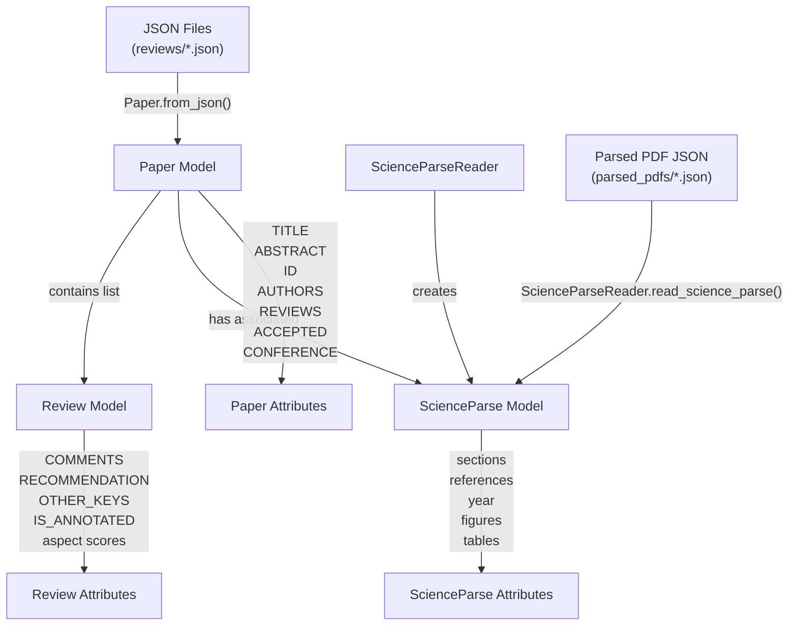
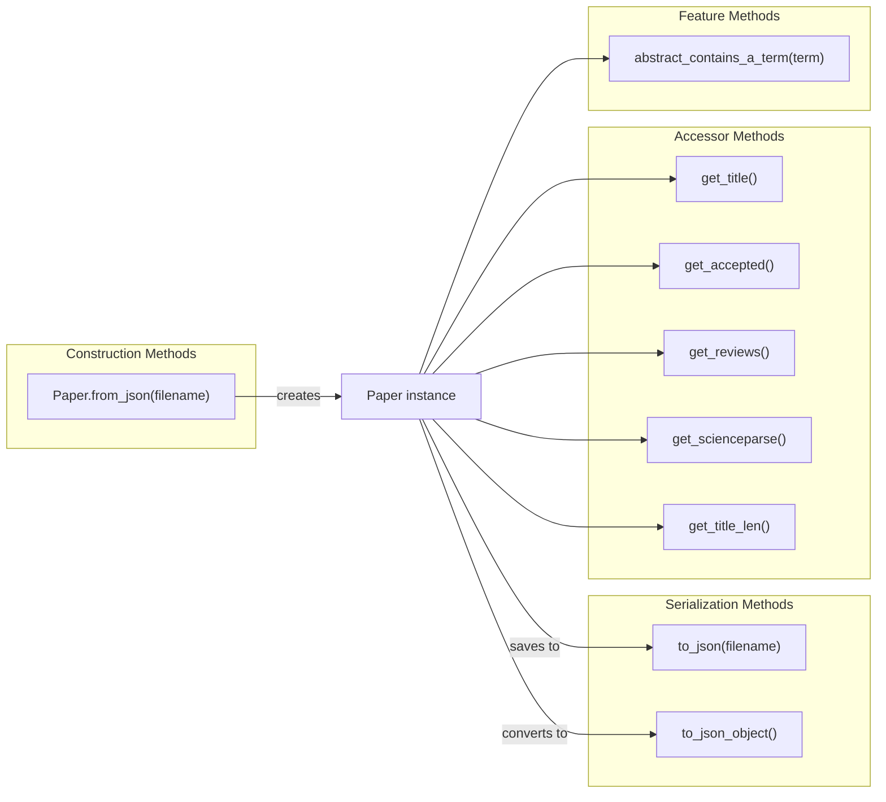
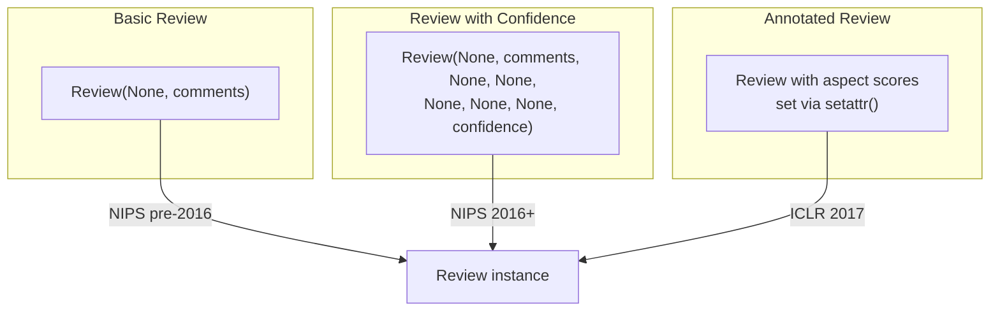
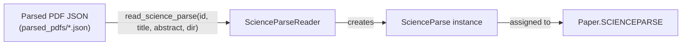
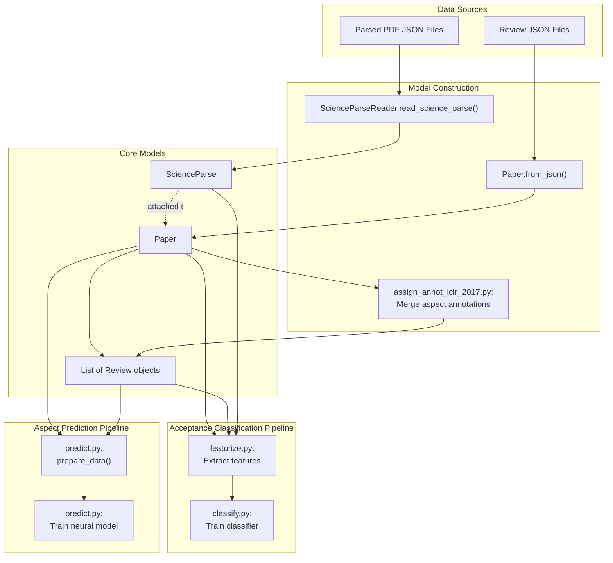

<!-- source: DeepWiki mcp.deepwiki.com · repo allenai/PeerRead · page 7.1 Data Models · fetched 2026-10-26 -->

# Data Models

<details>
<summary>Relevant source files</summary>

The following files were used as context for generating this wiki page:

- [code/accept_classify/featurize.py](code/accept_classify/featurize.py)
- [code/aspect_predict/assign_annot_iclr_2017.py](code/aspect_predict/assign_annot_iclr_2017.py)
- [code/data_prepare/crawler/NIPS_crawl.py](code/data_prepare/crawler/NIPS_crawl.py)

</details>


## Purpose and Scope

This document describes the core data models that represent the fundamental entities in the PeerRead dataset: **Paper**, **Review**, and **ScienceParse**. These models provide structured representations of academic papers, peer reviews, and parsed PDF metadata. They are used throughout both the acceptance classification pipeline ([5](#5)) and aspect prediction pipeline ([6](#6)).

For information about utility functions that work with these models (batching, padding, data loading), see [Data Helper Utilities](#7.2).

---

## Model Architecture Overview

The three core models form a hierarchical structure where a `Paper` contains multiple `Review` objects and has an associated `ScienceParse` object with PDF-extracted metadata:



**Sources:** [code/accept_classify/featurize.py:16-19](), [code/aspect_predict/assign_annot_iclr_2017.py:5-8](), [code/data_prepare/crawler/NIPS_crawl.py:10]()

---

## Paper Model

The `Paper` class represents an academic paper submission with its metadata, reviews, and acceptance status.

### Structure and Key Attributes

Based on usage patterns in the codebase, the `Paper` model contains the following core attributes:

| Attribute | Type | Description |
|-----------|------|-------------|
| `ID` | string | Unique identifier for the paper |
| `TITLE` | string | Paper title |
| `ABSTRACT` | string | Paper abstract text |
| `AUTHORS` | list | List of author names |
| `REVIEWS` | list of Review | Associated peer reviews |
| `ACCEPTED` | boolean | Acceptance/rejection status |
| `CONFERENCE` | string | Conference name (e.g., "NIPS2016", "ICLR") |
| `PUBLICATION_TYPE` | string | Type of publication (e.g., "Poster", "Oral") |
| `SCIENCEPARSE` | ScienceParse | Associated parsed PDF metadata |

**Sources:** [code/data_prepare/crawler/NIPS_crawl.py:84](), [code/aspect_predict/assign_annot_iclr_2017.py:72-75]()

### Key Methods

The `Paper` model provides methods for construction, serialization, and feature extraction:



**Sources:** [code/accept_classify/featurize.py:123-126, 269, 273, 302-322, 354](), [code/aspect_predict/assign_annot_iclr_2017.py:72, 103](), [code/data_prepare/crawler/NIPS_crawl.py:84, 86]()

### Usage Example from Featurize Pipeline

The following code pattern shows typical usage in the acceptance classification pipeline:

```python
# Loading papers from JSON
paper = Paper.from_json(paper_json_filename)

# Associating parsed PDF data
paper.SCIENCEPARSE = ScienceParseReader.read_science_parse(
    paper.ID, paper.TITLE, paper.ABSTRACT, scienceparse_dir
)

# Accessing attributes
title = paper.get_title()
accepted = paper.get_accepted()
reviews = paper.get_reviews()

# Feature extraction
has_deep = paper.abstract_contains_a_term("deep")
has_neural = paper.abstract_contains_a_term("neural")
```

**Sources:** [code/accept_classify/featurize.py:123-126, 269, 273, 302-306]()

---

## Review Model

The `Review` class represents a single peer review with optional aspect-level annotations.

### Structure and Key Attributes

| Attribute | Type | Description |
|-----------|------|-------------|
| `COMMENTS` | string | Review text/comments |
| `RECOMMENDATION` | string/int | Reviewer's recommendation |
| `OTHER_KEYS` | string | Additional metadata/identifier |
| `CONFIDENCE` | int | Reviewer confidence score |
| `IS_ANNOTATED` | boolean | Whether aspect annotations are present |

**Aspect Annotation Attributes** (when `IS_ANNOTATED=True`):

| Attribute | Type | Description |
|-----------|------|-------------|
| `RECOMMENDATION_UNOFFICIAL` | int | Unofficial recommendation score (1-9) |
| `SUBSTANCE` | int | Substance rating |
| `APPROPRIATENESS` | int | Appropriateness rating |
| `MEANINGFUL_COMPARISON` | int | Meaningful comparison rating |
| `SOUNDNESS_CORRECTNESS` | int | Soundness/correctness rating |
| `ORIGINALITY` | int | Originality rating |
| `CLARITY` | int | Clarity rating |
| `IMPACT` | int | Impact rating |

**Sources:** [code/data_prepare/crawler/NIPS_crawl.py:182, 208, 235](), [code/aspect_predict/assign_annot_iclr_2017.py:24-42, 85-91]()

### Construction Patterns

The `Review` model supports multiple construction patterns:



**Sources:** [code/data_prepare/crawler/NIPS_crawl.py:182, 208, 235](), [code/aspect_predict/assign_annot_iclr_2017.py:88-91]()

### Aspect Annotation Merging

In the aspect prediction pipeline, aspect annotations are merged into reviews from a separate annotation file:

```python
# Load annotation data
aspect_dic = {
    'ID': paper_id,
    'COMMENTS': comments,
    'OTHER_KEYS': other_keys,
    'RECOMMENDATION_UNOFFICIAL': score,
    'SUBSTANCE': score,
    'APPROPRIATENESS': score,
    'MEANINGFUL_COMPARISON': score,
    'SOUNDNESS_CORRECTNESS': score,
    'ORIGINALITY': score,
    'CLARITY': score,
    'IMPACT': score
}

# Match and merge with original review
if r_annotated['OTHER_KEYS'] == r_original.OTHER_KEYS:
    for k, v in r_annotated.items():
        if k in ['RECOMMENDATION_UNOFFICIAL', 'SUBSTANCE', ...]:
            setattr(r_combined, k, v)
    setattr(r_combined, 'IS_ANNOTATED', True)
```

**Sources:** [code/aspect_predict/assign_annot_iclr_2017.py:24-42, 85-91]()

---

## ScienceParse Model

The `ScienceParse` class encapsulates metadata extracted from PDF files using the external Science Parse tool ([9](#9)). It provides structured access to document structure, references, and linguistic features.

### Structure and Key Attributes

The model represents parsed PDF content including:

| Category | Attributes | Description |
|----------|------------|-------------|
| **Metadata** | year, authors | Publication year and author list |
| **Document Structure** | sections, figures, tables | Document organization |
| **References** | references, refmentions | Bibliography and citation contexts |
| **Content** | paper content | Full text of the paper |

**Sources:** [code/accept_classify/featurize.py:124-125, 273]()

### Feature Extraction Methods

The `ScienceParse` model provides numerous methods for extracting hand-crafted features:

```mermaid
graph TB
    ScienceParse["ScienceParse instance"]
    
    subgraph "Reference Features"
        GetNumRefs["get_num_references()"]
        GetRecentRefs["get_num_recent_references(year)"]
        GetMostRecentYear["get_most_recent_reference_year()"]
        GetNumRefMentions["get_num_refmentions()"]
        GetAvgRefContext["get_avg_length_reference_mention_contexts()"]
    end
    
    subgraph "Document Structure Features"
        GetNumSections["get_num_sections()"]
        GetNumFigures["get_num_ref_to_figures()"]
        GetNumTables["get_num_ref_to_tables()"]
        GetNumSectionRefs["get_num_ref_to_sections()"]
        GetContainsAppendix["get_contains_appendix()"]
        GetNumEquations["get_num_ref_to_equations()"]
        GetNumTheorems["get_num_ref_to_theorems()"]
    end
    
    subgraph "Linguistic Features"
        GetNumUniqWords["get_num_uniq_words()"]
        GetAvgSentLen["get_avg_sentence_length()"]
        GetFreqWordsProp["get_frequent_words_proportion()"]
        GetNumAuthors["get_num_authors()"]
    end
    
    subgraph "Content Access"
        GetPaperContent["get_paper_content()"]
    end
    
    ScienceParse --> GetNumRefs
    ScienceParse --> GetRecentRefs
    ScienceParse --> GetMostRecentYear
    ScienceParse --> GetNumRefMentions
    ScienceParse --> GetAvgRefContext
    ScienceParse --> GetNumSections
    ScienceParse --> GetNumFigures
    ScienceParse --> GetNumTables
    ScienceParse --> GetNumSectionRefs
    ScienceParse --> GetContainsAppendix
    ScienceParse --> GetNumEquations
    ScienceParse --> GetNumTheorems
    ScienceParse --> GetNumUniqWords
    ScienceParse --> GetAvgSentLen
    ScienceParse --> GetFreqWordsProp
    ScienceParse --> GetNumAuthors
    ScienceParse --> GetPaperContent
```



**Sources:** [code/accept_classify/featurize.py:234-260, 290-363]()

### Feature Extraction Usage Pattern

The acceptance classification pipeline extracts 23 hand-crafted features from `ScienceParse`:

```python
sp = paper.get_scienceparse()

# Reference statistics
most_recent_year = sp.get_most_recent_reference_year() - 2000
num_refs = sp.get_num_references()
num_refmentions = sp.get_num_refmentions()
avg_ref_context = sp.get_avg_length_reference_mention_contexts()
num_recent_refs = sp.get_num_recent_references(2017)

# Document structure
num_figures = sp.get_num_ref_to_figures()
num_tables = sp.get_num_ref_to_tables()
num_sections = sp.get_num_sections()
num_section_refs = sp.get_num_ref_to_sections()
contains_appendix = sp.get_contains_appendix()
num_equations = sp.get_num_ref_to_equations()
num_theorems = sp.get_num_ref_to_theorems()

# Linguistic features
num_uniq_words = sp.get_num_uniq_words()
avg_sent_len = sp.get_avg_sentence_length()
freq_words_prop = sp.get_frequent_words_proportion(hfws, mfw, lfw)
num_authors = sp.get_num_authors()
```

**Sources:** [code/accept_classify/featurize.py:290-363]()

---

## ScienceParseReader

The `ScienceParseReader` is a utility class that loads and creates `ScienceParse` objects from JSON files produced by the external Science Parse tool.

### Usage Pattern



**Sources:** [code/accept_classify/featurize.py:19, 124](), [code/aspect_predict/assign_annot_iclr_2017.py:8]()

### Typical Usage

The reader associates parsed PDF data with a `Paper` object:

```python
from models.ScienceParseReader import ScienceParseReader

# Create ScienceParse object from parsed PDF directory
paper.SCIENCEPARSE = ScienceParseReader.read_science_parse(
    paper.ID,           # Paper identifier
    paper.TITLE,        # Paper title (fallback)
    paper.ABSTRACT,     # Paper abstract (fallback)
    scienceparse_dir    # Directory containing parsed JSON files
)
```

**Sources:** [code/accept_classify/featurize.py:124]()

---

## Data Model Interactions Across Pipelines

The following diagram illustrates how the three models flow through the system's major pipelines:



**Sources:** [code/accept_classify/featurize.py:123-126](), [code/aspect_predict/assign_annot_iclr_2017.py:72-103]()

---

## Model Persistence and Serialization

### Paper Serialization

The `Paper` model supports JSON serialization for persistence:

| Method | Purpose | Usage Context |
|--------|---------|---------------|
| `Paper.from_json(filename)` | Deserialize from JSON file | Loading data in all pipelines |
| `paper.to_json(filename)` | Serialize to JSON file | NIPS crawler output |
| `paper.to_json_object()` | Convert to JSON-serializable dict | Annotation merging output |

**Sources:** [code/data_prepare/crawler/NIPS_crawl.py:86](), [code/aspect_predict/assign_annot_iclr_2017.py:103]()

### File Organization

Papers and their associated models are organized in the dataset structure:

```
data/
└── {venue}_{year}/
    └── {split}/
        ├── reviews/*.json          # Paper objects with reviews
        ├── parsed_pdfs/*.json      # ScienceParse source data
        └── dataset/                # Generated features
```

**Sources:** [code/accept_classify/featurize.py:82-84]()

---

## Summary

The three core data models provide structured access to the PeerRead dataset:

- **Paper**: Represents paper submissions with metadata, reviews, and acceptance status
- **Review**: Encapsulates peer review comments and optional aspect-level scores  
- **ScienceParse**: Provides PDF-extracted metadata and features for papers

These models are shared across both machine learning pipelines and serve as the foundation for feature extraction ([5.1](#5.1)), aspect prediction ([6](#6)), and data preparation ([4](#4)).

---

