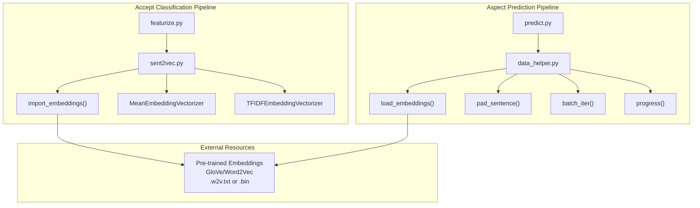
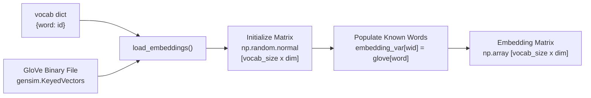
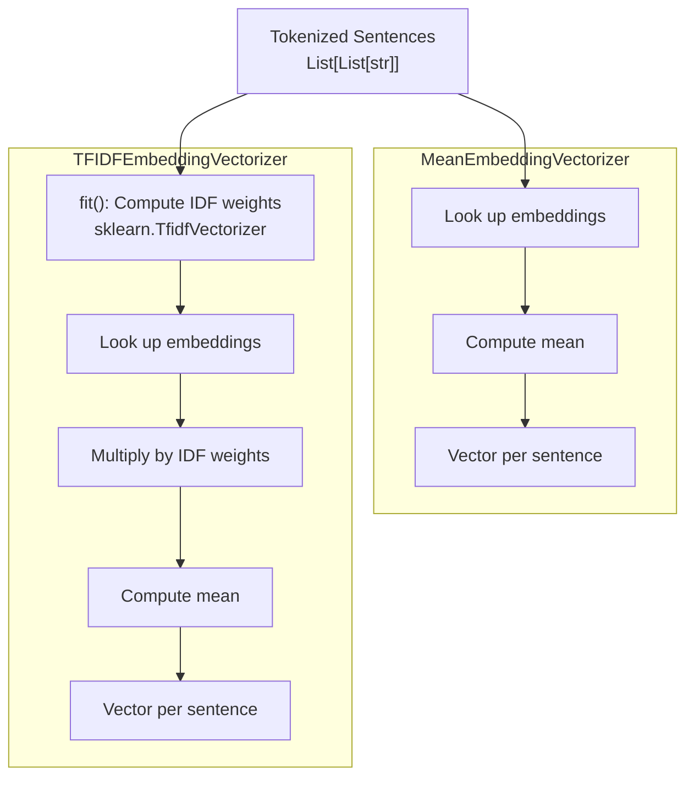
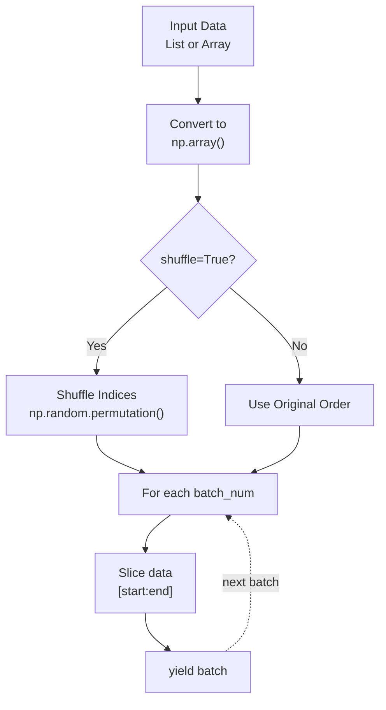
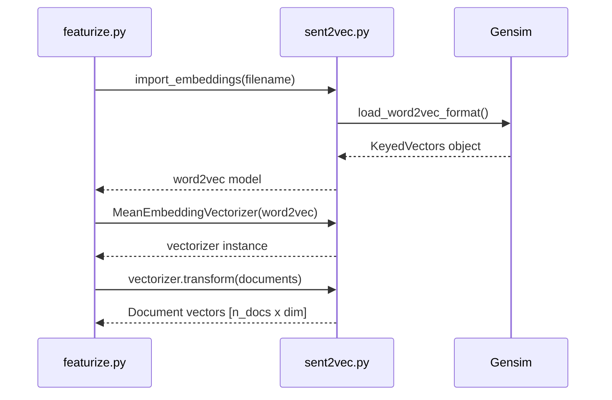
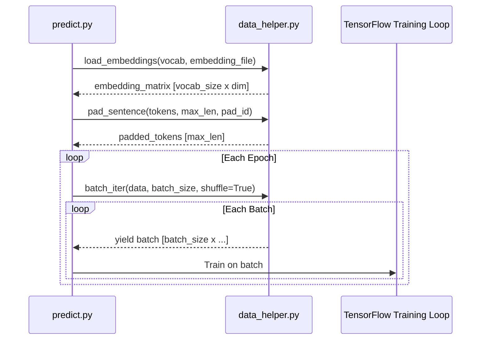

<!-- source: DeepWiki mcp.deepwiki.com · repo allenai/PeerRead · page 7.2 Data Helper Utilities · fetched 2026-10-26 -->

# Data Helper Utilities

<details>
<summary>Relevant source files</summary>

The following files were used as context for generating this wiki page:

- [code/accept_classify/sent2vec.py](code/accept_classify/sent2vec.py)
- [code/aspect_predict/data_helper.py](code/aspect_predict/data_helper.py)

</details>


## Purpose and Scope

This document describes the utility functions and helper classes used for data manipulation, embedding management, and batch processing across both the acceptance classification and aspect prediction pipelines. These utilities provide core functionality for loading word embeddings, encoding text into vector representations, padding sequences, and iterating over data in batches during training.

For information about the data structures that these utilities operate on (Paper, Review, ScienceParse objects), see [Data Models](#7.1). For details about how these utilities are used in feature extraction, see [Feature Extraction](#5.1) and [Text Encoding Methods](#5.2).

---

## Overview

The PeerRead repository contains two primary helper modules that provide data manipulation utilities:

| Module | Location | Primary Purpose |
|--------|----------|-----------------|
| `sent2vec.py` | `code/accept_classify/` | Embedding management and text vectorization for acceptance classification |
| `data_helper.py` | `code/aspect_predict/` | Sequence processing, batching, and embedding loading for aspect prediction |

These modules share similar functionality but are tailored to the specific needs of their respective pipelines:



Sources: [code/accept_classify/sent2vec.py:1-95](), [code/aspect_predict/data_helper.py:1-75]()

---

## Embedding Management

### Loading Pre-trained Word Embeddings

The `import_embeddings()` function loads pre-trained word vectors from disk using the Gensim library. It handles both text and binary formats and includes version compatibility for Python 2 and 3.

#### Function: `import_embeddings()`

**Location:** [code/accept_classify/sent2vec.py:11-21]()

**Signature:**
```python
def import_embeddings(filename="../../data/word2vec/glove.840B.300d.w2v.txt", binary=False)
```

**Parameters:**
- `filename` (str): Path to the word embedding file. Default is GloVe 840B embeddings with 300 dimensions.
- `binary` (bool): Whether the file is in binary format. Binary format loads faster.

**Returns:** A Gensim `Word2Vec` or `KeyedVectors` object containing the word embeddings.

**Implementation Details:**
- Uses `gensim.models.Word2Vec.load_word2vec_format()` for Python 2
- Uses `gensim.models.KeyedVectors.load_word2vec_format()` for Python 3
- Binary format recommended for speed improvements after initial conversion

#### Function: `load_embeddings()`

**Location:** [code/aspect_predict/data_helper.py:40-55]()

**Signature:**
```python
def load_embeddings(vocab, load=False)
```

This function creates an embedding matrix for a specific vocabulary, initializing out-of-vocabulary (OOV) words randomly.

**Parameters:**
- `vocab` (dict): Vocabulary mapping words to integer IDs
- `load` (str/bool): Path to binary word embedding file

**Returns:** A numpy array of shape `[vocab_size, embedding_dim]` containing embeddings.

**Process:**
1. Loads pre-trained embeddings using Gensim
2. Initializes embedding matrix with random values (mean=0.0, std=0.01)
3. Replaces random values with pre-trained vectors where available
4. Reports count of OOV words



Sources: [code/aspect_predict/data_helper.py:40-55]()

---

## Text Vectorization Classes

The `sent2vec.py` module provides two scikit-learn compatible vectorizer classes for converting tokenized text into fixed-dimensional vectors using word embeddings.

### Class: `MeanEmbeddingVectorizer`

**Location:** [code/accept_classify/sent2vec.py:23-51]()

Converts a sentence (list of tokens) into a single vector by averaging the word embeddings of all tokens.

#### Initialization

```python
MeanEmbeddingVectorizer(word2vec, word_counter=False)
```

**Parameters:**
- `word2vec`: A Gensim word embedding model
- `word_counter` (optional): Dictionary of word counts to filter the embedding vocabulary

**Attributes:**
- `self.word2vec`: The word embedding dictionary
- `self.dim`: Dimensionality of embeddings (determined from the embedding of 'a')

#### Methods

| Method | Purpose | Parameters | Returns |
|--------|---------|------------|---------|
| `fit(X, y=None)` | Sklearn-compatible fit (no-op) | Training data | self |
| `transform(X)` | Convert tokenized sentences to vectors | List of token lists | numpy array [n_samples x dim] |

**Transform Logic:**
- For each sentence (list of tokens):
  - Look up embeddings for all in-vocabulary words
  - Compute mean across all embeddings
  - If no words are in vocabulary, return zero vector

Sources: [code/accept_classify/sent2vec.py:23-51]()

### Class: `TFIDFEmbeddingVectorizer`

**Location:** [code/accept_classify/sent2vec.py:55-92]()

Similar to `MeanEmbeddingVectorizer`, but weights each word embedding by its TF-IDF score before averaging.

#### Initialization

```python
TFIDFEmbeddingVectorizer(word2vec, word_counter=False)
```

**Parameters:** Same as `MeanEmbeddingVectorizer`

**Additional Attributes:**
- `self.word2weight`: Dictionary mapping words to TF-IDF weights (computed during `fit()`)

#### Methods

| Method | Purpose | Details |
|--------|---------|---------|
| `fit(X, y=None)` | Compute TF-IDF weights from training data | Uses `TfidfVectorizer` from sklearn to compute IDF scores |
| `transform(X)` | Convert sentences to TF-IDF weighted vectors | Multiplies each word embedding by its IDF weight before averaging |

**Key Features:**
- Uses `TfidfVectorizer(analyzer=lambda x: x)` to work with pre-tokenized text
- Assigns max IDF to unseen words (conservative weighting)
- Returns zero vector for sentences with no in-vocabulary words



Sources: [code/accept_classify/sent2vec.py:55-92]()

---

## Sequence Processing Utilities

### Function: `pad_sentence()`

**Location:** [code/aspect_predict/data_helper.py:29-37]()

Pads or truncates a token sequence to a fixed length, essential for batching sequences of varying lengths in neural network training.

**Signature:**
```python
def pad_sentence(token_list, pad_length, pad_id, reverse=False)
```

**Parameters:**

| Parameter | Type | Description |
|-----------|------|-------------|
| `token_list` | list[int] | Sequence of token IDs to pad |
| `pad_length` | int | Target length for the sequence |
| `pad_id` | int | ID to use for padding tokens (typically 0) |
| `reverse` | bool | If True, add padding at start and reverse sequence |

**Returns:** Padded list of length `pad_length`

**Behavior:**
- If `len(token_list) < pad_length`: Adds `pad_id` tokens to fill
- If `len(token_list) > pad_length`: Truncates to `pad_length`
- If `reverse=True`: Reverses the token list and pads at the beginning
- If `reverse=False`: Pads at the end

**Usage Example (conceptual):**
```
token_list = [45, 23, 67, 12]
pad_length = 7
pad_id = 0

Normal: [45, 23, 67, 12, 0, 0, 0]
Reverse: [0, 0, 0, 12, 67, 23, 45]
```

Sources: [code/aspect_predict/data_helper.py:29-37]()

---

## Batch Iteration

### Function: `batch_iter()`

**Location:** [code/aspect_predict/data_helper.py:58-73]()

Creates an iterator that yields batches of data for mini-batch training. This is a critical utility for the neural network training loop in aspect prediction.

**Signature:**
```python
def batch_iter(data, batch_size, shuffle=True)
```

**Parameters:**

| Parameter | Type | Description |
|-----------|------|-------------|
| `data` | array-like | Input data to batch (converted to numpy array) |
| `batch_size` | int | Number of samples per batch |
| `shuffle` | bool | Whether to shuffle data before batching |

**Returns:** Generator yielding numpy arrays of shape `[batch_size, ...]`

**Implementation Details:**
1. Converts input to numpy array
2. Calculates number of batches: `⌈data_size / batch_size⌉`
3. Optionally shuffles data using `np.random.permutation()`
4. Yields batches sequentially
5. Last batch may be smaller if data size is not divisible by batch size



Sources: [code/aspect_predict/data_helper.py:58-73]()

---

## Progress Tracking

### Function: `progress()`

**Location:** [code/aspect_predict/data_helper.py:10-26]()

Displays a console progress bar for long-running operations, useful for monitoring data loading and processing tasks.

**Signature:**
```python
def progress(progress, status="")
```

**Parameters:**
- `progress` (float or int): Progress value between 0.0 and 1.0 (or 0 to 100 if int)
- `status` (str): Optional status message to display

**Output Format:**
```
Percent: [###############] 100.00% | Finished.
```

**Features:**
- 15-character progress bar with `#` symbols
- Percentage display with 2 decimal places
- Custom status message support
- Automatic error handling for invalid progress values
- Uses `\r` for in-place updating (overwrites same line)

Sources: [code/aspect_predict/data_helper.py:10-26]()

---

## Usage Patterns

### Pattern 1: Loading Embeddings for Feature Extraction

Used in the acceptance classification pipeline to create Word2Vec-based text encoders.



**Code Locations:**
- Import: [code/accept_classify/sent2vec.py:11-21]()
- Vectorizer: [code/accept_classify/sent2vec.py:23-51]()

Sources: [code/accept_classify/sent2vec.py:11-51]()

### Pattern 2: Preparing Data for Neural Network Training

Used in the aspect prediction pipeline to process sequences and create batches.



**Code Locations:**
- Embedding loading: [code/aspect_predict/data_helper.py:40-55]()
- Padding: [code/aspect_predict/data_helper.py:29-37]()
- Batching: [code/aspect_predict/data_helper.py:58-73]()

Sources: [code/aspect_predict/data_helper.py:29-73]()

---

## Dependencies

Both helper modules rely on the following external libraries:

| Library | Purpose | Version Requirements |
|---------|---------|----------------------|
| `numpy` | Array operations, random initialization | Standard scientific Python |
| `gensim` | Loading pre-trained word embeddings | Compatible with both Python 2 and 3 |
| `sklearn` | TF-IDF computation, vectorizer interface | For TFIDFEmbeddingVectorizer |

**Import Statements:**
- [code/accept_classify/sent2vec.py:4-9](): numpy, gensim, sklearn, collections, dill
- [code/aspect_predict/data_helper.py:5-6](): os, re, sys, json, logging, itertools, gensim, numpy, functools, random

Sources: [code/accept_classify/sent2vec.py:1-9](), [code/aspect_predict/data_helper.py:1-8]()

---

## Summary

The data helper utilities provide essential infrastructure for both machine learning pipelines in PeerRead:

1. **Embedding Management**: Loading and managing pre-trained word vectors with vocabulary filtering
2. **Text Vectorization**: Converting tokenized text to fixed-dimensional vectors via averaging (simple or TF-IDF weighted)
3. **Sequence Processing**: Padding token sequences to uniform length for neural network batch processing
4. **Batch Iteration**: Creating mini-batches with optional shuffling for training
5. **Progress Tracking**: Visual feedback for long-running operations

These utilities are designed to be reusable across different parts of the codebase and follow scikit-learn conventions where appropriate (e.g., `fit()` and `transform()` methods in vectorizers).

---

