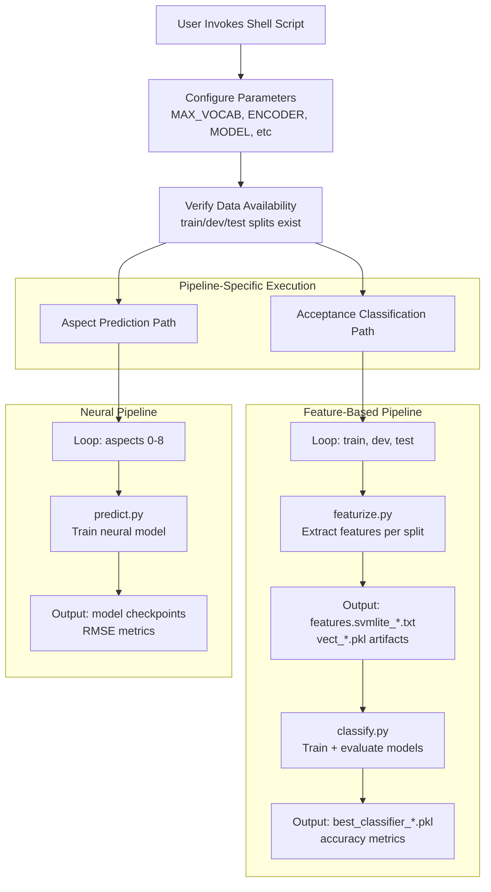
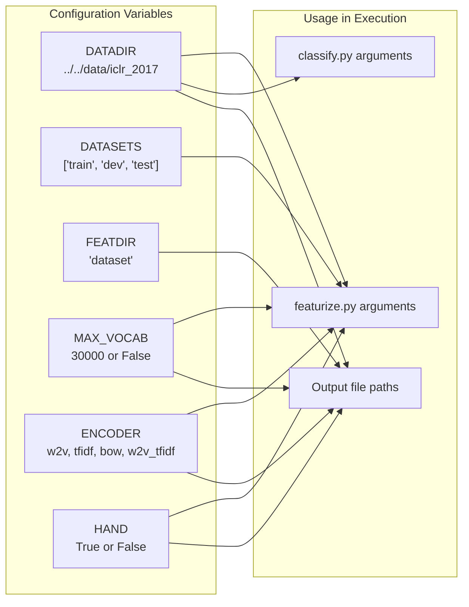
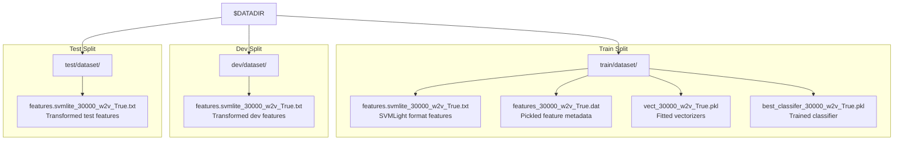
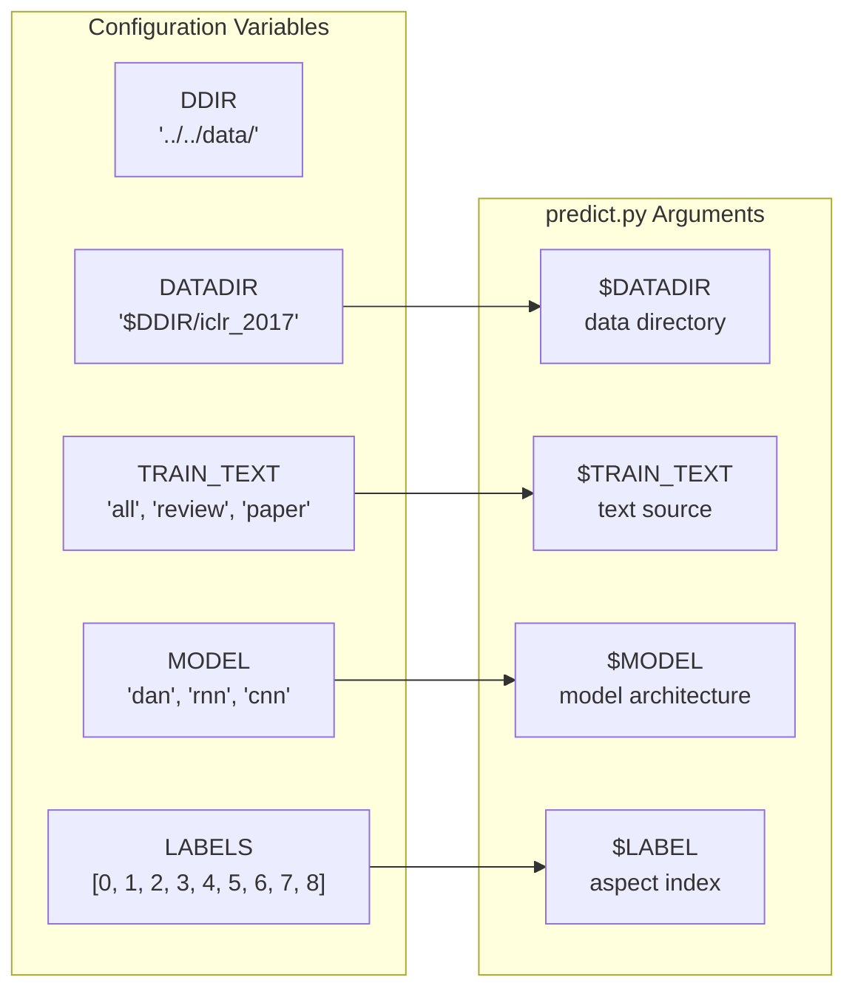
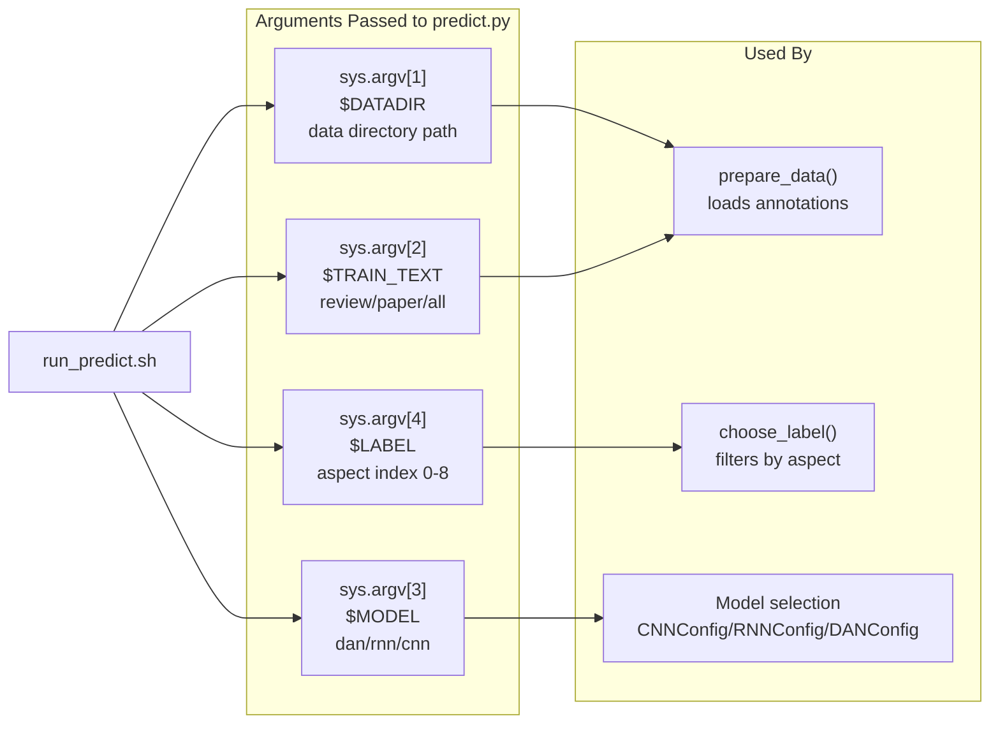
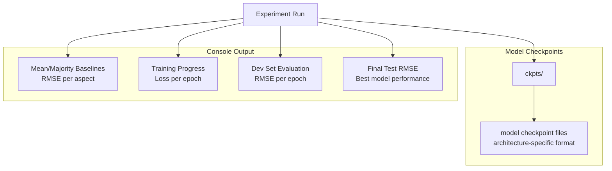

<!-- source: DeepWiki mcp.deepwiki.com · repo allenai/PeerRead · page 8 Running Experiments · fetched 2026-10-26 -->

# Running Experiments

<details>
<summary>Relevant source files</summary>

The following files were used as context for generating this wiki page:

- [code/accept_classify/run_classify.sh](code/accept_classify/run_classify.sh)
- [code/accept_classify/run_featurize_classify.sh](code/accept_classify/run_featurize_classify.sh)
- [code/aspect_predict/run_predict.sh](code/aspect_predict/run_predict.sh)

</details>


## Purpose and Scope

This document provides a practical guide to executing machine learning experiments in the PeerRead repository. It covers how to run the shell scripts that orchestrate both the acceptance classification and aspect prediction pipelines, configure experimental parameters, and locate output artifacts.

For detailed information about the underlying feature extraction process, see [Feature Extraction](#5.1). For neural model architectures and training procedures, see [Neural Network Models](#6.2) and [Training and Evaluation](#6.3). For data preparation that must precede experiments, see [Data Preparation Pipeline](#4).

---

## Overview

The PeerRead repository provides two main shell scripts for running experiments:

| Pipeline | Shell Script | Purpose |
|----------|-------------|---------|
| Acceptance Classification | `run_featurize_classify.sh` | Feature extraction + linear model training |
| Aspect Prediction | `run_predict.sh` | Neural network training for aspect score prediction |

Both scripts are designed to run end-to-end experiments with minimal manual intervention, handling data loading, model training, evaluation, and artifact persistence automatically.

---

## Experiment Execution Flow

The following diagram shows the high-level execution pattern common to both pipelines:

**Diagram: End-to-End Experiment Execution Pattern**



Sources: [code/accept_classify/run_featurize_classify.sh:1-41](), [code/aspect_predict/run_predict.sh:1-17]()

---

## Acceptance Classification Experiments

### Script Configuration

The `run_featurize_classify.sh` script controls the acceptance classification pipeline through several key configuration variables set at the top of the file:

**Diagram: Acceptance Classification Configuration Parameters**



Sources: [code/accept_classify/run_featurize_classify.sh:4-9]()

**Configuration Parameter Details:**

| Parameter | Type | Purpose | Common Values |
|-----------|------|---------|---------------|
| `DATADIR` | Path | Root directory containing train/dev/test splits | `../../data/iclr_2017` |
| `DATASETS` | Array | Dataset splits to process | `("train" "dev" "test")` |
| `FEATDIR` | String | Subdirectory name for feature outputs | `dataset` |
| `MAX_VOCAB` | Integer or False | Maximum vocabulary size for text encoding | `30000`, `False` |
| `ENCODER` | String | Text encoding strategy | `w2v`, `tfidf`, `bow`, `w2v_tfidf` |
| `HAND` | Boolean | Include hand-crafted features | `True`, `False` |

Sources: [code/accept_classify/run_featurize_classify.sh:4-9]()

### Execution Phases

The script executes in two sequential phases:

**Phase 1: Feature Extraction (lines 14-26)**

The script iterates over all dataset splits and invokes `featurize.py` for each:

```bash
for DATASET in "${DATASETS[@]}"
do
    python featurize.py \
        $DATADIR/$DATASET/reviews/ \
        $DATADIR/$DATASET/parsed_pdfs/ \
        $DATADIR/$DATASET/$FEATDIR \
        $DATADIR/train/$FEATDIR/features_${MAX_VOCAB}_${ENCODER}_${HAND}.dat \
        $DATADIR/train/$FEATDIR/vect_${MAX_VOCAB}_${ENCODER}_${HAND}.pkl \
        $MAX_VOCAB $ENCODER $HAND
done
```

**Key behaviors:**
- Cleans output directory before each run: `rm -rf $DATADIR/$DATASET/$FEATDIR` [code/accept_classify/run_featurize_classify.sh:17]()
- Passes training split's vectorizer artifacts to dev/test to ensure consistent feature spaces
- Outputs runtime statistics: `echo "run-time: $(expr date +%s - $start_time) s"` [code/accept_classify/run_featurize_classify.sh:27]()

Sources: [code/accept_classify/run_featurize_classify.sh:14-27]()

**Phase 2: Classification (lines 30-38)**

After feature extraction completes, the script trains and evaluates models:

```bash
python classify.py \
    $DATADIR/train/$FEATDIR/features.svmlite_${MAX_VOCAB}_${ENCODER}_${HAND}.txt \
    $DATADIR/dev/$FEATDIR/features.svmlite_${MAX_VOCAB}_${ENCODER}_${HAND}.txt \
    $DATADIR/test/$FEATDIR/features.svmlite_${MAX_VOCAB}_${ENCODER}_${HAND}.txt \
    $DATADIR/train/$FEATDIR/best_classifer_${MAX_VOCAB}_${ENCODER}_${HAND}.pkl \
    $DATADIR/train/$FEATDIR/features_${MAX_VOCAB}_${ENCODER}_${HAND}.dat
```

Sources: [code/accept_classify/run_featurize_classify.sh:32-37]()

### Output Artifacts

The acceptance classification pipeline produces the following artifacts:

**Diagram: Acceptance Classification Output Structure**



Sources: [code/accept_classify/run_featurize_classify.sh:19-37]()

**File Naming Convention:**

All output files follow the pattern: `{base_name}_{MAX_VOCAB}_{ENCODER}_{HAND}.{ext}`

Example with `MAX_VOCAB=30000`, `ENCODER=w2v`, `HAND=True`:
- `features.svmlite_30000_w2v_True.txt`
- `vect_30000_w2v_True.pkl`
- `best_classifer_30000_w2v_True.pkl`

Sources: [code/accept_classify/run_featurize_classify.sh:22-36]()

### Running the Experiment

**Prerequisites:**
1. Data must be prepared (see [Data Preparation Pipeline](#4))
2. Working directory must be `code/accept_classify/`

**Execution command:**
```bash
cd code/accept_classify/
./run_featurize_classify.sh
```

**Modifying configuration:**
Edit the configuration variables at the top of the script before execution. For example, to use TF-IDF encoding without hand features:

```bash
ENCODER=tfidf
HAND=False
```

Sources: [code/accept_classify/run_featurize_classify.sh:1-41]()

---

## Aspect Prediction Experiments

### Script Configuration

The `run_predict.sh` script controls aspect prediction experiments through these configuration variables:

**Diagram: Aspect Prediction Configuration**



Sources: [code/aspect_predict/run_predict.sh:2-8]()

**Configuration Parameter Details:**

| Parameter | Type | Purpose | Valid Values |
|-----------|------|---------|--------------|
| `DDIR` | Path | Base data directory | `../../data/` |
| `DATADIR` | Path | Dataset-specific directory | `$DDIR/iclr_2017`, `$DDIR/acl_2017` |
| `LABELS` | Array | Aspect indices to predict | `0` through `8` (9 aspects total) |
| `TRAIN_TEXT` | String | Input text type | `all`, `review`, `paper` |
| `MODEL` | String | Neural architecture | `dan`, `rnn`, `cnn` |

Sources: [code/aspect_predict/run_predict.sh:2-8]()

### Execution Loop

The script loops over aspect labels, training a separate model for each:

```bash
for LABEL in "${LABELS[@]}"
do
  echo "Predicting aspect on..." Data=$DATADIR Model=$MODEL Text=$TRAIN_TEXT Label=$LABEL
  python predict.py $DATADIR $TRAIN_TEXT $MODEL $LABEL
  exit
done
```

**Note:** The script contains `exit` after the first iteration [code/aspect_predict/run_predict.sh:13](), which means it only trains one aspect model per execution. To train all 9 aspects, either:
1. Remove the `exit` statement
2. Run the script 9 times with different `LABEL` values

Sources: [code/aspect_predict/run_predict.sh:9-14]()

### Command-Line Arguments to predict.py

The `predict.py` script receives four positional arguments:

**Diagram: predict.py Argument Flow**



Sources: [code/aspect_predict/run_predict.sh:12]()

### Output Artifacts

Aspect prediction experiments produce model checkpoints and evaluation metrics:

**Diagram: Aspect Prediction Output Structure**



Sources: [code/aspect_predict/run_predict.sh:1-17]()

### Running the Experiment

**Prerequisites:**
1. Data must be prepared with aspect annotations merged (see [Aspect Annotations](#6.1))
2. Working directory must be `code/aspect_predict/`

**Execution command:**
```bash
cd code/aspect_predict/
./run_predict.sh
```

**Training a single aspect:**
To train only aspect 3 with RNN on review text:
```bash
TRAIN_TEXT="review"
MODEL="rnn"
LABELS=(3)
```

**Training all aspects:**
Remove the `exit` statement on line 13 or run the script multiple times with different `LABEL` values.

Sources: [code/aspect_predict/run_predict.sh:1-17]()

---

## Alternative Scripts

The repository includes an alternative script for acceptance classification:

### run_classify.sh

This script [code/accept_classify/run_classify.sh:1-36]() provides a similar pipeline to `run_featurize_classify.sh` but with some differences:

**Key differences:**

| Aspect | run_featurize_classify.sh | run_classify.sh |
|--------|---------------------------|-----------------|
| Default `MAX_VOCAB` | `30000` | `False` (no limit) |
| Data directory | Hardcoded to `iclr_2017` | Uses `DATADIR` array for multiple datasets |
| Configuration | Single dataset | Supports multiple datasets via array |

Sources: [code/accept_classify/run_classify.sh:1-36](), [code/accept_classify/run_featurize_classify.sh:1-41]()

---

## Configuration Matrix

The following table shows common experimental configurations and their use cases:

### Acceptance Classification Configurations

| Configuration | `ENCODER` | `MAX_VOCAB` | `HAND` | Use Case |
|---------------|-----------|-------------|--------|----------|
| Baseline BOW | `bow` | `30000` | `False` | Simple baseline without embeddings |
| TF-IDF Only | `tfidf` | `30000` | `False` | Weighted term importance |
| Word2Vec + Features | `w2v` | `30000` | `True` | Best reported performance |
| Word2Vec TF-IDF | `w2v_tfidf` | `30000` | `False` | Weighted embeddings |
| Full Vocabulary | Any | `False` | Any | No vocabulary limit |

### Aspect Prediction Configurations

| Configuration | `MODEL` | `TRAIN_TEXT` | Use Case |
|---------------|---------|--------------|----------|
| CNN on Reviews | `cnn` | `review` | Local pattern detection in reviews |
| RNN on Papers | `rnn` | `paper` | Sequential modeling of paper content |
| DAN on Combined | `dan` | `all` | Fast training on all text |
| RNN on Combined | `rnn` | `all` | Best sequential modeling |

Sources: [code/accept_classify/run_featurize_classify.sh:7-9](), [code/aspect_predict/run_predict.sh:6-7]()

---

## Execution Time Considerations

Both scripts include timing instrumentation:

**Acceptance classification:**
- Separate timers for feature extraction and classification phases
- Timing output: `echo "run-time: $(expr date +%s - $start_time) s"` [code/accept_classify/run_featurize_classify.sh:27,38]()

**Typical execution times:**
- Feature extraction: 5-15 minutes per split (depends on corpus size and `ENCODER`)
- Classification: 2-10 minutes (depends on cross-validation folds and model complexity)

**Aspect prediction:**
- No built-in timing in `run_predict.sh`
- Typical training time: 30-120 minutes per aspect (depends on `MODEL` and corpus size)
- Early stopping can reduce time significantly

Sources: [code/accept_classify/run_featurize_classify.sh:13,27,30,38]()

---

## Common Execution Patterns

### Running Multiple Experiments in Parallel

Since aspect prediction trains independent models per aspect, experiments can be parallelized:

```bash
# Terminal 1
LABELS=(0 1 2)
./run_predict.sh

# Terminal 2  
LABELS=(3 4 5)
./run_predict.sh

# Terminal 3
LABELS=(6 7 8)
./run_predict.sh
```

### Comparing Text Encoders

To compare different text encoding strategies for acceptance classification:

```bash
# Experiment 1: Word2Vec
ENCODER=w2v
./run_featurize_classify.sh

# Experiment 2: TF-IDF
ENCODER=tfidf
./run_featurize_classify.sh

# Experiment 3: BOW
ENCODER=bow
./run_featurize_classify.sh
```

### Ablation Studies

To measure the impact of hand-crafted features:

```bash
# With hand features
HAND=True
./run_featurize_classify.sh

# Without hand features
HAND=False
./run_featurize_classify.sh
```

Sources: [code/accept_classify/run_featurize_classify.sh:7-9](), [code/aspect_predict/run_predict.sh:6-7]()

---

## Interpreting Results

### Acceptance Classification Output

The `classify.py` script outputs:
1. **Training accuracy** from cross-validation on training set
2. **Development set accuracy** for model selection
3. **Test set accuracy** for final evaluation
4. **Best model saved** to `.pkl` file

Results are printed to console during execution.

### Aspect Prediction Output

The `predict.py` script outputs:
1. **Baseline RMSE** (mean and majority predictions)
2. **Training loss** per epoch
3. **Development RMSE** per epoch
4. **Test RMSE** for best development checkpoint
5. **Per-aspect RMSE** when evaluating all 9 aspects

All metrics are printed to console. No automatic logging to files is implemented.

Sources: [code/accept_classify/run_featurize_classify.sh:31-38](), [code/aspect_predict/run_predict.sh:9-14]()

---

## Troubleshooting

### Common Issues

**Issue: "No such file or directory" errors**
- **Cause:** Data not prepared or incorrect `DATADIR` path
- **Solution:** Verify data preparation completed (see [Data Preparation Pipeline](#4)) and check path variables

**Issue: Feature extraction fails on dev/test splits**
- **Cause:** Training split must be processed first to create vectorizer artifacts
- **Solution:** Ensure the `DATASETS` array has `"train"` as the first element [code/accept_classify/run_featurize_classify.sh:5]()

**Issue: Out of memory during aspect prediction**
- **Cause:** Batch size or model size too large
- **Solution:** Modify configuration in `config.py` (see [Neural Network Models](#6.2))

**Issue: Aspect prediction only trains one aspect**
- **Cause:** `exit` statement on line 13
- **Solution:** Remove `exit` statement from `run_predict.sh` [code/aspect_predict/run_predict.sh:13]()

Sources: [code/accept_classify/run_featurize_classify.sh:5,14-24](), [code/aspect_predict/run_predict.sh:13]()

---

