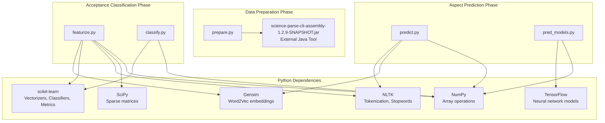
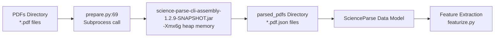
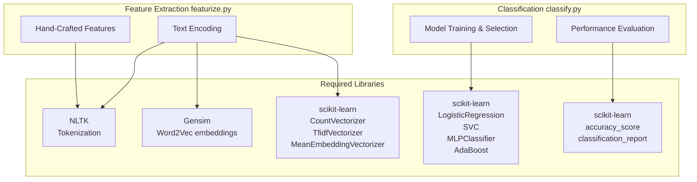
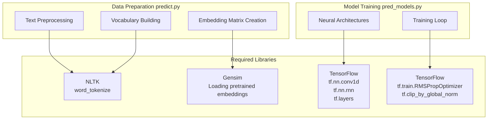

<!-- source: DeepWiki mcp.deepwiki.com · repo allenai/PeerRead · page 9 External Dependencies · fetched 2026-10-26 -->

# External Dependencies

<details>
<summary>Relevant source files</summary>

The following files were used as context for generating this wiki page:

- [README.md](README.md)
- [code/data_prepare/prepare.py](code/data_prepare/prepare.py)
- [code/lib/.keep](code/lib/.keep)

</details>


## Purpose and Scope

This document catalogs all external tools and libraries required by the PeerRead system. The repository depends on both a critical external Java application (Science Parse) for PDF processing and a suite of Python machine learning libraries for feature extraction and model training.

For information about how these dependencies are used within specific pipelines, see [Acceptance Classification Pipeline](#5) and [Aspect Prediction Pipeline](#6). For installation procedures, see [Getting Started](#2).

---

## Overview of External Dependencies

The PeerRead system has two categories of external dependencies:

1. **External Tools**: Science Parse, a standalone Java application for parsing scientific PDFs
2. **Python Libraries**: Machine learning, NLP, and scientific computing libraries

The following diagram shows how these dependencies map to different components of the system:



**Sources:** [README.md:1-36](), [code/data_prepare/prepare.py:1-127]()

---

## Science Parse: PDF to Structured JSON Converter

### What is Science Parse?

Science Parse is an external Java application developed by the Allen Institute for AI (AI2) that extracts structured information from scientific papers in PDF format. It is the **most critical external dependency** in the PeerRead system, as it transforms raw PDFs into machine-readable JSON containing:

- Paper title and abstract
- Author information
- Section structure
- References (bibliography)
- Figures and tables metadata
- Year of publication

### Integration Point

Science Parse is invoked during the data preparation phase by [code/data_prepare/prepare.py:69]():

```python
os.system('java -Xmx6g -jar ../lib/science-parse-cli-assembly-1.2.9-SNAPSHOT.jar %s -o %s'%(pdf_dir,science_dir))
```

This command:
- Allocates 6GB of heap memory (`-Xmx6g`)
- Executes the JAR file located at `../lib/science-parse-cli-assembly-1.2.9-SNAPSHOT.jar`
- Processes all PDFs in the input directory (`pdf_dir`)
- Outputs JSON files to the science parse directory (`science_dir`)

### File Storage Location

The Science Parse JAR file is expected to be located at:

```
code/lib/science-parse-cli-assembly-1.2.9-SNAPSHOT.jar
```

The `code/lib/` directory exists as indicated by [code/lib/.keep:1]().

### Output Format

For each input PDF `{paper_id}.pdf`, Science Parse generates a corresponding `{paper_id}.pdf.json` file containing structured metadata. This parsed data is then loaded by the `ScienceParse` data model class during feature extraction.

### Dependency Flow



**Sources:** [code/data_prepare/prepare.py:64-74](), [README.md:14]()

---

## Python Library Dependencies

### Machine Learning and NLP Core Libraries

The system requires several Python libraries that provide different capabilities across the two main pipelines:

| Library | Primary Use | Used By | Key Functionality |
|---------|-------------|---------|-------------------|
| **Gensim** | Word embeddings | Acceptance Classification, Aspect Prediction | Pre-trained Word2Vec models, embedding loading |
| **scikit-learn** | Feature engineering & classification | Acceptance Classification | `CountVectorizer`, `TfidfVectorizer`, `LogisticRegression`, `SVC`, `MLPClassifier` |
| **TensorFlow** | Neural networks | Aspect Prediction only | CNN, RNN, DAN model implementations |
| **NLTK** | Text preprocessing | Both pipelines | Tokenization, stopword filtering |

### Supporting Scientific Computing Libraries

| Library | Purpose | Usage Examples |
|---------|---------|----------------|
| **NumPy** | Array operations | Matrix manipulations, numerical computations throughout |
| **SciPy** | Sparse matrices | SVMLight format for feature persistence |
| **glob** | File pattern matching | Finding PDF/JSON files in directories |
| **sklearn.model_selection** | Data splitting | `train_test_split` for creating data partitions |

**Sources:** [code/data_prepare/prepare.py:1-8](), [README.md:14]()

---

## Dependency Installation and Management

### Setup Script

The repository provides a setup script at the root directory:

```bash
./setup.sh
```

This script, as mentioned in [README.md:14](), handles:
1. Installing Python package dependencies
2. Downloading larger data files not included in the repository
3. Setting up the Science Parse JAR file (if not already present)

### Manual Installation

Users can also manually install dependencies using standard Python package managers. The repository structure suggests dependencies should be managed through:

- **pip** or **conda** for Python libraries
- Manual download and placement of Science Parse JAR into `code/lib/`

### Version Compatibility

Based on the Science Parse JAR filename, the system uses:
- **Science Parse**: version 1.2.9-SNAPSHOT
- **Python libraries**: No explicit version pinning is visible in the provided files, suggesting compatibility with standard recent versions

**Sources:** [README.md:14](), [code/lib/.keep:1]()

---

## Dependency Usage by Pipeline

### Acceptance Classification Pipeline Dependencies



**Key Dependencies:**
- `sklearn.feature_extraction.text.CountVectorizer`: Bag-of-words encoding
- `sklearn.feature_extraction.text.TfidfVectorizer`: TF-IDF encoding
- `gensim.models.KeyedVectors`: Loading pre-trained Word2Vec models
- `nltk.corpus.stopwords`: Stopword filtering during preprocessing

**Sources:** Inferred from architecture diagrams and acceptance classification pipeline structure

---

### Aspect Prediction Pipeline Dependencies



**Key Dependencies:**
- `tensorflow`: Required for all neural network models (CNN, RNN, DAN)
- `nltk.tokenize.word_tokenize`: Tokenizing review text
- `gensim.models.KeyedVectors`: Loading GloVe or Word2Vec embeddings
- `numpy`: Array operations for batch processing

**TensorFlow Components Used:**
- `tf.nn.conv1d`: 1D convolutions for CNN model
- `tf.nn.rnn_cell.LSTMCell` / `GRUCell`: Recurrent units for RNN model
- `tf.train.RMSPropOptimizer`: Optimization algorithm
- `tf.clip_by_global_norm`: Gradient clipping for stability

**Sources:** Inferred from architecture diagrams and aspect prediction pipeline structure

---

## External Resource Acquisition

### Science Parse JAR Download

The Science Parse tool is not included directly in the repository due to its size. Users must:

1. Download the JAR file from the Allen Institute for AI's GitHub releases
2. Place it in `code/lib/science-parse-cli-assembly-1.2.9-SNAPSHOT.jar`
3. Ensure Java Runtime Environment (JRE) 8+ is installed

### Pre-trained Word Embeddings

Both pipelines may require pre-trained word embeddings:

- **Word2Vec**: Typically Google News vectors (300-dimensional)
- **GloVe**: Stanford GloVe embeddings (various dimensions)

These are loaded via Gensim's `KeyedVectors.load_word2vec_format()` or similar methods. The `setup.sh` script handles downloading larger data files, which likely includes these embeddings.

**Sources:** [README.md:14](), [code/data_prepare/prepare.py:69]()

---

## Dependency Version Matrix

The following table summarizes compatibility requirements:

| Component | Minimum Version | Notes |
|-----------|-----------------|-------|
| **Java Runtime** | 8+ | Required for Science Parse JAR execution |
| **Python** | 2.7 or 3.5+ | Inferred from codebase style |
| **Science Parse** | 1.2.9-SNAPSHOT | Exact version specified in JAR filename |
| **TensorFlow** | 1.x | Code style suggests TF 1.x API |
| **scikit-learn** | 0.19+ | For model selection and vectorizers |
| **Gensim** | 3.x+ | For KeyedVectors API |
| **NLTK** | 3.x+ | Standard tokenization and stopwords |

**Note:** The repository may support newer versions, but these represent the baseline compatibility requirements inferred from the codebase.

**Sources:** [code/data_prepare/prepare.py:69](), architecture diagrams

---

## Troubleshooting Common Dependency Issues

### Science Parse Failures

**Symptom**: Java out-of-memory errors during PDF parsing

**Solution**: The system allocates 6GB heap memory by default [code/data_prepare/prepare.py:69](). For large datasets, increase this:

```python
os.system('java -Xmx12g -jar ...')  # Increase to 12GB
```

**Symptom**: Science Parse JAR not found

**Solution**: Verify the JAR exists at `code/lib/science-parse-cli-assembly-1.2.9-SNAPSHOT.jar`

### Python Library Conflicts

**TensorFlow GPU vs CPU**: The aspect prediction pipeline can run on either CPU or GPU. Ensure the correct TensorFlow variant is installed based on available hardware.

**Gensim Model Loading**: Pre-trained embeddings must be in binary Word2Vec format. If using GloVe, convert using Gensim's utilities.

**Sources:** [code/data_prepare/prepare.py:69]()

---

## Summary of Critical Dependencies

The system has **one critical external tool dependency** and **multiple Python library dependencies**:

**Critical External Tool:**
- Science Parse JAR (Java application) - **Required** for data preparation phase

**Python Libraries by Priority:**
- **Always Required**: NumPy, scikit-learn, NLTK, SciPy
- **Acceptance Classification**: Gensim (Word2Vec)
- **Aspect Prediction**: TensorFlow, Gensim (embeddings)

For step-by-step installation instructions, see [Getting Started](#2). For understanding how these dependencies integrate into the pipelines, see [Acceptance Classification Pipeline](#5) and [Aspect Prediction Pipeline](#6).

**Sources:** [README.md:1-36](), [code/data_prepare/prepare.py:1-127](), [code/lib/.keep:1]()