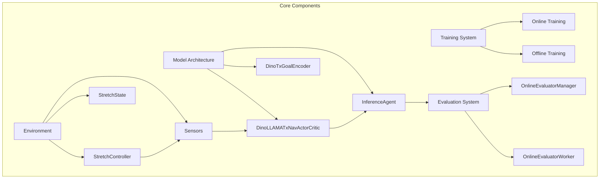
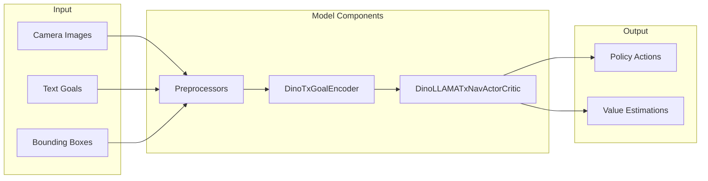
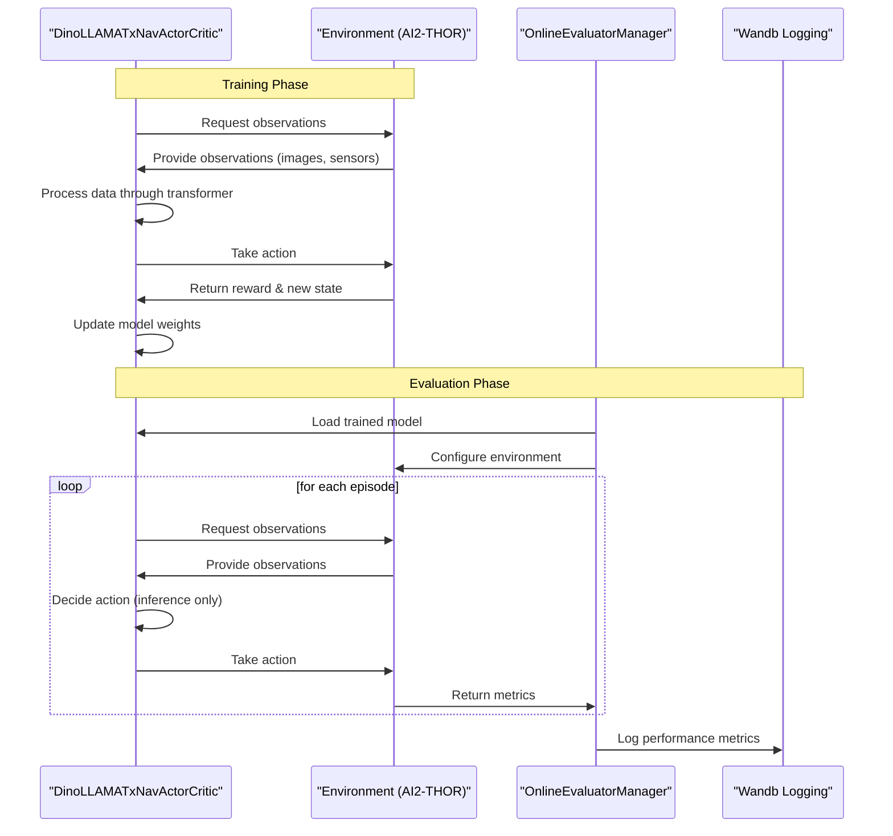

<!-- source: DeepWiki mcp.deepwiki.com · repo allenai/PoliFormer · page 1 Overview · fetched 2026-10-26 -->

# Overview

Relevant source files

The following files were used as context for generating this wiki page:

- [LICENSE](LICENSE)
- [README.md](README.md)
- [TRAINING_README.md](TRAINING_README.md)

PoliFormer is a system designed to scale on-policy reinforcement learning using transformers for robot navigation tasks. This page provides a high-level overview of the PoliFormer repository, its architecture, and its approach to reinforcement learning.

## Introduction

PoliFormer, as described in its full title "PoliFormer: Scaling On-Policy RL with Transformers Results in Masterful Navigators," is a framework that combines transformer-based models with on-policy reinforcement learning to create effective visual navigation agents. The system is designed to navigate to specific objects within environments based on either text descriptions or visual recognition cues.

Sources: [README.md:1-11]()

## System Purpose

The primary purpose of PoliFormer is to:

1. Implement a transformer-based architecture for visual navigation tasks
2. Scale on-policy reinforcement learning using transformers
3. Train agents to navigate to objects based on text descriptions or visual cues
4. Evaluate agent performance in realistic environments

The system addresses the challenge of creating embodied AI systems that can understand natural language commands and navigate to fulfill those commands in physical environments.

Sources: [README.md:11-12]()

## High-Level Architecture

PoliFormer consists of four major components working together to enable transformer-based reinforcement learning for navigation:

**Model Architecture**: Contains the transformer-based models that process sensory inputs and goal information to output navigation actions.

**Environment**: Manages the simulation environment and robot state, providing observations through various sensors.

**Training System**: Implements both online reinforcement learning (via AllenAct) and offline learning (via PyTorch Lightning).

**Evaluation System**: Enables distributed evaluation of trained models in online settings.

Sources: [README.md:90-180](), [TRAINING_README.md:30-62]()

## Data Flow and Processing

The following diagram illustrates how data flows through the PoliFormer system during both training and inference:

During training and inference:
1. The system receives inputs from cameras, text goal descriptions, and/or bounding boxes of target objects
2. These inputs are processed by specialized preprocessors
3. The encoded inputs are fed to the transformer models
4. The models output policy actions (what to do next) and value estimations (how good the current state is)

Sources: [README.md:135-178]()

## Training and Evaluation Pipeline

PoliFormer supports both online training (reinforcement learning) and offline training (supervised learning):

The system uses AllenAct for online training and PyTorch Lightning for offline training, with a distributed evaluation system to assess trained models.

Sources: [TRAINING_README.md:1-28](), [TRAINING_README.md:82-113]()

## Scaling On-Policy Reinforcement Learning

PoliFormer scales on-policy reinforcement learning through:

1. **Transformer Architecture**: Uses transformer models adapted for embodied AI tasks instead of traditional CNN-RNN models
2. **Multimodal Learning**: Processes multiple input modalities (images, text, bounding boxes) through specialized encoders
3. **Distributed Training**: Supports multiple training processes to parallelize experience collection
4. **Efficient Evaluation**: Implements a distributed evaluation system with multiple workers

The approach achieves scalability by leveraging the transformer architecture's ability to handle complex, multi-modal inputs and extract meaningful patterns from them.

Sources: [README.md:152-178](), [TRAINING_README.md:83-104]()

## Key Components in Context

The PoliFormer system is made up of several key components that work together:

| Component | Purpose | Implementation |
|-----------|---------|----------------|
| DinoLLAMATxNavActorCritic | Main model that processes inputs and outputs actions | Transformer-based architecture using DINO and LLAMA components |
| DinoTxGoalEncoder | Encodes goal information for the navigation task | Specialized encoder for goal representations |
| InferenceAgent | Uses trained models for online evaluation | Manages inference during evaluation |
| StretchController | Interfaces with the simulated environment | Controls the robot in AI2-THOR environment |
| Sensors | Provide observations to the agent | Include vision, navigation, and manipulation sensors |
| OnlineEvaluatorManager | Manages the evaluation process | Coordinates distributed evaluation across workers |

For more detailed information about specific components:
- For Model Architecture details, see [Architecture](#2.1)
- For Environment components, see [Environment](#3)
- For Training System details, see [Training System](#4)
- For Evaluation System details, see [Evaluation System](#5)

Sources: [README.md:13-134]()

## Supported Tasks and Datasets

PoliFormer is primarily trained and evaluated on navigation tasks from the SPOC dataset, specifically the "fifteen" type which has the agent navigating and fetching one of fifteen possible object types.

The system supports:
- Object navigation by text description
- Object navigation by visual cues (bounding boxes)
- Combined text and visual navigation

Sources: [README.md:51-86]()

## Getting Started

To get started with PoliFormer, you'll need to:

1. Set up the Python environment (preferably using Docker)
2. Download the necessary data (Objaverse assets, ProcTHOR-Objaverse houses, SPOC dataset)
3. Configure environment variables
4. Run training or evaluation scripts

For detailed setup instructions, see [Setup and Deployment](#6).

Sources: [README.md:13-49](), [README.md:51-86]()

## Licensing

PoliFormer is released under dual licensing:
- LLAMA 2 components are licensed under the LLAMA 2 Community License
- All other code is licensed under the Apache License 2.0

Sources: [LICENSE:1-23]()

---

