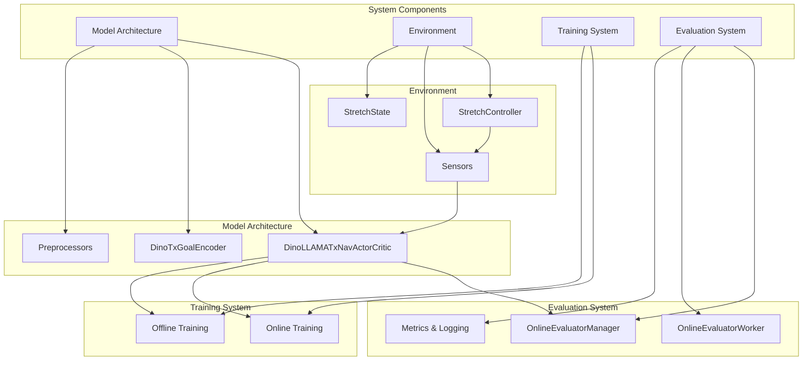
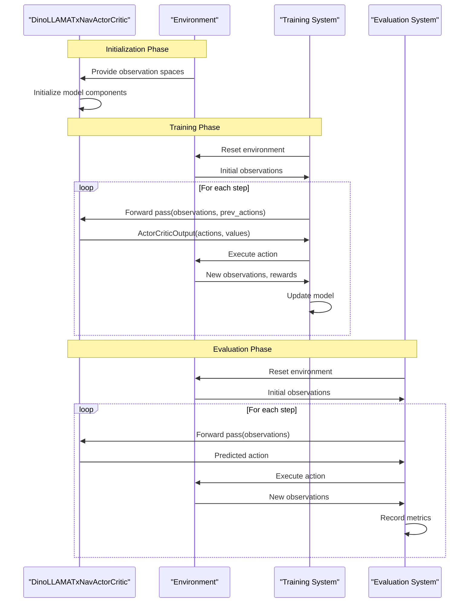
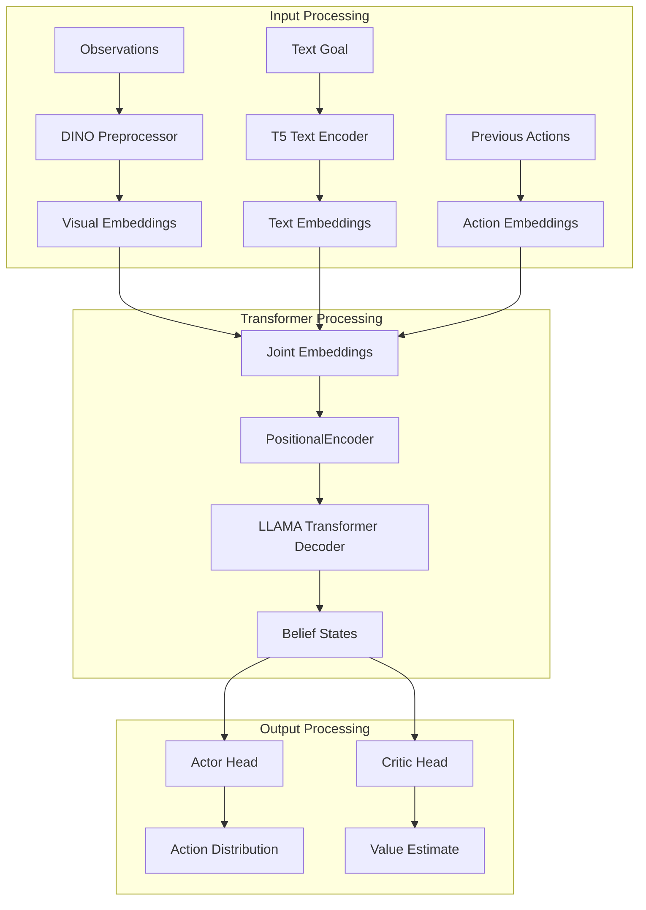
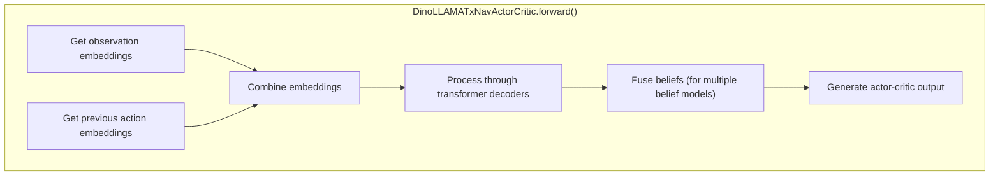
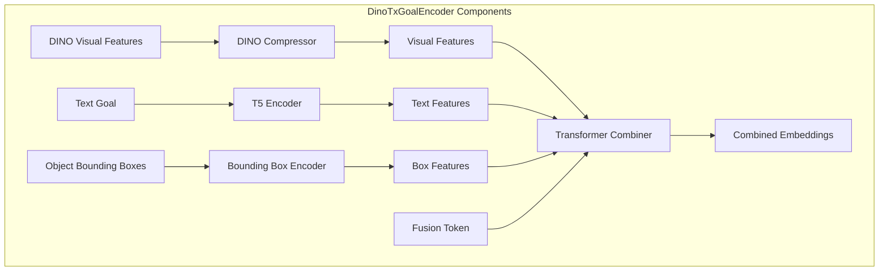
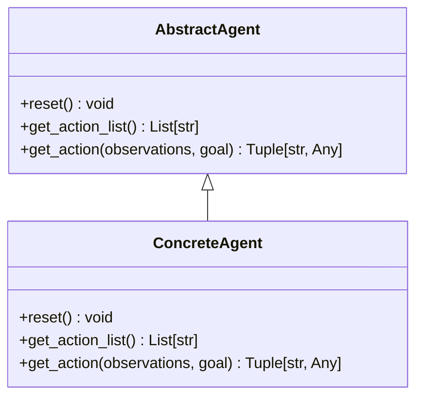

<!-- source: DeepWiki mcp.deepwiki.com · repo allenai/PoliFormer · page 2 Architecture · fetched 2026-10-26 -->

# Architecture

Relevant source files

The following files were used as context for generating this wiki page:

- [architecture/agent.py](architecture/agent.py)
- [architecture/models/allenact_transformer_models/allenact_dino_transformer.py](architecture/models/allenact_transformer_models/allenact_dino_transformer.py)

This document provides a comprehensive overview of the PoliFormer system architecture, detailing how the different components interact to implement on-policy reinforcement learning with transformer models for robot navigation tasks. For details about specific subsystems, see the corresponding pages for [Model Architecture](#2.1), [Inference Agent](#2.2), and [Preprocessors](#2.3).

## System Overview

PoliFormer is organized into four core subsystems that work together to enable transformer-based reinforcement learning for embodied navigation:

1. **Model Architecture** - The transformer-based neural networks that process multimodal inputs and produce action decisions
2. **Environment** - Components that represent the robot, world, and sensor observations
3. **Training System** - Infrastructure for both online and offline training of the models
4. **Evaluation System** - Components that assess model performance in navigational tasks

### High-Level Architecture Diagram

Sources: 
- [architecture/models/allenact_transformer_models/allenact_dino_transformer.py:51-372]()
- [architecture/agent.py:5-51]()

## Component Relationships

The PoliFormer architecture follows a modular design pattern where each component has a specific responsibility:

1. **Model Architecture**: Contains the core transformer models that process sensor data and goal specifications to produce navigation actions.
2. **Environment**: Manages the robot state, sensors, and interaction with the simulated world (AI2-THOR).
3. **Training System**: Implements the RL algorithms for training the transformer models.
4. **Evaluation System**: Handles online evaluation of trained models in navigation tasks.

### Component Interaction Flow

Sources:
- [architecture/models/allenact_transformer_models/allenact_dino_transformer.py:248-372]()
- [architecture/agent.py:37-51]()

## Model Architecture Components

The core of PoliFormer is its transformer-based model architecture, which consists of several key components:

| Component | Purpose | Implementation |
|-----------|---------|----------------|
| DinoLLAMATxNavActorCritic | Main transformer model combining vision, text, and navigation | [allenact_dino_transformer.py:51-372]() |
| DinoTxGoalEncoder | Encodes goal specifications and visual observations | [allenact_dino_transformer.py:375-542]() |
| PositionalEncoder | Provides positional encoding for transformer inputs | [allenact_dino_transformer.py:30-48]() |

### Model Data Flow

Sources:
- [architecture/models/allenact_transformer_models/allenact_dino_transformer.py:51-372]()
- [architecture/models/allenact_transformer_models/allenact_dino_transformer.py:375-542]()

## Model Component Details

The `DinoLLAMATxNavActorCritic` class extends `VisualNavActorCritic` and serves as the primary model for navigational decisions. It processes visual input through the DINO (a vision transformer) and combines it with text goals through a T5 encoder.

Key internal components include:

1. **Goal Visual Encoder** - Processes visual observations and text goals
2. **State Encoders** - LLAMA transformer decoders that maintain belief states
3. **Actor-Critic Heads** - Output action distributions and value estimates

The data processing flow in the forward method can be summarized as:

Sources:
- [architecture/models/allenact_transformer_models/allenact_dino_transformer.py:248-372]()

## Goal Encoding Process

The `DinoTxGoalEncoder` handles multimodal input processing:

Sources:
- [architecture/models/allenact_transformer_models/allenact_dino_transformer.py:375-542]()

## Agent Interface

The `AbstractAgent` class defines the interface for agents in the system:

Sources:
- [architecture/agent.py:5-51]()

## Integration with Training and Evaluation

The model architecture integrates with the training and evaluation systems through standardized interfaces:

1. **For Training**:
   - The model receives batched observations, previous actions, and masks
   - It returns action distributions and value estimates
   - The training system uses these to compute losses and update the model

2. **For Evaluation**:
   - The model processes single observations to produce action decisions
   - The evaluation system executes these actions in the environment
   - Performance metrics are tracked and logged

## Conclusion

The PoliFormer architecture represents a sophisticated approach to visual navigation using transformer models. Its modular design allows for flexibility in experimentation, while the integration of vision transformers (DINO) with language models (LLAMA, T5) enables effective multimodal reasoning. The system supports both online reinforcement learning and offline training approaches, with a comprehensive evaluation framework to assess performance.

For more detailed information about specific components, please refer to the dedicated pages for [Model Architecture](#2.1), [Inference Agent](#2.2), and [Preprocessors](#2.3).

---

