<!-- source: DeepWiki mcp.deepwiki.com · repo allenai/PoliFormer · page 2.1 Model Architecture · fetched 2026-10-26 -->

# Model Architecture

Relevant source files

The following files were used as context for generating this wiki page:

- [architecture/models/allenact_transformer_models/allenact_dino_transformer.py](architecture/models/allenact_transformer_models/allenact_dino_transformer.py)

## Purpose and Scope

This document details the transformer-based model architecture used in PoliFormer for visual navigation tasks. We focus on explaining the core components DinoLLAMATxNavActorCritic and DinoTxGoalEncoder, their interactions, and how they process multimodal inputs (images, text, bounding boxes) to produce navigation decisions. For information about the Inference Agent that uses these models, see [Inference Agent](#2.2).

## Architectural Overview

PoliFormer implements a transformer-based actor-critic architecture for visual navigation that fuses vision and language. The model processes RGB images using DINO features, text goals using a T5 encoder, and optionally incorporates bounding box information. A LLAMA-based transformer then processes this information to produce navigation actions.

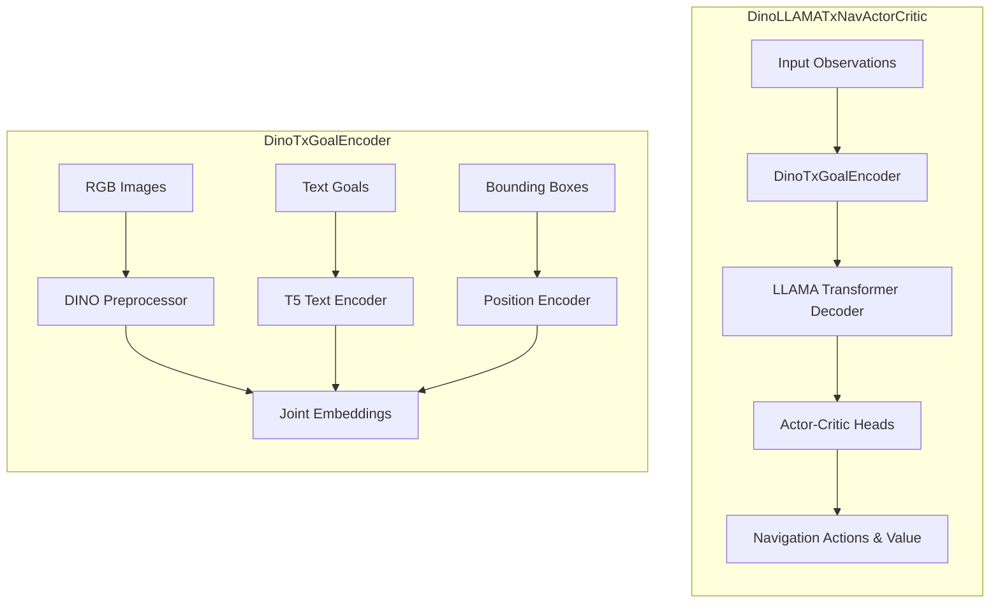

Sources: [architecture/models/allenact_transformer_models/allenact_dino_transformer.py:51-372](). [architecture/models/allenact_transformer_models/allenact_dino_transformer.py:375-542]()

## Core Component: DinoLLAMATxNavActorCritic

The `DinoLLAMATxNavActorCritic` class is the main model architecture, inheriting from AllenAct's `VisualNavActorCritic`. It combines vision, language, and positional information to navigate based on textual goals.

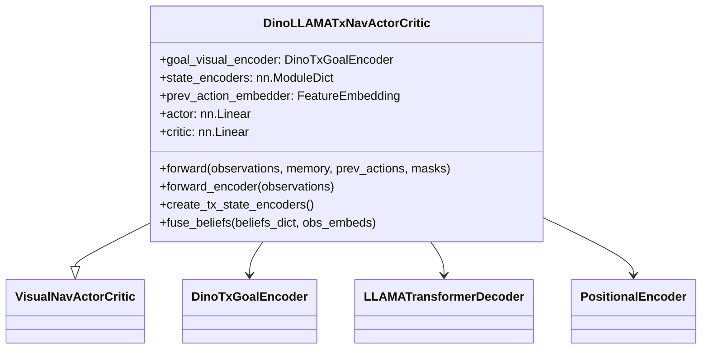

Key functionalities:
1. **Input Processing**: Takes observations, memory, previous actions, and masks as input
2. **Encoding**: Uses `DinoTxGoalEncoder` to encode visual and text inputs
3. **Transformer Processing**: Processes encoded inputs through LLAMA-based transformer 
4. **Belief Fusion**: Supports single or multiple belief models with fusion capabilities
5. **Action Production**: Outputs actor-critic values for reinforcement learning

Sources: [architecture/models/allenact_transformer_models/allenact_dino_transformer.py:51-372]()

## Core Component: DinoTxGoalEncoder

The `DinoTxGoalEncoder` processes multimodal inputs including images, text goals, and bounding boxes.

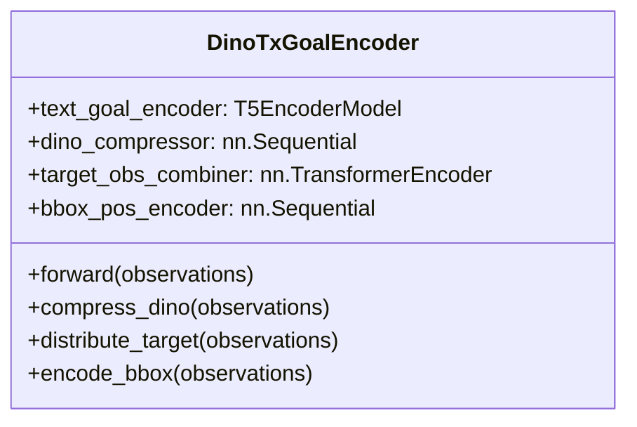

Key functionalities:
1. **Vision Processing**: Compresses DINO features from RGB images
2. **Text Processing**: Encodes text goals using the T5 encoder
3. **Bounding Box Processing**: Encodes object bounding boxes if provided
4. **Multimodal Fusion**: Combines all modalities using a transformer encoder

Sources: [architecture/models/allenact_transformer_models/allenact_dino_transformer.py:375-542]()

## Data Flow Through the Architecture

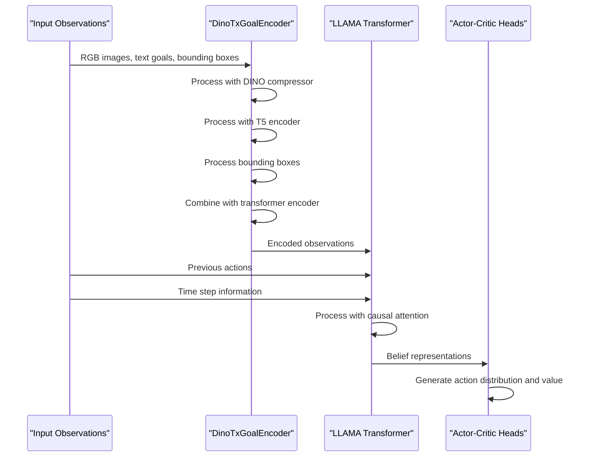

Sources: [architecture/models/allenact_transformer_models/allenact_dino_transformer.py:248-372]()

## Input Processing and Encoding

### DINO Vision Features

The model processes RGB images through a DINO preprocessor and compresses them:

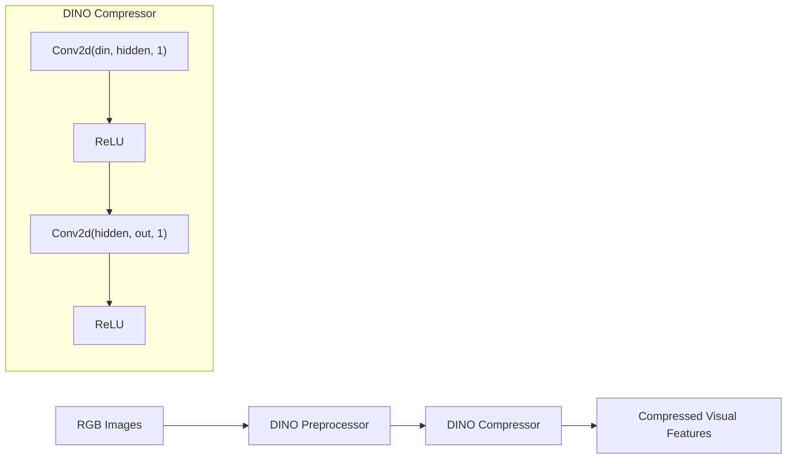

Sources: [architecture/models/allenact_transformer_models/allenact_dino_transformer.py:410-417](). [architecture/models/allenact_transformer_models/allenact_dino_transformer.py:458-459]()

### Text Goal Encoding

Text goals are processed using a T5 encoder:

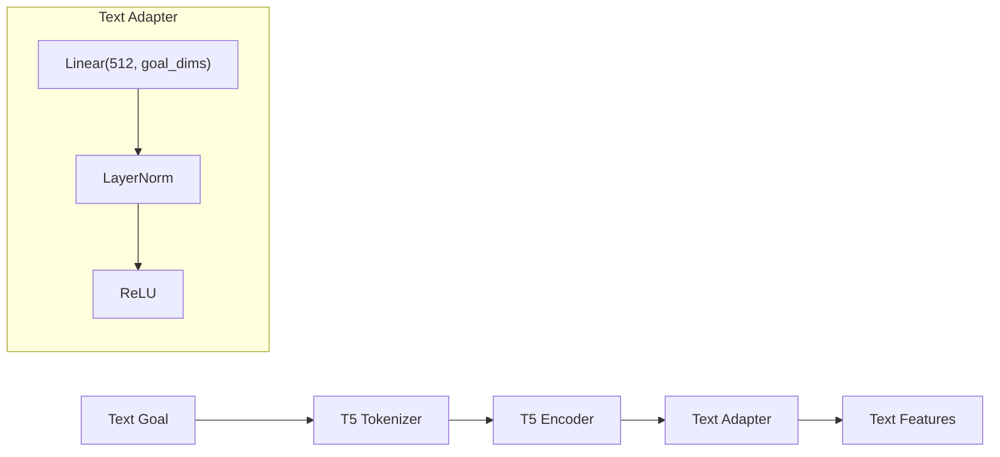

Sources: [architecture/models/allenact_transformer_models/allenact_dino_transformer.py:399-404](). [architecture/models/allenact_transformer_models/allenact_dino_transformer.py:462-474]()

### Bounding Box Encoding

When available, bounding box information is encoded:

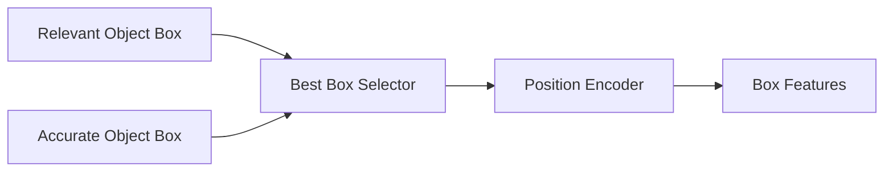

Sources: [architecture/models/allenact_transformer_models/allenact_dino_transformer.py:426-436](). [architecture/models/allenact_transformer_models/allenact_dino_transformer.py:476-489]()

## Transformer Architecture

The model uses a LLAMA-based transformer decoder to process the encoded observations:

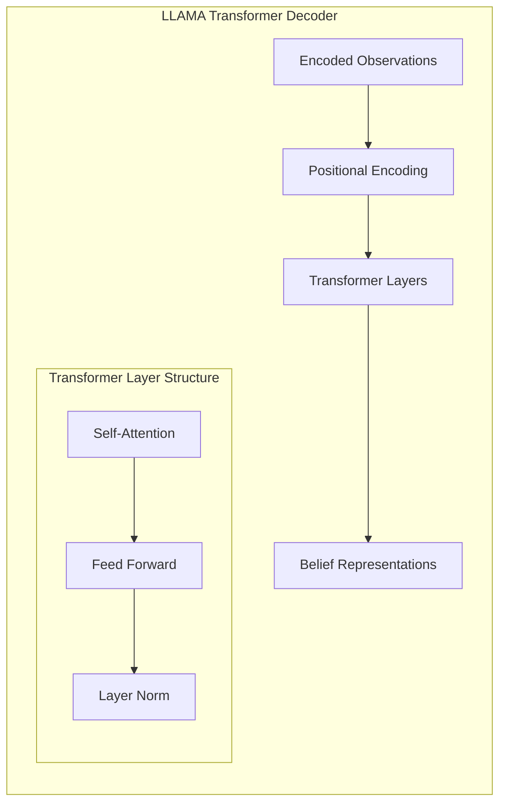

### Positional Encoding

The `PositionalEncoder` class adds sinusoidal positional encoding to the transformer inputs:

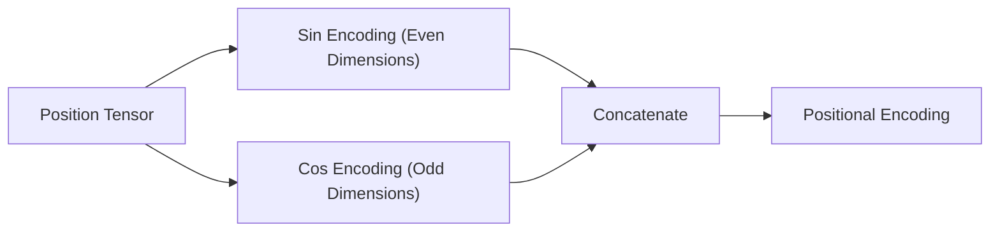

Sources: [architecture/models/allenact_transformer_models/allenact_dino_transformer.py:30-48]()

### Belief Mechanisms

The model supports two belief mechanisms:

1. **Single Belief**: One transformer decoder processes all observations
2. **Multiple Beliefs**: Multiple transformer decoders process observations and are then fused

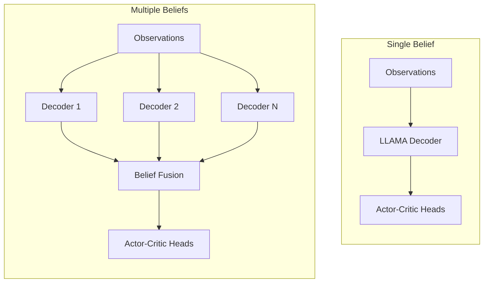

Sources: [architecture/models/allenact_transformer_models/allenact_dino_transformer.py:177-220]()

## Actor-Critic Heads

The output of the transformer is passed to actor and critic heads for reinforcement learning:

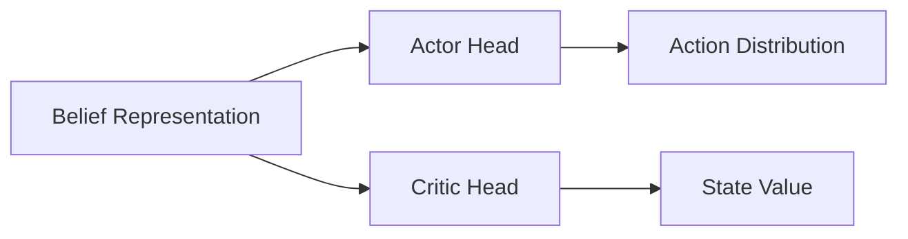

Sources: [architecture/models/allenact_transformer_models/allenact_dino_transformer.py:366-370]()

## Technical Details

| Component | Implementation | Purpose |
|-----------|---------------|---------|
| DinoLLAMATxNavActorCritic | Main actor-critic model | Processes observations and outputs actions and values |
| DinoTxGoalEncoder | Multimodal encoder | Encodes visual, text, and bounding box inputs |
| PositionalEncoder | Positional encoding | Adds position information to sequence inputs |
| LLAMATransformerDecoder | Causal transformer | Processes encoded inputs with attention mechanism |
| T5EncoderModel | Text encoder | Encodes text goals |
| DINO Preprocessor | Vision encoder | Extracts features from RGB images |

Sources: [architecture/models/allenact_transformer_models/allenact_dino_transformer.py:51-372](). [architecture/models/allenact_transformer_models/allenact_dino_transformer.py:375-542]()

## Forward Pass Execution Flow

The model forward pass follows these steps:

1. Encode observations using `DinoTxGoalEncoder`
2. Encode previous actions
3. Add observations and previous action embeddings
4. Apply linear projections to prepare inputs for the transformer
5. Add positional encoding based on time step
6. Process through the LLAMA transformer decoder
7. Fuse beliefs if using multiple belief models
8. Generate actor-critic outputs (action distribution and value)

Sources: [architecture/models/allenact_transformer_models/allenact_dino_transformer.py:248-372]()

---

