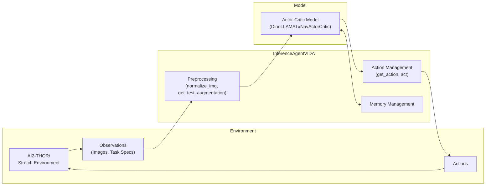
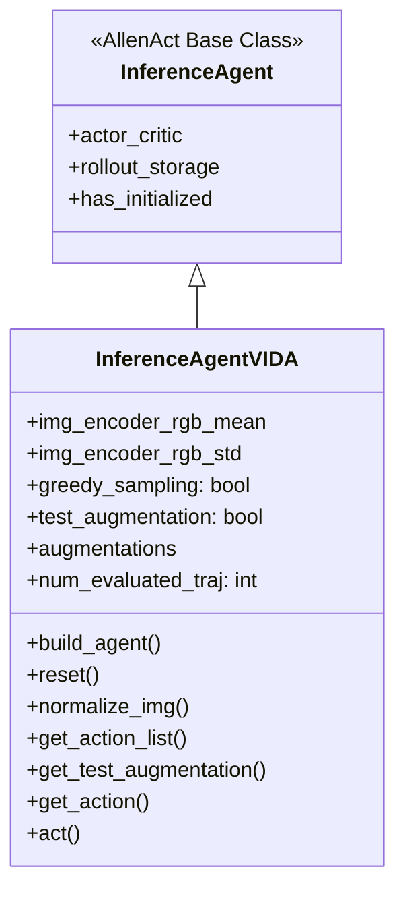
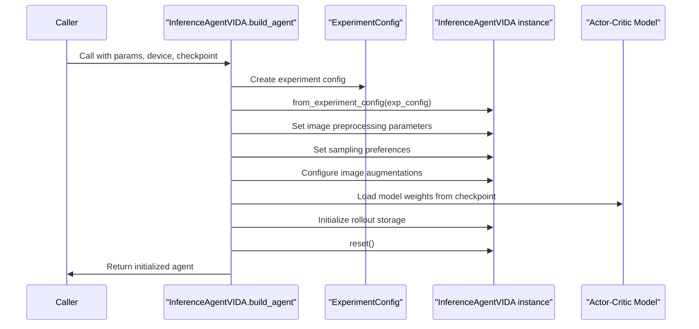
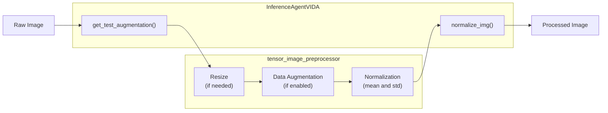
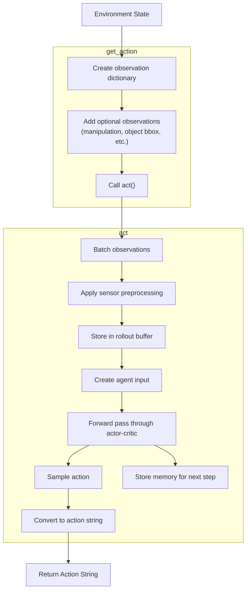
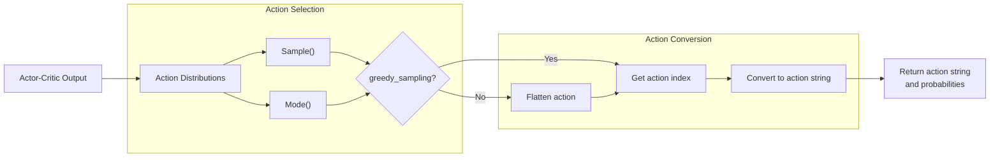

<!-- source: DeepWiki mcp.deepwiki.com · repo allenai/PoliFormer · page 2.2 Inference Agent · fetched 2026-10-26 -->

# Inference Agent

Relevant source files

The following files were used as context for generating this wiki page:

- [architecture/models/allenact_transformer_models/inference_agent.py](architecture/models/allenact_transformer_models/inference_agent.py)

## Purpose and Scope

The Inference Agent is a critical component of the PoliFormer system that handles the deployment of trained models for online evaluation. It serves as the bridge between the transformer-based models and the testing environment, processing observations and selecting actions. This document details the implementation, architecture, and functionality of the inference agent used for evaluating the PoliFormer models on navigation tasks.

For information about the underlying model architecture, see [Model Architecture](#2.1). For details on how the inference agent is used during evaluation, see [Online Evaluator](#5.1).

Sources: [architecture/models/allenact_transformer_models/inference_agent.py:76-246]()

## Architecture Overview

The Inference Agent sits between the trained models and the environment, managing the inference process during online evaluation. It processes observations from the environment, passes them through the transformer models, and selects appropriate actions to execute.

**Diagram: Inference Agent Position in System Architecture**

Sources: [architecture/models/allenact_transformer_models/inference_agent.py:76-246]()

## Implementation Details

The Inference Agent is implemented in the `InferenceAgentVIDA` class, which inherits from AllenAct's `InferenceAgent`. This specialized implementation adds capabilities for image preprocessing, action selection, and tracking of evaluation metrics.

### Key Components

1. **Image Processing** - Handles normalization and augmentation of visual inputs
2. **Action Selection** - Converts model outputs to executable actions
3. **Memory Management** - Maintains state across inference steps
4. **Trajectory Tracking** - Keeps count of trajectories for evaluation

**Diagram: InferenceAgentVIDA Class Structure**

Sources: [architecture/models/allenact_transformer_models/inference_agent.py:76-85]()

## Initialization Process

The `InferenceAgentVIDA` class provides a static `build_agent` method that constructs and initializes the agent with the required parameters:

**Diagram: Inference Agent Initialization Process**

The initialization process includes:
1. Creating an experiment configuration
2. Building the agent based on this configuration
3. Setting preprocessing parameters for images
4. Configuring sampling behavior and augmentations
5. Loading the trained model weights
6. Initializing internal state tracking
7. Resetting the agent to prepare for the first trajectory

Sources: [architecture/models/allenact_transformer_models/inference_agent.py:84-123]()

## Observation Processing

The Inference Agent processes various types of observations from the environment:

| Observation Type | Description | Processing |
|-----------------|-------------|------------|
| `rgb_raw` | Raw RGB images from navigation camera | Normalized and potentially augmented |
| `natural_language_spec` | Text description of the goal | Converted to byte representation |
| `time_step` | Current step in the trajectory | Tracked for sequence modeling |
| `traj_index` | Index of the current trajectory | Used for evaluation tracking |
| `manipulation_rgb_raw` | RGB images from manipulation camera (optional) | Processed when available |
| `an_object_is_in_hand` | Boolean indicating if object is held (optional) | Passed through when available |
| `relative_arm_location_metadata` | Arm position data (optional) | Normalized when available |
| `nav_accurate_object_bbox` | Object bounding boxes (optional) | Passed through when available |

Sources: [architecture/models/allenact_transformer_models/inference_agent.py:158-177]()

## Image Processing Pipeline

The agent includes specialized image processing methods to prepare visual inputs for the transformer model:

**Diagram: Image Processing Pipeline**

The image processor can be configured with:
- Custom image size (default 256×256)
- Data augmentation options
- Custom normalization parameters

Sources: [architecture/models/allenact_transformer_models/inference_agent.py:25-61](), [architecture/models/allenact_transformer_models/inference_agent.py:132-156]()

## Inference Flow

The core inference process involves taking observations from the environment and producing actions through the trained model:

**Diagram: Inference Process Flow**

This flow includes several key steps:
1. Constructing an observation dictionary from environment state
2. Batching and preprocessing observations
3. Tracking state in the rollout storage
4. Creating inputs for the actor-critic model
5. Running the model forward pass to generate distributions
6. Sampling an action (or taking the mode for greedy behavior)
7. Converting the action to a string representation from the action list

Sources: [architecture/models/allenact_transformer_models/inference_agent.py:158-246]()

## Memory Management

The Inference Agent manages memory across steps in a trajectory and between trajectories:

1. **Step Memory**: The agent stores and updates memory between steps within a trajectory.
2. **Rollout Storage**: Maintains a buffer of recent observations and agent states.
3. **Trajectory Reset**: Clears memory and resets counters when starting a new trajectory.

When the agent has taken a configurable number of steps (controlled by `steps_before_rollout_refresh`), it refreshes the rollout storage to prevent memory issues during long trajectories.

Sources: [architecture/models/allenact_transformer_models/inference_agent.py:125-131](), [architecture/models/allenact_transformer_models/inference_agent.py:234-235]()

## Action Selection

The agent can select actions in two modes:

1. **Stochastic Sampling**: Samples from the action probability distribution (default)
2. **Greedy Selection**: Takes the highest probability action (when `greedy_sampling=True`)

The action is selected from a predefined list of possible actions, which is either:
- Loaded from an action dictionary file specified in the `ACTION_DICT` environment variable
- Default to the `ALL_STRETCH_ACTIONS` constant

**Diagram: Action Selection Process**

Sources: [architecture/models/allenact_transformer_models/inference_agent.py:219-246](), [architecture/models/allenact_transformer_models/inference_agent.py:147-152]()

## Integration with Evaluation System

The Inference Agent is designed to work within the broader evaluation framework of PoliFormer:

1. It tracks trajectory counts via `num_evaluated_traj`, which can be used for evaluation metrics
2. It resets internal state between trajectories
3. It can be configured for different evaluation settings (greedy vs. stochastic, with or without augmentation)

The agent outputs both the selected action string and the action probabilities, which can be used for logging and analysis in the evaluation system.

Sources: [architecture/models/allenact_transformer_models/inference_agent.py:76-246]()

---

