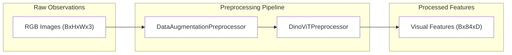
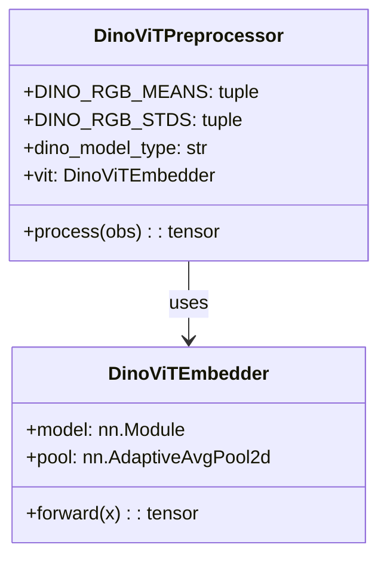
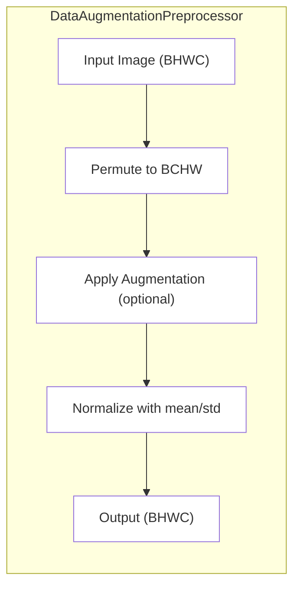
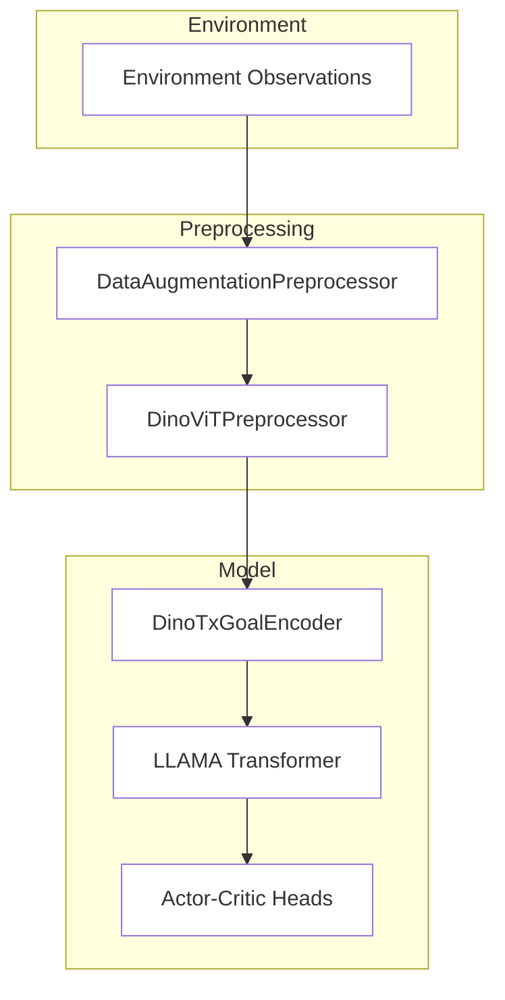

<!-- source: DeepWiki mcp.deepwiki.com · repo allenai/PoliFormer · page 2.3 Preprocessors · fetched 2026-10-26 -->

# Preprocessors

<details>
<summary>Relevant source files</summary>

The following files were used as context for generating this wiki page:

- [architecture/allenact_preprocessors/dino_preprocessors.py](architecture/allenact_preprocessors/dino_preprocessors.py)

</details>


## Introduction

This document covers the preprocessor components in the PoliFormer system, which are responsible for preparing input data (primarily images) for the transformer-based models. Preprocessors transform raw sensor inputs into feature representations optimized for the model architecture described in [Model Architecture](#2.1).

The PoliFormer system uses specialized preprocessors built on the AllenAct framework to handle image preparation and feature extraction using the DINO Vision Transformer (ViT) models.

Sources: [architecture/allenact_preprocessors/dino_preprocessors.py:1-5]()

## Key Preprocessor Components

PoliFormer implements two primary preprocessor types:

1. **DinoViTPreprocessor**: Extracts visual features from RGB images using DINO Vision Transformer models
2. **DataAugmentationPreprocessor**: Applies data augmentation and normalization to input images

These preprocessors work in sequence to transform raw observations into the feature representations required by the transformer models.



**Diagram: Preprocessor Pipeline**

Sources: [architecture/allenact_preprocessors/dino_preprocessors.py:32-117](), [architecture/allenact_preprocessors/dino_preprocessors.py:119-184]()

## DinoViTPreprocessor

The `DinoViTPreprocessor` leverages pre-trained DINO Vision Transformer models to extract high-level visual features from input images. This preprocessor uses self-supervised visual features that capture rich semantic information.

### DINO Models Supported

The preprocessor supports four variants of DINO ViT models with different parameter sizes:

| Model Type | Output Feature Dimensions | Parameter Size |
|------------|---------------------------|----------------|
| dinov2_vits14 | 384 | Small |
| dinov2_vitb14 | 768 | Base |
| dinov2_vitl14 | 1024 | Large |
| dinov2_vitg14 | 1536 | Giant |

All models output feature maps with spatial dimensions of 7×12, but the feature dimension (channel depth) varies by model size.

### DinoViTEmbedder

The `DinoViTEmbedder` is an auxiliary class that wraps the DINO model and handles the feature extraction process:



**Diagram: DinoViTPreprocessor Class Structure**

The embedder:
- Takes input images of size 224×384 pixels
- Processes them through the DINO model to extract patch token features
- Reshapes and pools the features to a consistent size (7×12)
- Returns the processed features for use by the model

Sources: [architecture/allenact_preprocessors/dino_preprocessors.py:14-29](), [architecture/allenact_preprocessors/dino_preprocessors.py:32-117]()

## DataAugmentationPreprocessor

The `DataAugmentationPreprocessor` prepares images for feature extraction by applying data augmentation and normalization. It is typically used as a first step before the DINO preprocessor.

### Key Functions



**Diagram: Data Augmentation Process**

This preprocessor:
1. Converts images from BHWC format (batch, height, width, channels) to BCHW format
2. Applies random augmentations if enabled
3. Normalizes pixel values (dividing by 255, then applying mean/std normalization)
4. Converts back to BHWC format for downstream processing

### Augmentation Strategy

The augmentation transforms are changed periodically (every `num_steps_to_change` steps) to introduce variety during training. The augmentations are sampled from a predefined set of transformations provided by the `get_transformation()` function.

Sources: [architecture/allenact_preprocessors/dino_preprocessors.py:119-184]()

## Integration with Training Pipeline

Preprocessors are integrated into the PoliFormer training and inference pipelines as part of the observation processing workflow:



**Diagram: Preprocessor Integration in Model Pipeline**

The preprocessors are configured during model initialization and process observations before they reach the main model components. During training, the augmentation preprocessor introduces variability to help with generalization, while the DINO preprocessor extracts robust visual features.

Sources: [architecture/allenact_preprocessors/dino_preprocessors.py:32-117](), [architecture/allenact_preprocessors/dino_preprocessors.py:119-184]()

## Technical Implementation Details

### Normalization Constants

Both preprocessors use the same normalization constants, which are the standard ImageNet mean and standard deviation values:

```
DINO_RGB_MEANS = (0.485, 0.456, 0.406)
DINO_RGB_STDS = (0.299, 0.224, 0.225)
```

### Output Shapes

The output shape of the `DinoViTPreprocessor` depends on the selected DINO model and whether flattening is applied:

| Model | Flattened Output Shape | Non-flattened Output Shape |
|-------|------------------------|----------------------------|
| dinov2_vits14 | (84, 384) | (7, 12, 384) |
| dinov2_vitb14 | (84, 768) | (7, 12, 768) |
| dinov2_vitl14 | (84, 1024) | (7, 12, 1024) |
| dinov2_vitg14 | (84, 1536) | (7, 12, 1536) |

The spatial dimensions (7×12) are determined by the pooling layer in the `DinoViTEmbedder`.

Sources: [architecture/allenact_preprocessors/dino_preprocessors.py:32-66]()

## Usage Considerations

When working with the preprocessors in the PoliFormer system, consider the following:

1. **Model Selection**: Choose the appropriate DINO model size based on your computational resources and performance requirements.

2. **Augmentation Configuration**: Configure the data augmentation preprocessor based on your training needs. You can adjust the `num_steps_to_change` parameter to control how frequently augmentations change, or disable augmentation entirely for evaluation.

3. **GPU Utilization**: Both preprocessors support being moved to specific devices using the `to()` method, which is important for efficient GPU utilization.

4. **Input Requirements**: The DINO preprocessor expects input images of size 224×384 pixels, so ensure your observation space provides images of this size or that they are resized appropriately.

Sources: [architecture/allenact_preprocessors/dino_preprocessors.py:105-108](), [architecture/allenact_preprocessors/dino_preprocessors.py:163-167]()

---

