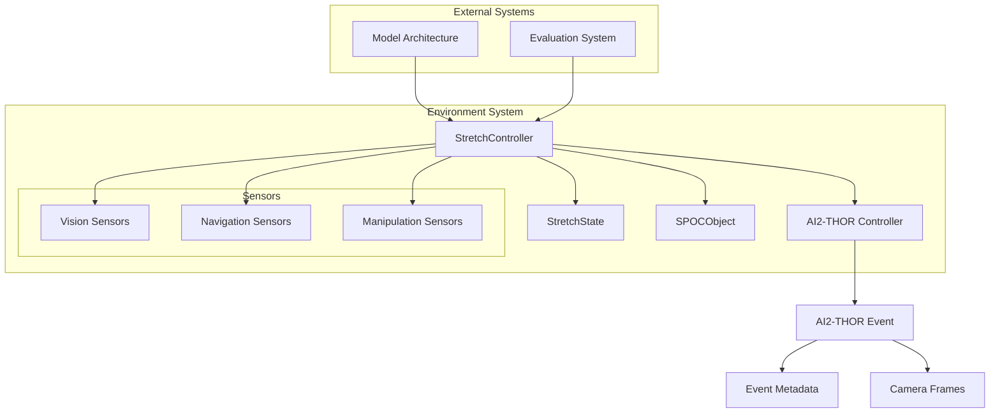
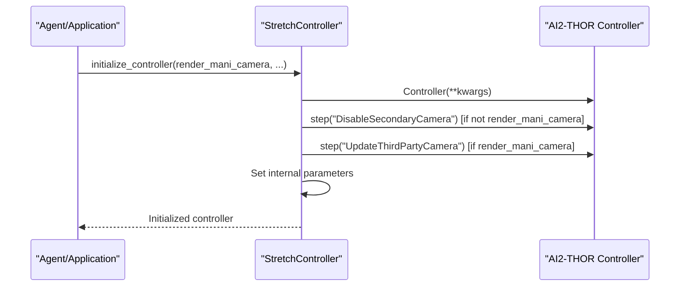
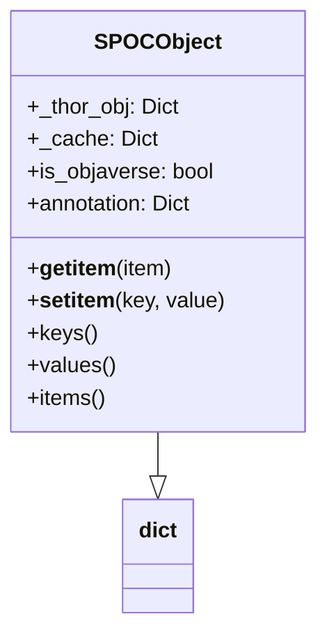
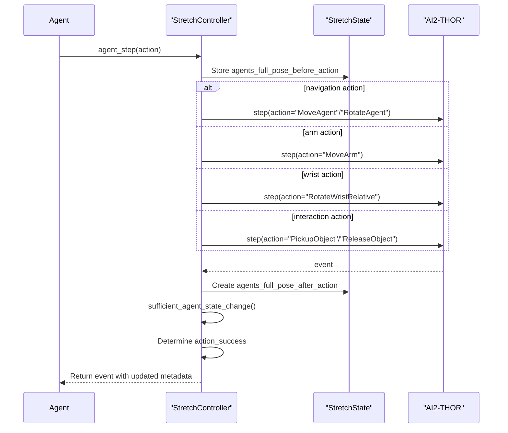
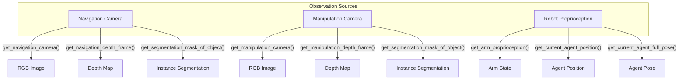
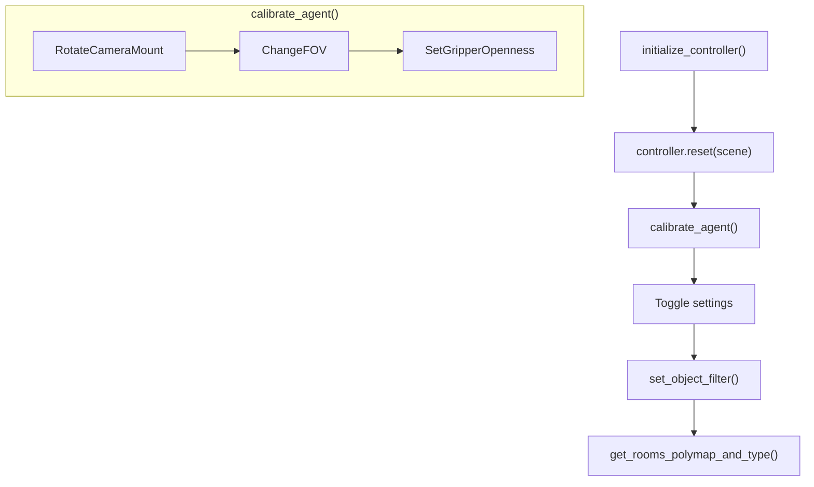

<!-- source: DeepWiki mcp.deepwiki.com · repo allenai/PoliFormer · page 3 Environment · fetched 2026-10-26 -->

# Environment

<details>
<summary>Relevant source files</summary>

The following files were used as context for generating this wiki page:

- [environment/spoc_objects.py](environment/spoc_objects.py)
- [environment/stretch_controller.py](environment/stretch_controller.py)

</details>


The Environment system in PoliFormer provides a comprehensive representation of the world and robot state for embodied AI navigation tasks. It serves as the interface between the learning agents and the underlying AI2-THOR simulation platform, handling robot control, state management, object representation, and sensor observations.

## Core Components

The Environment system consists of several interconnected components that work together to provide a complete representation of the robot and its surroundings:


*Environment System Components Diagram*

Sources: [environment/stretch_controller.py:53-1212]()

The primary components include:

1. **StretchController**: The main interface for controlling the Stretch robot in the AI2-THOR environment
2. **StretchState**: Tracks and manages the state of the robot (position, rotation, arm configuration)
3. **SPOCObject**: Wrapper for AI2-THOR objects providing enhanced metadata
4. **Sensors**: Various sensor types that provide observations to the agent

## StretchController

The StretchController is the central component that manages the robot's interaction with the AI2-THOR environment. It initializes the simulation, handles robot actions, and provides methods to access environmental information.

### Initialization and Configuration

When instantiating a StretchController, several key parameters can be configured:


*StretchController Initialization Flow*

Sources: [environment/stretch_controller.py:54-107]()

The controller can be initialized with options such as:
- `render_mani_camera`: Whether to render the manipulation camera
- `use_quick_navi_action`: Whether to use optimized navigation actions

### Robot Action Control

StretchController provides methods to control the robot's movement and actions through the `agent_step` method, which handles:

| Action Type | Examples | Description |
|-------------|----------|-------------|
| Navigation | move_ahead, move_back, rotate_left, rotate_right | Control the robot's position and orientation |
| Arm Movement | move_arm_up, move_arm_down, move_arm_in, move_arm_out | Control the robot's arm position |
| Wrist Control | wrist_open, wrist_close | Control the robot's wrist rotation |
| Object Interaction | pickup, dropoff | Interact with objects in the environment |

Sources: [environment/stretch_controller.py:752-877]()

### Environment Perception

The controller provides access to camera observations and environmental information:

```mermaid
graph TD
    SC["StretchController"] --> NAV["navigation_camera()"]
    SC --> MANIP["manipulation_camera()"]
    SC --> SEG["camera_segmentation()"]
    SC --> DEPTH["depth_frame()"]
    
    NAV --> "RGB Image"
    MANIP --> "RGB Image"
    SEG --> "Instance Masks"
    DEPTH --> "Depth Map"
    
    SC --> GO["get_objects()"]
    GO --> "SPOCObject List"
    
    SC --> VIS["get_visible_objects()"]
    VIS --> "Visible Object IDs"
```
*Environment Perception Methods*

Sources: [environment/stretch_controller.py:164-205](), [environment/stretch_controller.py:513-515]()

### Navigation and Pathfinding

StretchController provides methods for navigating to objects, points, and rooms:

- `get_shortest_path_to_object`: Finds the shortest path to a specific object
- `get_shortest_path_to_point`: Finds the shortest path to a specific location
- `get_shortest_path_to_room`: Finds the shortest path to a room

These methods utilize AI2-THOR's pathfinding capabilities and can be customized with different navigation meshes for different agent sizes.

Sources: [environment/stretch_controller.py:903-951](), [environment/stretch_controller.py:978-1023](), [environment/stretch_controller.py:1124-1156]()

## SPOCObject

The SPOCObject class provides an enhanced representation of objects in the environment. It wraps AI2-THOR object metadata and adds functionality for handling both standard objects and Objaverse objects.


*SPOCObject Class Diagram*

Sources: [environment/spoc_objects.py:13-127]()

SPOCObject provides:

1. Seamless access to standard AI2-THOR object properties
2. Enhanced metadata for Objaverse objects
3. Common properties like "synset" and "lemma" that work across both object types
4. Object descriptions and additional semantic information

Example enhanced properties available through SPOCObject:
- `synset`: WordNet synset ID for the object
- `lemma`: Most specific WordNet lemma for the object
- `description`: Object description (for Objaverse objects)

Sources: [environment/spoc_objects.py:41-65]()

## Environment-Agent Interaction Flow

The interaction between the agent and environment follows a consistent pattern:


*Environment-Agent Interaction Flow*

Sources: [environment/stretch_controller.py:752-877]()

## Sensors and Observations

The Environment system provides multiple sensors that generate observations for the agent:


*Sensor Observation Types*

Sources: [environment/stretch_controller.py:164-204](), [environment/stretch_controller.py:896-900](), [environment/stretch_controller.py:607-614]()

### Vision Sensors
The Environment provides two camera views:
- **Navigation Camera**: First-person view from the robot's navigation camera
- **Manipulation Camera**: Third-person view focused on the manipulation area

For each camera, the system can provide:
- RGB images
- Depth maps
- Instance segmentation masks

### Navigation Sensors
The navigation sensors provide information about:
- Current position and rotation
- Reachable positions in the environment
- Room information and relationships

### Manipulation Sensors
The manipulation sensors track:
- Arm and wrist position/rotation
- Objects in the manipulation sphere
- Objects held by the robot

For more detailed information about the Stretch Controller and State, see [Stretch Controller and State](#3.1).

For details about the specific sensor implementations, see [Sensors](#3.2).

## Environment Initialization and Reset

The environment initialization process involves setting up the AI2-THOR controller, configuring the robot's initial state, and preparing the environment:


*Environment Initialization Flow*

Sources: [environment/stretch_controller.py:376-433](), [environment/stretch_controller.py:339-375]()

The initialization process:
1. Creates an AI2-THOR controller instance
2. Resets the scene with the provided scene configuration
3. Calibrates the agent (camera mounts, FOV, gripper)
4. Configures visibility settings
5. Prepares room polygons for navigation

## Summary

The Environment system in PoliFormer provides a flexible and comprehensive interface between learning agents and the AI2-THOR simulation. It handles robot control, environment perception, object representation, and navigation, enabling complex embodied AI tasks.

The system is designed to be modular, with clear separation between:
- Robot control (StretchController)
- State representation (StretchState)
- Object representation (SPOCObject)
- Sensing and perception (various sensor methods)

This architecture allows for clean integration with the rest of the PoliFormer system, particularly the Model Architecture and Evaluation components.

---

