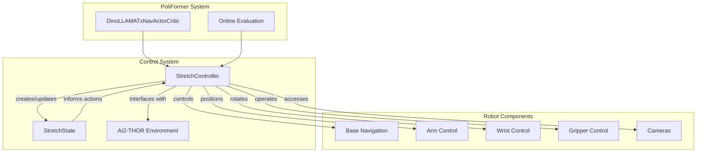
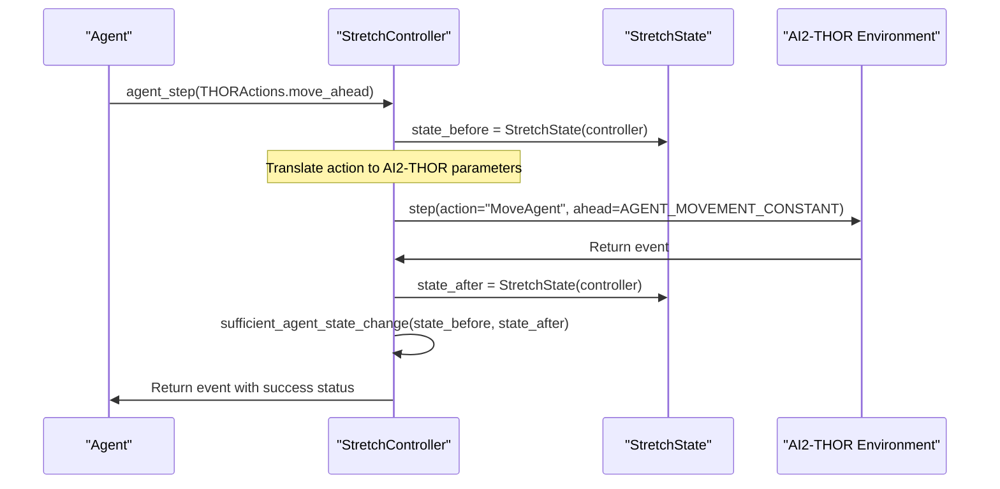
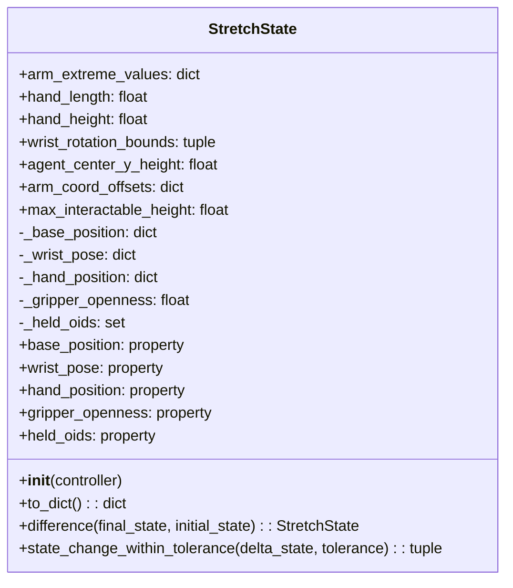
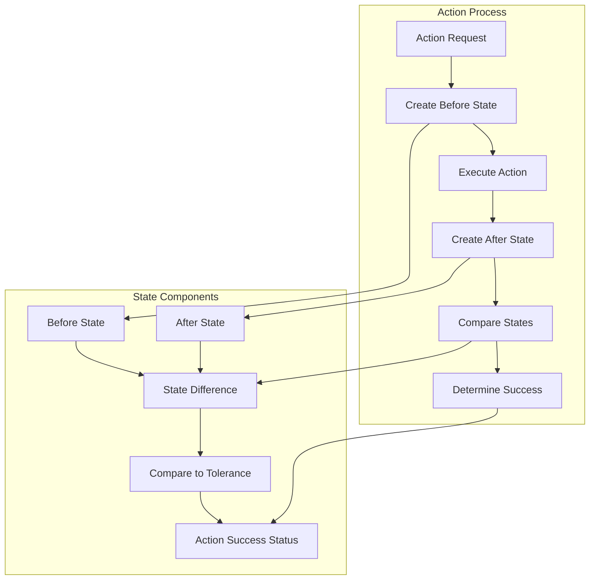
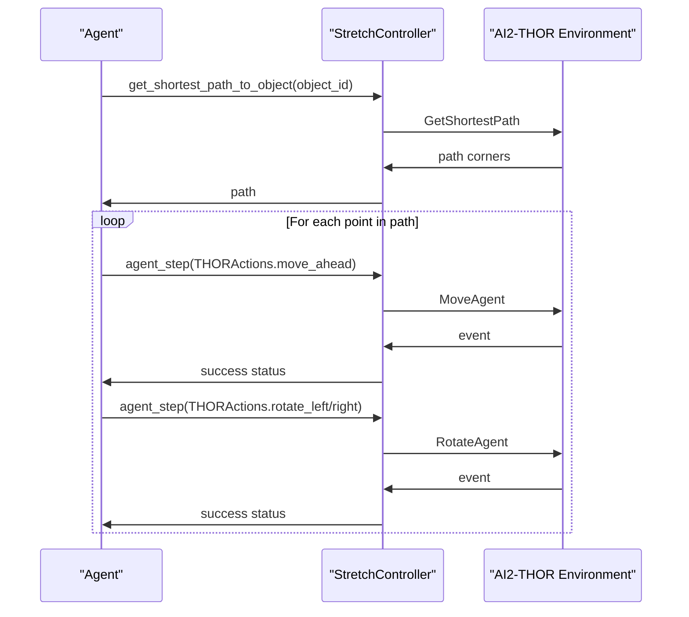
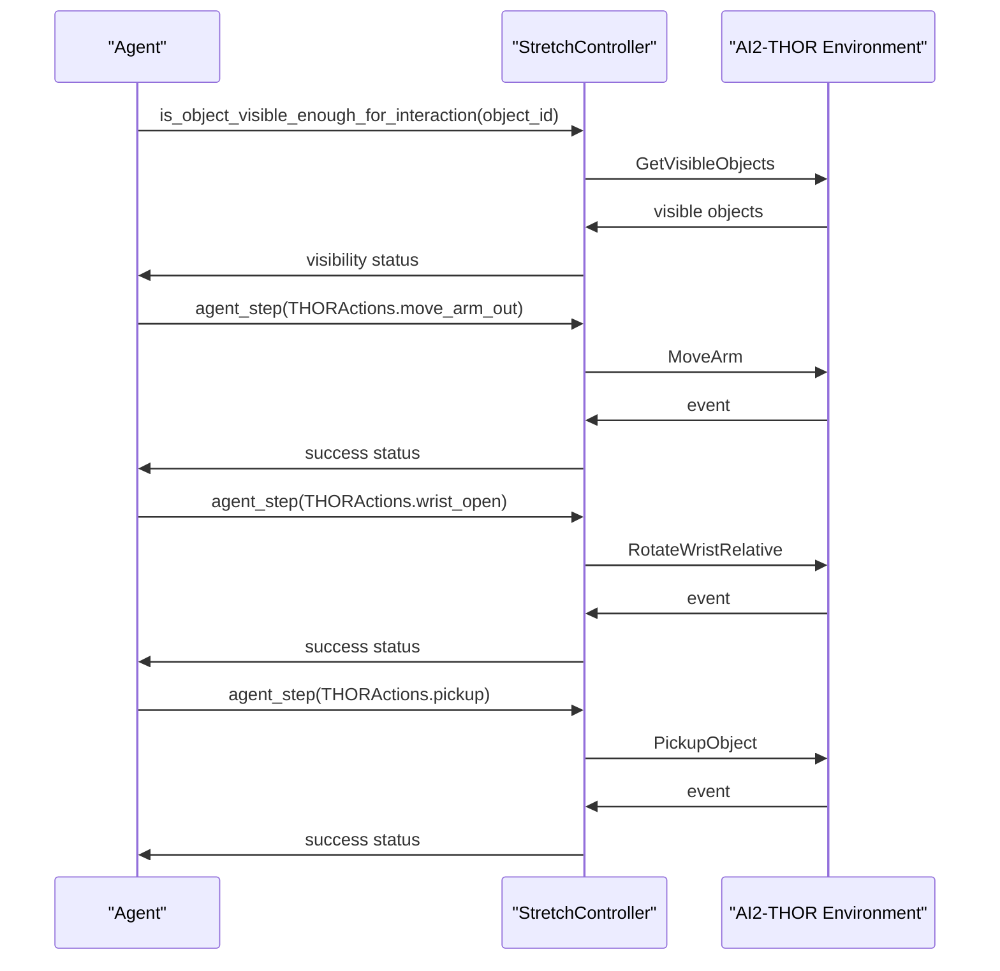
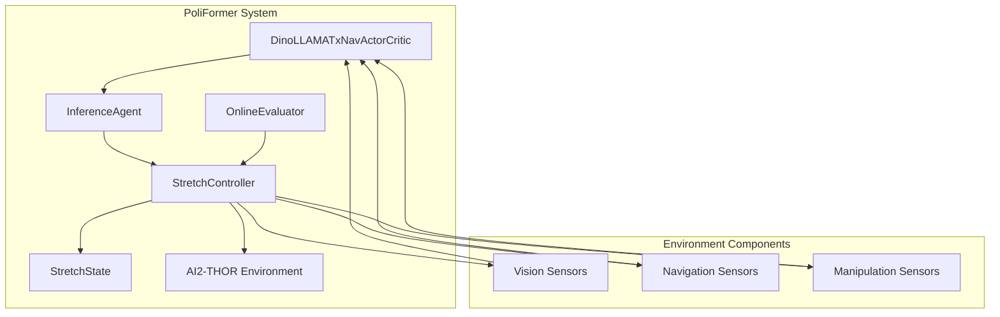

<!-- source: DeepWiki mcp.deepwiki.com · repo allenai/PoliFormer · page 3.1 Stretch Controller and State · fetched 2026-10-26 -->

# Stretch Controller and State

<details>
<summary>Relevant source files</summary>

The following files were used as context for generating this wiki page:

- [environment/stretch_controller.py](environment/stretch_controller.py)
- [environment/stretch_state.py](environment/stretch_state.py)

</details>


The Stretch Controller and State components provide a unified interface for controlling the Stretch robot within the AI2-THOR simulation environment. These components serve as a critical bridge between the high-level navigation models (like the DinoLLAMATxNavActorCritic) and the underlying simulation environment, enabling the PoliFormer system to navigate, manipulate objects, and perceive its surroundings.

Sources: [environment/stretch_controller.py:54-57](), [environment/stretch_state.py:20-23]()

## System Overview



Sources: [environment/stretch_controller.py:54-179](), [environment/stretch_state.py:20-110]()

## Stretch Controller

The `StretchController` class wraps the AI2-THOR controller to provide high-level commands for the Stretch robot, handling navigation, arm movement, object interaction, and environmental perception.

### Initialization and Configuration

The controller is initialized with parameters that determine its behavior:

```python
controller = StretchController(
    initialize_controller=True,  # Create new AI2-THOR controller
    render_mani_camera=True,     # Render manipulation camera
    use_quick_navi_action=False  # Use standard navigation actions
)
```

Key initialization parameters:
- `initialize_controller`: Whether to create a new AI2-THOR controller instance
- `render_mani_camera`: Whether to render the manipulation camera
- `use_quick_navi_action`: Whether to use optimized navigation actions

Sources: [environment/stretch_controller.py:54-106]()

### Core Action System

The controller's action system converts high-level commands into specific robot actions through two main methods:

1. `step(**kwargs)`: Low-level interface to AI2-THOR
2. `agent_step(action)`: High-level interface that handles common robot actions



Sources: [environment/stretch_controller.py:278-292](), [environment/stretch_controller.py:752-877]()

### Movement and Navigation

The controller supports various movement actions:

| Action | Description | Method Call |
|--------|-------------|-------------|
| Move Forward | Move the robot forward | `agent_step(THORActions.move_ahead)` |
| Move Backward | Move the robot backward | `agent_step(THORActions.move_back)` |
| Rotate Left | Rotate the robot left | `agent_step(THORActions.rotate_left)` |
| Rotate Right | Rotate the robot right | `agent_step(THORActions.rotate_right)` |
| Teleport | Move to a specific position | `teleport_agent(position, rotation)` |

The controller also provides path planning methods:
- `get_shortest_path_to_object`: Find the shortest path to an object
- `get_shortest_path_to_point`: Find the shortest path to a point
- `get_shortest_path_to_room`: Find the shortest path to a room

Sources: [environment/stretch_controller.py:245-259](), [environment/stretch_controller.py:903-1023](), [environment/stretch_controller.py:1124-1156]()

### Arm and Wrist Control

The controller manages the robot's arm and wrist:

| Action | Description | Method Call |
|--------|-------------|-------------|
| Move Arm Up | Move the arm up | `agent_step(THORActions.move_arm_up)` |
| Move Arm Down | Move the arm down | `agent_step(THORActions.move_arm_down)` |
| Move Arm Out | Extend the arm | `agent_step(THORActions.move_arm_out)` |
| Move Arm In | Retract the arm | `agent_step(THORActions.move_arm_in)` |
| Wrist Open | Rotate wrist open | `agent_step(THORActions.wrist_open)` |
| Wrist Close | Rotate wrist closed | `agent_step(THORActions.wrist_close)` |

Arm position can be retrieved with:
- `get_arm_wrist_position()`: Get relative wrist position
- `get_arm_wrist_absolute_position()`: Get absolute wrist position
- `get_arm_wrist_rotation()`: Get wrist rotation angle
- `get_arm_proprioception()`: Get full arm state

Sources: [environment/stretch_controller.py:793-838](), [environment/stretch_controller.py:879-900]()

### Object Interaction

The controller enables object manipulation:

| Action | Description | Method Call |
|--------|-------------|-------------|
| Pickup | Pick up an object | `agent_step(THORActions.pickup)` |
| Dropoff | Drop a held object | `agent_step(THORActions.dropoff)` |

Object interaction helper methods:
- `get_objects_in_hand_sphere()`: Get objects within the hand sphere
- `get_held_objects()`: Get objects currently held by the robot
- `dist_from_arm_to_obj(object_id)`: Calculate distance from arm to object
- `object_is_visible_in_camera(object_id)`: Check if object is visible
- `is_object_visible_enough_for_interaction(object_id)`: Check if object can be interacted with

Sources: [environment/stretch_controller.py:124-129](), [environment/stretch_controller.py:840-842](), [environment/stretch_controller.py:441-490](), [environment/stretch_controller.py:1041-1047]()

### Environment Perception

The controller provides access to sensor data:

| Sensor | Description | Property |
|--------|-------------|----------|
| Navigation Camera | Front-facing camera | `navigation_camera` |
| Manipulation Camera | Arm-mounted camera | `manipulation_camera` |
| Navigation Depth | Depth from nav camera | `navigation_depth_frame` |
| Manipulation Depth | Depth from manip camera | `manipulation_depth_frame` |

The controller also provides access to segmentation masks:
- `get_segmentation_mask_of_object(object_id, which_camera)`: Get segmentation mask for an object

Sources: [environment/stretch_controller.py:164-216](), [environment/stretch_controller.py:218-235]()

### Object and Environment Queries

The controller provides methods for querying the environment:

| Method | Description |
|--------|-------------|
| `get_objects()` | Get all objects in the scene |
| `get_object(object_id)` | Get metadata for a specific object |
| `get_objects_of_synset_list(synsets)` | Get objects of specific types |
| `get_visible_objects(which_camera)` | Get objects visible in a camera |
| `get_reachable_positions()` | Get positions the robot can reach |
| `get_objects_room_id_and_type(object_id)` | Get room containing an object |

Sources: [environment/stretch_controller.py:513-553](), [environment/stretch_controller.py:628-647](), [environment/stretch_controller.py:671-704]()

## Stretch State

The `StretchState` class represents the physical state of the Stretch robot, providing a structured representation that can be compared, processed, and used to validate actions.



Sources: [environment/stretch_state.py:20-110](), [environment/stretch_state.py:45-114]()

### State Components

The state consists of five key components:

1. **Base Position**: Location and orientation of the robot base
   ```python
   base_position = {
       "x": x_coord,        # X-coordinate in world space
       "y": y_height,       # Y-coordinate (height) in world space
       "z": z_coord,        # Z-coordinate in world space
       "theta": rotation    # Rotation around Y-axis in degrees
   }
   ```

2. **Wrist Pose**: Position and orientation of the robot's wrist
   ```python
   wrist_pose = {
       "y": vertical_position,    # Height relative to robot base
       "z": horizontal_position,  # Extension distance from robot
       "yaw": rotation            # Rotation angle in degrees
   }
   ```

3. **Hand Position**: Absolute position of the robot's hand in world space
   ```python
   hand_position = {
       "x": x_coord,  # X-coordinate in world space
       "y": y_coord,  # Y-coordinate in world space
       "z": z_coord   # Z-coordinate in world space
   }
   ```

4. **Gripper Openness**: Current state of the gripper (0-1)

5. **Held Objects**: Set of object IDs currently held by the robot

Sources: [environment/stretch_state.py:45-92](), [environment/stretch_state.py:94-113]()

### State Comparison and Tolerances

The `StretchState` class provides methods for comparing states and calculating differences:

1. `difference(final_state, initial_state)`: Calculates the difference between two states
   - Returns a new `StretchState` representing the delta

2. `state_change_within_tolerance(delta_state, tolerance)`: Checks if a state change is within specified tolerances
   - Returns a tuple with a boolean indicating if change is within tolerance and a dictionary of parameters that exceed tolerances

This is particularly useful for:
- Validating whether an action produced the expected state change
- Determining if a state change is significant enough to count as a successful action

Sources: [environment/stretch_state.py:158-218](), [environment/stretch_state.py:278-347]()

### Coordinate Transformations

The state system provides utility functions for coordinate transformations:

| Function | Description |
|----------|-------------|
| `convert_world_to_agent_coordinate(world_point, agent_state)` | Convert world coordinates to agent-relative coordinates |
| `convert_relative_to_world_coordinate(agent_relative_point, agent_state)` | Convert agent-relative coordinates to world coordinates |
| `convert_world_to_relative_coordinate(world_obj, relative_location, relative_rotation)` | Convert world coordinates to coordinates relative to any reference frame |

Sources: [environment/stretch_state.py:404-473]()

## Interaction Between Controller and State

The controller and state work together to provide a complete robot control system:



A key interaction is the `sufficient_agent_state_change` method, which determines if an action produced a significant change:

```python
def sufficient_agent_state_change(self, agent_state_before, agent_state_after):
    # Calculate the difference between states
    delta_state = StretchState.difference(
        final_state=agent_state_after, 
        initial_state=agent_state_before
    )
    
    # Check if the difference is within tolerance
    too_small, _ = StretchState.state_change_within_tolerance(
        delta_state=delta_state,
        tolerance=self._universal_state_tolerance,
    )
    
    # Return whether the change was significant
    return not too_small
```

Sources: [environment/stretch_controller.py:740-750](), [environment/stretch_controller.py:752-877]()

## Usage Patterns

### Navigation Workflow



### Object Manipulation Workflow



Sources: [environment/stretch_controller.py:903-1023](), [environment/stretch_controller.py:752-877]()

## System Integration

Within the broader PoliFormer system, the `StretchController` serves as the interface between the agent models and the simulation environment:



Key integration points:
- The `DinoLLAMATxNavActorCritic` model uses the controller to interact with the environment during navigation tasks
- The `OnlineEvaluator` uses the controller to set up and evaluate agent performance in different scenarios
- The controller provides sensor data that is processed by the model's preprocessors

Sources: [environment/stretch_controller.py:54-55](), [environment/stretch_state.py:20-21]()

## Conclusion

The Stretch Controller and State components provide a comprehensive interface for controlling the Stretch robot within the AI2-THOR environment. By abstracting the complexity of direct robot control and state management, these components enable the higher-level navigation models to focus on decision-making rather than low-level control details.

---

