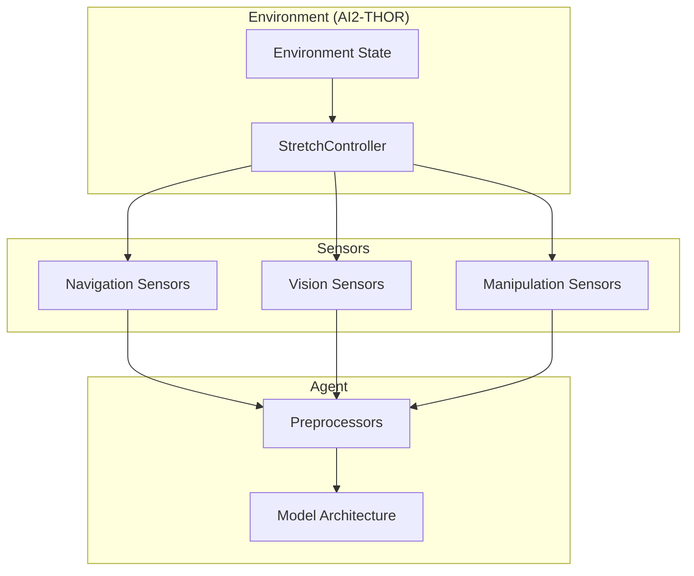
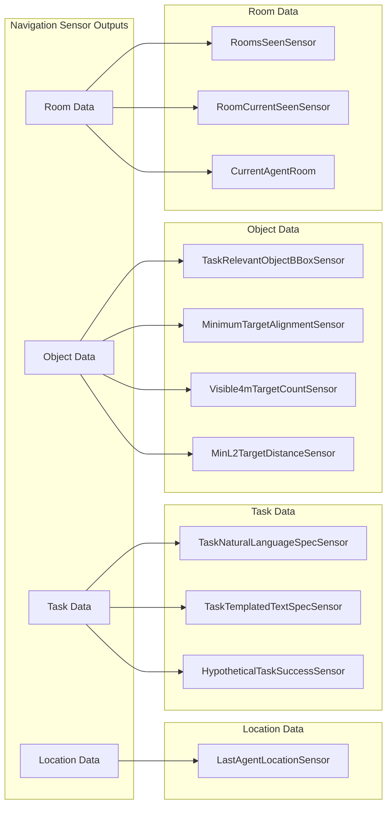
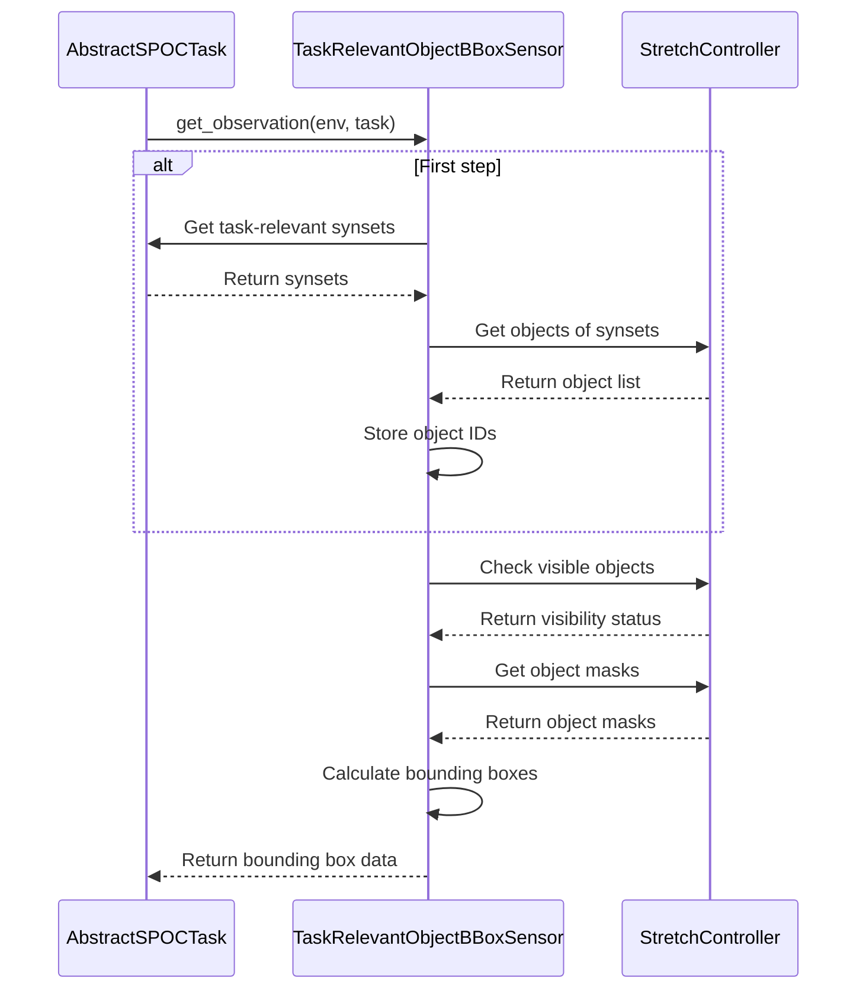
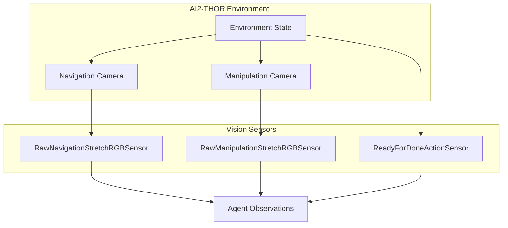
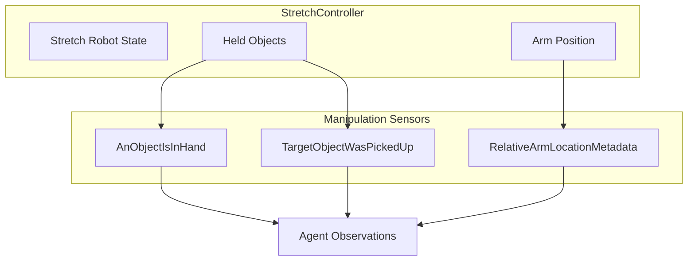
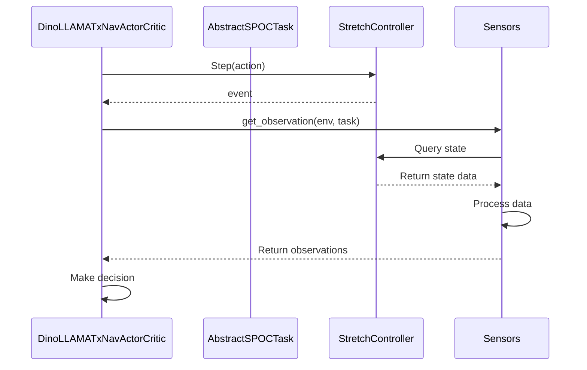

<!-- source: DeepWiki mcp.deepwiki.com · repo allenai/PoliFormer · page 3.2 Sensors · fetched 2026-10-26 -->

# Sensors

<details>
<summary>Relevant source files</summary>

The following files were used as context for generating this wiki page:

- [environment/manipulation_sensors.py](environment/manipulation_sensors.py)
- [environment/navigation_sensors.py](environment/navigation_sensors.py)
- [environment/vision_sensors.py](environment/vision_sensors.py)

</details>


## Purpose and Scope

This document describes the sensor system in the PoliFormer architecture. Sensors are responsible for providing various observations to the agent, enabling it to perceive and interact with the environment effectively. These sensors are organized into three primary categories: navigation sensors, vision sensors, and manipulation sensors.

For information about how these sensors are used in the model architecture, see [Model Architecture](#2.1). For details on the environment they operate in, see [Environment](#3) and [Stretch Controller and State](#3.1).

## Sensor Architecture

Sensors in PoliFormer are built on top of the AllenAct framework's `Sensor` base class. Each sensor implementation defines an observation space and provides a method to extract specific observations from the environment.

```mermaid
classDiagram
    class "Sensor" {
        +uuid: str
        +observation_space: gym.Space
        +get_observation(): Any
    }
    
    "Sensor" <|-- "NavigationSensors"
    "Sensor" <|-- "VisionSensors"
    "Sensor" <|-- "ManipulationSensors"
    
    class "NavigationSensors" {
        +Last action status
        +Agent location
        +Task specifications
        +Object information
        +Spatial awareness
    }
    
    class "VisionSensors" {
        +RGB observations
        +Task completion signals
    }
    
    class "ManipulationSensors" {
        +Object grasping status
        +Arm position
    }
    
    "NavigationSensors" <|-- "LastActionSuccessSensor"
    "NavigationSensors" <|-- "LastAgentLocationSensor"
    "NavigationSensors" <|-- "TaskNaturalLanguageSpecSensor"
    "NavigationSensors" <|-- "TaskRelevantObjectBBoxSensor"
    
    "VisionSensors" <|-- "RawNavigationStretchRGBSensor"
    "VisionSensors" <|-- "RawManipulationStretchRGBSensor"
    "VisionSensors" <|-- "ReadyForDoneActionSensor"
    
    "ManipulationSensors" <|-- "AnObjectIsInHand"
    "ManipulationSensors" <|-- "RelativeArmLocationMetadata"
    "ManipulationSensors" <|-- "TargetObjectWasPickedUp"
```

Sources: [environment/navigation_sensors.py:2-10](), [environment/vision_sensors.py:2-12](), [environment/manipulation_sensors.py:1-8]()

## Sensor System Data Flow

The following diagram illustrates how sensors interact with the environment and provide observations to the agent:



Sources: [environment/navigation_sensors.py](), [environment/vision_sensors.py](), [environment/manipulation_sensors.py]()

## Navigation Sensors

Navigation sensors provide spatial information, task specifications, and environmental awareness to help the agent navigate effectively.

### Key Navigation Sensor Classes

| Sensor | Description | Observation Space | Output |
|--------|-------------|-------------------|--------|
| `LastActionSuccessSensor` | Indicates if the last action was successful | Discrete(3) | Boolean as np.int64 |
| `LastAgentLocationSensor` | Provides agent position and rotation | Discrete(3) | 6D vector (x,y,z, rot_x,rot_y,rot_z) |
| `TaskNaturalLanguageSpecSensor` | Natural language task description | Discrete(str_max_len) | Byte array of encoded string |
| `TaskRelevantObjectBBoxSensor` | Bounding boxes for task-relevant objects | Dict with multiple spaces | Dict with object IDs and bbox coordinates |
| `MinimumTargetAlignmentSensor` | Minimum alignment with visible targets | Discrete(3) | Float value |
| `CurrentAgentRoom` | Agent's current room | Discrete(1) | Room number as int |
| `TimeStepSensor` | Current time step in episode | Discrete(1) | Integer time step |

Sources: [environment/navigation_sensors.py:34-983]()

### Navigation Sensor Data Types



Sources: [environment/navigation_sensors.py:34-783]()

### Example: TaskRelevantObjectBBoxSensor

This sensor is particularly important as it provides bounding box information for objects relevant to the task, which is crucial for visual navigation.



Sources: [environment/navigation_sensors.py:265-425]()

## Vision Sensors

Vision sensors provide visual observations from the agent's cameras, which are critical for perceiving the environment.

### Key Vision Sensor Classes

| Sensor | Description | Observation Space | Output |
|--------|-------------|-------------------|--------|
| `RawRGBSensorTHOR` | Base class for RGB sensors | Box(height, width, 3) | RGB image array |
| `RawManipulationStretchRGBSensor` | RGB from manipulation camera | Box(height, width, 3) | RGB image array |
| `RawNavigationStretchRGBSensor` | RGB from navigation camera | Box(height, width, 3) | RGB image array |
| `ReadyForDoneActionSensor` | Indicates if task can be marked done | Discrete(1) | Boolean as np.float64 |

Sources: [environment/vision_sensors.py:15-94]()

### Vision Sensor Data Flow



Sources: [environment/vision_sensors.py:15-94]()

## Manipulation Sensors

Manipulation sensors provide information about the agent's manipulation capabilities, including arm position and object interactions.

### Key Manipulation Sensor Classes

| Sensor | Description | Observation Space | Output |
|--------|-------------|-------------------|--------|
| `AnObjectIsInHand` | Whether any object is held | Discrete(3) | Boolean as np.int64 |
| `RelativeArmLocationMetadata` | Arm proprioception data | Discrete(3) | Float array of arm joint positions |
| `TargetObjectWasPickedUp` | If target object is held | Discrete(3) | Boolean as np.int64 |

Sources: [environment/manipulation_sensors.py:10-71]()

### Manipulation Sensor Data Flow



Sources: [environment/manipulation_sensors.py:10-71]()

## Sensor Implementation Patterns

All sensors in the PoliFormer system follow a common implementation pattern inherited from the AllenAct framework:

1. Define an observation space using gym spaces (e.g., `Discrete`, `Box`, `Dict`)
2. Implement a `get_observation` method that extracts data from the environment
3. Process and format the data for the agent to consume

### Common Observation Space Types

- `Discrete`: Used for categorical or boolean values
- `Box`: Used for continuous numerical values or images
- `Dict`: Used for composite observations with multiple components
- `MultiDiscrete`: Used for arrays of discrete values, often for text encoding

### Sensor Integration

Sensors are instantiated and passed to the agent during initialization. The agent then calls each sensor's `get_observation` method during each step of the environment to collect observations.



Sources: [environment/navigation_sensors.py:34-60](), [environment/vision_sensors.py:15-32](), [environment/manipulation_sensors.py:10-26]()

## Practical Usage

To use these sensors in a system, they must be:

1. Instantiated with appropriate parameters
2. Registered with the agent
3. Called at each environment step to collect observations

When designing new sensors, developers should:

1. Inherit from the base `Sensor` class
2. Define an appropriate observation space
3. Implement the `get_observation` method
4. Ensure the output format matches what the agent expects

Sensor outputs often need to be processed further by the agent's preprocessors before being fed into the neural network. For more information on preprocessors, see [Preprocessors](#2.3).

---

