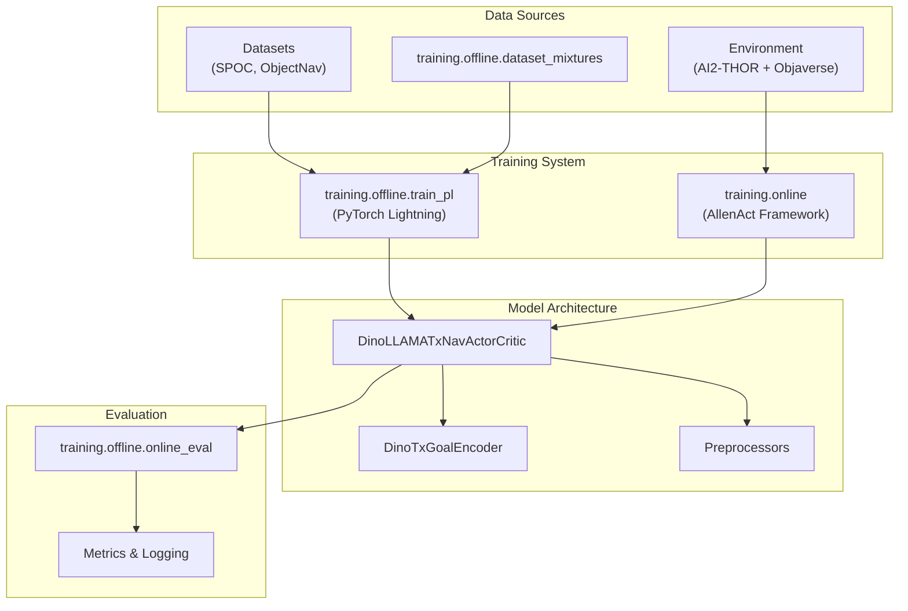
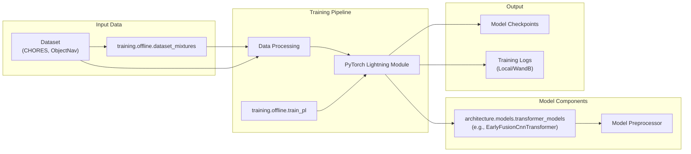
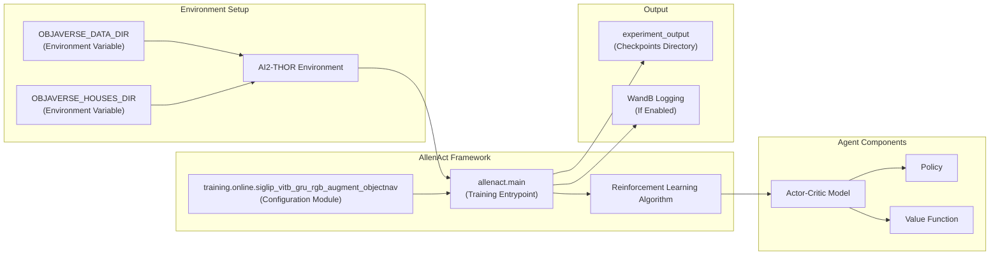
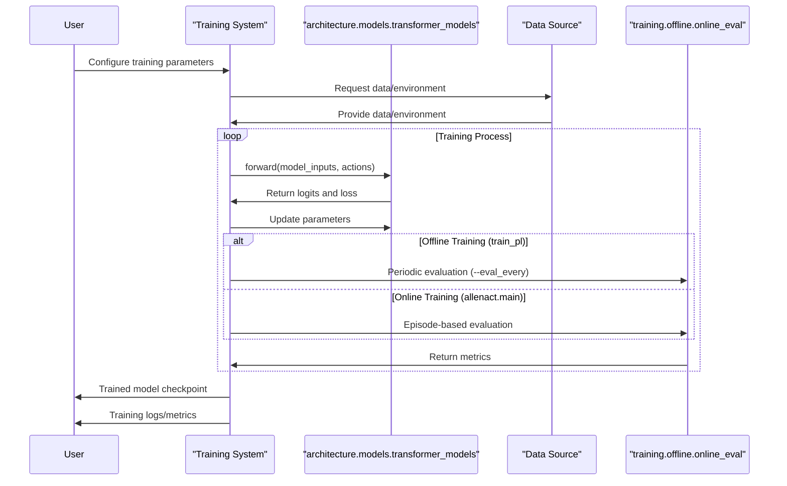

<!-- source: DeepWiki mcp.deepwiki.com · repo allenai/PoliFormer · page 4 Training System · fetched 2026-10-26 -->

# Training System

<details>
<summary>Relevant source files</summary>

The following files were used as context for generating this wiki page:

- [TRAINING_README.md](TRAINING_README.md)

</details>


This document describes PoliFormer's training system, which supports both offline supervised learning via PyTorch Lightning and online reinforcement learning using the AllenAct framework. The training system enables transformer-based models to learn visual navigation and manipulation tasks.

For information about the model architecture being trained, see [Model Architecture](#2.1). For details on how trained models are evaluated, see [Evaluation System](#5).

## Overview

The PoliFormer training system offers two distinct approaches for training models:

1. **Offline Training**: A supervised learning approach using PyTorch Lightning, implemented in `training.offline.train_pl`
2. **Online Training**: A reinforcement learning approach using AllenAct, implemented in `training.online` modules

These approaches serve different training paradigms and offer complementary benefits for model development.

Sources: [TRAINING_README.md:1-114]()

## Training System Architecture

Below is a high-level diagram of the training system architecture and how it fits into the overall PoliFormer system:



Sources: [TRAINING_README.md:1-114]()

## Offline Training

The offline training approach uses PyTorch Lightning to train models on pre-collected datasets. This approach is implemented in the `training.offline.train_pl` module.

### Offline Training Pipeline



Sources: [TRAINING_README.md:1-27](), [TRAINING_README.md:64-77]()

### Configuration Options

The offline training supports various configuration options, including:

| Parameter | Description | Example Value |
|-----------|-------------|---------------|
| `--dataset_version` | Dataset or mixture to use | `CHORES` or `TWO_TASK_MIX` |
| `--model` | Model architecture to train | `EarlyFusionCnnTransformer` |
| `--model_version` | Specific version of the model | `siglip_base_3` |
| `--sliding_window` | Window size for temporal data | `4` |
| `--per_gpu_batch` | Batch size per GPU | `3` |
| `--lr` | Learning rate | `0.0002` |
| `--input_sensors` | List of sensors to use | `raw_navigation_camera raw_manipulation_camera` |
| `--precision` | Numerical precision | `32-true` or `16-mixed` |
| `--loss` | Loss function | `action` |
| `--eval_every` | Evaluation frequency | `50` |
| `--save_every` | Checkpoint saving frequency | `50` |

Sources: [TRAINING_README.md:3-19](), [TRAINING_README.md:21-25]()

### Example Command

```bash
python -m training.offline.train_pl --model_version siglip_base_3 \
                                   --sliding_window 4 \
                                   --per_gpu_batch 3 \
                                   --lr 0.0002 \
                                   --dataset_version CHORES \
                                   --model EarlyFusionCnnTransformer \
                                   --input_sensors raw_navigation_camera raw_manipulation_camera last_actions an_object_is_in_hand \
                                   --precision 16-mixed \
                                   --loss action
```

Sources: [TRAINING_README.md:21-25]()

## Online Training (Reinforcement Learning)

The online training approach uses the AllenAct framework for reinforcement learning, where the agent learns through interaction with the environment. This approach is implemented in the `training.online` module.

### Online Training Pipeline



Sources: [TRAINING_README.md:81-96]()

### Environment Setup

Before training, you need to set up the environment by exporting the Objaverse data directory and houses directory:

```bash
export OBJAVERSE_DATA_DIR=/path/to/objaverse_assets
export OBJAVERSE_HOUSES_DIR=/path/to/objaverse_houses
```

Sources: [TRAINING_README.md:83-88]()

### Example Command

Basic training command:

```bash
python -m allenact.main training/online/siglip_vitb_gru_rgb_augment_objectnav
```

For WandB logging:

```bash
export WANDB_PROJECT=YOUR_WANDB_PROJECT_NAME
export WANDB_ENTITY=YOUR_WANDB_ENTITY_NAME
python -m allenact.main training/online/siglip_vitb_gru_rgb_augment_objectnav --callbacks wandb_logging_callback
```

Sources: [TRAINING_README.md:90-104]()

## Training Workflow

The general workflow for training a model in PoliFormer is as follows:



Sources: [TRAINING_README.md:1-114]()

## Evaluation During Training

Both training approaches include evaluation mechanisms:

1. **Offline Training Evaluation**:
   - Periodic evaluation using the `--eval_every` parameter
   - Evaluates on a validation subset of the dataset
   - Can specify `--eval_max_samples` to limit evaluation samples

2. **Online Training Evaluation**:
   - Episode-based evaluation during training
   - Final evaluation using the trained checkpoint with command:
     ```bash
     python -m allenact.main training/online/siglip_vitb_gru_rgb_augment_objectnav -c /path/to/checkpoint --eval
     ```

For detailed information about the evaluation system, see [Evaluation System](#5).

Sources: [TRAINING_README.md:29-56](), [TRAINING_README.md:106-112]()

## Online Evaluation of Offline-Trained Models

To evaluate a model trained with the offline approach using online evaluation:

```bash
python -m training.offline.online_eval --shuffle --eval_subset minival \
                                     --output_basedir OUTPUT_DIR \
                                     --test_augmentation \
                                     --eval_set_size 200 \
                                     --task_type TASK_TYPE \
                                     --max_eps_len 600 \
                                     --input_sensors raw_navigation_camera raw_manipulation_camera last_actions an_object_is_in_hand \
                                     --house_set objaverse \
                                     --training_run_id TRAINING_ID \
                                     --wandb_logging False \
                                     --ckptStep STEP_NUMBER \
                                     --num_workers NUM_WORKERS \
                                     --gpu_devices LIST_OF_GPU_IDS
```

You can choose to log metrics locally or using WandB:

- **Local logging**:
  ```bash
  --wandb_logging False --output_dir OUTPUT_DIR
  ```

- **WandB logging**:
  ```bash
  --wandb_logging True --wandb_entity_name WANDB_ENTITY_NAME --wandb_project_name WANDB_PROJECT_NAME
  ```

Sources: [TRAINING_README.md:29-62]()

## Creating Custom Models

To create a custom model for training:

1. Define a new model class in `architecture/models/transformer_models` (e.g., `early_fusion_tsfm_models.py`).
2. Implement required methods:
   - `forward(self, model_inputs, actions)` - Calculates loss and returns logits and loss
   - `build_model` (class method) - Creates the model and preprocessor
   - `build_agent` (class method) - Creates the evaluation agent
3. Register the model in `architecture/models/transformer_models/__init__.py`.
4. Implement the `Agent` class for online evaluation.

Sources: [TRAINING_README.md:64-80]()

## Training on Multiple Datasets

To train on multiple datasets:

1. Define a dataset mixture in `training/offline/dataset_mixtures.py`.
2. Pass the mixture name to the training script via the `--dataset_version` parameter.

Example definition in `dataset_mixtures.py`:
```python
TWO_TASK_MIX = ['ObjectNavType', 'ObjectNavDescription']
```

Example command:
```bash
python -m training.offline.train_pl --dataset_version TWO_TASK_MIX ...
```

Sources: [TRAINING_README.md:27]()

---

