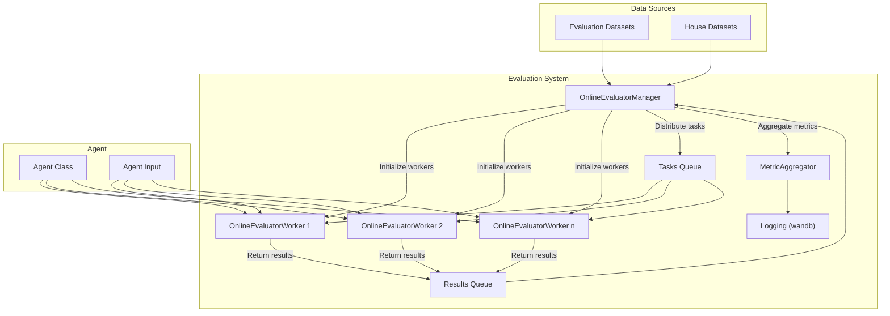
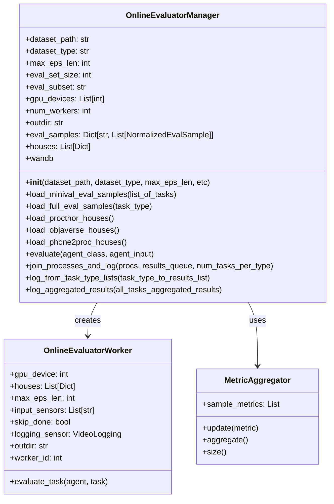
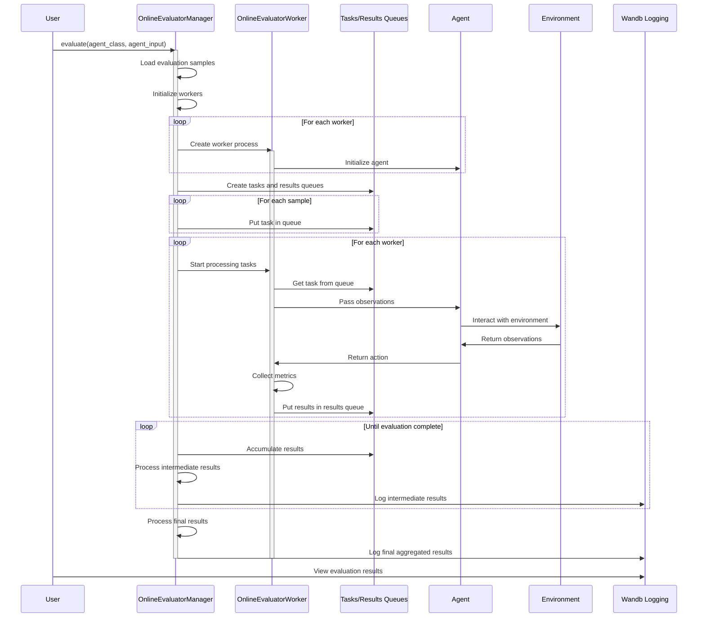
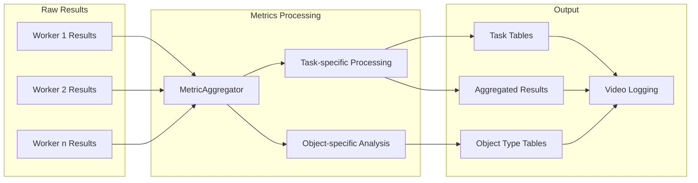
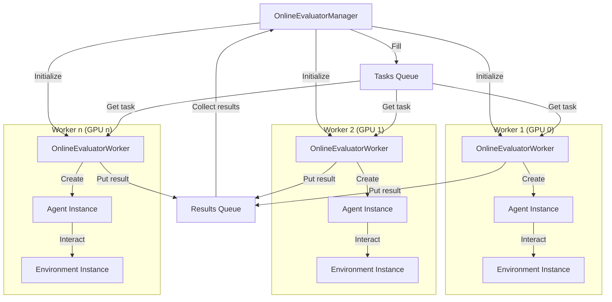
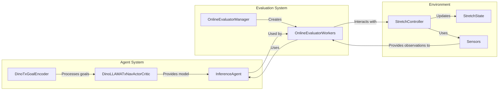

<!-- source: DeepWiki mcp.deepwiki.com · repo allenai/PoliFormer · page 5 Evaluation System · fetched 2026-10-26 -->

# Evaluation System

Relevant source files

The following files were used as context for generating this wiki page:

- [online_evaluation/max_episode_configs.py](online_evaluation/max_episode_configs.py)
- [online_evaluation/online_evaluator.py](online_evaluation/online_evaluator.py)

## Purpose and Scope

The Evaluation System in PoliFormer provides a robust framework for assessing agent performance in online settings. This system enables distributed parallel evaluation of transformer-based navigation agents across multiple environments, task types, and hardware resources. The Evaluation System handles loading evaluation samples, distributing evaluation tasks to workers, collecting metrics, and generating comprehensive performance reports.

For more information about the specific metrics used and logging details, see [Logging and Metrics](#5.2).

Sources: [online_evaluation/online_evaluator.py:190-666]()

## System Architecture

The Evaluation System follows a manager-worker architecture to efficiently distribute evaluation tasks across available computational resources. The system is designed to scale based on available GPUs and handle a variety of task types.

Sources: [online_evaluation/online_evaluator.py:190-214](), [online_evaluation/online_evaluator.py:425-460]()

## Key Components

### OnlineEvaluatorManager

The `OnlineEvaluatorManager` class is the central component of the evaluation system, responsible for:

1. Loading evaluation samples and house environments
2. Creating and coordinating worker processes
3. Distributing evaluation tasks
4. Collecting and aggregating results
5. Logging performance metrics

Sources: [online_evaluation/online_evaluator.py:190-344](), [online_evaluation/online_evaluator.py:80-92]()

### Evaluation Workflow

The evaluation process follows a specific sequence of operations:

Sources: [online_evaluation/online_evaluator.py:425-509](), [online_evaluation/online_evaluator.py:532-666]()

## Evaluation Data Sources

The Evaluation System can load evaluation samples from multiple sources:

1. **Minival Samples**: A small validation set for quick evaluation
2. **Full Evaluation Sets**: Larger sets for comprehensive evaluation
3. **House Environments**:
   - ProcTHOR houses (procedurally generated environments)
   - Objaverse houses (based on 3D object collections)
   - Phone2Proc houses (based on real-world data)

The system supports various task types:
- ObjectNavType
- RoomVisit
- ObjectNavMulti
- FetchType
- PickupType
- And other navigation and manipulation tasks

Each task type has its own configuration, including maximum episode length defined in `MAX_EPISODE_LEN_PER_TASK`.

Sources: [online_evaluation/online_evaluator.py:282-341](), [online_evaluation/max_episode_configs.py:1-15]()

## Metrics Collection and Aggregation

The system uses a `MetricAggregator` class to collect and aggregate metrics across evaluation samples:

The system collects various metrics including:
- Success rate
- Episode length
- Path length
- Distance to goal
- Object-specific performance

Results are aggregated:
- By task type (e.g., ObjectNavType, RoomVisit)
- By object type (for object navigation tasks)
- Across all evaluation samples

Sources: [online_evaluation/online_evaluator.py:80-92](), [online_evaluation/online_evaluator.py:94-98](), [online_evaluation/online_evaluator.py:101-188]()

## Distributed Evaluation

The system is designed to run evaluations in parallel across multiple workers. Each worker:
1. Runs on a dedicated GPU
2. Processes tasks from the shared queue
3. Evaluates the agent on assigned tasks
4. Returns results to the results queue

The system handles worker management, including:
- Starting worker processes
- Monitoring worker status
- Handling worker termination
- Collecting results from all workers

Sources: [online_evaluation/online_evaluator.py:425-509](), [online_evaluation/online_evaluator.py:29]()

## Result Logging

The Evaluation System provides comprehensive logging of evaluation results using Weights & Biases (wandb):

1. **Task-specific Results**:
   - Metrics for each task type (success rate, episode length, etc.)
   - Video recordings of agent behavior (for a subset of tasks)
   
2. **Object-specific Results**:
   - Performance metrics broken down by object type
   - Detailed statistics for specific object categories

3. **Aggregated Results**:
   - Combined metrics across all task types
   - Summary tables for overall performance

A table structure is used to display results in a readable format:

| Task Type | Success Rate | Path Length | Episode Length | Total Size | Num Workers |
|-----------|--------------|-------------|----------------|------------|-------------|
| ObjectNavType | 0.85 | 15.2 | 245.6 | 100 | 4 |
| RoomVisit | 0.92 | 25.3 | 456.2 | 50 | 4 |
| ObjectNavMulti | 0.76 | 18.7 | 356.4 | 75 | 4 |

Sources: [online_evaluation/online_evaluator.py:101-188](), [online_evaluation/online_evaluator.py:609-666]()

## Integration with the Agent System

The Evaluation System integrates with the PoliFormer agent architecture as follows:

The agent system provides the models and inference capabilities, while the evaluation system:
1. Creates a suitable environment for evaluation
2. Provides observations to the agent
3. Records and analyzes agent behavior
4. Computes performance metrics

Sources: [online_evaluation/online_evaluator.py:425-447]()

## Conclusion

The Evaluation System in PoliFormer provides a comprehensive framework for assessing agent performance across diverse tasks and environments. Its distributed architecture enables efficient parallel evaluation, while the robust metrics collection and analysis capabilities provide detailed insights into agent behavior and performance.

Key features include:
- Distributed parallel evaluation
- Support for multiple task types and environments
- Comprehensive metrics collection and aggregation
- Detailed result visualization and logging
- Integration with the agent and environment systems

This system plays a crucial role in the development and benchmarking of transformer-based navigation agents in the PoliFormer framework.

---

