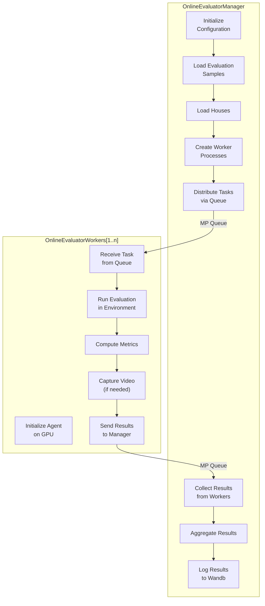
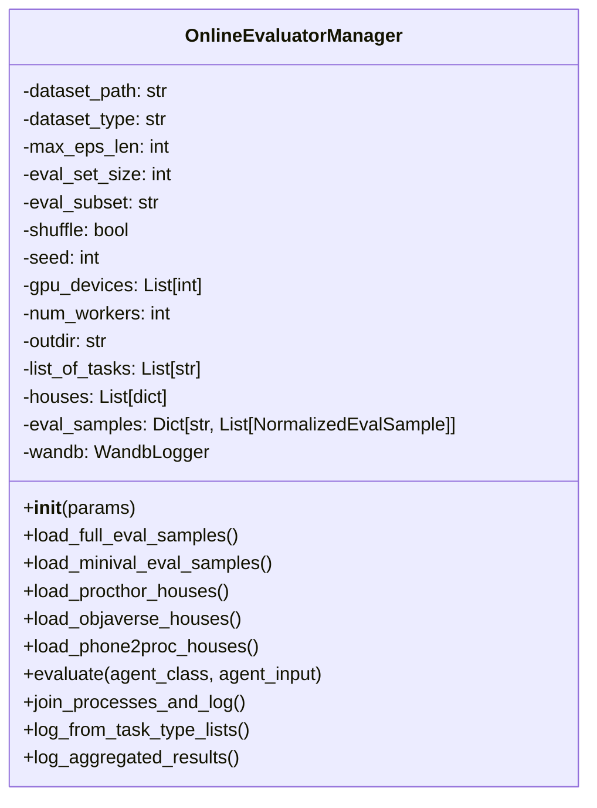
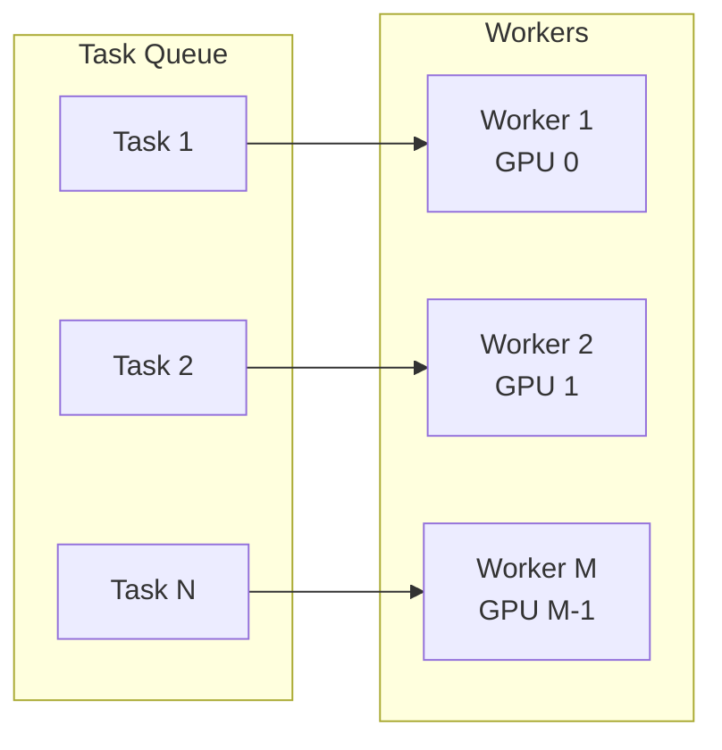

<!-- source: DeepWiki mcp.deepwiki.com · repo allenai/PoliFormer · page 5.1 Online Evaluator · fetched 2026-10-26 -->

# Online Evaluator

<details>
<summary>Relevant source files</summary>

The following files were used as context for generating this wiki page:

- [online_evaluation/online_evaluator.py](online_evaluation/online_evaluator.py)

</details>


## Purpose and Scope

The Online Evaluator is a system for evaluating trained agents in the PoliFormer architecture. It provides a framework for distributed evaluation of models on a variety of robot navigation and manipulation tasks, collecting performance metrics, and logging results. This component focuses on the post-training assessment of model capabilities in online settings, where agents interact with the environment in real-time.

This page covers the architecture and implementation of the evaluation infrastructure, including the manager that coordinates evaluation processes and the workers that execute evaluation tasks. For information about the metrics used and detailed logging functionality, see [Logging and Metrics](#5.2).

Sources: [online_evaluation/online_evaluator.py:190-191](). [online_evaluation/online_evaluator.py:21-24]()

## Architecture Overview

The Online Evaluator employs a manager-worker architecture to distribute evaluation tasks efficiently across available computational resources. This design allows for parallel evaluation of models, optimizing the utilization of GPU resources and accelerating the evaluation process.



Sources: [online_evaluation/online_evaluator.py:425-510](), [online_evaluation/online_evaluator.py:28-29]()

## Key Components

### OnlineEvaluatorManager

The `OnlineEvaluatorManager` class is the central component that orchestrates the entire evaluation process. It is responsible for:

1. Loading evaluation samples and house environments
2. Creating and managing worker processes
3. Distributing tasks via queues
4. Collecting and aggregating results
5. Logging metrics and videos to Weights & Biases (wandb)



The manager supports different types of evaluation datasets and house environments, including:
- Dataset types: chores-small, chores-large, etc.
- House sets: procthor, objaverse, phone2proc

Sources: [online_evaluation/online_evaluator.py:191-266](), [online_evaluation/online_evaluator.py:425-509]()

### OnlineEvaluatorWorker

The `OnlineEvaluatorWorker` class handles the execution of evaluation tasks on specific GPU devices. Each worker:

1. Initializes the agent model on its assigned GPU
2. Executes evaluation episodes in the environment
3. Computes performance metrics
4. Captures videos for visualization (if configured)
5. Returns results to the manager

The workers run as separate processes to enable parallel evaluation, with communication handled through multiprocessing queues.

Sources: [online_evaluation/online_evaluator.py:21-24](), [online_evaluation/online_evaluator.py:447-450](), [online_evaluation/online_evaluator.py:486-507]()

### MetricAggregator

The `MetricAggregator` class maintains and aggregates metrics across multiple evaluation episodes. It provides functionality to update metrics with new values and compute aggregate statistics.

```python
class MetricAggregator:
    def __init__(self):
        self.sample_metrics = list()

    def update(self, metric):
        self.sample_metrics.append(metric)

    def aggregate(self):
        return sum(self.sample_metrics) / (len(self.sample_metrics) + 1e-10)

    def size(self):
        return len(self.sample_metrics)
```

Sources: [online_evaluation/online_evaluator.py:80-92]()

## Evaluation Workflow

### 1. Initialization and Configuration

The evaluation process begins with the initialization of the `OnlineEvaluatorManager` with configuration parameters, including:
- Dataset path and type
- Evaluation subset (train, val, minival)
- GPU devices to use
- Number of worker processes
- Maximum episode length
- Output directory for results

Sources: [online_evaluation/online_evaluator.py:192-266]()

### 2. Loading Evaluation Data

The manager loads evaluation samples based on the configured dataset type and evaluation subset. It supports multiple data loading methods:

- `load_full_eval_samples`: Loads samples from the full dataset
- `load_minival_eval_samples`: Loads a smaller subset for quick evaluation
- Environment houses are loaded according to the specified house set (procthor, objaverse, phone2proc)

Sources: [online_evaluation/online_evaluator.py:282-416]()

### 3. Task Distribution

The manager creates a task queue and populates it with evaluation samples. Each sample includes task specifications such as:
- Task type (e.g., ObjectNav, RoomVisit)
- Goal specification
- House configuration
- Flag indicating whether video should be captured

Tasks are shuffled and distributed among worker processes through a multiprocessing queue.



Sources: [online_evaluation/online_evaluator.py:455-471]()

### 4. Worker Execution

Each worker operates in its own process and executes the following steps for each task:
1. Initialize the agent with the provided model
2. Set up the environment according to task specifications
3. Run the evaluation episode (agent-environment interaction)
4. Compute performance metrics
5. Capture video (if specified)
6. Return results to the manager via a results queue

Sources: [online_evaluation/online_evaluator.py:485-508]()

### 5. Results Collection and Aggregation

The manager continuously polls the results queue, collecting and aggregating metrics from completed tasks. It uses the `MetricAggregator` to maintain running statistics for each metric.

The system also tracks progress and estimates completion time based on the processing rate:
```python
speed = (total_finished - uncounted_finished) / (current_time - start_time)
ETA = (total_tasks - total_finished) / (speed + 1e-8)
print(f"Rate {speed:.3f} tasks/s, ETA {ETA / 3600:.3f}hours")
```

Sources: [online_evaluation/online_evaluator.py:532-608](), [online_evaluation/online_evaluator.py:560-563]()

### 6. Logging and Visualization

Results are logged to Weights & Biases in several formats:
- Tables with per-task metrics
- Tables with per-object metrics (for objectnav tasks)
- Aggregated results across all tasks
- Videos of selected evaluation episodes

The system supports intermediate logging during evaluation to track progress and diagnose issues.

Sources: [online_evaluation/online_evaluator.py:101-188](), [online_evaluation/online_evaluator.py:609-665]()

## Configuration Parameters

The `OnlineEvaluatorManager` accepts numerous configuration parameters to customize the evaluation process:

| Parameter | Description | Default |
|-----------|-------------|---------|
| `dataset_path` | Path to the dataset directory | "/data/datasets" |
| `dataset_type` | Type of dataset to use (e.g., "object_nav_v0.3") | "object_nav_v0.3" |
| `max_eps_len` | Maximum length of evaluation episodes | -1 (no limit) |
| `eval_set_size` | Number of samples to evaluate | None (all samples) |
| `eval_subset` | Dataset subset to use (train, val, minival) | "val" |
| `shuffle` | Whether to shuffle evaluation samples | True |
| `seed` | Random seed for shuffling | 123 |
| `gpu_devices` | List of GPU device IDs to use | None |
| `outdir` | Directory for output files | "/data/results/online_evaluation/OnlineEval-default" |
| `table_size` | Number of samples to include in detailed logging | 200 |
| `list_of_tasks` | List of task types to evaluate | [] (all tasks) |
| `input_sensors` | Sensors to use for agent input | ("raw_navigation_camera", "raw_manipulation_camera") |
| `skip_done` | Whether to skip completed tasks | False |
| `house_set` | Type of house environments (procthor, objaverse, phone2proc) | "procthor" |
| `num_workers` | Number of worker processes | 1 |
| `benchmark_revision` | Benchmark revision to use | "chores-small" |

Sources: [online_evaluation/online_evaluator.py:192-242]()

## Time Management and Error Handling

The system includes mechanisms for managing execution time and handling errors:

1. **Timeouts**: The `time_limit` context manager sets alarm signals to enforce time limits on operations
2. **Worker Monitoring**: The manager tracks worker processes and handles cases where workers become unresponsive
3. **Queue Management**: The system handles queue timeouts and empty queue conditions

```python
@contextmanager
def time_limit(seconds):
    def signal_handler(signum, frame):
        raise TimeoutException("Timed out!")

    signal.signal(signal.SIGALRM, signal_handler)
    signal.alarm(seconds)
    try:
        yield
    finally:
        signal.alarm(0)
```

Sources: [online_evaluation/online_evaluator.py:38-52](), [online_evaluation/online_evaluator.py:576-584]()

## Integration with Training

The Online Evaluator is designed to work with models trained using the PoliFormer architecture. It can evaluate models during or after training to assess their performance on specific tasks.

When used during training, it provides feedback on model performance that can guide training decisions. When used after training, it provides comprehensive evaluation of model capabilities across a range of tasks and environments.

Sources: [online_evaluation/online_evaluator.py:425-428]()

---

