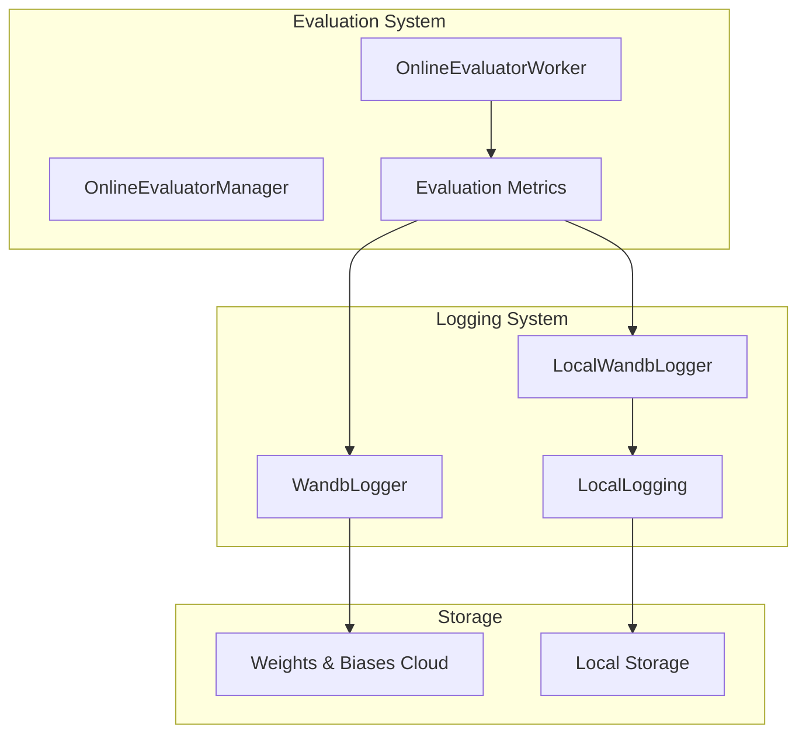
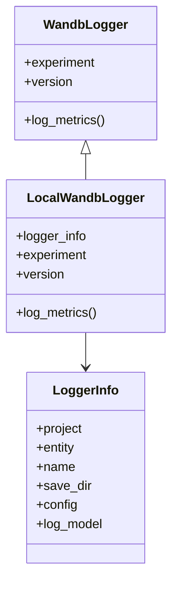
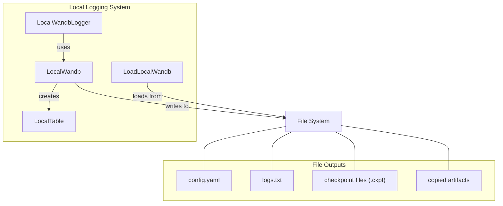
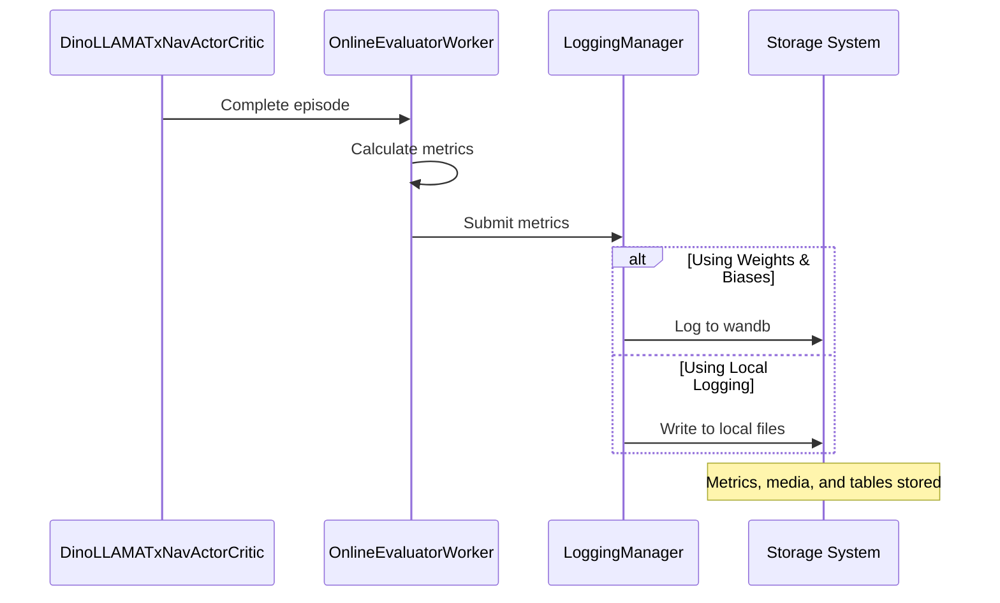
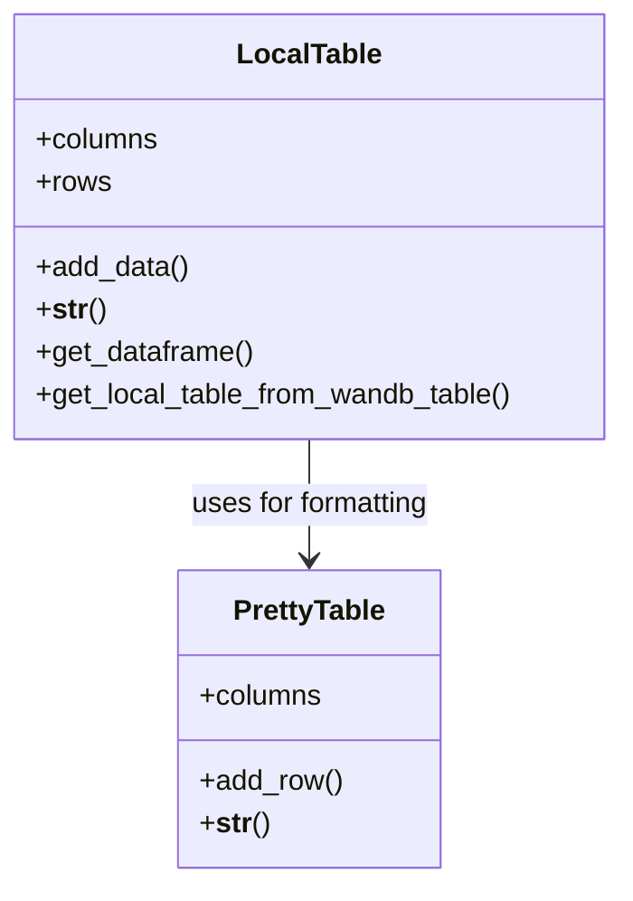

<!-- source: DeepWiki mcp.deepwiki.com · repo allenai/PoliFormer · page 5.2 Logging and Metrics · fetched 2026-10-26 -->

# Logging and Metrics

<details>
<summary>Relevant source files</summary>

The following files were used as context for generating this wiki page:

- [online_evaluation/local_logging_utils.py](online_evaluation/local_logging_utils.py)

</details>


This document describes the logging and metrics system used in PoliFormer to track, record, and visualize evaluation results. It covers the integration with Weights & Biases (wandb) for experiment tracking, the local logging fallback mechanism, and the key metrics used to evaluate model performance. For information about the online evaluation system itself, see [Online Evaluator](#5.1).

## Logging Architecture

PoliFormer implements a flexible logging system that supports both cloud-based experiment tracking via Weights & Biases and a local logging fallback mechanism that mimics the wandb API but stores all data on disk.



Sources: [online_evaluation/local_logging_utils.py:1-223]()

### Weights & Biases Integration

The primary logging method uses Weights & Biases (wandb) for experiment tracking. This cloud-based solution provides:

- Real-time experiment tracking
- Performance visualization
- Experiment comparison
- Artifact management for model checkpoints

PyTorch Lightning's built-in wandb logger is extended through the `LocalWandbLogger` class to provide additional functionality while maintaining compatibility with the standard logging interface.



Sources: [online_evaluation/local_logging_utils.py:20-67]()

### Local Logging System

For scenarios where cloud logging is unavailable or undesirable, PoliFormer implements a local logging system that mirrors the wandb API. This consists of:

1. `LocalWandbLogger`: A PyTorch Lightning logger that mimics `WandbLogger`
2. `LocalWandb`: A class that provides the same interface as wandb's logger but writes to local storage
3. `LocalTable`: A class for creating formatted tables similar to wandb's Table utility
4. `LoadLocalWandb`: A utility for loading configurations and checkpoints from local logs

This architecture ensures consistent logging behavior regardless of whether the system is using wandb or the local fallback mechanism.



Sources: [online_evaluation/local_logging_utils.py:69-216]()

## Metrics Collection and Processing

The evaluation system collects various metrics that are then processed and logged. The system supports different types of data:

1. **Scalar metrics**: Numerical values like success rate, SPL (Success weighted by Path Length), etc.
2. **Media**: Images and videos from the agent's perspective
3. **Tables**: Structured data showcasing detailed per-episode results

### Key Metrics

The following table summarizes the primary metrics tracked in the PoliFormer evaluation system:

| Metric | Description | Type |
|--------|-------------|------|
| Success Rate | Percentage of episodes where the agent successfully completed the task | Scalar |
| SPL | Success weighted by Path Length - measures efficiency of successful paths | Scalar |
| Episode Length | Average number of steps taken per episode | Scalar |
| Goal Accuracy | How accurately the agent identifies and reaches the specified goal | Scalar |
| Navigation Error | Average distance from the agent's final position to the goal | Scalar |
| Per-Episode Results | Detailed breakdown of each evaluation episode | Table |

## Logging Workflow

The logging process in PoliFormer follows a specific workflow from metric collection to visualization:



Sources: [online_evaluation/local_logging_utils.py:134-189]()

## Local Logging Implementation Details

The local logging system is designed to be a drop-in replacement for wandb, maintaining the same API while writing to the local filesystem instead of uploading to the cloud.

### Logging Configuration

The configuration is stored in a YAML file that mirrors the wandb config structure:

```yaml
# Example config.yaml
model_type: DinoLLAMATxNavActorCritic
batch_size: 64
learning_rate: 0.0001
# ... other parameters
```

### Media Handling

For media like videos and images, the local logging system stores file paths rather than the media itself. This is handled by the following methods:

- `LocalWandb.Video()`: Returns the video path for reference
- `LocalWandb.Image()`: Returns the image path for reference

### Tabular Data

The `LocalTable` class provides functionality similar to wandb's Table feature, using PrettyTable for formatting:



Sources: [online_evaluation/local_logging_utils.py:192-216]()

## Loading and Recovering Experiments

The `LoadLocalWandb` utility allows for loading experiment configurations and checkpoints from previous runs:

```python
# Example usage (not in codebase)
loader = LoadLocalWandb(run_id="abcd1234", save_dir="/path/to/logs")
config = loader.config  # Load configuration
checkpoint_path = loader.get_checkpoint(ckpt_step=1000)  # Get specific checkpoint
```

This is particularly useful for:
- Resuming training from a checkpoint
- Analyzing results offline
- Converting local experiments to wandb format if needed

Sources: [online_evaluation/local_logging_utils.py:69-95]()

## Integration with PyTorch Lightning

The logging system integrates with PyTorch Lightning's training framework through the custom `LocalWandbLogger` class. This ensures that metrics logged during both training and evaluation follow the same format and can be compared directly.

Key integration points:
- Log metrics from training steps via PyTorch Lightning callbacks
- Track model checkpoints automatically
- Support for Lightning's rank-zero logging to prevent duplicate logs in distributed training

Sources: [online_evaluation/local_logging_utils.py:20-67]()

## Best Practices for Logging

When using the PoliFormer logging system:

1. Always specify a unique experiment name to avoid confusion between runs
2. Use structured hierarchical keys for metrics (e.g., `navigation/success_rate`)
3. Include relevant configuration details with each experiment
4. For local logging, ensure sufficient disk space for media files
5. When comparing experiments, use consistent metrics and task configurations

The logging and metrics system provides crucial visibility into the performance of PoliFormer models during both training and evaluation phases, enabling data-driven iteration and improvement of model architectures and training procedures.

---

