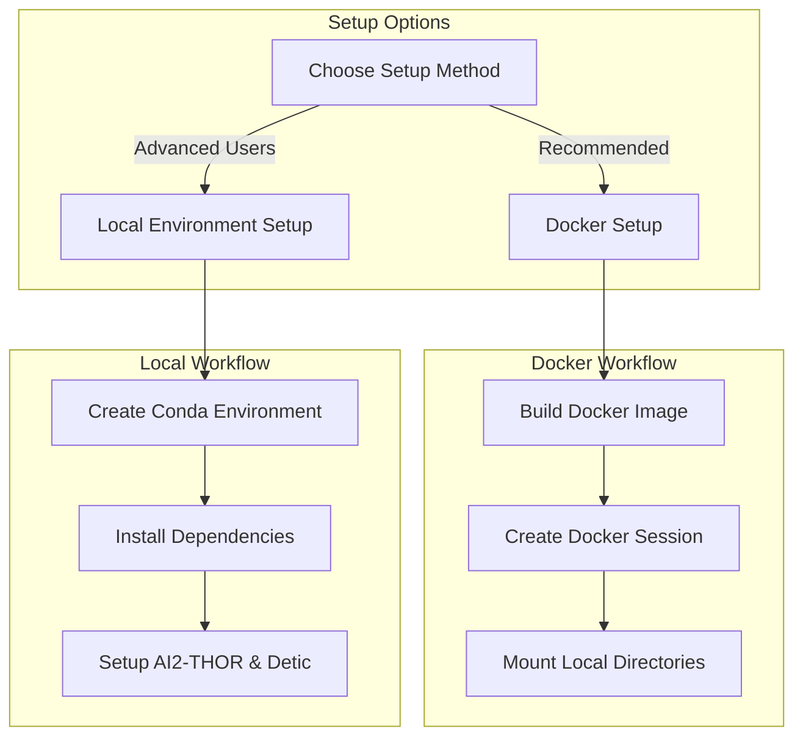
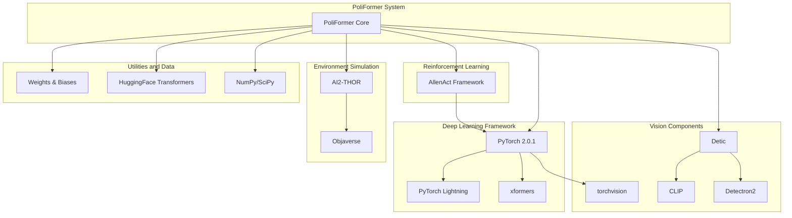
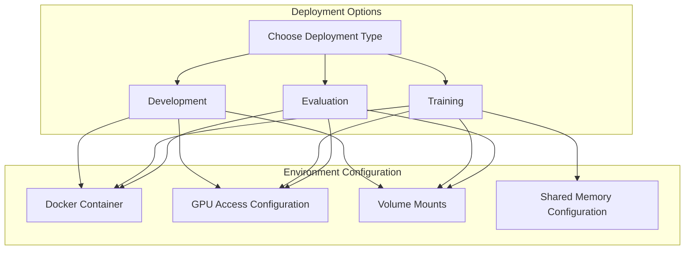

<!-- source: DeepWiki mcp.deepwiki.com · repo allenai/PoliFormer · page 6 Setup and Deployment · fetched 2026-10-26 -->

# Setup and Deployment

<details>
<summary>Relevant source files</summary>

The following files were used as context for generating this wiki page:

- [docker/Dockerfile](docker/Dockerfile)
- [docker/README.md](docker/README.md)
- [docker/requirements.txt](docker/requirements.txt)

</details>


This document provides comprehensive instructions for setting up the PoliFormer environment and deploying the system. It covers system requirements, environment setup, and deployment options. For Docker-specific configuration details, see [Docker Configuration](#6.1).

## System Requirements

PoliFormer is designed to run on systems with NVIDIA GPUs and requires significant computational resources for training transformer models for robot navigation. Below are the minimum and recommended system specifications.

### Hardware Requirements

| Component | Minimum | Recommended |
|-----------|---------|-------------|
| CPU | 8 cores | 16+ cores |
| RAM | 32GB | 64GB+ |
| GPU | NVIDIA GPU with 12GB VRAM | NVIDIA GPU with 24GB+ VRAM (RTX 3090/4090 or A100) |
| Storage | 100GB SSD | 500GB+ SSD |

### Software Requirements

| Software | Version |
|----------|---------|
| Operating System | Ubuntu 20.04 LTS |
| CUDA | 11.8 |
| Python | 3.10 |
| Docker (optional) | Latest |
| NVIDIA Container Toolkit (for Docker) | Latest |

Sources: [docker/Dockerfile:1-3](), [docker/README.md:5-20]()

## Environment Setup

The PoliFormer codebase can be set up in two ways: using Docker (recommended) or setting up a local environment.



### Docker Setup (Recommended)

The simplest way to set up PoliFormer is to use the provided Docker configuration, which encapsulates all dependencies and environment variables.

1. Clone the repository:
   ```bash
   git clone https://github.com/allenai/PoliFormer.git
   cd PoliFormer
   ```

2. Build the Docker image:
   ```bash
   cd docker
   ./create_image.sh
   ```

3. Run the Docker container:
   ```bash
   DOCKER_IMAGE=spoc-base-[DATE]
   SPOC_PATH=/path/to/PoliFormer
   DATA_PATH=/path/to/data
   
   docker run \
       --gpus all \
       --device /dev/dri \
       --mount type=bind,source=${SPOC_PATH},target=/root/spoc \
       --mount type=bind,source=${DATA_PATH},target=/root/data \
       --shm-size 250G \
       -it ${DOCKER_IMAGE}:latest
   ```

Sources: [docker/README.md:22-60]()

### Local Environment Setup

If you prefer to set up a local environment without Docker:

1. Create a Conda environment:
   ```bash
   conda create -n spoc python=3.10
   conda activate spoc
   conda install -c conda-forge jsonnet ipython
   ```

2. Install dependencies:
   ```bash
   pip install setuptools==66.0.0
   pip install -r requirements.txt
   ```

3. Install AI2-THOR and Detic:
   ```bash
   pip install --extra-index-url https://ai2thor-pypi.allenai.org ai2thor==0+966bd7758586e05d18f6181f459c0e90ba318bec
   
   # Detic installation
   git clone https://github.com/facebookresearch/Detic.git --recurse-submodules
   cd Detic
   pip install -r requirements.txt
   mkdir models
   wget https://dl.fbaipublicfiles.com/detic/Detic_LCOCOI21k_CLIP_SwinB_896b32_4x_ft4x_max-size.pth -O models/Detic_LCOCOI21k_CLIP_SwinB_896b32_4x_ft4x_max-size.pth
   cd ..
   ```

4. Install PyTorch and related libraries:
   ```bash
   pip install torch==2.0.1 torchvision xformers lightning open_clip_torch
   ```

Sources: [docker/Dockerfile:6-39](), [docker/requirements.txt:1-84]()

## Key Dependencies Architecture

The PoliFormer system depends on several key libraries and frameworks that work together to enable transformer-based reinforcement learning for robot navigation.



Sources: [docker/requirements.txt:17-84](), [docker/Dockerfile:15-28]()

## Deployment Options

PoliFormer supports several deployment scenarios depending on your use case. The main deployment options are:

### 1. Development Environment

This setup is ideal for developing and experimenting with the PoliFormer codebase.

- Use Docker with mounted volumes for easy code editing
- Enable larger shared memory with `--shm-size` for efficient training
- Configure GPU access with `--gpus all`

### 2. Training Environment

For training new models:

- Increase shared memory allocation (`--shm-size 250G` or as appropriate for your system)
- Ensure all GPUs are available to the container
- Mount data directories for efficient data access

### 3. Evaluation Environment

For evaluating trained models:

- Mount model checkpoints directory
- Configure Weights & Biases for logging results
- Minimal resource requirements compared to training



Sources: [docker/README.md:36-56]()

## Resource Management

Training transformer models for robot navigation requires careful resource management. Here are key considerations:

### Shared Memory

When running data-intensive training, configure adequate shared memory:

```bash
--shm-size 250G
```

Adjust this value based on your system's capabilities and the dataset size.

### GPU Memory Management

PoliFormer uses xformers for efficient transformer attention computation, which helps reduce GPU memory usage. To further optimize memory:

1. Adjust batch sizes based on available GPU memory
2. Consider gradient accumulation for larger effective batch sizes
3. Use mixed precision training when possible

Sources: [docker/README.md:51-55]()

## Post-Installation Verification

After setting up the environment, verify the installation:

1. Activate the environment:
   ```bash
   # If using Docker, you're already in the environment
   # If using Conda:
   conda activate spoc
   ```

2. Test basic imports:
   ```python
   import torch
   import ai2thor
   import allenact
   ```

3. Run a simple evaluation:
   ```bash
   # From the repository root
   python -m poliformer.evaluation.run_basic_test
   ```

## Troubleshooting

Common issues and their solutions:

| Issue | Solution |
|-------|----------|
| CUDA out of memory | Reduce batch size or model size |
| Docker permission errors | Ensure proper user permissions for Docker |
| AI2-THOR rendering issues | Check GPU drivers and X server configuration |
| Import errors | Verify all dependencies are installed correctly |
| Shared memory errors | Increase --shm-size parameter when running Docker |

For Docker-specific issues and advanced configuration, refer to [Docker Configuration](#6.1).

Sources: [docker/README.md:54-55]()

---

