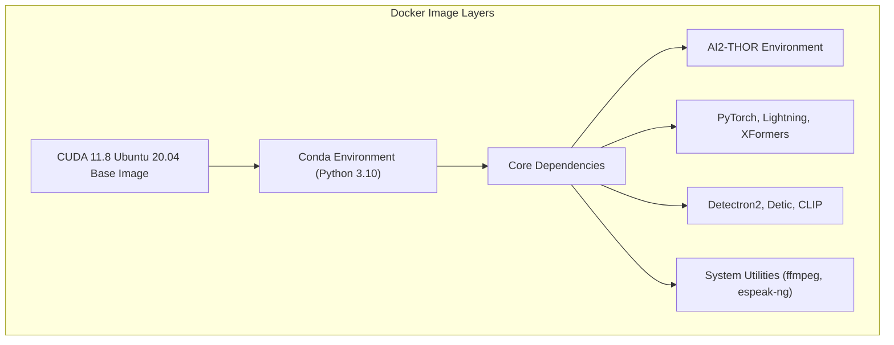
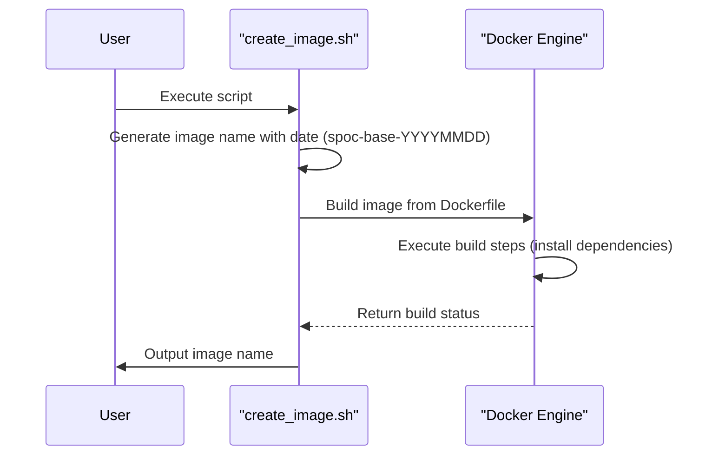
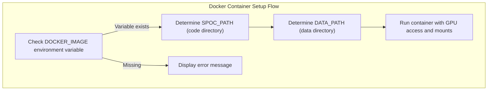
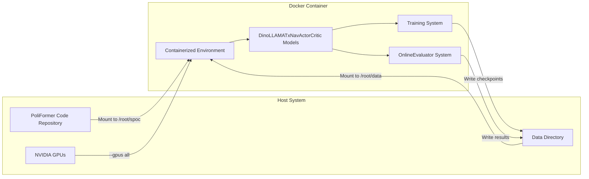

<!-- source: DeepWiki mcp.deepwiki.com · repo allenai/PoliFormer · page 6.1 Docker Configuration · fetched 2026-10-26 -->

# Docker Configuration

<details>
<summary>Relevant source files</summary>

The following files were used as context for generating this wiki page:

- [docker/Dockerfile](docker/Dockerfile)
- [docker/README.md](docker/README.md)
- [docker/create_image.sh](docker/create_image.sh)
- [docker/create_session.sh](docker/create_session.sh)

</details>


This document explains how to use Docker with the PoliFormer system. Docker provides a consistent environment for development, training, and evaluation of the transformer-based reinforcement learning models used in robot navigation tasks.

## Purpose and Scope

The Docker configuration ensures that all dependencies and CUDA settings are properly set up to run PoliFormer. This includes managing GPU access, installing required libraries, and providing scripts for easily building and running containers. This page covers:

- Building the Docker image
- Running Docker containers
- Understanding the Docker environment
- Configuring mount points for code and data

For information about the actual setup of the training and evaluation systems that run inside this Docker environment, see [Setup and Deployment](#6).

## Docker Image Architecture

The PoliFormer Docker image is built on a CUDA-enabled Ubuntu base image and contains a conda environment with all necessary dependencies.



The Dockerfile creates the image in multiple stages:
1. `conda_env_builder` - Creates the base conda environment
2. `requirements_installer` - Installs Python dependencies and system utilities

Sources: [docker/Dockerfile:1-41]()

## Prerequisites

Before building the Docker image, ensure you have:

1. Docker installed
2. NVIDIA Container Toolkit installed (for GPU support)

The toolkit can be installed using the commands provided in the repository README:

```bash
curl -s -L https://nvidia.github.io/nvidia-container-runtime/gpgkey | \
  sudo apt-key add -
distribution=$(. /etc/os-release;echo $ID$VERSION_ID)
curl -s -L https://nvidia.github.io/nvidia-container-runtime/$distribution/nvidia-container-runtime.list | \
  sudo tee /etc/apt/sources.list.d/nvidia-container-runtime.list
sudo apt-get update
sudo apt-get install -y nvidia-container-toolkit-base nvidia-container-toolkit
sudo systemctl restart docker
```

Sources: [docker/README.md:5-20]()

## Building the Docker Image

The image build process is automated using the `create_image.sh` script. This script creates a Docker image tagged with the current date.



To build the image:

1. Navigate to the docker directory:
   ```bash
   cd /path/to/PoliFormer/docker
   ```

2. Run the create_image.sh script:
   ```bash
   ./create_image.sh
   ```

3. The script will output the name of the generated image (e.g., `spoc-base-20241104`)

Sources: [docker/create_image.sh:1-7](), [docker/README.md:22-34]()

## Running Docker Containers

The repository provides a helper script (`create_session.sh`) for running Docker containers. This script handles mounting the code repository and data directories inside the container.

### Environment Variables

The script uses these environment variables:

| Variable | Purpose | Required | Default |
|----------|---------|----------|---------|
| `DOCKER_IMAGE` | Name of the Docker image to use | Yes | None |
| `SPOC_PATH` | Path to PoliFormer code | No | Current directory |
| `DATA_PATH` | Path to data directory | No | ./data |

### Starting a Container

1. Export the Docker image name:
   ```bash
   export DOCKER_IMAGE=spoc-base-20241104
   ```

2. Optionally set the code and data paths:
   ```bash
   export SPOC_PATH=/path/to/PoliFormer
   export DATA_PATH=/path/to/data
   ```

3. Run the script:
   ```bash
   ./create_session.sh
   ```



Sources: [docker/create_session.sh:1-37](), [docker/README.md:36-60]()

### Container Configuration Parameters

The Docker container is started with several important parameters:

| Parameter | Description |
|-----------|-------------|
| `--gpus all` | Enables access to all NVIDIA GPUs |
| `--device /dev/dri` | Provides access to Direct Rendering Infrastructure |
| `--mount type=bind,source=${SPOC_PATH},target=/root/spoc` | Mounts local code to /root/spoc in container |
| `--mount type=bind,source=${DATA_PATH},target=/root/data` | Mounts local data to /root/data in container |
| `--shm-size 50G` | Sets shared memory size (important for data loading) |

The shared memory size (`--shm-size`) is particularly important for training, as the dataloader will load large amounts of data into shared memory. You may need to adjust this value based on your system's capabilities.

Sources: [docker/create_session.sh:30-37](), [docker/README.md:43-56]()

## Manual Container Creation

You can also manually create and run a Docker container without using the helper script:

```bash
docker run \
    --gpus all \
    --device /dev/dri \
    --mount type=bind,source=/path/to/PoliFormer,target=/root/spoc \
    --mount type=bind,source=/path/to/data,target=/root/data \
    --shm-size 250G \
    -it spoc-base-20241104:latest
```

This approach gives you more control over the container configuration if needed.

Sources: [docker/README.md:43-53]()

## Container and Host System Integration

The Docker configuration integrates with the broader PoliFormer system as follows:



This containerized approach ensures consistent environments for development, training, and evaluation while allowing easy access to the code and data from the host system.

Sources: [docker/README.md:36-60](), [docker/create_session.sh:30-37]()

## Troubleshooting

### Common Issues and Solutions

1. **NVIDIA Driver/Container Toolkit Issues**
   - Symptom: Error messages about missing NVIDIA drivers or containers
   - Solution: Ensure NVIDIA drivers and container toolkit are correctly installed and Docker has been restarted

2. **Shared Memory Size Issues**
   - Symptom: "Bus error" or crashes during training with large batches
   - Solution: Increase the `--shm-size` parameter when starting the container

3. **Directory Mounting Issues**
   - Symptom: Files not accessible within container
   - Solution: Verify the paths provided to `SPOC_PATH` and `DATA_PATH` exist and have appropriate permissions

Sources: [docker/README.md:7-20](), [docker/README.md:54-56]()