# Page: Overview

# Overview

<details>
<summary>Relevant source files</summary>

The following files were used as context for generating this wiki page:

- [LICENSE](LICENSE)
- [README.md](README.md)
- [TRAINING_README.md](TRAINING_README.md)

</details>


PoliFormer is a system designed to scale on-policy reinforcement learning using transformers for robot navigation tasks. This page provides a high-level overview of the PoliFormer repository, its architecture, and its approach to reinforcement learning.

## Introduction

PoliFormer, as described in its full title "PoliFormer: Scaling On-Policy RL with Transformers Results in Masterful Navigators," is a framework that combines transformer-based models with on-policy reinforcement learning to create effective visual navigation agents. The system is designed to navigate to specific objects within environments based on either text descriptions or visual recognition cues.

Sources: [README.md:1-11]()

## System Purpose

The primary purpose of PoliFormer is to:

1. Implement a transformer-based architecture for visual navigation tasks
2. Scale on-policy reinforcement learning using transformers
3. Train agents to navigate to objects based on text descriptions or visual cues
4. Evaluate agent performance in realistic environments

The system addresses the challenge of creating embodied AI systems that can understand natural language commands and navigate to fulfill those commands in physical environments.

Sources: [README.md:11-12]()

## High-Level Architecture

PoliFormer consists of four major components working together to enable transformer-based reinforcement learning for navigation:

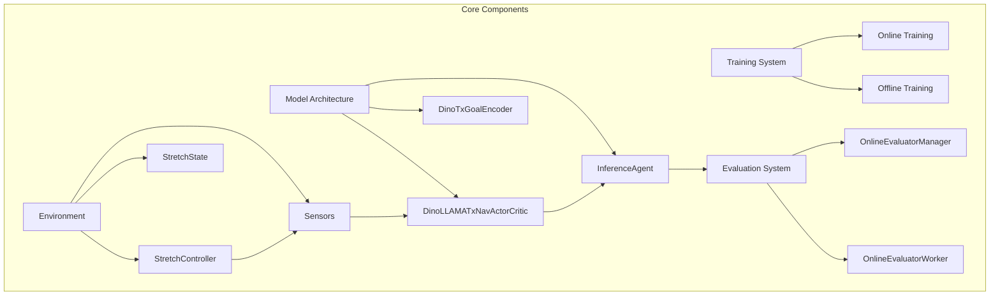

**Model Architecture**: Contains the transformer-based models that process sensory inputs and goal information to output navigation actions.

**Environment**: Manages the simulation environment and robot state, providing observations through various sensors.

**Training System**: Implements both online reinforcement learning (via AllenAct) and offline learning (via PyTorch Lightning).

**Evaluation System**: Enables distributed evaluation of trained models in online settings.

Sources: [README.md:90-180](), [TRAINING_README.md:30-62]()

## Data Flow and Processing

The following diagram illustrates how data flows through the PoliFormer system during both training and inference:

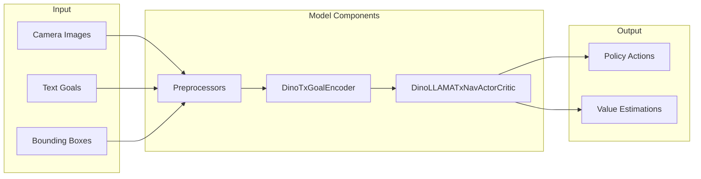

During training and inference:
1. The system receives inputs from cameras, text goal descriptions, and/or bounding boxes of target objects
2. These inputs are processed by specialized preprocessors
3. The encoded inputs are fed to the transformer models
4. The models output policy actions (what to do next) and value estimations (how good the current state is)

Sources: [README.md:135-178]()

## Training and Evaluation Pipeline

PoliFormer supports both online training (reinforcement learning) and offline training (supervised learning):

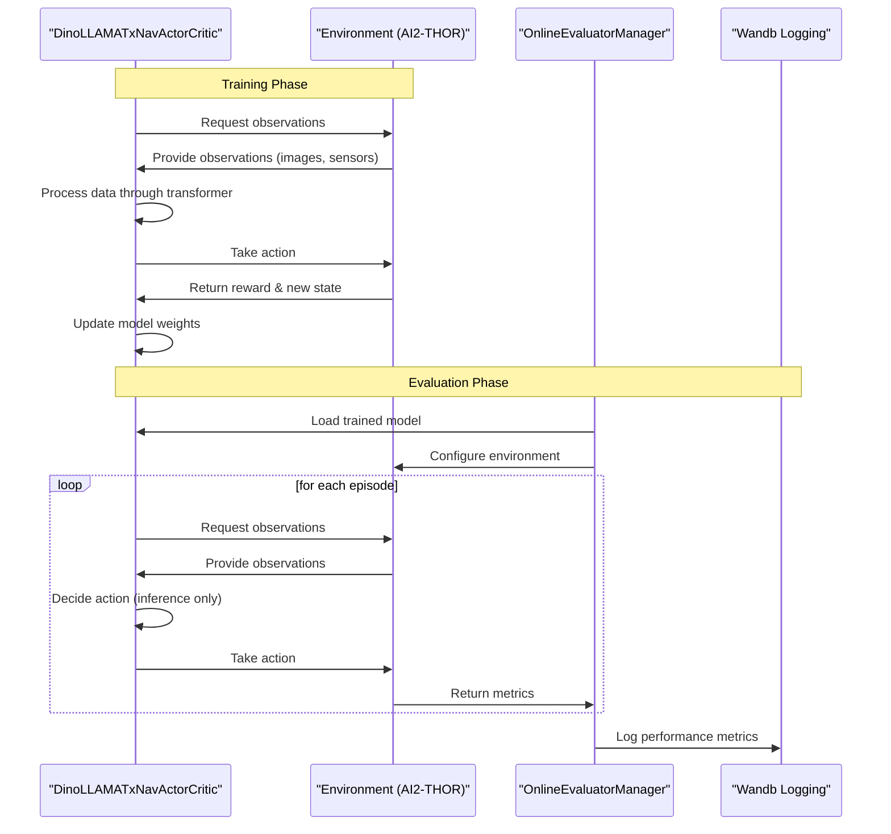

The system uses AllenAct for online training and PyTorch Lightning for offline training, with a distributed evaluation system to assess trained models.

Sources: [TRAINING_README.md:1-28](), [TRAINING_README.md:82-113]()

## Scaling On-Policy Reinforcement Learning

PoliFormer scales on-policy reinforcement learning through:

1. **Transformer Architecture**: Uses transformer models adapted for embodied AI tasks instead of traditional CNN-RNN models
2. **Multimodal Learning**: Processes multiple input modalities (images, text, bounding boxes) through specialized encoders
3. **Distributed Training**: Supports multiple training processes to parallelize experience collection
4. **Efficient Evaluation**: Implements a distributed evaluation system with multiple workers

The approach achieves scalability by leveraging the transformer architecture's ability to handle complex, multi-modal inputs and extract meaningful patterns from them.

Sources: [README.md:152-178](), [TRAINING_README.md:83-104]()

## Key Components in Context

The PoliFormer system is made up of several key components that work together:

| Component | Purpose | Implementation |
|-----------|---------|----------------|
| DinoLLAMATxNavActorCritic | Main model that processes inputs and outputs actions | Transformer-based architecture using DINO and LLAMA components |
| DinoTxGoalEncoder | Encodes goal information for the navigation task | Specialized encoder for goal representations |
| InferenceAgent | Uses trained models for online evaluation | Manages inference during evaluation |
| StretchController | Interfaces with the simulated environment | Controls the robot in AI2-THOR environment |
| Sensors | Provide observations to the agent | Include vision, navigation, and manipulation sensors |
| OnlineEvaluatorManager | Manages the evaluation process | Coordinates distributed evaluation across workers |

For more detailed information about specific components:
- For Model Architecture details, see [Architecture](#2.1)
- For Environment components, see [Environment](#3)
- For Training System details, see [Training System](#4)
- For Evaluation System details, see [Evaluation System](#5)

Sources: [README.md:13-134]()

## Supported Tasks and Datasets

PoliFormer is primarily trained and evaluated on navigation tasks from the SPOC dataset, specifically the "fifteen" type which has the agent navigating and fetching one of fifteen possible object types.

The system supports:
- Object navigation by text description
- Object navigation by visual cues (bounding boxes)
- Combined text and visual navigation

Sources: [README.md:51-86]()

## Getting Started

To get started with PoliFormer, you'll need to:

1. Set up the Python environment (preferably using Docker)
2. Download the necessary data (Objaverse assets, ProcTHOR-Objaverse houses, SPOC dataset)
3. Configure environment variables
4. Run training or evaluation scripts

For detailed setup instructions, see [Setup and Deployment](#6).

Sources: [README.md:13-49](), [README.md:51-86]()

## Licensing

PoliFormer is released under dual licensing:
- LLAMA 2 components are licensed under the LLAMA 2 Community License
- All other code is licensed under the Apache License 2.0

Sources: [LICENSE:1-23]()

---

# Page: Architecture

# Architecture

<details>
<summary>Relevant source files</summary>

The following files were used as context for generating this wiki page:

- [architecture/agent.py](architecture/agent.py)
- [architecture/models/allenact_transformer_models/allenact_dino_transformer.py](architecture/models/allenact_transformer_models/allenact_dino_transformer.py)

</details>


This document provides a comprehensive overview of the PoliFormer system architecture, detailing how the different components interact to implement on-policy reinforcement learning with transformer models for robot navigation tasks. For details about specific subsystems, see the corresponding pages for [Model Architecture](#2.1), [Inference Agent](#2.2), and [Preprocessors](#2.3).

## System Overview

PoliFormer is organized into four core subsystems that work together to enable transformer-based reinforcement learning for embodied navigation:

1. **Model Architecture** - The transformer-based neural networks that process multimodal inputs and produce action decisions
2. **Environment** - Components that represent the robot, world, and sensor observations
3. **Training System** - Infrastructure for both online and offline training of the models
4. **Evaluation System** - Components that assess model performance in navigational tasks

### High-Level Architecture Diagram

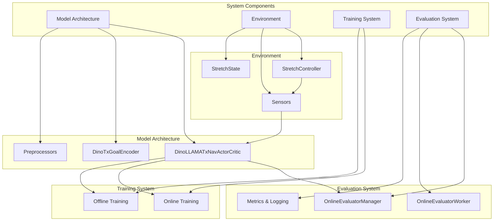

Sources: 
- [architecture/models/allenact_transformer_models/allenact_dino_transformer.py:51-372]()
- [architecture/agent.py:5-51]()

## Component Relationships

The PoliFormer architecture follows a modular design pattern where each component has a specific responsibility:

1. **Model Architecture**: Contains the core transformer models that process sensor data and goal specifications to produce navigation actions.
2. **Environment**: Manages the robot state, sensors, and interaction with the simulated world (AI2-THOR).
3. **Training System**: Implements the RL algorithms for training the transformer models.
4. **Evaluation System**: Handles online evaluation of trained models in navigation tasks.

### Component Interaction Flow

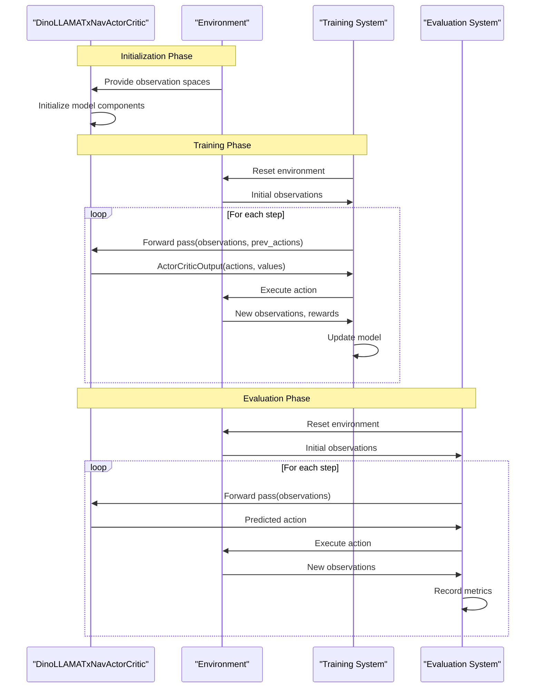

Sources:
- [architecture/models/allenact_transformer_models/allenact_dino_transformer.py:248-372]()
- [architecture/agent.py:37-51]()

## Model Architecture Components

The core of PoliFormer is its transformer-based model architecture, which consists of several key components:

| Component | Purpose | Implementation |
|-----------|---------|----------------|
| DinoLLAMATxNavActorCritic | Main transformer model combining vision, text, and navigation | [allenact_dino_transformer.py:51-372]() |
| DinoTxGoalEncoder | Encodes goal specifications and visual observations | [allenact_dino_transformer.py:375-542]() |
| PositionalEncoder | Provides positional encoding for transformer inputs | [allenact_dino_transformer.py:30-48]() |

### Model Data Flow

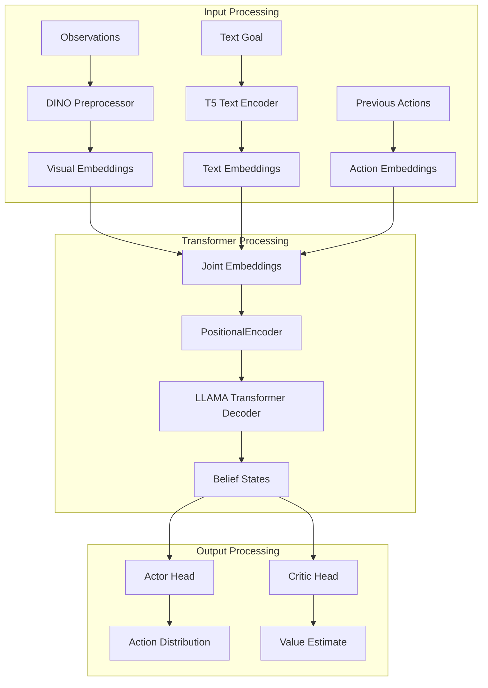

Sources:
- [architecture/models/allenact_transformer_models/allenact_dino_transformer.py:51-372]()
- [architecture/models/allenact_transformer_models/allenact_dino_transformer.py:375-542]()

## Model Component Details

The `DinoLLAMATxNavActorCritic` class extends `VisualNavActorCritic` and serves as the primary model for navigational decisions. It processes visual input through the DINO (a vision transformer) and combines it with text goals through a T5 encoder.

Key internal components include:

1. **Goal Visual Encoder** - Processes visual observations and text goals
2. **State Encoders** - LLAMA transformer decoders that maintain belief states
3. **Actor-Critic Heads** - Output action distributions and value estimates

The data processing flow in the forward method can be summarized as:

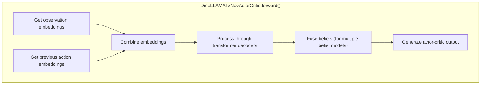

Sources:
- [architecture/models/allenact_transformer_models/allenact_dino_transformer.py:248-372]()

## Goal Encoding Process

The `DinoTxGoalEncoder` handles multimodal input processing:

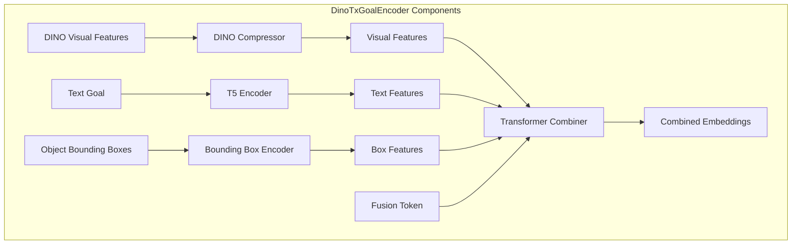

Sources:
- [architecture/models/allenact_transformer_models/allenact_dino_transformer.py:375-542]()

## Agent Interface

The `AbstractAgent` class defines the interface for agents in the system:

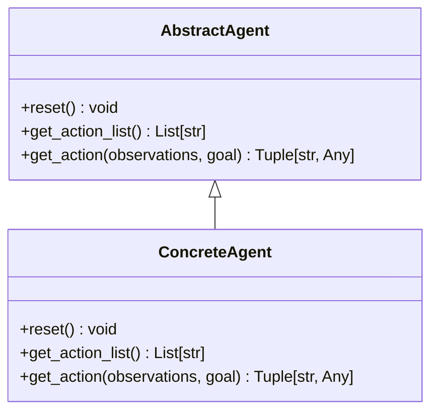

Sources:
- [architecture/agent.py:5-51]()

## Integration with Training and Evaluation

The model architecture integrates with the training and evaluation systems through standardized interfaces:

1. **For Training**:
   - The model receives batched observations, previous actions, and masks
   - It returns action distributions and value estimates
   - The training system uses these to compute losses and update the model

2. **For Evaluation**:
   - The model processes single observations to produce action decisions
   - The evaluation system executes these actions in the environment
   - Performance metrics are tracked and logged

## Conclusion

The PoliFormer architecture represents a sophisticated approach to visual navigation using transformer models. Its modular design allows for flexibility in experimentation, while the integration of vision transformers (DINO) with language models (LLAMA, T5) enables effective multimodal reasoning. The system supports both online reinforcement learning and offline training approaches, with a comprehensive evaluation framework to assess performance.

For more detailed information about specific components, please refer to the dedicated pages for [Model Architecture](#2.1), [Inference Agent](#2.2), and [Preprocessors](#2.3).

---

# Page: Model Architecture

# Model Architecture

<details>
<summary>Relevant source files</summary>

The following files were used as context for generating this wiki page:

- [architecture/models/allenact_transformer_models/allenact_dino_transformer.py](architecture/models/allenact_transformer_models/allenact_dino_transformer.py)

</details>


## Purpose and Scope

This document details the transformer-based model architecture used in PoliFormer for visual navigation tasks. We focus on explaining the core components DinoLLAMATxNavActorCritic and DinoTxGoalEncoder, their interactions, and how they process multimodal inputs (images, text, bounding boxes) to produce navigation decisions. For information about the Inference Agent that uses these models, see [Inference Agent](#2.2).

## Architectural Overview

PoliFormer implements a transformer-based actor-critic architecture for visual navigation that fuses vision and language. The model processes RGB images using DINO features, text goals using a T5 encoder, and optionally incorporates bounding box information. A LLAMA-based transformer then processes this information to produce navigation actions.

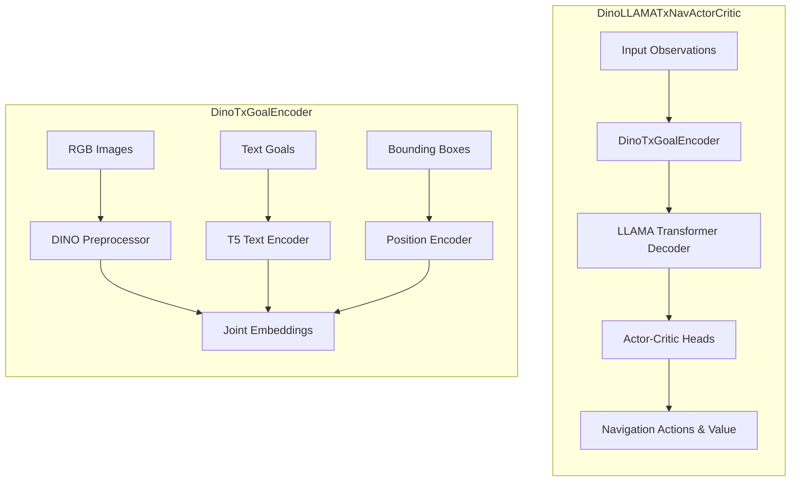

Sources: [architecture/models/allenact_transformer_models/allenact_dino_transformer.py:51-372](). [architecture/models/allenact_transformer_models/allenact_dino_transformer.py:375-542]()

## Core Component: DinoLLAMATxNavActorCritic

The `DinoLLAMATxNavActorCritic` class is the main model architecture, inheriting from AllenAct's `VisualNavActorCritic`. It combines vision, language, and positional information to navigate based on textual goals.

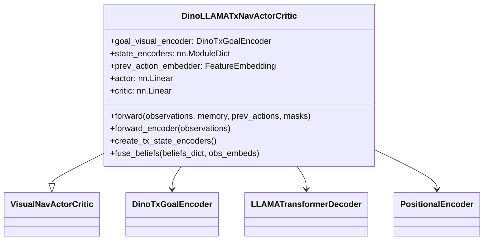

Key functionalities:
1. **Input Processing**: Takes observations, memory, previous actions, and masks as input
2. **Encoding**: Uses `DinoTxGoalEncoder` to encode visual and text inputs
3. **Transformer Processing**: Processes encoded inputs through LLAMA-based transformer 
4. **Belief Fusion**: Supports single or multiple belief models with fusion capabilities
5. **Action Production**: Outputs actor-critic values for reinforcement learning

Sources: [architecture/models/allenact_transformer_models/allenact_dino_transformer.py:51-372]()

## Core Component: DinoTxGoalEncoder

The `DinoTxGoalEncoder` processes multimodal inputs including images, text goals, and bounding boxes.

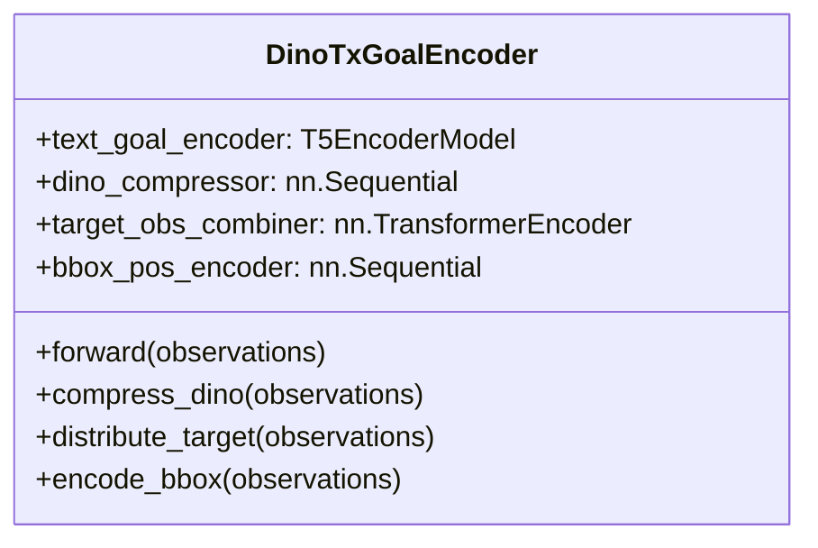

Key functionalities:
1. **Vision Processing**: Compresses DINO features from RGB images
2. **Text Processing**: Encodes text goals using the T5 encoder
3. **Bounding Box Processing**: Encodes object bounding boxes if provided
4. **Multimodal Fusion**: Combines all modalities using a transformer encoder

Sources: [architecture/models/allenact_transformer_models/allenact_dino_transformer.py:375-542]()

## Data Flow Through the Architecture

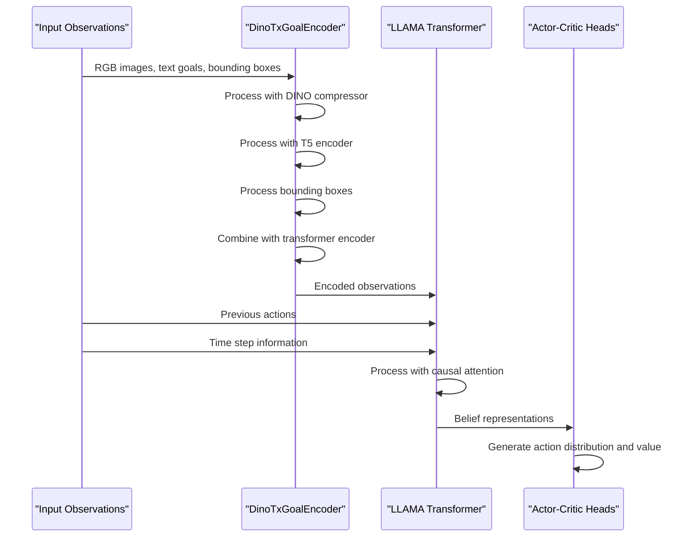

Sources: [architecture/models/allenact_transformer_models/allenact_dino_transformer.py:248-372]()

## Input Processing and Encoding

### DINO Vision Features

The model processes RGB images through a DINO preprocessor and compresses them:

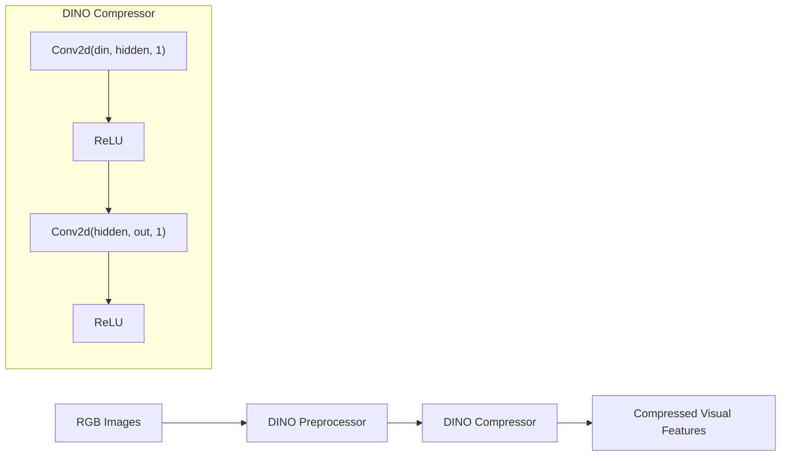

Sources: [architecture/models/allenact_transformer_models/allenact_dino_transformer.py:410-417](). [architecture/models/allenact_transformer_models/allenact_dino_transformer.py:458-459]()

### Text Goal Encoding

Text goals are processed using a T5 encoder:

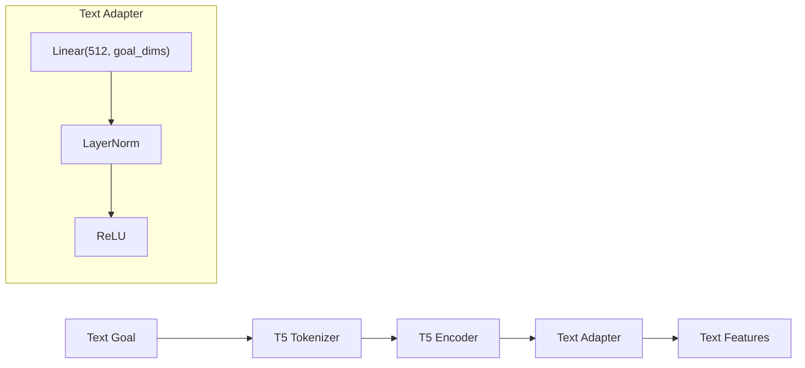

Sources: [architecture/models/allenact_transformer_models/allenact_dino_transformer.py:399-404](). [architecture/models/allenact_transformer_models/allenact_dino_transformer.py:462-474]()

### Bounding Box Encoding

When available, bounding box information is encoded:

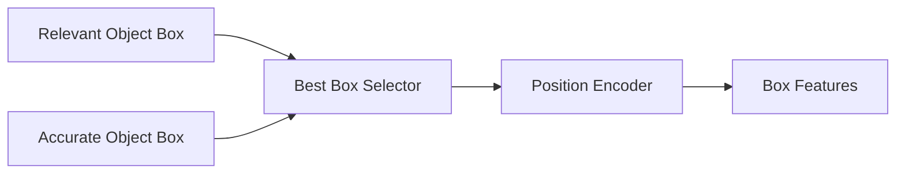

Sources: [architecture/models/allenact_transformer_models/allenact_dino_transformer.py:426-436](). [architecture/models/allenact_transformer_models/allenact_dino_transformer.py:476-489]()

## Transformer Architecture

The model uses a LLAMA-based transformer decoder to process the encoded observations:

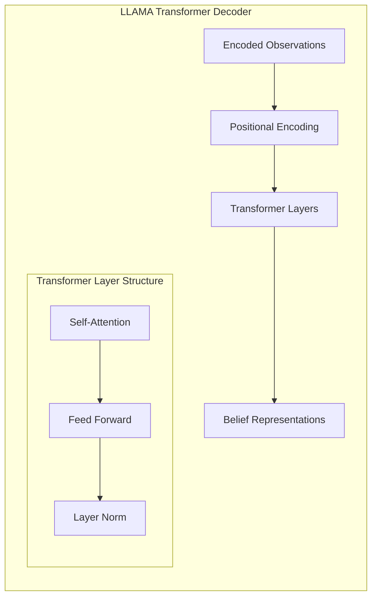

### Positional Encoding

The `PositionalEncoder` class adds sinusoidal positional encoding to the transformer inputs:

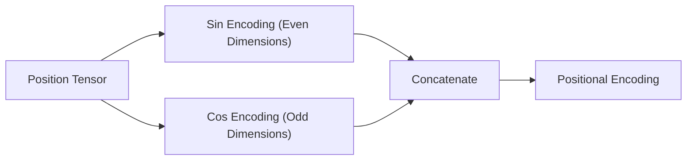

Sources: [architecture/models/allenact_transformer_models/allenact_dino_transformer.py:30-48]()

### Belief Mechanisms

The model supports two belief mechanisms:

1. **Single Belief**: One transformer decoder processes all observations
2. **Multiple Beliefs**: Multiple transformer decoders process observations and are then fused

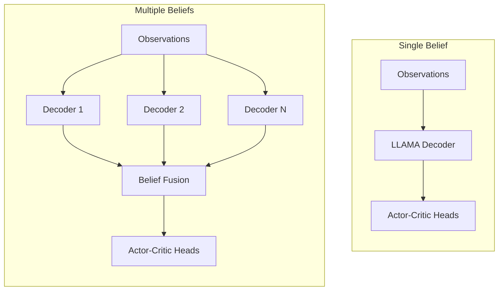

Sources: [architecture/models/allenact_transformer_models/allenact_dino_transformer.py:177-220]()

## Actor-Critic Heads

The output of the transformer is passed to actor and critic heads for reinforcement learning:

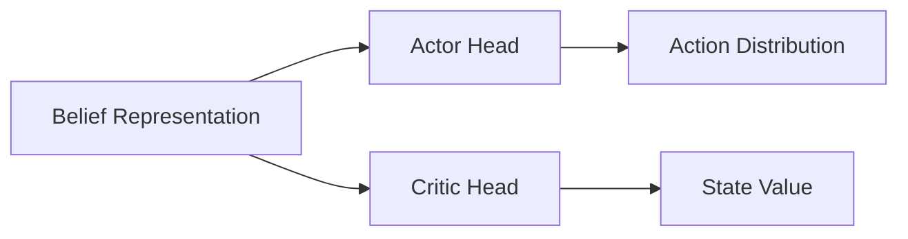

Sources: [architecture/models/allenact_transformer_models/allenact_dino_transformer.py:366-370]()

## Technical Details

| Component | Implementation | Purpose |
|-----------|---------------|---------|
| DinoLLAMATxNavActorCritic | Main actor-critic model | Processes observations and outputs actions and values |
| DinoTxGoalEncoder | Multimodal encoder | Encodes visual, text, and bounding box inputs |
| PositionalEncoder | Positional encoding | Adds position information to sequence inputs |
| LLAMATransformerDecoder | Causal transformer | Processes encoded inputs with attention mechanism |
| T5EncoderModel | Text encoder | Encodes text goals |
| DINO Preprocessor | Vision encoder | Extracts features from RGB images |

Sources: [architecture/models/allenact_transformer_models/allenact_dino_transformer.py:51-372](). [architecture/models/allenact_transformer_models/allenact_dino_transformer.py:375-542]()

## Forward Pass Execution Flow

The model forward pass follows these steps:

1. Encode observations using `DinoTxGoalEncoder`
2. Encode previous actions
3. Add observations and previous action embeddings
4. Apply linear projections to prepare inputs for the transformer
5. Add positional encoding based on time step
6. Process through the LLAMA transformer decoder
7. Fuse beliefs if using multiple belief models
8. Generate actor-critic outputs (action distribution and value)

Sources: [architecture/models/allenact_transformer_models/allenact_dino_transformer.py:248-372]()

---

# Page: Inference Agent

# Inference Agent

<details>
<summary>Relevant source files</summary>

The following files were used as context for generating this wiki page:

- [architecture/models/allenact_transformer_models/inference_agent.py](architecture/models/allenact_transformer_models/inference_agent.py)

</details>


## Purpose and Scope

The Inference Agent is a critical component of the PoliFormer system that handles the deployment of trained models for online evaluation. It serves as the bridge between the transformer-based models and the testing environment, processing observations and selecting actions. This document details the implementation, architecture, and functionality of the inference agent used for evaluating the PoliFormer models on navigation tasks.

For information about the underlying model architecture, see [Model Architecture](#2.1). For details on how the inference agent is used during evaluation, see [Online Evaluator](#5.1).

Sources: [architecture/models/allenact_transformer_models/inference_agent.py:76-246]()

## Architecture Overview

The Inference Agent sits between the trained models and the environment, managing the inference process during online evaluation. It processes observations from the environment, passes them through the transformer models, and selects appropriate actions to execute.

```mermaid
flowchart LR
    subgraph "Environment"
        ENV["AI2-THOR/\nStretch Environment"]
        OBS["Observations\n(Images, Task Specs)"]
        ACT["Actions"]
    end

    subgraph "InferenceAgentVIDA"
        PP["Preprocessing\n(normalize_img, get_test_augmentation)"]
        AM["Action Management\n(get_action, act)"]
        MM["Memory Management"]
    end

    subgraph "Model"
        AC["Actor-Critic Model\n(DinoLLAMATxNavActorCritic)"]
    end

    ENV --> OBS
    OBS --> PP
    PP --> AC
    AC --> AM
    AM --> ACT
    ACT --> ENV
    AC <--> MM
```
**Diagram: Inference Agent Position in System Architecture**

Sources: [architecture/models/allenact_transformer_models/inference_agent.py:76-246]()

## Implementation Details

The Inference Agent is implemented in the `InferenceAgentVIDA` class, which inherits from AllenAct's `InferenceAgent`. This specialized implementation adds capabilities for image preprocessing, action selection, and tracking of evaluation metrics.

### Key Components

1. **Image Processing** - Handles normalization and augmentation of visual inputs
2. **Action Selection** - Converts model outputs to executable actions
3. **Memory Management** - Maintains state across inference steps
4. **Trajectory Tracking** - Keeps count of trajectories for evaluation

```mermaid
classDiagram
    class InferenceAgent {
        <<AllenAct Base Class>>
        +actor_critic
        +rollout_storage
        +has_initialized
    }
    
    class InferenceAgentVIDA {
        +img_encoder_rgb_mean
        +img_encoder_rgb_std
        +greedy_sampling: bool
        +test_augmentation: bool
        +augmentations
        +num_evaluated_traj: int
        
        +build_agent()
        +reset()
        +normalize_img()
        +get_action_list()
        +get_test_augmentation()
        +get_action()
        +act()
    }
    
    InferenceAgent <|-- InferenceAgentVIDA
```
**Diagram: InferenceAgentVIDA Class Structure**

Sources: [architecture/models/allenact_transformer_models/inference_agent.py:76-85]()

## Initialization Process

The `InferenceAgentVIDA` class provides a static `build_agent` method that constructs and initializes the agent with the required parameters:

```mermaid
sequenceDiagram
    participant Caller
    participant Builder as "InferenceAgentVIDA.build_agent"
    participant ExpConfig as "ExperimentConfig"
    participant Agent as "InferenceAgentVIDA instance"
    participant Model as "Actor-Critic Model"
    
    Caller->>Builder: Call with params, device, checkpoint
    Builder->>ExpConfig: Create experiment config
    Builder->>Agent: from_experiment_config(exp_config)
    Builder->>Agent: Set image preprocessing parameters
    Builder->>Agent: Set sampling preferences
    Builder->>Agent: Configure image augmentations
    Builder->>Model: Load model weights from checkpoint
    Builder->>Agent: Initialize rollout storage
    Builder->>Agent: reset()
    Builder->>Caller: Return initialized agent
```
**Diagram: Inference Agent Initialization Process**

The initialization process includes:
1. Creating an experiment configuration
2. Building the agent based on this configuration
3. Setting preprocessing parameters for images
4. Configuring sampling behavior and augmentations
5. Loading the trained model weights
6. Initializing internal state tracking
7. Resetting the agent to prepare for the first trajectory

Sources: [architecture/models/allenact_transformer_models/inference_agent.py:84-123]()

## Observation Processing

The Inference Agent processes various types of observations from the environment:

| Observation Type | Description | Processing |
|-----------------|-------------|------------|
| `rgb_raw` | Raw RGB images from navigation camera | Normalized and potentially augmented |
| `natural_language_spec` | Text description of the goal | Converted to byte representation |
| `time_step` | Current step in the trajectory | Tracked for sequence modeling |
| `traj_index` | Index of the current trajectory | Used for evaluation tracking |
| `manipulation_rgb_raw` | RGB images from manipulation camera (optional) | Processed when available |
| `an_object_is_in_hand` | Boolean indicating if object is held (optional) | Passed through when available |
| `relative_arm_location_metadata` | Arm position data (optional) | Normalized when available |
| `nav_accurate_object_bbox` | Object bounding boxes (optional) | Passed through when available |

Sources: [architecture/models/allenact_transformer_models/inference_agent.py:158-177]()

## Image Processing Pipeline

The agent includes specialized image processing methods to prepare visual inputs for the transformer model:

```mermaid
flowchart LR
    subgraph "tensor_image_preprocessor"
        RS["Resize\n(if needed)"]
        DA["Data Augmentation\n(if enabled)"]
        NM["Normalization\n(mean and std)"]
    end
    
    subgraph "InferenceAgentVIDA"
        NI["normalize_img()"]
        GT["get_test_augmentation()"]
    end
    
    IMG["Raw Image"] --> GT
    GT --> RS
    RS --> DA
    DA --> NM
    NM --> NI
    NI --> PROC["Processed Image"]
```
**Diagram: Image Processing Pipeline**

The image processor can be configured with:
- Custom image size (default 256×256)
- Data augmentation options
- Custom normalization parameters

Sources: [architecture/models/allenact_transformer_models/inference_agent.py:25-61](), [architecture/models/allenact_transformer_models/inference_agent.py:132-156]()

## Inference Flow

The core inference process involves taking observations from the environment and producing actions through the trained model:

```mermaid
flowchart TD
    subgraph "get_action"
        OB["Create observation dictionary"]
        AP["Add optional observations\n(manipulation, object bbox, etc.)"]
        CA["Call act()"]
    end
    
    subgraph "act"
        BO["Batch observations"]
        PP["Apply sensor preprocessing"]
        ST["Store in rollout buffer"]
        AI["Create agent input"]
        FW["Forward pass through actor-critic"]
        SA["Sample action"]
        SM["Store memory for next step"]
        CO["Convert to action string"]
    end
    
    ENV["Environment State"] --> OB
    OB --> AP
    AP --> CA
    CA --> BO
    BO --> PP
    PP --> ST
    ST --> AI
    AI --> FW
    FW --> SA
    FW --> SM
    SA --> CO
    CO --> ACT["Return Action String"]
```
**Diagram: Inference Process Flow**

This flow includes several key steps:
1. Constructing an observation dictionary from environment state
2. Batching and preprocessing observations
3. Tracking state in the rollout storage
4. Creating inputs for the actor-critic model
5. Running the model forward pass to generate distributions
6. Sampling an action (or taking the mode for greedy behavior)
7. Converting the action to a string representation from the action list

Sources: [architecture/models/allenact_transformer_models/inference_agent.py:158-246]()

## Memory Management

The Inference Agent manages memory across steps in a trajectory and between trajectories:

1. **Step Memory**: The agent stores and updates memory between steps within a trajectory.
2. **Rollout Storage**: Maintains a buffer of recent observations and agent states.
3. **Trajectory Reset**: Clears memory and resets counters when starting a new trajectory.

When the agent has taken a configurable number of steps (controlled by `steps_before_rollout_refresh`), it refreshes the rollout storage to prevent memory issues during long trajectories.

Sources: [architecture/models/allenact_transformer_models/inference_agent.py:125-131](), [architecture/models/allenact_transformer_models/inference_agent.py:234-235]()

## Action Selection

The agent can select actions in two modes:

1. **Stochastic Sampling**: Samples from the action probability distribution (default)
2. **Greedy Selection**: Takes the highest probability action (when `greedy_sampling=True`)

The action is selected from a predefined list of possible actions, which is either:
- Loaded from an action dictionary file specified in the `ACTION_DICT` environment variable
- Default to the `ALL_STRETCH_ACTIONS` constant

```mermaid
flowchart LR
    AC["Actor-Critic Output"]
    
    subgraph "Action Selection"
        direction TB
        DIST["Action Distributions"]
        SAMPLE["Sample()"]
        MODE["Mode()"]
        CHOICE{"greedy_sampling?"}
        
        DIST --> SAMPLE
        DIST --> MODE
        SAMPLE --> CHOICE
        MODE --> CHOICE
    end
    
    subgraph "Action Conversion"
        FLAT["Flatten action"]
        INDEX["Get action index"]
        STR["Convert to action string"]
    end
    
    AC --> DIST
    CHOICE -- "No" --> FLAT
    CHOICE -- "Yes" --> INDEX
    FLAT --> INDEX
    INDEX --> STR
    STR --> ACTION["Return action string\nand probabilities"]
```
**Diagram: Action Selection Process**

Sources: [architecture/models/allenact_transformer_models/inference_agent.py:219-246](), [architecture/models/allenact_transformer_models/inference_agent.py:147-152]()

## Integration with Evaluation System

The Inference Agent is designed to work within the broader evaluation framework of PoliFormer:

1. It tracks trajectory counts via `num_evaluated_traj`, which can be used for evaluation metrics
2. It resets internal state between trajectories
3. It can be configured for different evaluation settings (greedy vs. stochastic, with or without augmentation)

The agent outputs both the selected action string and the action probabilities, which can be used for logging and analysis in the evaluation system.

Sources: [architecture/models/allenact_transformer_models/inference_agent.py:76-246]()

---

# Page: Preprocessors

# Preprocessors

<details>
<summary>Relevant source files</summary>

The following files were used as context for generating this wiki page:

- [architecture/allenact_preprocessors/dino_preprocessors.py](architecture/allenact_preprocessors/dino_preprocessors.py)

</details>


## Introduction

This document covers the preprocessor components in the PoliFormer system, which are responsible for preparing input data (primarily images) for the transformer-based models. Preprocessors transform raw sensor inputs into feature representations optimized for the model architecture described in [Model Architecture](#2.1).

The PoliFormer system uses specialized preprocessors built on the AllenAct framework to handle image preparation and feature extraction using the DINO Vision Transformer (ViT) models.

Sources: [architecture/allenact_preprocessors/dino_preprocessors.py:1-5]()

## Key Preprocessor Components

PoliFormer implements two primary preprocessor types:

1. **DinoViTPreprocessor**: Extracts visual features from RGB images using DINO Vision Transformer models
2. **DataAugmentationPreprocessor**: Applies data augmentation and normalization to input images

These preprocessors work in sequence to transform raw observations into the feature representations required by the transformer models.

```mermaid
flowchart LR
    subgraph "Raw Observations"
        RGB["RGB Images (BxHxWx3)"]
    end
    
    subgraph "Preprocessing Pipeline"
        AUG["DataAugmentationPreprocessor"]
        DINO["DinoViTPreprocessor"]
    end
    
    subgraph "Processed Features"
        FEAT["Visual Features (Bx84xD)"]
    end
    
    RGB --> AUG
    AUG --> DINO
    DINO --> FEAT
    
    style RGB fill:white
    style AUG fill:white
    style DINO fill:white
    style FEAT fill:white
```

**Diagram: Preprocessor Pipeline**

Sources: [architecture/allenact_preprocessors/dino_preprocessors.py:32-117](), [architecture/allenact_preprocessors/dino_preprocessors.py:119-184]()

## DinoViTPreprocessor

The `DinoViTPreprocessor` leverages pre-trained DINO Vision Transformer models to extract high-level visual features from input images. This preprocessor uses self-supervised visual features that capture rich semantic information.

### DINO Models Supported

The preprocessor supports four variants of DINO ViT models with different parameter sizes:

| Model Type | Output Feature Dimensions | Parameter Size |
|------------|---------------------------|----------------|
| dinov2_vits14 | 384 | Small |
| dinov2_vitb14 | 768 | Base |
| dinov2_vitl14 | 1024 | Large |
| dinov2_vitg14 | 1536 | Giant |

All models output feature maps with spatial dimensions of 7×12, but the feature dimension (channel depth) varies by model size.

### DinoViTEmbedder

The `DinoViTEmbedder` is an auxiliary class that wraps the DINO model and handles the feature extraction process:

```mermaid
classDiagram
    class DinoViTEmbedder {
        +model: nn.Module
        +pool: nn.AdaptiveAvgPool2d
        +forward(x): tensor
    }
    
    class DinoViTPreprocessor {
        +DINO_RGB_MEANS: tuple
        +DINO_RGB_STDS: tuple
        +dino_model_type: str
        +vit: DinoViTEmbedder
        +process(obs): tensor
    }
    
    DinoViTPreprocessor --> DinoViTEmbedder: uses
```

**Diagram: DinoViTPreprocessor Class Structure**

The embedder:
- Takes input images of size 224×384 pixels
- Processes them through the DINO model to extract patch token features
- Reshapes and pools the features to a consistent size (7×12)
- Returns the processed features for use by the model

Sources: [architecture/allenact_preprocessors/dino_preprocessors.py:14-29](), [architecture/allenact_preprocessors/dino_preprocessors.py:32-117]()

## DataAugmentationPreprocessor

The `DataAugmentationPreprocessor` prepares images for feature extraction by applying data augmentation and normalization. It is typically used as a first step before the DINO preprocessor.

### Key Functions

```mermaid
flowchart LR
    subgraph "DataAugmentationPreprocessor"
        direction TB
        I["Input Image (BHWC)"] --> P["Permute to BCHW"]
        P --> A["Apply Augmentation (optional)"]
        A --> N["Normalize with mean/std"]
        N --> O["Output (BHWC)"]
    end
    
    style I fill:white
    style P fill:white
    style A fill:white
    style N fill:white
    style O fill:white
```

**Diagram: Data Augmentation Process**

This preprocessor:
1. Converts images from BHWC format (batch, height, width, channels) to BCHW format
2. Applies random augmentations if enabled
3. Normalizes pixel values (dividing by 255, then applying mean/std normalization)
4. Converts back to BHWC format for downstream processing

### Augmentation Strategy

The augmentation transforms are changed periodically (every `num_steps_to_change` steps) to introduce variety during training. The augmentations are sampled from a predefined set of transformations provided by the `get_transformation()` function.

Sources: [architecture/allenact_preprocessors/dino_preprocessors.py:119-184]()

## Integration with Training Pipeline

Preprocessors are integrated into the PoliFormer training and inference pipelines as part of the observation processing workflow:

```mermaid
flowchart TD
    subgraph "Environment"
        E["Environment Observations"]
    end
    
    subgraph "Preprocessing"
        E --> DA["DataAugmentationPreprocessor"]
        DA --> DV["DinoViTPreprocessor"]
    end
    
    subgraph "Model"
        DV --> GE["DinoTxGoalEncoder"]
        GE --> TR["LLAMA Transformer"]
        TR --> AC["Actor-Critic Heads"]
    end
    
    style E fill:white
    style DA fill:white
    style DV fill:white
    style GE fill:white
    style TR fill:white
    style AC fill:white
```

**Diagram: Preprocessor Integration in Model Pipeline**

The preprocessors are configured during model initialization and process observations before they reach the main model components. During training, the augmentation preprocessor introduces variability to help with generalization, while the DINO preprocessor extracts robust visual features.

Sources: [architecture/allenact_preprocessors/dino_preprocessors.py:32-117](), [architecture/allenact_preprocessors/dino_preprocessors.py:119-184]()

## Technical Implementation Details

### Normalization Constants

Both preprocessors use the same normalization constants, which are the standard ImageNet mean and standard deviation values:

```
DINO_RGB_MEANS = (0.485, 0.456, 0.406)
DINO_RGB_STDS = (0.299, 0.224, 0.225)
```

### Output Shapes

The output shape of the `DinoViTPreprocessor` depends on the selected DINO model and whether flattening is applied:

| Model | Flattened Output Shape | Non-flattened Output Shape |
|-------|------------------------|----------------------------|
| dinov2_vits14 | (84, 384) | (7, 12, 384) |
| dinov2_vitb14 | (84, 768) | (7, 12, 768) |
| dinov2_vitl14 | (84, 1024) | (7, 12, 1024) |
| dinov2_vitg14 | (84, 1536) | (7, 12, 1536) |

The spatial dimensions (7×12) are determined by the pooling layer in the `DinoViTEmbedder`.

Sources: [architecture/allenact_preprocessors/dino_preprocessors.py:32-66]()

## Usage Considerations

When working with the preprocessors in the PoliFormer system, consider the following:

1. **Model Selection**: Choose the appropriate DINO model size based on your computational resources and performance requirements.

2. **Augmentation Configuration**: Configure the data augmentation preprocessor based on your training needs. You can adjust the `num_steps_to_change` parameter to control how frequently augmentations change, or disable augmentation entirely for evaluation.

3. **GPU Utilization**: Both preprocessors support being moved to specific devices using the `to()` method, which is important for efficient GPU utilization.

4. **Input Requirements**: The DINO preprocessor expects input images of size 224×384 pixels, so ensure your observation space provides images of this size or that they are resized appropriately.

Sources: [architecture/allenact_preprocessors/dino_preprocessors.py:105-108](), [architecture/allenact_preprocessors/dino_preprocessors.py:163-167]()

---

# Page: Environment

# Environment

<details>
<summary>Relevant source files</summary>

The following files were used as context for generating this wiki page:

- [environment/spoc_objects.py](environment/spoc_objects.py)
- [environment/stretch_controller.py](environment/stretch_controller.py)

</details>


The Environment system in PoliFormer provides a comprehensive representation of the world and robot state for embodied AI navigation tasks. It serves as the interface between the learning agents and the underlying AI2-THOR simulation platform, handling robot control, state management, object representation, and sensor observations.

## Core Components

The Environment system consists of several interconnected components that work together to provide a complete representation of the robot and its surroundings:

```mermaid
graph TD
    subgraph "Environment System"
        SC["StretchController"] --> SS["StretchState"]
        SC --> AI2["AI2-THOR Controller"]
        SC --> SO["SPOCObject"]
        
        subgraph "Sensors"
            VS["Vision Sensors"]
            NS["Navigation Sensors"]
            MS["Manipulation Sensors"]
        end
        
        SC --> VS
        SC --> NS
        SC --> MS
    end
    
    AI2 --> Event["AI2-THOR Event"]
    Event --> Metadata["Event Metadata"]
    Event --> Frames["Camera Frames"]
    
    subgraph "External Systems"
        MA["Model Architecture"] --> SC
        EVAL["Evaluation System"] --> SC
    end
```
*Environment System Components Diagram*

Sources: [environment/stretch_controller.py:53-1212]()

The primary components include:

1. **StretchController**: The main interface for controlling the Stretch robot in the AI2-THOR environment
2. **StretchState**: Tracks and manages the state of the robot (position, rotation, arm configuration)
3. **SPOCObject**: Wrapper for AI2-THOR objects providing enhanced metadata
4. **Sensors**: Various sensor types that provide observations to the agent

## StretchController

The StretchController is the central component that manages the robot's interaction with the AI2-THOR environment. It initializes the simulation, handles robot actions, and provides methods to access environmental information.

### Initialization and Configuration

When instantiating a StretchController, several key parameters can be configured:

```mermaid
sequenceDiagram
    participant App as "Agent/Application"
    participant SC as "StretchController"
    participant AI2 as "AI2-THOR Controller"
    
    App->>SC: initialize_controller(render_mani_camera, ...)
    SC->>AI2: Controller(**kwargs)
    SC->>AI2: step("DisableSecondaryCamera") [if not render_mani_camera]
    SC->>AI2: step("UpdateThirdPartyCamera") [if render_mani_camera]
    SC->>SC: Set internal parameters
    SC-->>App: Initialized controller
```
*StretchController Initialization Flow*

Sources: [environment/stretch_controller.py:54-107]()

The controller can be initialized with options such as:
- `render_mani_camera`: Whether to render the manipulation camera
- `use_quick_navi_action`: Whether to use optimized navigation actions

### Robot Action Control

StretchController provides methods to control the robot's movement and actions through the `agent_step` method, which handles:

| Action Type | Examples | Description |
|-------------|----------|-------------|
| Navigation | move_ahead, move_back, rotate_left, rotate_right | Control the robot's position and orientation |
| Arm Movement | move_arm_up, move_arm_down, move_arm_in, move_arm_out | Control the robot's arm position |
| Wrist Control | wrist_open, wrist_close | Control the robot's wrist rotation |
| Object Interaction | pickup, dropoff | Interact with objects in the environment |

Sources: [environment/stretch_controller.py:752-877]()

### Environment Perception

The controller provides access to camera observations and environmental information:

```mermaid
graph TD
    SC["StretchController"] --> NAV["navigation_camera()"]
    SC --> MANIP["manipulation_camera()"]
    SC --> SEG["camera_segmentation()"]
    SC --> DEPTH["depth_frame()"]
    
    NAV --> "RGB Image"
    MANIP --> "RGB Image"
    SEG --> "Instance Masks"
    DEPTH --> "Depth Map"
    
    SC --> GO["get_objects()"]
    GO --> "SPOCObject List"
    
    SC --> VIS["get_visible_objects()"]
    VIS --> "Visible Object IDs"
```
*Environment Perception Methods*

Sources: [environment/stretch_controller.py:164-205](), [environment/stretch_controller.py:513-515]()

### Navigation and Pathfinding

StretchController provides methods for navigating to objects, points, and rooms:

- `get_shortest_path_to_object`: Finds the shortest path to a specific object
- `get_shortest_path_to_point`: Finds the shortest path to a specific location
- `get_shortest_path_to_room`: Finds the shortest path to a room

These methods utilize AI2-THOR's pathfinding capabilities and can be customized with different navigation meshes for different agent sizes.

Sources: [environment/stretch_controller.py:903-951](), [environment/stretch_controller.py:978-1023](), [environment/stretch_controller.py:1124-1156]()

## SPOCObject

The SPOCObject class provides an enhanced representation of objects in the environment. It wraps AI2-THOR object metadata and adds functionality for handling both standard objects and Objaverse objects.

```mermaid
classDiagram
    class SPOCObject {
        +_thor_obj: Dict
        +_cache: Dict
        +is_objaverse: bool
        +annotation: Dict
        +__getitem__(item)
        +__setitem__(key, value)
        +keys()
        +values()
        +items()
    }
    
    SPOCObject --|> dict
```
*SPOCObject Class Diagram*

Sources: [environment/spoc_objects.py:13-127]()

SPOCObject provides:

1. Seamless access to standard AI2-THOR object properties
2. Enhanced metadata for Objaverse objects
3. Common properties like "synset" and "lemma" that work across both object types
4. Object descriptions and additional semantic information

Example enhanced properties available through SPOCObject:
- `synset`: WordNet synset ID for the object
- `lemma`: Most specific WordNet lemma for the object
- `description`: Object description (for Objaverse objects)

Sources: [environment/spoc_objects.py:41-65]()

## Environment-Agent Interaction Flow

The interaction between the agent and environment follows a consistent pattern:

```mermaid
sequenceDiagram
    participant Agent
    participant SC as "StretchController"
    participant State as "StretchState"
    participant AI2 as "AI2-THOR"
    
    Agent->>SC: agent_step(action)
    SC->>State: Store agents_full_pose_before_action
    
    alt navigation action
        SC->>AI2: step(action="MoveAgent"/"RotateAgent")
    else arm action
        SC->>AI2: step(action="MoveArm")
    else wrist action
        SC->>AI2: step(action="RotateWristRelative")
    else interaction action
        SC->>AI2: step(action="PickupObject"/"ReleaseObject")
    end
    
    AI2-->>SC: event
    SC->>State: Create agents_full_pose_after_action
    SC->>SC: sufficient_agent_state_change()
    SC->>SC: Determine action_success
    SC-->>Agent: Return event with updated metadata
```
*Environment-Agent Interaction Flow*

Sources: [environment/stretch_controller.py:752-877]()

## Sensors and Observations

The Environment system provides multiple sensors that generate observations for the agent:

```mermaid
graph TD
    subgraph "Observation Sources"
        NAV["Navigation Camera"]
        MANIP["Manipulation Camera"]
        PROPRIOCEPTION["Robot Proprioception"]
    end
    
    NAV -->|"get_navigation_camera()"| RGB1["RGB Image"]
    NAV -->|"get_navigation_depth_frame()"| DEPTH1["Depth Map"]
    NAV -->|"get_segmentation_mask_of_object()"| SEG1["Instance Segmentation"]
    
    MANIP -->|"get_manipulation_camera()"| RGB2["RGB Image"]
    MANIP -->|"get_manipulation_depth_frame()"| DEPTH2["Depth Map"]
    MANIP -->|"get_segmentation_mask_of_object()"| SEG2["Instance Segmentation"]
    
    PROPRIOCEPTION -->|"get_arm_proprioception()"| ARM["Arm State"]
    PROPRIOCEPTION -->|"get_current_agent_position()"| POS["Agent Position"]
    PROPRIOCEPTION -->|"get_current_agent_full_pose()"| POSE["Agent Pose"]
```
*Sensor Observation Types*

Sources: [environment/stretch_controller.py:164-204](), [environment/stretch_controller.py:896-900](), [environment/stretch_controller.py:607-614]()

### Vision Sensors
The Environment provides two camera views:
- **Navigation Camera**: First-person view from the robot's navigation camera
- **Manipulation Camera**: Third-person view focused on the manipulation area

For each camera, the system can provide:
- RGB images
- Depth maps
- Instance segmentation masks

### Navigation Sensors
The navigation sensors provide information about:
- Current position and rotation
- Reachable positions in the environment
- Room information and relationships

### Manipulation Sensors
The manipulation sensors track:
- Arm and wrist position/rotation
- Objects in the manipulation sphere
- Objects held by the robot

For more detailed information about the Stretch Controller and State, see [Stretch Controller and State](#3.1).

For details about the specific sensor implementations, see [Sensors](#3.2).

## Environment Initialization and Reset

The environment initialization process involves setting up the AI2-THOR controller, configuring the robot's initial state, and preparing the environment:

```mermaid
flowchart TD
    A["initialize_controller()"] --> B["controller.reset(scene)"]
    B --> C["calibrate_agent()"]
    C --> D["Toggle settings"]
    D --> E["set_object_filter()"]
    E --> F["get_rooms_polymap_and_type()"]
    
    subgraph "calibrate_agent()"
        C1["RotateCameraMount"] --> C2["ChangeFOV"] --> C3["SetGripperOpenness"]
    end
```
*Environment Initialization Flow*

Sources: [environment/stretch_controller.py:376-433](), [environment/stretch_controller.py:339-375]()

The initialization process:
1. Creates an AI2-THOR controller instance
2. Resets the scene with the provided scene configuration
3. Calibrates the agent (camera mounts, FOV, gripper)
4. Configures visibility settings
5. Prepares room polygons for navigation

## Summary

The Environment system in PoliFormer provides a flexible and comprehensive interface between learning agents and the AI2-THOR simulation. It handles robot control, environment perception, object representation, and navigation, enabling complex embodied AI tasks.

The system is designed to be modular, with clear separation between:
- Robot control (StretchController)
- State representation (StretchState)
- Object representation (SPOCObject)
- Sensing and perception (various sensor methods)

This architecture allows for clean integration with the rest of the PoliFormer system, particularly the Model Architecture and Evaluation components.

---

# Page: Stretch Controller and State

# Stretch Controller and State

<details>
<summary>Relevant source files</summary>

The following files were used as context for generating this wiki page:

- [environment/stretch_controller.py](environment/stretch_controller.py)
- [environment/stretch_state.py](environment/stretch_state.py)

</details>


The Stretch Controller and State components provide a unified interface for controlling the Stretch robot within the AI2-THOR simulation environment. These components serve as a critical bridge between the high-level navigation models (like the DinoLLAMATxNavActorCritic) and the underlying simulation environment, enabling the PoliFormer system to navigate, manipulate objects, and perceive its surroundings.

Sources: [environment/stretch_controller.py:54-57](), [environment/stretch_state.py:20-23]()

## System Overview

```mermaid
graph TD
    subgraph "Control System"
        SC["StretchController"]
        SS["StretchState"]
        THOR["AI2-THOR Environment"]
        SC -- "interfaces with" --> THOR
        SC -- "creates/updates" --> SS
        SS -- "informs actions" --> SC
    end
    
    subgraph "Robot Components"
        NAV["Base Navigation"]
        ARM["Arm Control"]
        WRIST["Wrist Control"]
        GRIP["Gripper Control"]
        CAM["Cameras"]
        SC -- "controls" --> NAV
        SC -- "positions" --> ARM
        SC -- "rotates" --> WRIST
        SC -- "operates" --> GRIP
        SC -- "accesses" --> CAM
    end
    
    subgraph "PoliFormer System"
        AGENT["DinoLLAMATxNavActorCritic"]
        EVAL["Online Evaluation"]
        AGENT --> SC
        EVAL --> SC
    end
```

Sources: [environment/stretch_controller.py:54-179](), [environment/stretch_state.py:20-110]()

## Stretch Controller

The `StretchController` class wraps the AI2-THOR controller to provide high-level commands for the Stretch robot, handling navigation, arm movement, object interaction, and environmental perception.

### Initialization and Configuration

The controller is initialized with parameters that determine its behavior:

```python
controller = StretchController(
    initialize_controller=True,  # Create new AI2-THOR controller
    render_mani_camera=True,     # Render manipulation camera
    use_quick_navi_action=False  # Use standard navigation actions
)
```

Key initialization parameters:
- `initialize_controller`: Whether to create a new AI2-THOR controller instance
- `render_mani_camera`: Whether to render the manipulation camera
- `use_quick_navi_action`: Whether to use optimized navigation actions

Sources: [environment/stretch_controller.py:54-106]()

### Core Action System

The controller's action system converts high-level commands into specific robot actions through two main methods:

1. `step(**kwargs)`: Low-level interface to AI2-THOR
2. `agent_step(action)`: High-level interface that handles common robot actions

```mermaid
sequenceDiagram
    participant Agent as "Agent"
    participant SC as "StretchController"
    participant SS as "StretchState"
    participant THOR as "AI2-THOR Environment"
    
    Agent->>SC: agent_step(THORActions.move_ahead)
    SC->>SS: state_before = StretchState(controller)
    Note over SC: Translate action to AI2-THOR parameters
    SC->>THOR: step(action="MoveAgent", ahead=AGENT_MOVEMENT_CONSTANT)
    THOR->>SC: Return event
    SC->>SS: state_after = StretchState(controller)
    SC->>SC: sufficient_agent_state_change(state_before, state_after)
    SC->>Agent: Return event with success status
```

Sources: [environment/stretch_controller.py:278-292](), [environment/stretch_controller.py:752-877]()

### Movement and Navigation

The controller supports various movement actions:

| Action | Description | Method Call |
|--------|-------------|-------------|
| Move Forward | Move the robot forward | `agent_step(THORActions.move_ahead)` |
| Move Backward | Move the robot backward | `agent_step(THORActions.move_back)` |
| Rotate Left | Rotate the robot left | `agent_step(THORActions.rotate_left)` |
| Rotate Right | Rotate the robot right | `agent_step(THORActions.rotate_right)` |
| Teleport | Move to a specific position | `teleport_agent(position, rotation)` |

The controller also provides path planning methods:
- `get_shortest_path_to_object`: Find the shortest path to an object
- `get_shortest_path_to_point`: Find the shortest path to a point
- `get_shortest_path_to_room`: Find the shortest path to a room

Sources: [environment/stretch_controller.py:245-259](), [environment/stretch_controller.py:903-1023](), [environment/stretch_controller.py:1124-1156]()

### Arm and Wrist Control

The controller manages the robot's arm and wrist:

| Action | Description | Method Call |
|--------|-------------|-------------|
| Move Arm Up | Move the arm up | `agent_step(THORActions.move_arm_up)` |
| Move Arm Down | Move the arm down | `agent_step(THORActions.move_arm_down)` |
| Move Arm Out | Extend the arm | `agent_step(THORActions.move_arm_out)` |
| Move Arm In | Retract the arm | `agent_step(THORActions.move_arm_in)` |
| Wrist Open | Rotate wrist open | `agent_step(THORActions.wrist_open)` |
| Wrist Close | Rotate wrist closed | `agent_step(THORActions.wrist_close)` |

Arm position can be retrieved with:
- `get_arm_wrist_position()`: Get relative wrist position
- `get_arm_wrist_absolute_position()`: Get absolute wrist position
- `get_arm_wrist_rotation()`: Get wrist rotation angle
- `get_arm_proprioception()`: Get full arm state

Sources: [environment/stretch_controller.py:793-838](), [environment/stretch_controller.py:879-900]()

### Object Interaction

The controller enables object manipulation:

| Action | Description | Method Call |
|--------|-------------|-------------|
| Pickup | Pick up an object | `agent_step(THORActions.pickup)` |
| Dropoff | Drop a held object | `agent_step(THORActions.dropoff)` |

Object interaction helper methods:
- `get_objects_in_hand_sphere()`: Get objects within the hand sphere
- `get_held_objects()`: Get objects currently held by the robot
- `dist_from_arm_to_obj(object_id)`: Calculate distance from arm to object
- `object_is_visible_in_camera(object_id)`: Check if object is visible
- `is_object_visible_enough_for_interaction(object_id)`: Check if object can be interacted with

Sources: [environment/stretch_controller.py:124-129](), [environment/stretch_controller.py:840-842](), [environment/stretch_controller.py:441-490](), [environment/stretch_controller.py:1041-1047]()

### Environment Perception

The controller provides access to sensor data:

| Sensor | Description | Property |
|--------|-------------|----------|
| Navigation Camera | Front-facing camera | `navigation_camera` |
| Manipulation Camera | Arm-mounted camera | `manipulation_camera` |
| Navigation Depth | Depth from nav camera | `navigation_depth_frame` |
| Manipulation Depth | Depth from manip camera | `manipulation_depth_frame` |

The controller also provides access to segmentation masks:
- `get_segmentation_mask_of_object(object_id, which_camera)`: Get segmentation mask for an object

Sources: [environment/stretch_controller.py:164-216](), [environment/stretch_controller.py:218-235]()

### Object and Environment Queries

The controller provides methods for querying the environment:

| Method | Description |
|--------|-------------|
| `get_objects()` | Get all objects in the scene |
| `get_object(object_id)` | Get metadata for a specific object |
| `get_objects_of_synset_list(synsets)` | Get objects of specific types |
| `get_visible_objects(which_camera)` | Get objects visible in a camera |
| `get_reachable_positions()` | Get positions the robot can reach |
| `get_objects_room_id_and_type(object_id)` | Get room containing an object |

Sources: [environment/stretch_controller.py:513-553](), [environment/stretch_controller.py:628-647](), [environment/stretch_controller.py:671-704]()

## Stretch State

The `StretchState` class represents the physical state of the Stretch robot, providing a structured representation that can be compared, processed, and used to validate actions.

```mermaid
classDiagram
    class StretchState {
        +arm_extreme_values: dict
        +hand_length: float
        +hand_height: float
        +wrist_rotation_bounds: tuple
        +agent_center_y_height: float
        +arm_coord_offsets: dict
        +max_interactable_height: float
        
        -_base_position: dict
        -_wrist_pose: dict
        -_hand_position: dict
        -_gripper_openness: float
        -_held_oids: set
        
        +base_position: property
        +wrist_pose: property
        +hand_position: property
        +gripper_openness: property
        +held_oids: property
        
        +__init__(controller)
        +to_dict(): dict
        +difference(final_state, initial_state): StretchState
        +state_change_within_tolerance(delta_state, tolerance): tuple
    }
```

Sources: [environment/stretch_state.py:20-110](), [environment/stretch_state.py:45-114]()

### State Components

The state consists of five key components:

1. **Base Position**: Location and orientation of the robot base
   ```python
   base_position = {
       "x": x_coord,        # X-coordinate in world space
       "y": y_height,       # Y-coordinate (height) in world space
       "z": z_coord,        # Z-coordinate in world space
       "theta": rotation    # Rotation around Y-axis in degrees
   }
   ```

2. **Wrist Pose**: Position and orientation of the robot's wrist
   ```python
   wrist_pose = {
       "y": vertical_position,    # Height relative to robot base
       "z": horizontal_position,  # Extension distance from robot
       "yaw": rotation            # Rotation angle in degrees
   }
   ```

3. **Hand Position**: Absolute position of the robot's hand in world space
   ```python
   hand_position = {
       "x": x_coord,  # X-coordinate in world space
       "y": y_coord,  # Y-coordinate in world space
       "z": z_coord   # Z-coordinate in world space
   }
   ```

4. **Gripper Openness**: Current state of the gripper (0-1)

5. **Held Objects**: Set of object IDs currently held by the robot

Sources: [environment/stretch_state.py:45-92](), [environment/stretch_state.py:94-113]()

### State Comparison and Tolerances

The `StretchState` class provides methods for comparing states and calculating differences:

1. `difference(final_state, initial_state)`: Calculates the difference between two states
   - Returns a new `StretchState` representing the delta

2. `state_change_within_tolerance(delta_state, tolerance)`: Checks if a state change is within specified tolerances
   - Returns a tuple with a boolean indicating if change is within tolerance and a dictionary of parameters that exceed tolerances

This is particularly useful for:
- Validating whether an action produced the expected state change
- Determining if a state change is significant enough to count as a successful action

Sources: [environment/stretch_state.py:158-218](), [environment/stretch_state.py:278-347]()

### Coordinate Transformations

The state system provides utility functions for coordinate transformations:

| Function | Description |
|----------|-------------|
| `convert_world_to_agent_coordinate(world_point, agent_state)` | Convert world coordinates to agent-relative coordinates |
| `convert_relative_to_world_coordinate(agent_relative_point, agent_state)` | Convert agent-relative coordinates to world coordinates |
| `convert_world_to_relative_coordinate(world_obj, relative_location, relative_rotation)` | Convert world coordinates to coordinates relative to any reference frame |

Sources: [environment/stretch_state.py:404-473]()

## Interaction Between Controller and State

The controller and state work together to provide a complete robot control system:

```mermaid
graph TD
    subgraph "Action Process"
        A["Action Request"] --> B["Create Before State"]
        B --> C["Execute Action"]
        C --> D["Create After State"]
        D --> E["Compare States"]
        E --> F["Determine Success"]
    end
    
    subgraph "State Components"
        BS["Before State"] --> DIF["State Difference"]
        AS["After State"] --> DIF
        DIF --> TOL["Compare to Tolerance"]
        TOL --> SUC["Action Success Status"]
    end
    
    B --> BS
    D --> AS
    E --> DIF
    F --> SUC
```

A key interaction is the `sufficient_agent_state_change` method, which determines if an action produced a significant change:

```python
def sufficient_agent_state_change(self, agent_state_before, agent_state_after):
    # Calculate the difference between states
    delta_state = StretchState.difference(
        final_state=agent_state_after, 
        initial_state=agent_state_before
    )
    
    # Check if the difference is within tolerance
    too_small, _ = StretchState.state_change_within_tolerance(
        delta_state=delta_state,
        tolerance=self._universal_state_tolerance,
    )
    
    # Return whether the change was significant
    return not too_small
```

Sources: [environment/stretch_controller.py:740-750](), [environment/stretch_controller.py:752-877]()

## Usage Patterns

### Navigation Workflow

```mermaid
sequenceDiagram
    participant Agent as "Agent"
    participant SC as "StretchController"
    participant THOR as "AI2-THOR Environment"
    
    Agent->>SC: get_shortest_path_to_object(object_id)
    SC->>THOR: GetShortestPath
    THOR->>SC: path corners
    SC->>Agent: path
    
    loop For each point in path
        Agent->>SC: agent_step(THORActions.move_ahead)
        SC->>THOR: MoveAgent
        THOR->>SC: event
        SC->>Agent: success status
        
        Agent->>SC: agent_step(THORActions.rotate_left/right)
        SC->>THOR: RotateAgent
        THOR->>SC: event
        SC->>Agent: success status
    end
```

### Object Manipulation Workflow

```mermaid
sequenceDiagram
    participant Agent as "Agent"
    participant SC as "StretchController"
    participant THOR as "AI2-THOR Environment"
    
    Agent->>SC: is_object_visible_enough_for_interaction(object_id)
    SC->>THOR: GetVisibleObjects
    THOR->>SC: visible objects
    SC->>Agent: visibility status
    
    Agent->>SC: agent_step(THORActions.move_arm_out)
    SC->>THOR: MoveArm
    THOR->>SC: event
    SC->>Agent: success status
    
    Agent->>SC: agent_step(THORActions.wrist_open)
    SC->>THOR: RotateWristRelative
    THOR->>SC: event
    SC->>Agent: success status
    
    Agent->>SC: agent_step(THORActions.pickup)
    SC->>THOR: PickupObject
    THOR->>SC: event
    SC->>Agent: success status
```

Sources: [environment/stretch_controller.py:903-1023](), [environment/stretch_controller.py:752-877]()

## System Integration

Within the broader PoliFormer system, the `StretchController` serves as the interface between the agent models and the simulation environment:

```mermaid
graph TD
    subgraph "PoliFormer System"
        DINO["DinoLLAMATxNavActorCritic"] --> IA["InferenceAgent"]
        IA --> SC["StretchController"]
        SC --> SS["StretchState"]
        SC --> AI2["AI2-THOR Environment"]
        
        OE["OnlineEvaluator"] --> SC
    end
    
    subgraph "Environment Components"
        SC --> VS["Vision Sensors"]
        SC --> NS["Navigation Sensors"]
        SC --> MS["Manipulation Sensors"]
    end
    
    VS --> DINO
    NS --> DINO
    MS --> DINO
```

Key integration points:
- The `DinoLLAMATxNavActorCritic` model uses the controller to interact with the environment during navigation tasks
- The `OnlineEvaluator` uses the controller to set up and evaluate agent performance in different scenarios
- The controller provides sensor data that is processed by the model's preprocessors

Sources: [environment/stretch_controller.py:54-55](), [environment/stretch_state.py:20-21]()

## Conclusion

The Stretch Controller and State components provide a comprehensive interface for controlling the Stretch robot within the AI2-THOR environment. By abstracting the complexity of direct robot control and state management, these components enable the higher-level navigation models to focus on decision-making rather than low-level control details.

---

# Page: Sensors

# Sensors

<details>
<summary>Relevant source files</summary>

The following files were used as context for generating this wiki page:

- [environment/manipulation_sensors.py](environment/manipulation_sensors.py)
- [environment/navigation_sensors.py](environment/navigation_sensors.py)
- [environment/vision_sensors.py](environment/vision_sensors.py)

</details>


## Purpose and Scope

This document describes the sensor system in the PoliFormer architecture. Sensors are responsible for providing various observations to the agent, enabling it to perceive and interact with the environment effectively. These sensors are organized into three primary categories: navigation sensors, vision sensors, and manipulation sensors.

For information about how these sensors are used in the model architecture, see [Model Architecture](#2.1). For details on the environment they operate in, see [Environment](#3) and [Stretch Controller and State](#3.1).

## Sensor Architecture

Sensors in PoliFormer are built on top of the AllenAct framework's `Sensor` base class. Each sensor implementation defines an observation space and provides a method to extract specific observations from the environment.

```mermaid
classDiagram
    class "Sensor" {
        +uuid: str
        +observation_space: gym.Space
        +get_observation(): Any
    }
    
    "Sensor" <|-- "NavigationSensors"
    "Sensor" <|-- "VisionSensors"
    "Sensor" <|-- "ManipulationSensors"
    
    class "NavigationSensors" {
        +Last action status
        +Agent location
        +Task specifications
        +Object information
        +Spatial awareness
    }
    
    class "VisionSensors" {
        +RGB observations
        +Task completion signals
    }
    
    class "ManipulationSensors" {
        +Object grasping status
        +Arm position
    }
    
    "NavigationSensors" <|-- "LastActionSuccessSensor"
    "NavigationSensors" <|-- "LastAgentLocationSensor"
    "NavigationSensors" <|-- "TaskNaturalLanguageSpecSensor"
    "NavigationSensors" <|-- "TaskRelevantObjectBBoxSensor"
    
    "VisionSensors" <|-- "RawNavigationStretchRGBSensor"
    "VisionSensors" <|-- "RawManipulationStretchRGBSensor"
    "VisionSensors" <|-- "ReadyForDoneActionSensor"
    
    "ManipulationSensors" <|-- "AnObjectIsInHand"
    "ManipulationSensors" <|-- "RelativeArmLocationMetadata"
    "ManipulationSensors" <|-- "TargetObjectWasPickedUp"
```

Sources: [environment/navigation_sensors.py:2-10](), [environment/vision_sensors.py:2-12](), [environment/manipulation_sensors.py:1-8]()

## Sensor System Data Flow

The following diagram illustrates how sensors interact with the environment and provide observations to the agent:

```mermaid
flowchart TD
    subgraph "Environment (AI2-THOR)"
        E["Environment State"]
        SC["StretchController"]
    end
    
    subgraph "Sensors"
        NS["Navigation Sensors"]
        VS["Vision Sensors"]
        MS["Manipulation Sensors"]
    end
    
    subgraph "Agent"
        PP["Preprocessors"]
        MA["Model Architecture"]
    end
    
    E --> SC
    SC --> NS
    SC --> VS
    SC --> MS
    
    NS --> PP
    VS --> PP
    MS --> PP
    
    PP --> MA
```

Sources: [environment/navigation_sensors.py](), [environment/vision_sensors.py](), [environment/manipulation_sensors.py]()

## Navigation Sensors

Navigation sensors provide spatial information, task specifications, and environmental awareness to help the agent navigate effectively.

### Key Navigation Sensor Classes

| Sensor | Description | Observation Space | Output |
|--------|-------------|-------------------|--------|
| `LastActionSuccessSensor` | Indicates if the last action was successful | Discrete(3) | Boolean as np.int64 |
| `LastAgentLocationSensor` | Provides agent position and rotation | Discrete(3) | 6D vector (x,y,z, rot_x,rot_y,rot_z) |
| `TaskNaturalLanguageSpecSensor` | Natural language task description | Discrete(str_max_len) | Byte array of encoded string |
| `TaskRelevantObjectBBoxSensor` | Bounding boxes for task-relevant objects | Dict with multiple spaces | Dict with object IDs and bbox coordinates |
| `MinimumTargetAlignmentSensor` | Minimum alignment with visible targets | Discrete(3) | Float value |
| `CurrentAgentRoom` | Agent's current room | Discrete(1) | Room number as int |
| `TimeStepSensor` | Current time step in episode | Discrete(1) | Integer time step |

Sources: [environment/navigation_sensors.py:34-983]()

### Navigation Sensor Data Types

```mermaid
graph LR
    subgraph "Navigation Sensor Outputs"
        L["Location Data"]
        T["Task Data"]
        O["Object Data"]
        R["Room Data"]
    end
    
    subgraph "Location Data"
        L --> LA["LastAgentLocationSensor"]
    end
    
    subgraph "Task Data"
        T --> TNL["TaskNaturalLanguageSpecSensor"]
        T --> TTS["TaskTemplatedTextSpecSensor"]
        T --> HTS["HypotheticalTaskSuccessSensor"]
    end
    
    subgraph "Object Data"
        O --> TROB["TaskRelevantObjectBBoxSensor"]
        O --> MTA["MinimumTargetAlignmentSensor"]
        O --> V4TC["Visible4mTargetCountSensor"]
        O --> MLTD["MinL2TargetDistanceSensor"]
    end
    
    subgraph "Room Data"
        R --> RSS["RoomsSeenSensor"]
        R --> RCSS["RoomCurrentSeenSensor"]
        R --> CAR["CurrentAgentRoom"]
    end
```

Sources: [environment/navigation_sensors.py:34-783]()

### Example: TaskRelevantObjectBBoxSensor

This sensor is particularly important as it provides bounding box information for objects relevant to the task, which is crucial for visual navigation.

```mermaid
sequenceDiagram
    participant Task as AbstractSPOCTask
    participant Sensor as TaskRelevantObjectBBoxSensor
    participant Controller as StretchController
    
    Task->>Sensor: get_observation(env, task)
    alt First step
        Sensor->>Task: Get task-relevant synsets
        Task-->>Sensor: Return synsets
        Sensor->>Controller: Get objects of synsets
        Controller-->>Sensor: Return object list
        Sensor->>Sensor: Store object IDs
    end
    Sensor->>Controller: Check visible objects
    Controller-->>Sensor: Return visibility status
    Sensor->>Controller: Get object masks
    Controller-->>Sensor: Return object masks
    Sensor->>Sensor: Calculate bounding boxes
    Sensor-->>Task: Return bounding box data
```

Sources: [environment/navigation_sensors.py:265-425]()

## Vision Sensors

Vision sensors provide visual observations from the agent's cameras, which are critical for perceiving the environment.

### Key Vision Sensor Classes

| Sensor | Description | Observation Space | Output |
|--------|-------------|-------------------|--------|
| `RawRGBSensorTHOR` | Base class for RGB sensors | Box(height, width, 3) | RGB image array |
| `RawManipulationStretchRGBSensor` | RGB from manipulation camera | Box(height, width, 3) | RGB image array |
| `RawNavigationStretchRGBSensor` | RGB from navigation camera | Box(height, width, 3) | RGB image array |
| `ReadyForDoneActionSensor` | Indicates if task can be marked done | Discrete(1) | Boolean as np.float64 |

Sources: [environment/vision_sensors.py:15-94]()

### Vision Sensor Data Flow

```mermaid
graph TD
    subgraph "AI2-THOR Environment"
        E["Environment State"]
        C1["Navigation Camera"]
        C2["Manipulation Camera"]
    end
    
    subgraph "Vision Sensors"
        R1["RawNavigationStretchRGBSensor"]
        R2["RawManipulationStretchRGBSensor"]
        RD["ReadyForDoneActionSensor"]
    end
    
    E --> C1
    E --> C2
    C1 --> R1
    C2 --> R2
    E --> RD
    
    R1 --> O["Agent Observations"]
    R2 --> O
    RD --> O
```

Sources: [environment/vision_sensors.py:15-94]()

## Manipulation Sensors

Manipulation sensors provide information about the agent's manipulation capabilities, including arm position and object interactions.

### Key Manipulation Sensor Classes

| Sensor | Description | Observation Space | Output |
|--------|-------------|-------------------|--------|
| `AnObjectIsInHand` | Whether any object is held | Discrete(3) | Boolean as np.int64 |
| `RelativeArmLocationMetadata` | Arm proprioception data | Discrete(3) | Float array of arm joint positions |
| `TargetObjectWasPickedUp` | If target object is held | Discrete(3) | Boolean as np.int64 |

Sources: [environment/manipulation_sensors.py:10-71]()

### Manipulation Sensor Data Flow

```mermaid
graph TD
    subgraph "StretchController"
        SC["Stretch Robot State"]
        H["Held Objects"]
        A["Arm Position"]
    end
    
    subgraph "Manipulation Sensors"
        AOH["AnObjectIsInHand"]
        RALM["RelativeArmLocationMetadata"]
        TOWP["TargetObjectWasPickedUp"]
    end
    
    H --> AOH
    A --> RALM
    H --> TOWP
    
    AOH --> O["Agent Observations"]
    RALM --> O
    TOWP --> O
```

Sources: [environment/manipulation_sensors.py:10-71]()

## Sensor Implementation Patterns

All sensors in the PoliFormer system follow a common implementation pattern inherited from the AllenAct framework:

1. Define an observation space using gym spaces (e.g., `Discrete`, `Box`, `Dict`)
2. Implement a `get_observation` method that extracts data from the environment
3. Process and format the data for the agent to consume

### Common Observation Space Types

- `Discrete`: Used for categorical or boolean values
- `Box`: Used for continuous numerical values or images
- `Dict`: Used for composite observations with multiple components
- `MultiDiscrete`: Used for arrays of discrete values, often for text encoding

### Sensor Integration

Sensors are instantiated and passed to the agent during initialization. The agent then calls each sensor's `get_observation` method during each step of the environment to collect observations.

```mermaid
sequenceDiagram
    participant Agent as DinoLLAMATxNavActorCritic
    participant Task as AbstractSPOCTask
    participant Environment as StretchController
    participant Sensors as Sensors
    
    Agent->>Environment: Step(action)
    Environment-->>Agent: event
    Agent->>Sensors: get_observation(env, task)
    Sensors->>Environment: Query state
    Environment-->>Sensors: Return state data
    Sensors->>Sensors: Process data
    Sensors-->>Agent: Return observations
    Agent->>Agent: Make decision
```

Sources: [environment/navigation_sensors.py:34-60](), [environment/vision_sensors.py:15-32](), [environment/manipulation_sensors.py:10-26]()

## Practical Usage

To use these sensors in a system, they must be:

1. Instantiated with appropriate parameters
2. Registered with the agent
3. Called at each environment step to collect observations

When designing new sensors, developers should:

1. Inherit from the base `Sensor` class
2. Define an appropriate observation space
3. Implement the `get_observation` method
4. Ensure the output format matches what the agent expects

Sensor outputs often need to be processed further by the agent's preprocessors before being fed into the neural network. For more information on preprocessors, see [Preprocessors](#2.3).

---

# Page: Training System

# Training System

<details>
<summary>Relevant source files</summary>

The following files were used as context for generating this wiki page:

- [TRAINING_README.md](TRAINING_README.md)

</details>


This document describes PoliFormer's training system, which supports both offline supervised learning via PyTorch Lightning and online reinforcement learning using the AllenAct framework. The training system enables transformer-based models to learn visual navigation and manipulation tasks.

For information about the model architecture being trained, see [Model Architecture](#2.1). For details on how trained models are evaluated, see [Evaluation System](#5).

## Overview

The PoliFormer training system offers two distinct approaches for training models:

1. **Offline Training**: A supervised learning approach using PyTorch Lightning, implemented in `training.offline.train_pl`
2. **Online Training**: A reinforcement learning approach using AllenAct, implemented in `training.online` modules

These approaches serve different training paradigms and offer complementary benefits for model development.

Sources: [TRAINING_README.md:1-114]()

## Training System Architecture

Below is a high-level diagram of the training system architecture and how it fits into the overall PoliFormer system:

```mermaid
graph TD
    subgraph "Training System"
        OT["training.online\n(AllenAct Framework)"]
        FT["training.offline.train_pl\n(PyTorch Lightning)"]
    end
    
    subgraph "Data Sources"
        DS["Datasets\n(SPOC, ObjectNav)"]
        MIX["training.offline.dataset_mixtures"]
        ENV["Environment\n(AI2-THOR + Objaverse)"]
    end
    
    subgraph "Model Architecture"
        DINO["DinoLLAMATxNavActorCritic"]
        GE["DinoTxGoalEncoder"]
        PP["Preprocessors"]
    end
    
    subgraph "Evaluation"
        OE["training.offline.online_eval"]
        METRICS["Metrics & Logging"]
    end
    
    DS --> FT
    MIX --> FT
    ENV --> OT
    
    FT --> DINO
    OT --> DINO
    
    DINO --> GE
    DINO --> PP
    
    DINO --> OE
    OE --> METRICS
```

Sources: [TRAINING_README.md:1-114]()

## Offline Training

The offline training approach uses PyTorch Lightning to train models on pre-collected datasets. This approach is implemented in the `training.offline.train_pl` module.

### Offline Training Pipeline

```mermaid
flowchart LR
    subgraph "Input Data"
        DS["Dataset\n(CHORES, ObjectNav)"]
        MIX["training.offline.dataset_mixtures"]
    end
    
    subgraph "Training Pipeline"
        DP["Data Processing"]
        TM["PyTorch Lightning Module"]
        TS["training.offline.train_pl"]
    end
    
    subgraph "Model Components"
        MC["architecture.models.transformer_models\n(e.g., EarlyFusionCnnTransformer)"]
        MP["Model Preprocessor"]
    end
    
    subgraph "Output"
        CKP["Model Checkpoints"]
        LOG["Training Logs\n(Local/WandB)"]
    end
    
    DS --> MIX
    MIX --> DP
    DS --> DP
    
    DP --> TM
    TS --> TM
    
    TM --> MC
    MC --> MP
    
    TM --> CKP
    TM --> LOG
```

Sources: [TRAINING_README.md:1-27](), [TRAINING_README.md:64-77]()

### Configuration Options

The offline training supports various configuration options, including:

| Parameter | Description | Example Value |
|-----------|-------------|---------------|
| `--dataset_version` | Dataset or mixture to use | `CHORES` or `TWO_TASK_MIX` |
| `--model` | Model architecture to train | `EarlyFusionCnnTransformer` |
| `--model_version` | Specific version of the model | `siglip_base_3` |
| `--sliding_window` | Window size for temporal data | `4` |
| `--per_gpu_batch` | Batch size per GPU | `3` |
| `--lr` | Learning rate | `0.0002` |
| `--input_sensors` | List of sensors to use | `raw_navigation_camera raw_manipulation_camera` |
| `--precision` | Numerical precision | `32-true` or `16-mixed` |
| `--loss` | Loss function | `action` |
| `--eval_every` | Evaluation frequency | `50` |
| `--save_every` | Checkpoint saving frequency | `50` |

Sources: [TRAINING_README.md:3-19](), [TRAINING_README.md:21-25]()

### Example Command

```bash
python -m training.offline.train_pl --model_version siglip_base_3 \
                                   --sliding_window 4 \
                                   --per_gpu_batch 3 \
                                   --lr 0.0002 \
                                   --dataset_version CHORES \
                                   --model EarlyFusionCnnTransformer \
                                   --input_sensors raw_navigation_camera raw_manipulation_camera last_actions an_object_is_in_hand \
                                   --precision 16-mixed \
                                   --loss action
```

Sources: [TRAINING_README.md:21-25]()

## Online Training (Reinforcement Learning)

The online training approach uses the AllenAct framework for reinforcement learning, where the agent learns through interaction with the environment. This approach is implemented in the `training.online` module.

### Online Training Pipeline

```mermaid
flowchart LR
    subgraph "Environment Setup"
        OBJA["OBJAVERSE_DATA_DIR\n(Environment Variable)"]
        HOUSE["OBJAVERSE_HOUSES_DIR\n(Environment Variable)"]
        THOR["AI2-THOR Environment"]
    end
    
    subgraph "AllenAct Framework"
        CONF["training.online.siglip_vitb_gru_rgb_augment_objectnav\n(Configuration Module)"]
        TRAIN["allenact.main\n(Training Entrypoint)"]
        RLA["Reinforcement Learning Algorithm"]
    end
    
    subgraph "Agent Components"
        AC["Actor-Critic Model"]
        POL["Policy"]
        VAL["Value Function"]
    end
    
    subgraph "Output"
        CKP["experiment_output\n(Checkpoints Directory)"]
        LOG["WandB Logging\n(If Enabled)"]
    end
    
    OBJA --> THOR
    HOUSE --> THOR
    
    THOR --> TRAIN
    CONF --> TRAIN
    TRAIN --> RLA
    
    RLA --> AC
    AC --> POL
    AC --> VAL
    
    TRAIN --> CKP
    TRAIN --> LOG
```

Sources: [TRAINING_README.md:81-96]()

### Environment Setup

Before training, you need to set up the environment by exporting the Objaverse data directory and houses directory:

```bash
export OBJAVERSE_DATA_DIR=/path/to/objaverse_assets
export OBJAVERSE_HOUSES_DIR=/path/to/objaverse_houses
```

Sources: [TRAINING_README.md:83-88]()

### Example Command

Basic training command:

```bash
python -m allenact.main training/online/siglip_vitb_gru_rgb_augment_objectnav
```

For WandB logging:

```bash
export WANDB_PROJECT=YOUR_WANDB_PROJECT_NAME
export WANDB_ENTITY=YOUR_WANDB_ENTITY_NAME
python -m allenact.main training/online/siglip_vitb_gru_rgb_augment_objectnav --callbacks wandb_logging_callback
```

Sources: [TRAINING_README.md:90-104]()

## Training Workflow

The general workflow for training a model in PoliFormer is as follows:

```mermaid
sequenceDiagram
    participant User
    participant Training as "Training System"
    participant Model as "architecture.models.transformer_models"
    participant Data as "Data Source"
    participant Eval as "training.offline.online_eval"
    
    User->>Training: Configure training parameters
    Training->>Data: Request data/environment
    Data->>Training: Provide data/environment
    
    loop Training Process
        Training->>Model: forward(model_inputs, actions)
        Model->>Training: Return logits and loss
        Training->>Model: Update parameters
        
        alt Offline Training (train_pl)
            Training->>Eval: Periodic evaluation (--eval_every)
        else Online Training (allenact.main)
            Training->>Eval: Episode-based evaluation
        end
        
        Eval->>Training: Return metrics
    end
    
    Training->>User: Trained model checkpoint
    Training->>User: Training logs/metrics
```

Sources: [TRAINING_README.md:1-114]()

## Evaluation During Training

Both training approaches include evaluation mechanisms:

1. **Offline Training Evaluation**:
   - Periodic evaluation using the `--eval_every` parameter
   - Evaluates on a validation subset of the dataset
   - Can specify `--eval_max_samples` to limit evaluation samples

2. **Online Training Evaluation**:
   - Episode-based evaluation during training
   - Final evaluation using the trained checkpoint with command:
     ```bash
     python -m allenact.main training/online/siglip_vitb_gru_rgb_augment_objectnav -c /path/to/checkpoint --eval
     ```

For detailed information about the evaluation system, see [Evaluation System](#5).

Sources: [TRAINING_README.md:29-56](), [TRAINING_README.md:106-112]()

## Online Evaluation of Offline-Trained Models

To evaluate a model trained with the offline approach using online evaluation:

```bash
python -m training.offline.online_eval --shuffle --eval_subset minival \
                                     --output_basedir OUTPUT_DIR \
                                     --test_augmentation \
                                     --eval_set_size 200 \
                                     --task_type TASK_TYPE \
                                     --max_eps_len 600 \
                                     --input_sensors raw_navigation_camera raw_manipulation_camera last_actions an_object_is_in_hand \
                                     --house_set objaverse \
                                     --training_run_id TRAINING_ID \
                                     --wandb_logging False \
                                     --ckptStep STEP_NUMBER \
                                     --num_workers NUM_WORKERS \
                                     --gpu_devices LIST_OF_GPU_IDS
```

You can choose to log metrics locally or using WandB:

- **Local logging**:
  ```bash
  --wandb_logging False --output_dir OUTPUT_DIR
  ```

- **WandB logging**:
  ```bash
  --wandb_logging True --wandb_entity_name WANDB_ENTITY_NAME --wandb_project_name WANDB_PROJECT_NAME
  ```

Sources: [TRAINING_README.md:29-62]()

## Creating Custom Models

To create a custom model for training:

1. Define a new model class in `architecture/models/transformer_models` (e.g., `early_fusion_tsfm_models.py`).
2. Implement required methods:
   - `forward(self, model_inputs, actions)` - Calculates loss and returns logits and loss
   - `build_model` (class method) - Creates the model and preprocessor
   - `build_agent` (class method) - Creates the evaluation agent
3. Register the model in `architecture/models/transformer_models/__init__.py`.
4. Implement the `Agent` class for online evaluation.

Sources: [TRAINING_README.md:64-80]()

## Training on Multiple Datasets

To train on multiple datasets:

1. Define a dataset mixture in `training/offline/dataset_mixtures.py`.
2. Pass the mixture name to the training script via the `--dataset_version` parameter.

Example definition in `dataset_mixtures.py`:
```python
TWO_TASK_MIX = ['ObjectNavType', 'ObjectNavDescription']
```

Example command:
```bash
python -m training.offline.train_pl --dataset_version TWO_TASK_MIX ...
```

Sources: [TRAINING_README.md:27]()

---

# Page: Evaluation System

# Evaluation System

<details>
<summary>Relevant source files</summary>

The following files were used as context for generating this wiki page:

- [online_evaluation/max_episode_configs.py](online_evaluation/max_episode_configs.py)
- [online_evaluation/online_evaluator.py](online_evaluation/online_evaluator.py)

</details>


## Purpose and Scope

The Evaluation System in PoliFormer provides a robust framework for assessing agent performance in online settings. This system enables distributed parallel evaluation of transformer-based navigation agents across multiple environments, task types, and hardware resources. The Evaluation System handles loading evaluation samples, distributing evaluation tasks to workers, collecting metrics, and generating comprehensive performance reports.

For more information about the specific metrics used and logging details, see [Logging and Metrics](#5.2).

Sources: [online_evaluation/online_evaluator.py:190-666]()

## System Architecture

The Evaluation System follows a manager-worker architecture to efficiently distribute evaluation tasks across available computational resources. The system is designed to scale based on available GPUs and handle a variety of task types.

```mermaid
flowchart TD
    subgraph "Evaluation System"
        OEM["OnlineEvaluatorManager"]
        OEW1["OnlineEvaluatorWorker 1"]
        OEW2["OnlineEvaluatorWorker 2"]
        OEWn["OnlineEvaluatorWorker n"]
        TQ["Tasks Queue"]
        RQ["Results Queue"]
        MA["MetricAggregator"]
        LOG["Logging (wandb)"]
    end

    subgraph "Data Sources"
        DS["Evaluation Datasets"]
        HS["House Datasets"]
    end

    subgraph "Agent"
        AC["Agent Class"]
        AI["Agent Input"]
    end

    DS --> OEM
    HS --> OEM
    OEM -- "Initialize workers" --> OEW1 & OEW2 & OEWn
    OEM -- "Distribute tasks" --> TQ
    TQ --> OEW1 & OEW2 & OEWn
    AC --> OEW1 & OEW2 & OEWn
    AI --> OEW1 & OEW2 & OEWn
    OEW1 & OEW2 & OEWn -- "Return results" --> RQ
    RQ --> OEM
    OEM -- "Aggregate metrics" --> MA
    MA --> LOG
```

Sources: [online_evaluation/online_evaluator.py:190-214](), [online_evaluation/online_evaluator.py:425-460]()

## Key Components

### OnlineEvaluatorManager

The `OnlineEvaluatorManager` class is the central component of the evaluation system, responsible for:

1. Loading evaluation samples and house environments
2. Creating and coordinating worker processes
3. Distributing evaluation tasks
4. Collecting and aggregating results
5. Logging performance metrics

```mermaid
classDiagram
    class OnlineEvaluatorManager {
        +dataset_path: str
        +dataset_type: str
        +max_eps_len: int
        +eval_set_size: int
        +eval_subset: str
        +gpu_devices: List[int]
        +num_workers: int
        +outdir: str
        +eval_samples: Dict[str, List[NormalizedEvalSample]]
        +houses: List[Dict]
        +wandb
        +__init__(dataset_path, dataset_type, max_eps_len, etc)
        +load_minival_eval_samples(list_of_tasks)
        +load_full_eval_samples(task_type)
        +load_procthor_houses()
        +load_objaverse_houses()
        +load_phone2proc_houses()
        +evaluate(agent_class, agent_input)
        +join_processes_and_log(procs, results_queue, num_tasks_per_type)
        +log_from_task_type_lists(task_type_to_results_list)
        +log_aggregated_results(all_tasks_aggregated_results)
    }

    class OnlineEvaluatorWorker {
        +gpu_device: int
        +houses: List[Dict]
        +max_eps_len: int
        +input_sensors: List[str]
        +skip_done: bool
        +logging_sensor: VideoLogging
        +outdir: str
        +worker_id: int
        +evaluate_task(agent, task)
    }

    class MetricAggregator {
        +sample_metrics: List
        +update(metric)
        +aggregate()
        +size()
    }

    OnlineEvaluatorManager --> OnlineEvaluatorWorker : creates
    OnlineEvaluatorManager --> MetricAggregator : uses
```

Sources: [online_evaluation/online_evaluator.py:190-344](), [online_evaluation/online_evaluator.py:80-92]()

### Evaluation Workflow

The evaluation process follows a specific sequence of operations:

```mermaid
sequenceDiagram
    participant User
    participant OEM as OnlineEvaluatorManager
    participant Worker as OnlineEvaluatorWorker
    participant Queue as Tasks/Results Queues
    participant Agent
    participant Environment
    participant Logging as Wandb Logging

    User->>OEM: evaluate(agent_class, agent_input)
    activate OEM
    
    OEM->>OEM: Load evaluation samples
    OEM->>OEM: Initialize workers
    
    loop For each worker
        OEM->>Worker: Create worker process
        activate Worker
        Worker->>Agent: Initialize agent
    end
    
    OEM->>Queue: Create tasks and results queues
    
    loop For each sample
        OEM->>Queue: Put task in queue
    end
    
    loop For each worker
        OEM->>Worker: Start processing tasks
        Worker->>Queue: Get task from queue
        Worker->>Agent: Pass observations
        Agent->>Environment: Interact with environment
        Environment->>Agent: Return observations
        Agent->>Worker: Return action
        Worker->>Worker: Collect metrics
        Worker->>Queue: Put results in results queue
    end
    
    loop Until evaluation complete
        OEM->>Queue: Accumulate results
        OEM->>OEM: Process intermediate results
        OEM->>Logging: Log intermediate results
    end
    
    OEM->>OEM: Process final results
    OEM->>Logging: Log final aggregated results
    
    deactivate Worker
    deactivate OEM
    User->>Logging: View evaluation results
```

Sources: [online_evaluation/online_evaluator.py:425-509](), [online_evaluation/online_evaluator.py:532-666]()

## Evaluation Data Sources

The Evaluation System can load evaluation samples from multiple sources:

1. **Minival Samples**: A small validation set for quick evaluation
2. **Full Evaluation Sets**: Larger sets for comprehensive evaluation
3. **House Environments**:
   - ProcTHOR houses (procedurally generated environments)
   - Objaverse houses (based on 3D object collections)
   - Phone2Proc houses (based on real-world data)

The system supports various task types:
- ObjectNavType
- RoomVisit
- ObjectNavMulti
- FetchType
- PickupType
- And other navigation and manipulation tasks

Each task type has its own configuration, including maximum episode length defined in `MAX_EPISODE_LEN_PER_TASK`.

Sources: [online_evaluation/online_evaluator.py:282-341](), [online_evaluation/max_episode_configs.py:1-15]()

## Metrics Collection and Aggregation

The system uses a `MetricAggregator` class to collect and aggregate metrics across evaluation samples:

```mermaid
flowchart LR
    subgraph "Raw Results"
        WR1["Worker 1 Results"]
        WR2["Worker 2 Results"]
        WRn["Worker n Results"]
    end
    
    subgraph "Metrics Processing"
        MA["MetricAggregator"]
        TP["Task-specific Processing"]
        OA["Object-specific Analysis"]
    end
    
    subgraph "Output"
        TT["Task Tables"]
        OT["Object Type Tables"]
        AR["Aggregated Results"]
        VL["Video Logging"]
    end
    
    WR1 & WR2 & WRn --> MA
    MA --> TP & OA
    TP --> TT & AR
    OA --> OT
    TT & OT & AR --> VL
```

The system collects various metrics including:
- Success rate
- Episode length
- Path length
- Distance to goal
- Object-specific performance

Results are aggregated:
- By task type (e.g., ObjectNavType, RoomVisit)
- By object type (for object navigation tasks)
- Across all evaluation samples

Sources: [online_evaluation/online_evaluator.py:80-92](), [online_evaluation/online_evaluator.py:94-98](), [online_evaluation/online_evaluator.py:101-188]()

## Distributed Evaluation

The system is designed to run evaluations in parallel across multiple workers. Each worker:
1. Runs on a dedicated GPU
2. Processes tasks from the shared queue
3. Evaluates the agent on assigned tasks
4. Returns results to the results queue

```mermaid
flowchart TB
    OEM["OnlineEvaluatorManager"]
    TQ["Tasks Queue"]
    RQ["Results Queue"]
    
    subgraph "Worker 1 (GPU 0)"
        W1["OnlineEvaluatorWorker"]
        A1["Agent Instance"]
        E1["Environment Instance"]
    end
    
    subgraph "Worker 2 (GPU 1)"
        W2["OnlineEvaluatorWorker"]
        A2["Agent Instance"]
        E2["Environment Instance"]
    end
    
    subgraph "Worker n (GPU n)"
        Wn["OnlineEvaluatorWorker"]
        An["Agent Instance"]
        En["Environment Instance"]
    end
    
    OEM -->|"Initialize"| W1 & W2 & Wn
    OEM -->|"Fill"| TQ
    TQ -->|"Get task"| W1 & W2 & Wn
    W1 -->|"Put result"| RQ
    W2 -->|"Put result"| RQ
    Wn -->|"Put result"| RQ
    RQ -->|"Collect results"| OEM
    
    W1 -->|"Create"| A1
    W2 -->|"Create"| A2
    Wn -->|"Create"| An
    
    A1 -->|"Interact"| E1
    A2 -->|"Interact"| E2
    An -->|"Interact"| En
```

The system handles worker management, including:
- Starting worker processes
- Monitoring worker status
- Handling worker termination
- Collecting results from all workers

Sources: [online_evaluation/online_evaluator.py:425-509](), [online_evaluation/online_evaluator.py:29]()

## Result Logging

The Evaluation System provides comprehensive logging of evaluation results using Weights & Biases (wandb):

1. **Task-specific Results**:
   - Metrics for each task type (success rate, episode length, etc.)
   - Video recordings of agent behavior (for a subset of tasks)
   
2. **Object-specific Results**:
   - Performance metrics broken down by object type
   - Detailed statistics for specific object categories

3. **Aggregated Results**:
   - Combined metrics across all task types
   - Summary tables for overall performance

A table structure is used to display results in a readable format:

| Task Type | Success Rate | Path Length | Episode Length | Total Size | Num Workers |
|-----------|--------------|-------------|----------------|------------|-------------|
| ObjectNavType | 0.85 | 15.2 | 245.6 | 100 | 4 |
| RoomVisit | 0.92 | 25.3 | 456.2 | 50 | 4 |
| ObjectNavMulti | 0.76 | 18.7 | 356.4 | 75 | 4 |

Sources: [online_evaluation/online_evaluator.py:101-188](), [online_evaluation/online_evaluator.py:609-666]()

## Integration with the Agent System

The Evaluation System integrates with the PoliFormer agent architecture as follows:

```mermaid
flowchart LR
    subgraph "Agent System"
        DLLM["DinoLLAMATxNavActorCritic"]
        DGE["DinoTxGoalEncoder"]
        IA["InferenceAgent"]
    end
    
    subgraph "Evaluation System"
        OEM["OnlineEvaluatorManager"]
        OEW["OnlineEvaluatorWorkers"]
    end
    
    subgraph "Environment"
        SC["StretchController"]
        SS["StretchState"]
        SENS["Sensors"]
    end
    
    IA -->|"Used by"| OEW
    DLLM -->|"Provides model"| IA
    DGE -->|"Processes goals"| DLLM
    OEM -->|"Creates"| OEW
    OEW -->|"Uses"| IA
    OEW -->|"Interacts with"| SC
    SC -->|"Updates"| SS
    SC -->|"Uses"| SENS
    SENS -->|"Provides observations to"| OEW
```

The agent system provides the models and inference capabilities, while the evaluation system:
1. Creates a suitable environment for evaluation
2. Provides observations to the agent
3. Records and analyzes agent behavior
4. Computes performance metrics

Sources: [online_evaluation/online_evaluator.py:425-447]()

## Conclusion

The Evaluation System in PoliFormer provides a comprehensive framework for assessing agent performance across diverse tasks and environments. Its distributed architecture enables efficient parallel evaluation, while the robust metrics collection and analysis capabilities provide detailed insights into agent behavior and performance.

Key features include:
- Distributed parallel evaluation
- Support for multiple task types and environments
- Comprehensive metrics collection and aggregation
- Detailed result visualization and logging
- Integration with the agent and environment systems

This system plays a crucial role in the development and benchmarking of transformer-based navigation agents in the PoliFormer framework.

---

# Page: Online Evaluator

# Online Evaluator

<details>
<summary>Relevant source files</summary>

The following files were used as context for generating this wiki page:

- [online_evaluation/online_evaluator.py](online_evaluation/online_evaluator.py)

</details>


## Purpose and Scope

The Online Evaluator is a system for evaluating trained agents in the PoliFormer architecture. It provides a framework for distributed evaluation of models on a variety of robot navigation and manipulation tasks, collecting performance metrics, and logging results. This component focuses on the post-training assessment of model capabilities in online settings, where agents interact with the environment in real-time.

This page covers the architecture and implementation of the evaluation infrastructure, including the manager that coordinates evaluation processes and the workers that execute evaluation tasks. For information about the metrics used and detailed logging functionality, see [Logging and Metrics](#5.2).

Sources: [online_evaluation/online_evaluator.py:190-191](). [online_evaluation/online_evaluator.py:21-24]()

## Architecture Overview

The Online Evaluator employs a manager-worker architecture to distribute evaluation tasks efficiently across available computational resources. This design allows for parallel evaluation of models, optimizing the utilization of GPU resources and accelerating the evaluation process.

```mermaid
flowchart TD
    subgraph "OnlineEvaluatorManager"
        init["Initialize\nConfiguration"]
        loadSamples["Load Evaluation\nSamples"]
        loadHouses["Load Houses"]
        createWorkers["Create Worker\nProcesses"]
        distributeTasks["Distribute Tasks\nvia Queue"]
        collectResults["Collect Results\nfrom Workers"]
        aggregateResults["Aggregate Results"]
        logResults["Log Results\nto Wandb"]
    end

    subgraph "OnlineEvaluatorWorkers[1..n]"
        initAgent["Initialize Agent\non GPU"]
        receiveTask["Receive Task\nfrom Queue"]
        runEvaluation["Run Evaluation\nin Environment"]
        computeMetrics["Compute Metrics"]
        captureVideo["Capture Video\n(if needed)"]
        sendResults["Send Results\nto Manager"]
    end

    init --> loadSamples
    loadSamples --> loadHouses
    loadHouses --> createWorkers
    createWorkers --> distributeTasks
    
    distributeTasks -->|"MP Queue"| receiveTask
    receiveTask --> runEvaluation
    runEvaluation --> computeMetrics
    computeMetrics --> captureVideo
    captureVideo --> sendResults
    
    sendResults -->|"MP Queue"| collectResults
    collectResults --> aggregateResults
    aggregateResults --> logResults
```

Sources: [online_evaluation/online_evaluator.py:425-510](), [online_evaluation/online_evaluator.py:28-29]()

## Key Components

### OnlineEvaluatorManager

The `OnlineEvaluatorManager` class is the central component that orchestrates the entire evaluation process. It is responsible for:

1. Loading evaluation samples and house environments
2. Creating and managing worker processes
3. Distributing tasks via queues
4. Collecting and aggregating results
5. Logging metrics and videos to Weights & Biases (wandb)

```mermaid
classDiagram
    class OnlineEvaluatorManager {
        -dataset_path: str
        -dataset_type: str
        -max_eps_len: int
        -eval_set_size: int
        -eval_subset: str
        -shuffle: bool
        -seed: int
        -gpu_devices: List[int]
        -num_workers: int
        -outdir: str
        -list_of_tasks: List[str]
        -houses: List[dict]
        -eval_samples: Dict[str, List[NormalizedEvalSample]]
        -wandb: WandbLogger
        +__init__(params)
        +load_full_eval_samples()
        +load_minival_eval_samples()
        +load_procthor_houses()
        +load_objaverse_houses()
        +load_phone2proc_houses()
        +evaluate(agent_class, agent_input)
        +join_processes_and_log()
        +log_from_task_type_lists()
        +log_aggregated_results()
    }
```

The manager supports different types of evaluation datasets and house environments, including:
- Dataset types: chores-small, chores-large, etc.
- House sets: procthor, objaverse, phone2proc

Sources: [online_evaluation/online_evaluator.py:191-266](), [online_evaluation/online_evaluator.py:425-509]()

### OnlineEvaluatorWorker

The `OnlineEvaluatorWorker` class handles the execution of evaluation tasks on specific GPU devices. Each worker:

1. Initializes the agent model on its assigned GPU
2. Executes evaluation episodes in the environment
3. Computes performance metrics
4. Captures videos for visualization (if configured)
5. Returns results to the manager

The workers run as separate processes to enable parallel evaluation, with communication handled through multiprocessing queues.

Sources: [online_evaluation/online_evaluator.py:21-24](), [online_evaluation/online_evaluator.py:447-450](), [online_evaluation/online_evaluator.py:486-507]()

### MetricAggregator

The `MetricAggregator` class maintains and aggregates metrics across multiple evaluation episodes. It provides functionality to update metrics with new values and compute aggregate statistics.

```python
class MetricAggregator:
    def __init__(self):
        self.sample_metrics = list()

    def update(self, metric):
        self.sample_metrics.append(metric)

    def aggregate(self):
        return sum(self.sample_metrics) / (len(self.sample_metrics) + 1e-10)

    def size(self):
        return len(self.sample_metrics)
```

Sources: [online_evaluation/online_evaluator.py:80-92]()

## Evaluation Workflow

### 1. Initialization and Configuration

The evaluation process begins with the initialization of the `OnlineEvaluatorManager` with configuration parameters, including:
- Dataset path and type
- Evaluation subset (train, val, minival)
- GPU devices to use
- Number of worker processes
- Maximum episode length
- Output directory for results

Sources: [online_evaluation/online_evaluator.py:192-266]()

### 2. Loading Evaluation Data

The manager loads evaluation samples based on the configured dataset type and evaluation subset. It supports multiple data loading methods:

- `load_full_eval_samples`: Loads samples from the full dataset
- `load_minival_eval_samples`: Loads a smaller subset for quick evaluation
- Environment houses are loaded according to the specified house set (procthor, objaverse, phone2proc)

Sources: [online_evaluation/online_evaluator.py:282-416]()

### 3. Task Distribution

The manager creates a task queue and populates it with evaluation samples. Each sample includes task specifications such as:
- Task type (e.g., ObjectNav, RoomVisit)
- Goal specification
- House configuration
- Flag indicating whether video should be captured

Tasks are shuffled and distributed among worker processes through a multiprocessing queue.

```mermaid
flowchart LR
    subgraph "Task Queue"
        task1["Task 1"]
        task2["Task 2"]
        taskN["Task N"]
    end
    
    subgraph "Workers"
        worker1["Worker 1\nGPU 0"]
        worker2["Worker 2\nGPU 1"]
        workerM["Worker M\nGPU M-1"]
    end
    
    task1 --> worker1
    task2 --> worker2
    taskN --> workerM
```

Sources: [online_evaluation/online_evaluator.py:455-471]()

### 4. Worker Execution

Each worker operates in its own process and executes the following steps for each task:
1. Initialize the agent with the provided model
2. Set up the environment according to task specifications
3. Run the evaluation episode (agent-environment interaction)
4. Compute performance metrics
5. Capture video (if specified)
6. Return results to the manager via a results queue

Sources: [online_evaluation/online_evaluator.py:485-508]()

### 5. Results Collection and Aggregation

The manager continuously polls the results queue, collecting and aggregating metrics from completed tasks. It uses the `MetricAggregator` to maintain running statistics for each metric.

The system also tracks progress and estimates completion time based on the processing rate:
```python
speed = (total_finished - uncounted_finished) / (current_time - start_time)
ETA = (total_tasks - total_finished) / (speed + 1e-8)
print(f"Rate {speed:.3f} tasks/s, ETA {ETA / 3600:.3f}hours")
```

Sources: [online_evaluation/online_evaluator.py:532-608](), [online_evaluation/online_evaluator.py:560-563]()

### 6. Logging and Visualization

Results are logged to Weights & Biases in several formats:
- Tables with per-task metrics
- Tables with per-object metrics (for objectnav tasks)
- Aggregated results across all tasks
- Videos of selected evaluation episodes

The system supports intermediate logging during evaluation to track progress and diagnose issues.

Sources: [online_evaluation/online_evaluator.py:101-188](), [online_evaluation/online_evaluator.py:609-665]()

## Configuration Parameters

The `OnlineEvaluatorManager` accepts numerous configuration parameters to customize the evaluation process:

| Parameter | Description | Default |
|-----------|-------------|---------|
| `dataset_path` | Path to the dataset directory | "/data/datasets" |
| `dataset_type` | Type of dataset to use (e.g., "object_nav_v0.3") | "object_nav_v0.3" |
| `max_eps_len` | Maximum length of evaluation episodes | -1 (no limit) |
| `eval_set_size` | Number of samples to evaluate | None (all samples) |
| `eval_subset` | Dataset subset to use (train, val, minival) | "val" |
| `shuffle` | Whether to shuffle evaluation samples | True |
| `seed` | Random seed for shuffling | 123 |
| `gpu_devices` | List of GPU device IDs to use | None |
| `outdir` | Directory for output files | "/data/results/online_evaluation/OnlineEval-default" |
| `table_size` | Number of samples to include in detailed logging | 200 |
| `list_of_tasks` | List of task types to evaluate | [] (all tasks) |
| `input_sensors` | Sensors to use for agent input | ("raw_navigation_camera", "raw_manipulation_camera") |
| `skip_done` | Whether to skip completed tasks | False |
| `house_set` | Type of house environments (procthor, objaverse, phone2proc) | "procthor" |
| `num_workers` | Number of worker processes | 1 |
| `benchmark_revision` | Benchmark revision to use | "chores-small" |

Sources: [online_evaluation/online_evaluator.py:192-242]()

## Time Management and Error Handling

The system includes mechanisms for managing execution time and handling errors:

1. **Timeouts**: The `time_limit` context manager sets alarm signals to enforce time limits on operations
2. **Worker Monitoring**: The manager tracks worker processes and handles cases where workers become unresponsive
3. **Queue Management**: The system handles queue timeouts and empty queue conditions

```python
@contextmanager
def time_limit(seconds):
    def signal_handler(signum, frame):
        raise TimeoutException("Timed out!")

    signal.signal(signal.SIGALRM, signal_handler)
    signal.alarm(seconds)
    try:
        yield
    finally:
        signal.alarm(0)
```

Sources: [online_evaluation/online_evaluator.py:38-52](), [online_evaluation/online_evaluator.py:576-584]()

## Integration with Training

The Online Evaluator is designed to work with models trained using the PoliFormer architecture. It can evaluate models during or after training to assess their performance on specific tasks.

When used during training, it provides feedback on model performance that can guide training decisions. When used after training, it provides comprehensive evaluation of model capabilities across a range of tasks and environments.

Sources: [online_evaluation/online_evaluator.py:425-428]()

---

# Page: Logging and Metrics

# Logging and Metrics

<details>
<summary>Relevant source files</summary>

The following files were used as context for generating this wiki page:

- [online_evaluation/local_logging_utils.py](online_evaluation/local_logging_utils.py)

</details>


This document describes the logging and metrics system used in PoliFormer to track, record, and visualize evaluation results. It covers the integration with Weights & Biases (wandb) for experiment tracking, the local logging fallback mechanism, and the key metrics used to evaluate model performance. For information about the online evaluation system itself, see [Online Evaluator](#5.1).

## Logging Architecture

PoliFormer implements a flexible logging system that supports both cloud-based experiment tracking via Weights & Biases and a local logging fallback mechanism that mimics the wandb API but stores all data on disk.

```mermaid
flowchart TD
    subgraph "Evaluation System"
        OEM["OnlineEvaluatorManager"]
        OEW["OnlineEvaluatorWorker"]
        METRICS["Evaluation Metrics"]
    end
    
    subgraph "Logging System"
        WL["WandbLogger"]
        LWL["LocalWandbLogger"]
        LL["LocalLogging"]
    end
    
    OEW --> METRICS
    METRICS --> WL
    METRICS --> LWL
    LWL --> LL
    
    subgraph "Storage"
        CLOUD["Weights & Biases Cloud"]
        LOCAL["Local Storage"]
    end
    
    WL --> CLOUD
    LL --> LOCAL
```

Sources: [online_evaluation/local_logging_utils.py:1-223]()

### Weights & Biases Integration

The primary logging method uses Weights & Biases (wandb) for experiment tracking. This cloud-based solution provides:

- Real-time experiment tracking
- Performance visualization
- Experiment comparison
- Artifact management for model checkpoints

PyTorch Lightning's built-in wandb logger is extended through the `LocalWandbLogger` class to provide additional functionality while maintaining compatibility with the standard logging interface.

```mermaid
classDiagram
    class WandbLogger {
        +experiment
        +log_metrics()
        +version
    }
    
    class LocalWandbLogger {
        +logger_info
        +experiment
        +log_metrics()
        +version
    }
    
    class LoggerInfo {
        +project
        +entity
        +name
        +save_dir
        +config
        +log_model
    }
    
    WandbLogger <|-- LocalWandbLogger
    LocalWandbLogger --> LoggerInfo
```

Sources: [online_evaluation/local_logging_utils.py:20-67]()

### Local Logging System

For scenarios where cloud logging is unavailable or undesirable, PoliFormer implements a local logging system that mirrors the wandb API. This consists of:

1. `LocalWandbLogger`: A PyTorch Lightning logger that mimics `WandbLogger`
2. `LocalWandb`: A class that provides the same interface as wandb's logger but writes to local storage
3. `LocalTable`: A class for creating formatted tables similar to wandb's Table utility
4. `LoadLocalWandb`: A utility for loading configurations and checkpoints from local logs

This architecture ensures consistent logging behavior regardless of whether the system is using wandb or the local fallback mechanism.

```mermaid
flowchart TD
    subgraph "Local Logging System"
        LWL["LocalWandbLogger"]
        LW["LocalWandb"]
        LT["LocalTable"]
        LLW["LoadLocalWandb"]
    end
    
    LWL -->|"uses"| LW
    LW -->|"creates"| LT
    LLW -->|"loads from"| FS["File System"]
    LW -->|"writes to"| FS
    
    subgraph "File Outputs"
        CONFIG["config.yaml"]
        LOGS["logs.txt"]
        CKPT["checkpoint files (.ckpt)"]
        ARTIFACTS["copied artifacts"]
    end
    
    FS --- CONFIG
    FS --- LOGS
    FS --- CKPT
    FS --- ARTIFACTS
```

Sources: [online_evaluation/local_logging_utils.py:69-216]()

## Metrics Collection and Processing

The evaluation system collects various metrics that are then processed and logged. The system supports different types of data:

1. **Scalar metrics**: Numerical values like success rate, SPL (Success weighted by Path Length), etc.
2. **Media**: Images and videos from the agent's perspective
3. **Tables**: Structured data showcasing detailed per-episode results

### Key Metrics

The following table summarizes the primary metrics tracked in the PoliFormer evaluation system:

| Metric | Description | Type |
|--------|-------------|------|
| Success Rate | Percentage of episodes where the agent successfully completed the task | Scalar |
| SPL | Success weighted by Path Length - measures efficiency of successful paths | Scalar |
| Episode Length | Average number of steps taken per episode | Scalar |
| Goal Accuracy | How accurately the agent identifies and reaches the specified goal | Scalar |
| Navigation Error | Average distance from the agent's final position to the goal | Scalar |
| Per-Episode Results | Detailed breakdown of each evaluation episode | Table |

## Logging Workflow

The logging process in PoliFormer follows a specific workflow from metric collection to visualization:

```mermaid
sequenceDiagram
    participant Agent as DinoLLAMATxNavActorCritic
    participant Evaluator as OnlineEvaluatorWorker
    participant LogManager as LoggingManager
    participant Storage as Storage System
    
    Agent->>Evaluator: Complete episode
    Evaluator->>Evaluator: Calculate metrics
    Evaluator->>LogManager: Submit metrics
    
    alt Using Weights & Biases
        LogManager->>Storage: Log to wandb
    else Using Local Logging
        LogManager->>Storage: Write to local files
    end
    
    Note over Storage: Metrics, media, and tables stored
```

Sources: [online_evaluation/local_logging_utils.py:134-189]()

## Local Logging Implementation Details

The local logging system is designed to be a drop-in replacement for wandb, maintaining the same API while writing to the local filesystem instead of uploading to the cloud.

### Logging Configuration

The configuration is stored in a YAML file that mirrors the wandb config structure:

```yaml
# Example config.yaml
model_type: DinoLLAMATxNavActorCritic
batch_size: 64
learning_rate: 0.0001
# ... other parameters
```

### Media Handling

For media like videos and images, the local logging system stores file paths rather than the media itself. This is handled by the following methods:

- `LocalWandb.Video()`: Returns the video path for reference
- `LocalWandb.Image()`: Returns the image path for reference

### Tabular Data

The `LocalTable` class provides functionality similar to wandb's Table feature, using PrettyTable for formatting:

```mermaid
classDiagram
    class LocalTable {
        +columns
        +rows
        +add_data()
        +__str__()
        +get_dataframe()
        +get_local_table_from_wandb_table()
    }
    
    class PrettyTable {
        +columns
        +add_row()
        +__str__()
    }
    
    LocalTable --> PrettyTable : uses for formatting
```

Sources: [online_evaluation/local_logging_utils.py:192-216]()

## Loading and Recovering Experiments

The `LoadLocalWandb` utility allows for loading experiment configurations and checkpoints from previous runs:

```python
# Example usage (not in codebase)
loader = LoadLocalWandb(run_id="abcd1234", save_dir="/path/to/logs")
config = loader.config  # Load configuration
checkpoint_path = loader.get_checkpoint(ckpt_step=1000)  # Get specific checkpoint
```

This is particularly useful for:
- Resuming training from a checkpoint
- Analyzing results offline
- Converting local experiments to wandb format if needed

Sources: [online_evaluation/local_logging_utils.py:69-95]()

## Integration with PyTorch Lightning

The logging system integrates with PyTorch Lightning's training framework through the custom `LocalWandbLogger` class. This ensures that metrics logged during both training and evaluation follow the same format and can be compared directly.

Key integration points:
- Log metrics from training steps via PyTorch Lightning callbacks
- Track model checkpoints automatically
- Support for Lightning's rank-zero logging to prevent duplicate logs in distributed training

Sources: [online_evaluation/local_logging_utils.py:20-67]()

## Best Practices for Logging

When using the PoliFormer logging system:

1. Always specify a unique experiment name to avoid confusion between runs
2. Use structured hierarchical keys for metrics (e.g., `navigation/success_rate`)
3. Include relevant configuration details with each experiment
4. For local logging, ensure sufficient disk space for media files
5. When comparing experiments, use consistent metrics and task configurations

The logging and metrics system provides crucial visibility into the performance of PoliFormer models during both training and evaluation phases, enabling data-driven iteration and improvement of model architectures and training procedures.

---

# Page: Setup and Deployment

# Setup and Deployment

<details>
<summary>Relevant source files</summary>

The following files were used as context for generating this wiki page:

- [docker/Dockerfile](docker/Dockerfile)
- [docker/README.md](docker/README.md)
- [docker/requirements.txt](docker/requirements.txt)

</details>


This document provides comprehensive instructions for setting up the PoliFormer environment and deploying the system. It covers system requirements, environment setup, and deployment options. For Docker-specific configuration details, see [Docker Configuration](#6.1).

## System Requirements

PoliFormer is designed to run on systems with NVIDIA GPUs and requires significant computational resources for training transformer models for robot navigation. Below are the minimum and recommended system specifications.

### Hardware Requirements

| Component | Minimum | Recommended |
|-----------|---------|-------------|
| CPU | 8 cores | 16+ cores |
| RAM | 32GB | 64GB+ |
| GPU | NVIDIA GPU with 12GB VRAM | NVIDIA GPU with 24GB+ VRAM (RTX 3090/4090 or A100) |
| Storage | 100GB SSD | 500GB+ SSD |

### Software Requirements

| Software | Version |
|----------|---------|
| Operating System | Ubuntu 20.04 LTS |
| CUDA | 11.8 |
| Python | 3.10 |
| Docker (optional) | Latest |
| NVIDIA Container Toolkit (for Docker) | Latest |

Sources: [docker/Dockerfile:1-3](), [docker/README.md:5-20]()

## Environment Setup

The PoliFormer codebase can be set up in two ways: using Docker (recommended) or setting up a local environment.

```mermaid
flowchart TD
    subgraph "Setup Options"
        A["Choose Setup Method"]
        B["Docker Setup"]
        C["Local Environment Setup"]
    end
    
    subgraph "Docker Workflow"
        D["Build Docker Image"]
        E["Create Docker Session"]
        F["Mount Local Directories"]
    end
    
    subgraph "Local Workflow"
        G["Create Conda Environment"]
        H["Install Dependencies"]
        I["Setup AI2-THOR & Detic"]
    end
    
    A -->|"Recommended"| B
    A -->|"Advanced Users"| C
    
    B --> D --> E --> F
    C --> G --> H --> I
```

### Docker Setup (Recommended)

The simplest way to set up PoliFormer is to use the provided Docker configuration, which encapsulates all dependencies and environment variables.

1. Clone the repository:
   ```bash
   git clone https://github.com/allenai/PoliFormer.git
   cd PoliFormer
   ```

2. Build the Docker image:
   ```bash
   cd docker
   ./create_image.sh
   ```

3. Run the Docker container:
   ```bash
   DOCKER_IMAGE=spoc-base-[DATE]
   SPOC_PATH=/path/to/PoliFormer
   DATA_PATH=/path/to/data
   
   docker run \
       --gpus all \
       --device /dev/dri \
       --mount type=bind,source=${SPOC_PATH},target=/root/spoc \
       --mount type=bind,source=${DATA_PATH},target=/root/data \
       --shm-size 250G \
       -it ${DOCKER_IMAGE}:latest
   ```

Sources: [docker/README.md:22-60]()

### Local Environment Setup

If you prefer to set up a local environment without Docker:

1. Create a Conda environment:
   ```bash
   conda create -n spoc python=3.10
   conda activate spoc
   conda install -c conda-forge jsonnet ipython
   ```

2. Install dependencies:
   ```bash
   pip install setuptools==66.0.0
   pip install -r requirements.txt
   ```

3. Install AI2-THOR and Detic:
   ```bash
   pip install --extra-index-url https://ai2thor-pypi.allenai.org ai2thor==0+966bd7758586e05d18f6181f459c0e90ba318bec
   
   # Detic installation
   git clone https://github.com/facebookresearch/Detic.git --recurse-submodules
   cd Detic
   pip install -r requirements.txt
   mkdir models
   wget https://dl.fbaipublicfiles.com/detic/Detic_LCOCOI21k_CLIP_SwinB_896b32_4x_ft4x_max-size.pth -O models/Detic_LCOCOI21k_CLIP_SwinB_896b32_4x_ft4x_max-size.pth
   cd ..
   ```

4. Install PyTorch and related libraries:
   ```bash
   pip install torch==2.0.1 torchvision xformers lightning open_clip_torch
   ```

Sources: [docker/Dockerfile:6-39](), [docker/requirements.txt:1-84]()

## Key Dependencies Architecture

The PoliFormer system depends on several key libraries and frameworks that work together to enable transformer-based reinforcement learning for robot navigation.

```mermaid
graph TD
    subgraph "PoliFormer System"
        MAIN["PoliFormer Core"]
    end
    
    subgraph "Deep Learning Framework"
        TORCH["PyTorch 2.0.1"]
        LIGHTNING["PyTorch Lightning"]
        XFORMERS["xformers"]
    end
    
    subgraph "Vision Components"
        TORCHVISION["torchvision"]
        CLIP["CLIP"]
        DETIC["Detic"]
        DETECTRON["Detectron2"]
    end
    
    subgraph "Reinforcement Learning"
        ALLENACT["AllenAct Framework"]
    end
    
    subgraph "Environment Simulation"
        AI2THOR["AI2-THOR"]
        OBJAVERSE["Objaverse"]
    end
    
    subgraph "Utilities and Data"
        WANDB["Weights & Biases"]
        TRANSFORMERS["HuggingFace Transformers"]
        NUMPY["NumPy/SciPy"]
    end
    
    MAIN --> TORCH
    MAIN --> ALLENACT
    MAIN --> AI2THOR
    MAIN --> DETIC
    
    TORCH --> TORCHVISION
    TORCH --> LIGHTNING
    TORCH --> XFORMERS
    
    DETIC --> DETECTRON
    DETIC --> CLIP
    
    ALLENACT --> TORCH
    
    AI2THOR --> OBJAVERSE
    
    MAIN --> WANDB
    MAIN --> TRANSFORMERS
    MAIN --> NUMPY
```

Sources: [docker/requirements.txt:17-84](), [docker/Dockerfile:15-28]()

## Deployment Options

PoliFormer supports several deployment scenarios depending on your use case. The main deployment options are:

### 1. Development Environment

This setup is ideal for developing and experimenting with the PoliFormer codebase.

- Use Docker with mounted volumes for easy code editing
- Enable larger shared memory with `--shm-size` for efficient training
- Configure GPU access with `--gpus all`

### 2. Training Environment

For training new models:

- Increase shared memory allocation (`--shm-size 250G` or as appropriate for your system)
- Ensure all GPUs are available to the container
- Mount data directories for efficient data access

### 3. Evaluation Environment

For evaluating trained models:

- Mount model checkpoints directory
- Configure Weights & Biases for logging results
- Minimal resource requirements compared to training

```mermaid
flowchart TD
    subgraph "Deployment Options"
        A["Choose Deployment Type"]
        B["Development"]
        C["Training"]
        D["Evaluation"]
    end
    
    subgraph "Environment Configuration"
        E["Docker Container"]
        F["GPU Access Configuration"]
        G["Volume Mounts"]
        H["Shared Memory Configuration"]
    end
    
    A --> B & C & D
    
    B --> E
    B --> F
    B --> G
    
    C --> E
    C --> F
    C --> G
    C --> H
    
    D --> E
    D --> F
    D --> G
```

Sources: [docker/README.md:36-56]()

## Resource Management

Training transformer models for robot navigation requires careful resource management. Here are key considerations:

### Shared Memory

When running data-intensive training, configure adequate shared memory:

```bash
--shm-size 250G
```

Adjust this value based on your system's capabilities and the dataset size.

### GPU Memory Management

PoliFormer uses xformers for efficient transformer attention computation, which helps reduce GPU memory usage. To further optimize memory:

1. Adjust batch sizes based on available GPU memory
2. Consider gradient accumulation for larger effective batch sizes
3. Use mixed precision training when possible

Sources: [docker/README.md:51-55]()

## Post-Installation Verification

After setting up the environment, verify the installation:

1. Activate the environment:
   ```bash
   # If using Docker, you're already in the environment
   # If using Conda:
   conda activate spoc
   ```

2. Test basic imports:
   ```python
   import torch
   import ai2thor
   import allenact
   ```

3. Run a simple evaluation:
   ```bash
   # From the repository root
   python -m poliformer.evaluation.run_basic_test
   ```

## Troubleshooting

Common issues and their solutions:

| Issue | Solution |
|-------|----------|
| CUDA out of memory | Reduce batch size or model size |
| Docker permission errors | Ensure proper user permissions for Docker |
| AI2-THOR rendering issues | Check GPU drivers and X server configuration |
| Import errors | Verify all dependencies are installed correctly |
| Shared memory errors | Increase --shm-size parameter when running Docker |

For Docker-specific issues and advanced configuration, refer to [Docker Configuration](#6.1).

Sources: [docker/README.md:54-55]()

---

# Page: Docker Configuration

# Docker Configuration

<details>
<summary>Relevant source files</summary>

The following files were used as context for generating this wiki page:

- [docker/Dockerfile](docker/Dockerfile)
- [docker/README.md](docker/README.md)
- [docker/create_image.sh](docker/create_image.sh)
- [docker/create_session.sh](docker/create_session.sh)

</details>


This document explains how to use Docker with the PoliFormer system. Docker provides a consistent environment for development, training, and evaluation of the transformer-based reinforcement learning models used in robot navigation tasks.

## Purpose and Scope

The Docker configuration ensures that all dependencies and CUDA settings are properly set up to run PoliFormer. This includes managing GPU access, installing required libraries, and providing scripts for easily building and running containers. This page covers:

- Building the Docker image
- Running Docker containers
- Understanding the Docker environment
- Configuring mount points for code and data

For information about the actual setup of the training and evaluation systems that run inside this Docker environment, see [Setup and Deployment](#6).

## Docker Image Architecture

The PoliFormer Docker image is built on a CUDA-enabled Ubuntu base image and contains a conda environment with all necessary dependencies.

```mermaid
flowchart TD
    subgraph "Docker Image Layers"
        BASE["CUDA 11.8 Ubuntu 20.04 Base Image"]
        CONDA["Conda Environment (Python 3.10)"]
        DEPS["Core Dependencies"]
        AI2THOR["AI2-THOR Environment"]
        PYTORCH["PyTorch, Lightning, XFormers"]
        VISION["Detectron2, Detic, CLIP"]
        UTILS["System Utilities (ffmpeg, espeak-ng)"]
    end
    
    BASE --> CONDA
    CONDA --> DEPS
    DEPS --> AI2THOR
    DEPS --> PYTORCH
    DEPS --> VISION
    DEPS --> UTILS
```

The Dockerfile creates the image in multiple stages:
1. `conda_env_builder` - Creates the base conda environment
2. `requirements_installer` - Installs Python dependencies and system utilities

Sources: [docker/Dockerfile:1-41]()

## Prerequisites

Before building the Docker image, ensure you have:

1. Docker installed
2. NVIDIA Container Toolkit installed (for GPU support)

The toolkit can be installed using the commands provided in the repository README:

```bash
curl -s -L https://nvidia.github.io/nvidia-container-runtime/gpgkey | \
  sudo apt-key add -
distribution=$(. /etc/os-release;echo $ID$VERSION_ID)
curl -s -L https://nvidia.github.io/nvidia-container-runtime/$distribution/nvidia-container-runtime.list | \
  sudo tee /etc/apt/sources.list.d/nvidia-container-runtime.list
sudo apt-get update
sudo apt-get install -y nvidia-container-toolkit-base nvidia-container-toolkit
sudo systemctl restart docker
```

Sources: [docker/README.md:5-20]()

## Building the Docker Image

The image build process is automated using the `create_image.sh` script. This script creates a Docker image tagged with the current date.

```mermaid
sequenceDiagram
    participant User
    participant Script as "create_image.sh"
    participant Docker as "Docker Engine"
    
    User->>Script: Execute script
    Script->>Script: Generate image name with date (spoc-base-YYYYMMDD)
    Script->>Docker: Build image from Dockerfile
    Docker->>Docker: Execute build steps (install dependencies)
    Docker-->>Script: Return build status
    Script->>User: Output image name
```

To build the image:

1. Navigate to the docker directory:
   ```bash
   cd /path/to/PoliFormer/docker
   ```

2. Run the create_image.sh script:
   ```bash
   ./create_image.sh
   ```

3. The script will output the name of the generated image (e.g., `spoc-base-20241104`)

Sources: [docker/create_image.sh:1-7](), [docker/README.md:22-34]()

## Running Docker Containers

The repository provides a helper script (`create_session.sh`) for running Docker containers. This script handles mounting the code repository and data directories inside the container.

### Environment Variables

The script uses these environment variables:

| Variable | Purpose | Required | Default |
|----------|---------|----------|---------|
| `DOCKER_IMAGE` | Name of the Docker image to use | Yes | None |
| `SPOC_PATH` | Path to PoliFormer code | No | Current directory |
| `DATA_PATH` | Path to data directory | No | ./data |

### Starting a Container

1. Export the Docker image name:
   ```bash
   export DOCKER_IMAGE=spoc-base-20241104
   ```

2. Optionally set the code and data paths:
   ```bash
   export SPOC_PATH=/path/to/PoliFormer
   export DATA_PATH=/path/to/data
   ```

3. Run the script:
   ```bash
   ./create_session.sh
   ```

```mermaid
flowchart TD
    subgraph "Docker Container Setup Flow"
        CHECK["Check DOCKER_IMAGE environment variable"]
        SPOC["Determine SPOC_PATH (code directory)"]
        DATA["Determine DATA_PATH (data directory)"]
        RUN["Run container with GPU access and mounts"]
        
        CHECK -->|"Variable exists"| SPOC
        CHECK -->|"Missing"| ERROR["Display error message"]
        SPOC --> DATA
        DATA --> RUN
    end
```

Sources: [docker/create_session.sh:1-37](), [docker/README.md:36-60]()

### Container Configuration Parameters

The Docker container is started with several important parameters:

| Parameter | Description |
|-----------|-------------|
| `--gpus all` | Enables access to all NVIDIA GPUs |
| `--device /dev/dri` | Provides access to Direct Rendering Infrastructure |
| `--mount type=bind,source=${SPOC_PATH},target=/root/spoc` | Mounts local code to /root/spoc in container |
| `--mount type=bind,source=${DATA_PATH},target=/root/data` | Mounts local data to /root/data in container |
| `--shm-size 50G` | Sets shared memory size (important for data loading) |

The shared memory size (`--shm-size`) is particularly important for training, as the dataloader will load large amounts of data into shared memory. You may need to adjust this value based on your system's capabilities.

Sources: [docker/create_session.sh:30-37](), [docker/README.md:43-56]()

## Manual Container Creation

You can also manually create and run a Docker container without using the helper script:

```bash
docker run \
    --gpus all \
    --device /dev/dri \
    --mount type=bind,source=/path/to/PoliFormer,target=/root/spoc \
    --mount type=bind,source=/path/to/data,target=/root/data \
    --shm-size 250G \
    -it spoc-base-20241104:latest
```

This approach gives you more control over the container configuration if needed.

Sources: [docker/README.md:43-53]()

## Container and Host System Integration

The Docker configuration integrates with the broader PoliFormer system as follows:

```mermaid
flowchart LR
    subgraph "Host System"
        CODE["PoliFormer Code Repository"]
        DATA["Data Directory"]
        GPU["NVIDIA GPUs"]
    end
    
    subgraph "Docker Container"
        ENV["Containerized Environment"]
        MODELS["DinoLLAMATxNavActorCritic Models"]
        TRAIN["Training System"]
        EVAL["OnlineEvaluator System"]
    end
    
    CODE -->|"Mount to /root/spoc"| ENV
    DATA -->|"Mount to /root/data"| ENV
    GPU -->|"--gpus all"| ENV
    ENV --> MODELS
    MODELS --> TRAIN
    MODELS --> EVAL
    TRAIN -->|"Write checkpoints"| DATA
    EVAL -->|"Write results"| DATA
```

This containerized approach ensures consistent environments for development, training, and evaluation while allowing easy access to the code and data from the host system.

Sources: [docker/README.md:36-60](), [docker/create_session.sh:30-37]()

## Troubleshooting

### Common Issues and Solutions

1. **NVIDIA Driver/Container Toolkit Issues**
   - Symptom: Error messages about missing NVIDIA drivers or containers
   - Solution: Ensure NVIDIA drivers and container toolkit are correctly installed and Docker has been restarted

2. **Shared Memory Size Issues**
   - Symptom: "Bus error" or crashes during training with large batches
   - Solution: Increase the `--shm-size` parameter when starting the container

3. **Directory Mounting Issues**
   - Symptom: Files not accessible within container
   - Solution: Verify the paths provided to `SPOC_PATH` and `DATA_PATH` exist and have appropriate permissions

Sources: [docker/README.md:7-20](), [docker/README.md:54-56]()