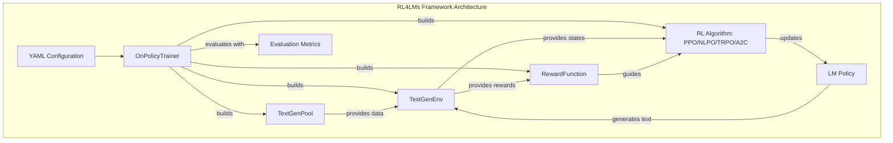
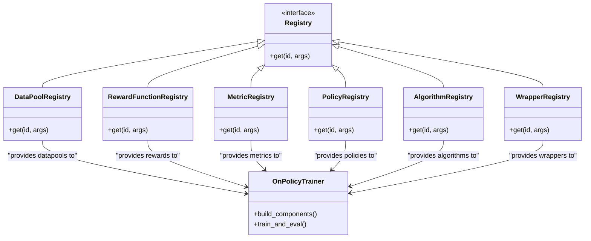
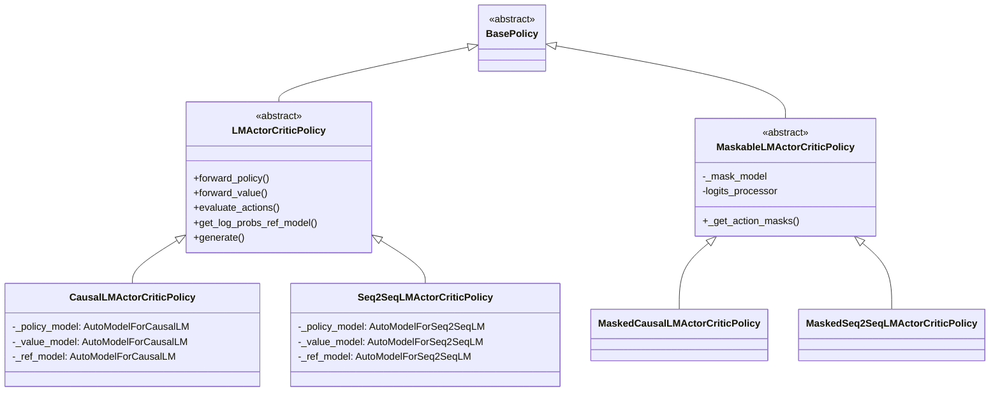
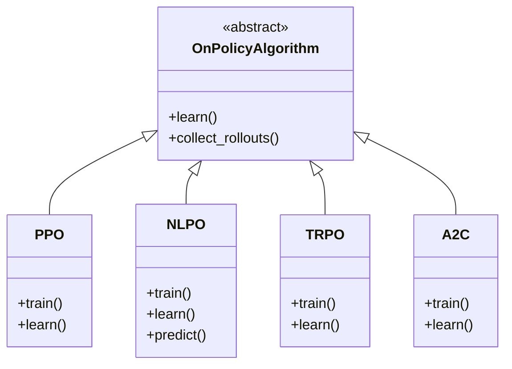
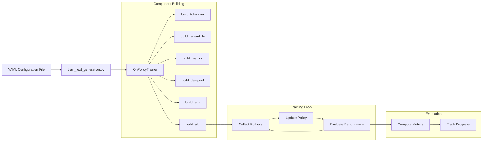

<!-- source: DeepWiki mcp.deepwiki.com · repo allenai/RL4LMs · page 1 Overview · fetched 2026-10-26 -->

# Overview

<details>
<summary>Relevant source files</summary>

The following files were used as context for generating this wiki page:

- [README.md](README.md)
- [rl4lms/envs/text_generation/training_utils.py](rl4lms/envs/text_generation/training_utils.py)
- [scripts/training/task_configs/synthetic_generate_increasing_numbers/gpt2_nlpo.yml](scripts/training/task_configs/synthetic_generate_increasing_numbers/gpt2_nlpo.yml)
- [scripts/training/train_text_generation.py](scripts/training/train_text_generation.py)
- [setup.py](setup.py)

</details>


RL4LMs is a modular reinforcement learning library designed to fine-tune language models to human preferences. This document provides an introduction to the RL4LMs framework, explaining its purpose, key components, and high-level architecture. For specific implementation details of individual components, please refer to their respective wiki pages.

## Purpose and Scope

The RL4LMs framework enables fine-tuning language models using reinforcement learning to optimize for arbitrary reward functions. It provides easily customizable building blocks including:

- On-policy reinforcement learning algorithms
- Reward functions based on various NLG metrics
- Evaluation metrics
- Datasets for different text generation tasks
- Language model based actor-critic policies

This framework has been tested and benchmarked with over 2,000 experiments on 7 different NLP tasks, including summarization, text continuation, machine translation, and dialog generation.

Sources: [README.md:5-34]()

## High-Level Architecture



The RL4LMs framework follows a modular architecture where the `OnPolicyTrainer` acts as the central orchestrator. It builds and connects all components according to a YAML configuration file. The reinforcement learning loop involves the agent interacting with the environment through the policy, generating text, receiving rewards, and updating the policy accordingly.

Sources: [rl4lms/envs/text_generation/training_utils.py:126-224](), [scripts/training/train_text_generation.py:46-54]()

## Component Registry System



The registry system is a core architectural component that enables the modular and extensible design of RL4LMs. Each type of component is managed by a dedicated registry, which allows components to be registered and retrieved by ID. This makes it easy to swap different implementations of components without changing the rest of the system.

Sources: [rl4lms/envs/text_generation/training_utils.py:10-15](), [rl4lms/envs/text_generation/training_utils.py:46-123]()

## Policy Architecture



The policy system supports different types of language models through a class hierarchy. The two main branches are for causal language models (like GPT-2) and sequence-to-sequence models (like T5 or BART). Each has a standard version and a maskable version that supports action masking for improved exploration during training (particularly used with NLPO algorithm).

Sources: [README.md:130-156]()

## Reinforcement Learning Algorithms

RL4LMs provides implementations of four on-policy reinforcement learning algorithms:

1. **PPO (Proximal Policy Optimization)**: A widely used RL algorithm known for its stability and sample efficiency
2. **NLPO (Natural Language Policy Optimization)**: A novel algorithm designed specifically for text generation tasks
3. **TRPO (Trust Region Policy Optimization)**: An algorithm that ensures policy updates stay within a trust region
4. **A2C (Advantage Actor-Critic)**: A synchronous version of the Asynchronous Advantage Actor-Critic algorithm

These algorithms are adapted from the Stable Baselines3 library and tailored to work with language model policies for text generation tasks.



Sources: [README.md:31](), [README.md:127-131]()

## Training Pipeline

The training pipeline in RL4LMs follows a standard reinforcement learning workflow:



The training process begins with loading a YAML configuration file that specifies all aspects of the training. The `OnPolicyTrainer` builds all components according to the configuration and executes the training loop. During training, the agent collects rollouts by interacting with the environment, updates the policy based on the observed rewards, and periodically evaluates the performance on validation data.

Sources: [scripts/training/train_text_generation.py:13-55](), [rl4lms/envs/text_generation/training_utils.py:194-223]()

## Configuration System

RL4LMs uses YAML configuration files to define all aspects of the training process. This includes:

1. **Dataset/Task Configuration**:
   ```yaml
   datapool:
     id: cnn_daily_mail
     args:
       prompt_prefix: "Summarize: "
   ```

2. **Tokenizer Configuration**:
   ```yaml
   tokenizer:
     model_name: t5-base
     padding_side: left
     truncation_side: left
     pad_token_as_eos_token: False
   ```

3. **Reward Function Configuration**:
   ```yaml
   reward_fn:
     id: rouge
     args:
       rouge_type: "rouge1"
   ```

4. **Environment Configuration**:
   ```yaml
   env:
     n_envs: 10
     args:
       max_prompt_length: 512
       max_episode_length: 100
       terminate_on_eos: True
   ```

5. **Algorithm and Policy Configuration**:
   ```yaml
   alg:
     id: ppo
     args: 
       n_steps: 512
       batch_size: 64
       learning_rate: 0.000002
     policy:
       id: seq2seq_lm_actor_critic_policy
       args:
         model_name: t5-base
   ```

6. **Training and Evaluation Configuration**:
   ```yaml
   train_evaluation:
     eval_batch_size: 100
     n_iters: 100
     eval_every: 10
     metrics:
       - id: rouge
       - id: bleu
   ```

This configuration-based approach makes it easy to experiment with different components and hyperparameters without changing code.

Sources: [README.md:79-187](), [scripts/training/task_configs/synthetic_generate_increasing_numbers/gpt2_nlpo.yml:1-61]()

## Use Cases and Supported Tasks

RL4LMs supports a wide range of text generation tasks:

| Task Type | Description | Example Applications |
|-----------|-------------|---------------------|
| Summarization | Generate concise summaries of longer texts | News article summarization, document summarization |
| Text Continuation | Continue text based on a prompt | Story generation, content creation |
| Dialog Generation | Generate conversational responses | Chatbots, dialog systems |
| Machine Translation | Translate text from one language to another | Language translation services |
| Table-to-Text Generation | Generate textual descriptions of tabular data | Data reporting, automated analysis |
| Question Answering | Generate answers to questions | QA systems, information retrieval |
| Commonsense Reasoning | Generate text that demonstrates reasoning about common situations | Reasoning systems, content creation |

The framework has been thoroughly tested across these tasks using various language models and reinforcement learning algorithms.

Sources: [README.md:17-25]()

## Extending the Framework

RL4LMs is designed to be highly extensible, allowing users to add custom components:

1. **Custom Datasets**: Create by subclassing `TextGenPool` and implementing the `prepare()` method
2. **Custom Reward Functions**: Create by subclassing `RewardFunction` and implementing the `__call__()` method
3. **Custom Metrics**: Create by subclassing `BaseMetric` and implementing the `compute()` method
4. **Custom Algorithms**: Create by subclassing `OnPolicyAlgorithm` and implementing required methods
5. **Custom Policies**: Create by subclassing the appropriate policy base class

Each custom component can be registered in the corresponding registry, making it available for use through the configuration system.

Sources: [README.md:190-293]()

## Getting Started

To get started with RL4LMs, you can:

1. **Install the library**:
   ```bash
   git clone https://github.com/allenai/RL4LMs.git
   cd RL4LMs
   pip install -e .
   ```

2. **Train a model** using an existing configuration:
   ```bash
   python scripts/training/train_text_generation.py --config_path scripts/training/task_configs/summarization/t5_ppo.yml
   ```

3. **Create your own configuration** by modifying an existing one to suit your needs

For more detailed information about specific components, please refer to the corresponding pages in this wiki.

Sources: [README.md:47-53](), [README.md:67-73]()

---

