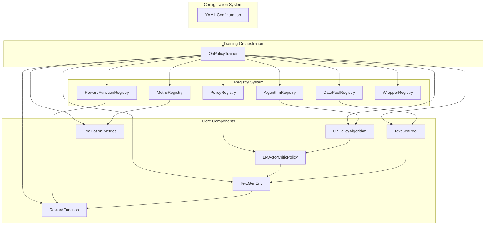
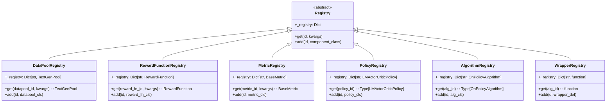
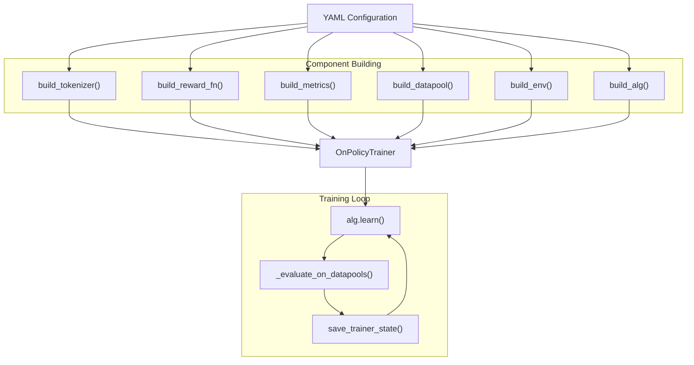
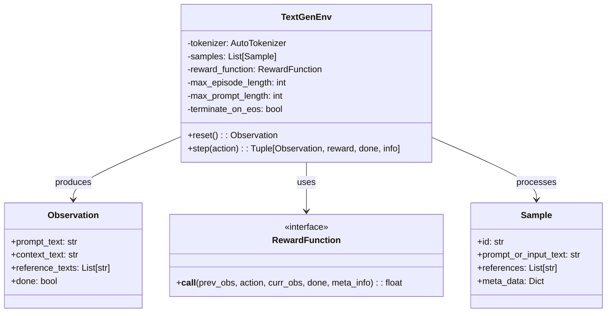
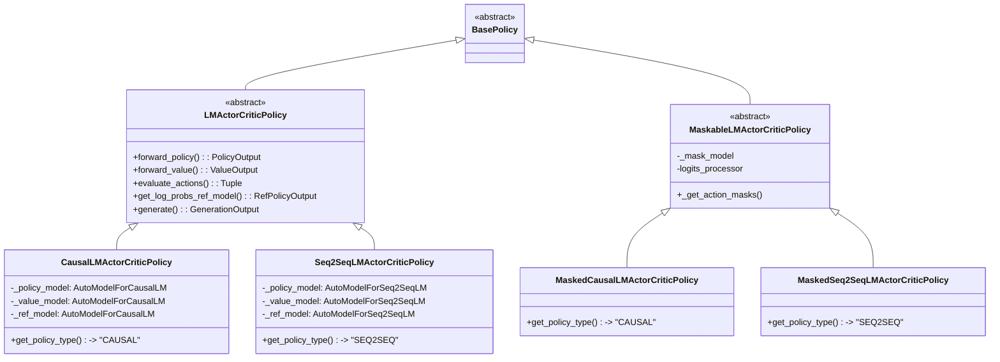
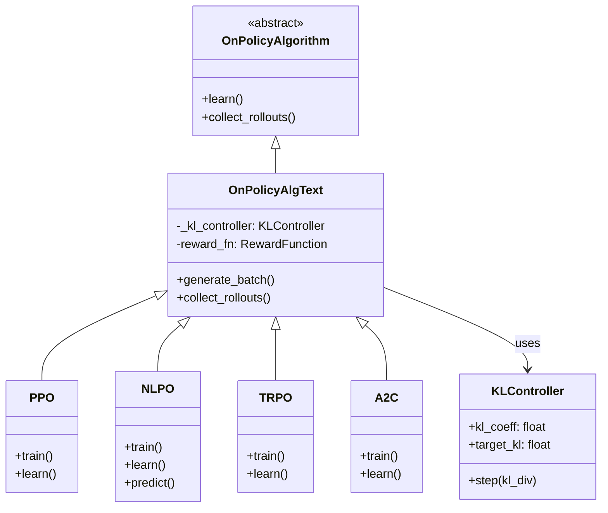
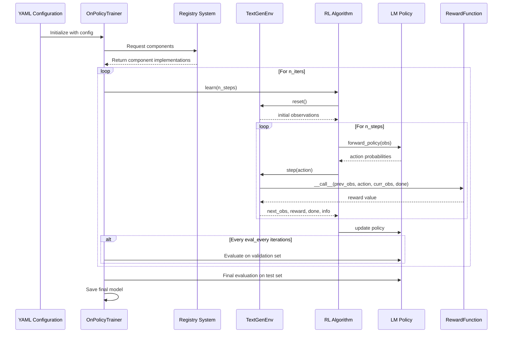
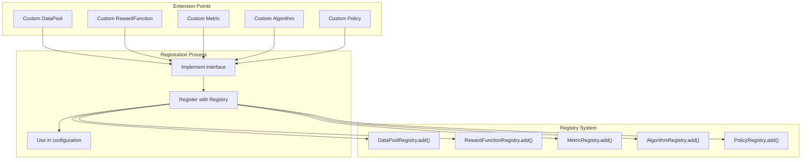

<!-- source: DeepWiki mcp.deepwiki.com · repo allenai/RL4LMs · page 2 System Architecture · fetched 2026-10-26 -->

# System Architecture

<details>
<summary>Relevant source files</summary>

The following files were used as context for generating this wiki page:

- [README.md](README.md)
- [rl4lms/envs/text_generation/alg_wrappers.py](rl4lms/envs/text_generation/alg_wrappers.py)
- [rl4lms/envs/text_generation/registry.py](rl4lms/envs/text_generation/registry.py)
- [rl4lms/envs/text_generation/reward.py](rl4lms/envs/text_generation/reward.py)
- [rl4lms/envs/text_generation/training_utils.py](rl4lms/envs/text_generation/training_utils.py)
- [setup.py](setup.py)

</details>


## Overview and Purpose

This document provides a comprehensive explanation of the RL4LMs system architecture, detailing how components interact to enable reinforcement learning for language models. RL4LMs is designed with modularity and extensibility as its core principles, allowing users to customize every aspect of the training pipeline while maintaining a consistent interface.

The architecture follows a registry-based component system that facilitates easy swapping of implementations for datasets, reward functions, metrics, policies, and algorithms. This document focuses on the structural organization of these components and their interactions. For specific information about reward functions, see [Reward Functions](#3), and for details about reinforcement learning algorithms, see [Reinforcement Learning Algorithms](#4).

## Core Architecture Overview

RL4LMs is structured around a central training orchestrator (`OnPolicyTrainer`) that coordinates the interaction between various components defined through registries. The system uses a YAML-based configuration to instantiate and connect these components.



Sources: [README.md:126-132](), [rl4lms/envs/text_generation/training_utils.py:126-169](), [rl4lms/envs/text_generation/registry.py:1-246]()

## Registry System Architecture

The RL4LMs framework implements a registry pattern to manage different types of components. This approach allows for a modular and extensible design where components can be added, removed, or swapped without modifying core code.



Each registry maintains a mapping between string identifiers and component implementations. When a component is requested by ID through configuration, the appropriate registry retrieves the implementation and instantiates it with the provided arguments.

Example registry usage:
```python
# Creating a data pool instance from a config
datapool = DataPoolRegistry.get(datapool_config["id"], 
                               datapool_config.get("args", {}))

# Creating a reward function instance from a config
reward_fn = RewardFunctionRegistry.get(reward_config["id"],
                                      reward_config.get("args", {}))
```

The registry system is extensible - custom components can be added to the registries and then used through configuration without modifying the core code.

Sources: [rl4lms/envs/text_generation/registry.py:87-264](), [rl4lms/envs/text_generation/training_utils.py:45-49](), [rl4lms/envs/text_generation/training_utils.py:57-65]()

## Training Pipeline

The training pipeline in RL4LMs is orchestrated by the `OnPolicyTrainer` class, which is responsible for:
1. Building all components based on configuration
2. Managing the training loop
3. Handling evaluation and checkpointing
4. Coordinating the interaction between components



The `OnPolicyTrainer` acts as the central coordinator for the training process. It initializes all components based on the provided configuration and manages the training loop. The training loop consists of learning iterations followed by periodic evaluation and checkpoint saving.

Key methods in the training pipeline:
- `_setup()`: Initializes all components based on the configuration
- `train_and_eval()`: Manages the training loop, alternating between learning and evaluation
- `_evaluate_on_datapools()`: Evaluates the model on validation and test datasets

Sources: [rl4lms/envs/text_generation/training_utils.py:126-224](), [README.md:77-187]()

## Environment Architecture

The environment in RL4LMs follows the OpenAI Gym interface and is implemented as `TextGenEnv`. It simulates a Markov Decision Process (MDP) for text generation, where:
- States are represented by the current text context
- Actions are token selections
- Rewards are computed based on the generated text quality



The environment maintains the state of the text generation process and computes rewards based on the configured reward function. The environment is typically vectorized using `SubprocVecEnv` to process multiple episodes in parallel for more efficient training.

The `step()` method advances the environment by taking a token action and returns:
1. The new observation
2. The reward for the action
3. A boolean indicating if the episode is done
4. Additional information (metadata)

Sources: [rl4lms/envs/text_generation/training_utils.py:79-95](), [README.md:107-125]()

## Policy Architecture

RL4LMs implements a comprehensive policy hierarchy that supports different types of language models. Policies are responsible for both generating text and evaluating the value of states.



The policy system supports two main types of language models:
1. **Causal Language Models** (like GPT-2): Models that generate text by predicting the next token based on previous tokens
2. **Sequence-to-Sequence Models** (like T5 or BART): Models that transform an input sequence into an output sequence

Each type has a standard version and a maskable version that supports action masking for improved exploration during training. The maskable variants are particularly important for the NLPO algorithm.

Key components of the policy:
- **Actor**: The language model used for generating text (policy_model)
- **Critic**: The model used for estimating state values (value_model)
- **Reference Model**: The original unmodified model used for KL-divergence calculation (ref_model)

Sources: [rl4lms/envs/text_generation/registry.py:48-56](), [rl4lms/envs/text_generation/registry.py:185-200](), [README.md:126-157]()

## Algorithm Implementation

RL4LMs implements several on-policy reinforcement learning algorithms adapted for language model training. These algorithms are built on top of the stable-baselines3 framework but enhanced with specific features for text generation.



The algorithms are wrapped by a common wrapper (`wrap_onpolicy_alg`) that extends them with text generation specific functionality. This wrapper adds:

1. **KL Divergence Control**: Manages the KL divergence between the trained policy and the reference model
2. **Batched Reward Computation**: Enables efficient reward calculation for multiple episodes
3. **Vectorized Environment Handling**: Manages parallel environments for improved efficiency

The most notable algorithms implemented are:
- **PPO** (Proximal Policy Optimization): A widely used RL algorithm that uses clipped surrogate objectives
- **NLPO** (Natural Language Policy Optimization): A novel algorithm specialized for text generation
- **TRPO** (Trust Region Policy Optimization): An algorithm that ensures policy updates stay within a trust region
- **A2C** (Advantage Actor-Critic): An on-policy algorithm that uses value functions to reduce variance

Sources: [rl4lms/envs/text_generation/alg_wrappers.py:90-408](), [rl4lms/envs/text_generation/registry.py:203-225](), [README.md:127-157]()

## Component Interaction Flow

The following diagram illustrates how the components interact during the training process, showing the flow of data and control:



The training process begins with the initialization of the `OnPolicyTrainer` with a configuration. The trainer then requests components from the registry system. The main training loop consists of:

1. The agent collecting rollouts by interacting with the environment
2. The environment computing rewards using the reward function
3. The agent updating the policy based on the collected rollouts
4. Periodic evaluation of the policy on validation data

This cycle repeats for the specified number of iterations, after which a final evaluation is performed on the test set.

Sources: [rl4lms/envs/text_generation/training_utils.py:194-223](), [rl4lms/envs/text_generation/alg_wrappers.py:352-404]()

## Configuration Schema

RL4LMs uses a YAML-based configuration system to define all aspects of the training process. The configuration specifies the components to use and their parameters.

| Component | Configuration Section | Description |
|-----------|----------------------|-------------|
| Dataset | `datapool` | Specifies the dataset to use for training and evaluation |
| Tokenizer | `tokenizer` | Configures the tokenizer for processing text |
| Reward Function | `reward_fn` | Defines the reward function for guiding the RL algorithm |
| Environment | `env` | Configures the text generation environment |
| Algorithm | `alg` | Specifies the RL algorithm and its parameters |
| Policy | `alg.policy` | Configures the language model policy |
| Training & Evaluation | `train_evaluation` | Defines training parameters and evaluation metrics |

Example configuration structure:
```yaml
datapool:
  id: "cnn_daily_mail"
  args:
    prompt_prefix: "Summarize: "

tokenizer:
  model_name: "t5-base"
  padding_side: "left"
  
reward_fn:
  id: "rouge"
  args:
    rouge_type: "rouge1"
    
env:
  n_envs: 10
  args:
    max_prompt_length: 512
    max_episode_length: 100
    
alg:
  id: "ppo"
  args:
    n_steps: 512
    batch_size: 64
  policy:
    id: "seq2seq_lm_actor_critic_policy"
    args:
      model_name: "t5-base"
      
train_evaluation:
  eval_batch_size: 100
  n_iters: 100
  eval_every: 10
```

Sources: [README.md:77-187]()

## Extensibility Architecture

RL4LMs is designed for extensibility, allowing users to add custom components without modifying the core codebase. This is achieved through the registry system and well-defined interfaces.



To extend RL4LMs with custom components:

1. Implement the appropriate interface (e.g., `RewardFunction`, `TextGenPool`, `BaseMetric`)
2. Register the implementation with the corresponding registry
3. Use the custom component in your configuration by its registered ID

This extensibility architecture allows users to experiment with new ideas without changing the core framework, making RL4LMs highly adaptable to different research needs.

Sources: [README.md:190-293]()

## Summary

The RL4LMs system architecture is built around a modular, registry-based design that enables the composition of various components to create customized reinforcement learning pipelines for language models. The architecture ensures:

1. **Modularity**: Components can be replaced or extended without modifying core code
2. **Configurability**: All aspects of the system can be controlled through configuration
3. **Extensibility**: New components can be easily added through the registry system
4. **Reusability**: Common components like policies and algorithms can be reused across different tasks

This architecture makes RL4LMs a powerful framework for experimenting with reinforcement learning approaches to language model fine-tuning.

Sources: [README.md:11-34](), [setup.py:6-15]()

---

