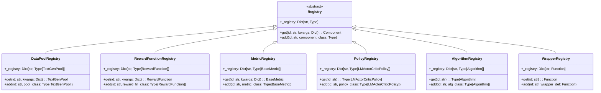
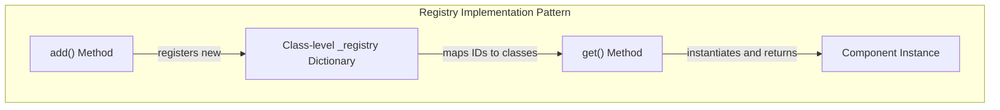
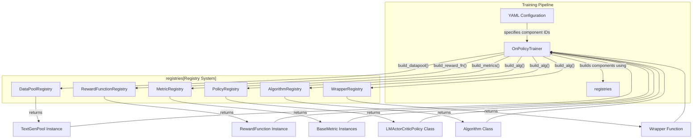
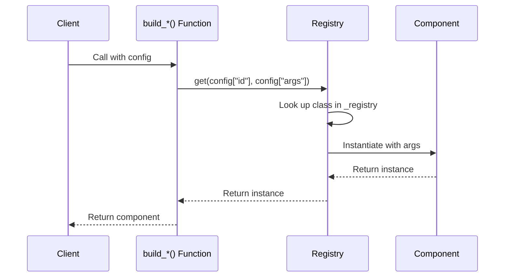
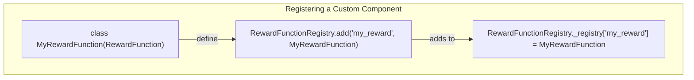
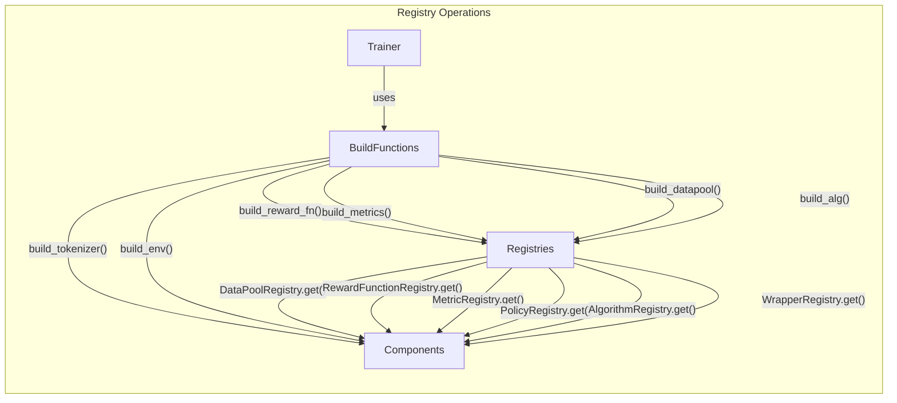
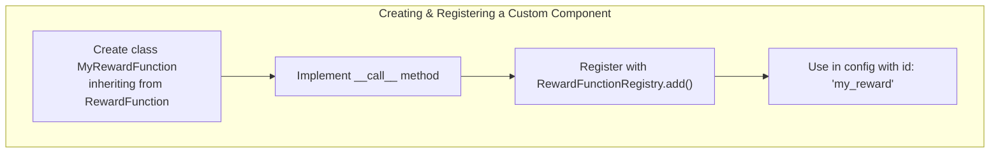

<!-- source: DeepWiki mcp.deepwiki.com · repo allenai/RL4LMs · page 2.1 Registry System · fetched 2026-10-26 -->

# Registry System

<details>
<summary>Relevant source files</summary>

The following files were used as context for generating this wiki page:

- [README.md](README.md)
- [rl4lms/envs/text_generation/registry.py](rl4lms/envs/text_generation/registry.py)
- [rl4lms/envs/text_generation/reward.py](rl4lms/envs/text_generation/reward.py)
- [rl4lms/envs/text_generation/training_utils.py](rl4lms/envs/text_generation/training_utils.py)
- [setup.py](setup.py)

</details>


## Purpose and Scope

The Registry System is a core architectural pattern in the RL4LMs framework that facilitates modular component management and extensibility. This document explains how the various registries function, their implementation, and how they integrate with the rest of the framework. For information about specific components being registered, see their respective wiki pages: [Policies](#2.3), [Reward Functions](#3), and [RL Algorithms](#4).

## Overview

The Registry System provides a central mechanism for managing various components used in reinforcement learning for language models. It follows a simple but powerful design pattern that organizes different types of components into their own dedicated registries, mapping string identifiers to their corresponding implementation classes.



Sources: [rl4lms/envs/text_generation/registry.py:87-264]()

## Registry Types

The RL4LMs framework implements several specific registry types, each managing a different category of components:

| Registry Type | Purpose | Key Classes/Functions Managed |
|---------------|---------|-------------------------------|
| `DataPoolRegistry` | Manages datasets for text generation tasks | `IMDB`, `CommonGen`, `CNNDailyMail`, etc. |
| `RewardFunctionRegistry` | Manages reward functions for RL training | `MeteorRewardFunction`, `RougeRewardFunction`, etc. |
| `MetricRegistry` | Manages evaluation metrics | `BLEUMetric`, `RougeMetric`, `BERTScoreMetric`, etc. |
| `PolicyRegistry` | Manages policy implementations | `CausalLMActorCriticPolicy`, `Seq2SeqLMActorCriticPolicy`, etc. |
| `AlgorithmRegistry` | Manages RL algorithms | `PPO`, `NLPO`, `TRPO`, `A2C` |
| `WrapperRegistry` | Manages algorithm wrappers | `wrap_onpolicy_alg` |
| `PostProcessorRegistry` | Manages text post-processors | `three_sentence_summary` |

Sources: [rl4lms/envs/text_generation/registry.py:87-264]()

## Registry Implementation

Each registry follows a consistent implementation pattern with three key elements:

1. A class-level `_registry` dictionary that maps string identifiers to component implementations
2. A `get()` class method to retrieve and instantiate components 
3. An `add()` class method to register new component implementations

Here's an example of how these registries are implemented:



Sources: [rl4lms/envs/text_generation/registry.py:87-264]()

## Integration with Training Pipeline

The Registry System is a core part of the RL4LMs training pipeline, enabling configuration-driven component creation. The `OnPolicyTrainer` class uses these registries to build the necessary components based on configuration files.



Sources: [rl4lms/envs/text_generation/training_utils.py:34-124]()

## Component Retrieval Process

When components are requested from a registry, they are retrieved by their string ID and instantiated with the provided arguments. The process for retrieving components follows this general pattern:



For example, here's how reward functions are built:

```mermaid
graph TD
    subgraph "Building a Reward Function"
        config["reward_config = {'id': 'rouge', 'args': {'rouge_type': 'rouge1'}}"]
        build["build_reward_fn(reward_config)"]
        registry["RewardFunctionRegistry.get('rouge', {'rouge_type': 'rouge1'})"]
        class["RougeRewardFunction class"]
        instance["RougeRewardFunction(rouge_type='rouge1')"]
        
        config -->|"passed to"| build
        build -->|"calls"| registry
        registry -->|"looks up"| class
        class -->|"instantiates"| instance
        instance -->|"returned to"| build
        build -->|"returns"| result["Reward Function Instance"]
    end
```

Sources: [rl4lms/envs/text_generation/training_utils.py:46-49](), [rl4lms/envs/text_generation/registry.py:139-142]()

## Component Registration Process

New components can be added to the system by registering them with the appropriate registry. This is done by calling the `add()` method with a string ID and the component class:



Sources: [rl4lms/envs/text_generation/registry.py:144-146]()

## Registry Usage in Configuration

The Registry System enables configuration-driven application development through YAML files. Component types and their parameters are specified in these files, which are then used to build the components using the registries.

```
datapool:
  id: cnn_daily_mail
  args:
    prompt_prefix: "Summarize: "

reward_fn:
  id: rouge
  args:
    rouge_type: "rouge1"

alg:
  id: ppo
  args: 
    n_steps: 512
    batch_size: 64
    learning_rate: 0.000002
```

Each component specification includes an `id` field that identifies which implementation to use, and an optional `args` field that provides parameters for initialization.

Sources: [rl4lms/envs/text_generation/training_utils.py:126-168]()

## Common Registry Operations

The Registry System is used throughout the RL4LMs codebase for building components. Here are some common registry operations:



Sources: [rl4lms/envs/text_generation/training_utils.py:34-124]()

## Benefits of the Registry System

The Registry System offers several key advantages:

1. **Modularity**: Components are decoupled, allowing them to be developed and tested independently.
2. **Extensibility**: New implementations can be added without modifying existing code.
3. **Configuration-driven**: Components can be selected and configured via YAML files.
4. **Discoverability**: All available components are clearly listed in the registries.
5. **Standardization**: Components follow consistent interfaces determined by their base classes.

Sources: [README.md:10-34]()

## Extending with Custom Components

Extending the RL4LMs framework with custom components is straightforward using the Registry System. Here's the general pattern:

1. Create a new class that inherits from the appropriate base class
2. Implement the required methods
3. Register the class with the appropriate registry

For example, to create and register a custom reward function:



Sources: [README.md:245-293]()

## Summary

The Registry System is a fundamental architectural component of RL4LMs that enables modular, extensible, and configuration-driven development. It organizes different types of components into dedicated registries, providing a clean interface for component retrieval and registration. Understanding the Registry System is essential for effectively using and extending the RL4LMs framework.

---

