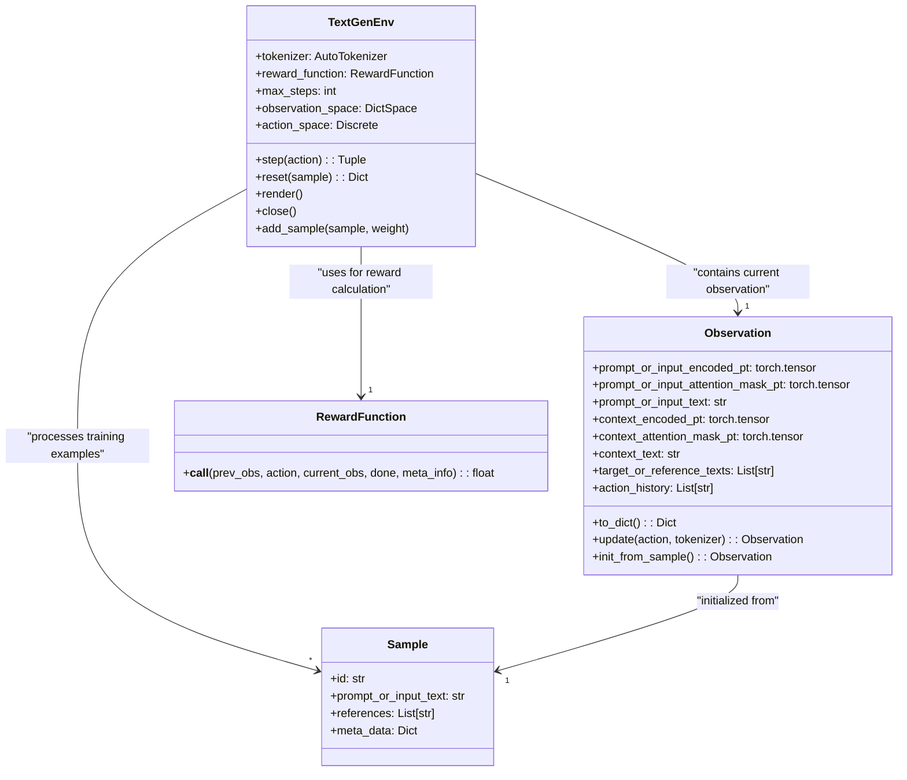
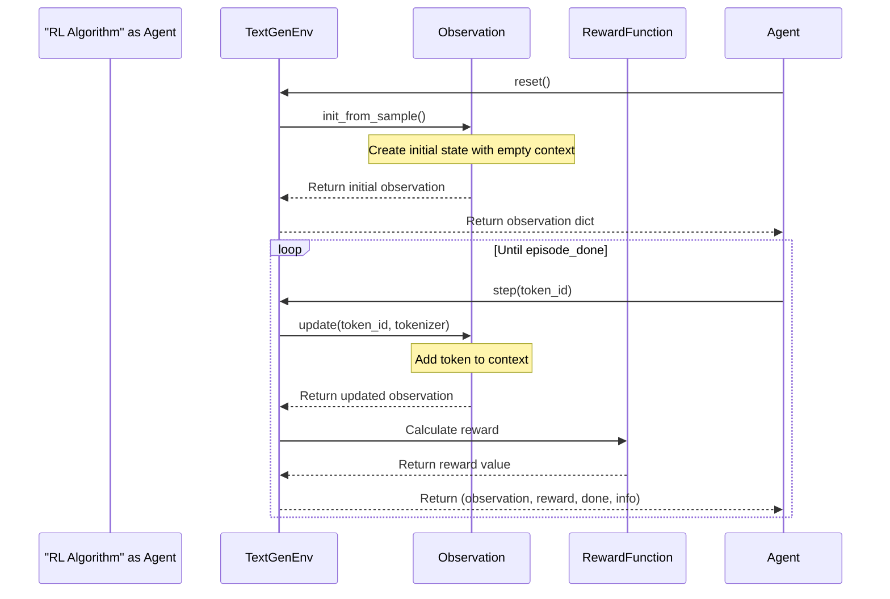
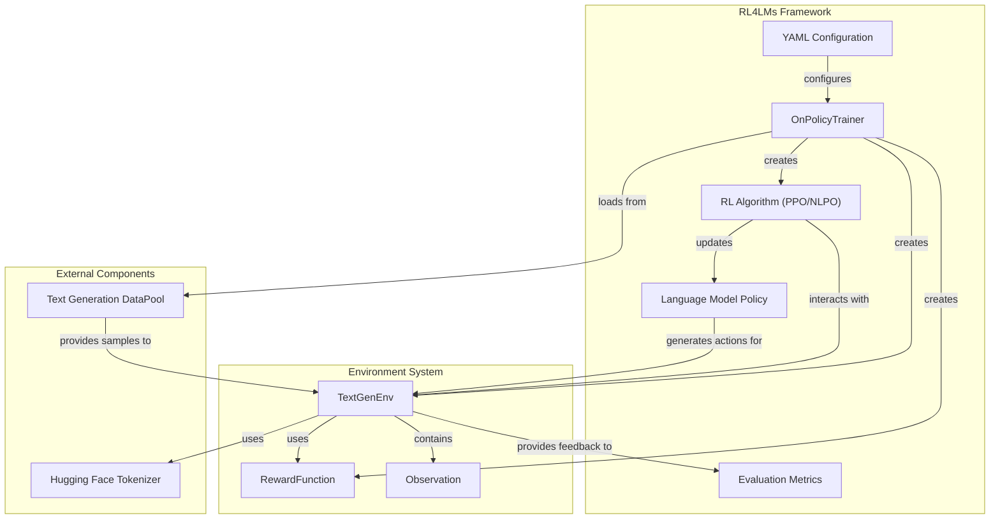

<!-- source: DeepWiki mcp.deepwiki.com · repo allenai/RL4LMs · page 2.2 Environment · fetched 2026-10-26 -->

# Environment

<details>
<summary>Relevant source files</summary>

The following files were used as context for generating this wiki page:

- [rl4lms/envs/text_generation/env.py](rl4lms/envs/text_generation/env.py)
- [rl4lms/envs/text_generation/observation.py](rl4lms/envs/text_generation/observation.py)
- [scripts/training/task_configs/synthetic_generate_increasing_numbers/bart_ppo.yml](scripts/training/task_configs/synthetic_generate_increasing_numbers/bart_ppo.yml)
- [scripts/training/task_configs/synthetic_generate_increasing_numbers/blendorbot_ppo.yml](scripts/training/task_configs/synthetic_generate_increasing_numbers/blendorbot_ppo.yml)

</details>


## Purpose and Overview

The Environment component in RL4LMs provides a reinforcement learning (RL) interface for text generation tasks. It implements the standard OpenAI Gym interface for RL environments, adapting it specifically for language model tasks such as text generation, summarization, and translation.

This document details the environment's architecture, its components, and how it interacts with other parts of the RL4LMs framework. For information about the policies that act within this environment, see [Policies](#2.3).

## Key Components

The RL4LMs environment system consists of two main classes:
1. `TextGenEnv`: The main environment class implementing the Gym interface
2. `Observation`: A dataclass representing the state of the environment



Sources: [rl4lms/envs/text_generation/env.py:15-40](), [rl4lms/envs/text_generation/observation.py:10-36]()

## TextGenEnv Class

The `TextGenEnv` class is the core of the environment system, implementing the standard OpenAI Gym interface (`Env`) for reinforcement learning. It converts text generation tasks into a format suitable for RL algorithms.

### Initialization

```python
def __init__(
    self,
    tokenizer: AutoTokenizer,
    reward_function: RewardFunction,
    samples: Tuple[List[Sample], float],
    max_episode_length: int = 512,
    priority_scale: float = 0.0,
    max_prompt_length: Optional[int] = None,
    terminate_on_eos: bool = False,
    context_start_token: Optional[int] = None,
    prompt_truncation_side: str = "left",
):
```

Key parameters:
- `tokenizer`: Hugging Face tokenizer for encoding/decoding text
- `reward_function`: Function to compute rewards for generated tokens
- `samples`: List of training examples with associated weights
- `max_episode_length`: Maximum number of tokens to generate
- `terminate_on_eos`: Whether to end generation when EOS token is produced
- `context_start_token`: Special token ID to start generation (for encoder-decoder models)

Sources: [rl4lms/envs/text_generation/env.py:16-51]()

### Observation and Action Spaces

The environment defines two key spaces:

1. **Observation Space**: A dictionary space containing tensors for:
   - Encoded prompt/input
   - Prompt attention mask
   - Generated context (tokens produced so far)
   - Context attention mask
   - Combined input and context

2. **Action Space**: A discrete space with size equal to the tokenizer's vocabulary size

Sources: [rl4lms/envs/text_generation/env.py:53-88]()

## Environment Flow and RL Loop

The environment implements the standard RL loop through its main methods:



Sources: [rl4lms/envs/text_generation/env.py:104-144](), [rl4lms/envs/text_generation/env.py:146-170]()

### Step Method

The `step` method is the core of the environment's functionality:

```python
def step(self, action: int) -> Tuple[Dict[str, torch.tensor], int, bool, dict]:
```

1. Takes a token ID as input (the action)
2. Updates the current observation by adding the token to the context
3. Checks if the episode is done (EOS token or max length reached)
4. Computes the reward using the reward function
5. Returns the updated observation, reward, done flag, and additional info

Sources: [rl4lms/envs/text_generation/env.py:104-144]()

### Reset Method

The `reset` method prepares the environment for a new episode:

```python
def reset(self, sample: Sample = None) -> Dict[str, torch.tensor]:
```

1. Selects a new sample if one isn't provided
2. Initializes a new observation from the sample
3. Resets the time step counter
4. Returns the initial observation

Sources: [rl4lms/envs/text_generation/env.py:146-170]()

## Observation Class

The `Observation` class represents the state of the environment at each step. It contains:

1. **Encoded Representations**:
   - `prompt_or_input_encoded_pt`: Tokenized prompt
   - `context_encoded_pt`: Tokens generated so far
   - `input_encoded_pt`: Combined prompt and context

2. **Text Representations**:
   - `prompt_or_input_text`: Original prompt text
   - `context_text`: Text generated so far
   - `target_or_reference_texts`: Reference texts for evaluation

3. **Methods**:
   - `to_dict()`: Converts observation to dictionary format for RL algorithms
   - `update(action, tokenizer)`: Creates a new observation with the action added to context
   - `init_from_sample()`: Initializes observation from a sample

Sources: [rl4lms/envs/text_generation/observation.py:10-36](), [rl4lms/envs/text_generation/observation.py:37-50](), [rl4lms/envs/text_generation/observation.py:72-118](), [rl4lms/envs/text_generation/observation.py:120-177]()

## Environment in the RL4LMs Framework

The environment fits into the larger RL4LMs framework as follows:



Sources: [rl4lms/envs/text_generation/env.py:15-179]()

## Environment Configuration

The environment is configured through YAML files. Here's an example configuration:

```yaml
env:
  n_envs: 10
  args:
    max_prompt_length: 5
    max_episode_length: 20
    terminate_on_eos: True
    context_start_token: 2  # decoder start token for seq2seq models
```

Key configuration parameters:

| Parameter | Description | Example |
|-----------|-------------|---------|
| `n_envs` | Number of parallel environments | 10 |
| `max_prompt_length` | Maximum length of input prompt | 5 |
| `max_episode_length` | Maximum tokens to generate | 20 |
| `terminate_on_eos` | Whether to stop on EOS token | True |
| `context_start_token` | Token ID to start generation (encoder-decoder models) | 2 |
| `prompt_truncation_side` | Which side to truncate prompts ("left" or "right") | "left" |

Sources: [scripts/training/task_configs/synthetic_generate_increasing_numbers/bart_ppo.yml:17-23](), [scripts/training/task_configs/synthetic_generate_increasing_numbers/blendorbot_ppo.yml:17-23]()

## Special Handling for Different Model Types

The environment handles different types of language models:

1. **Causal Language Models** (e.g., GPT-2)
   - Generation starts with an empty context
   - Each token is appended to the context sequentially

2. **Sequence-to-Sequence Models** (e.g., BART, T5)
   - Generation starts with a special `context_start_token`
   - For T5, the environment automatically adjusts the action space size

Sources: [rl4lms/envs/text_generation/env.py:83-88](), [rl4lms/envs/text_generation/observation.py:141-157]()

## Integration with Reward Functions

The environment integrates with reward functions to provide feedback signals for learning:

1. Standard reward functions compute rewards for each step
2. Batched reward functions handle multiple environments at once
3. Rewards are calculated based on previous observation, action, and current observation

The environment also collects information in the `info` dictionary returned by `step()`, which contains:
- Generated text so far
- Action history
- Reference texts
- Prompt text
- Additional metadata

Sources: [rl4lms/envs/text_generation/env.py:118-132](), [rl4lms/envs/text_generation/env.py:134-142]()

---

