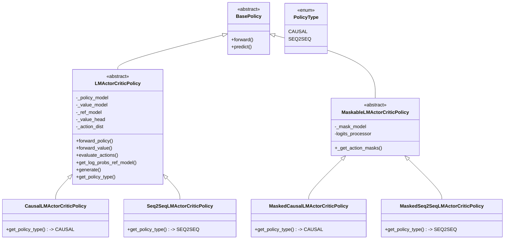
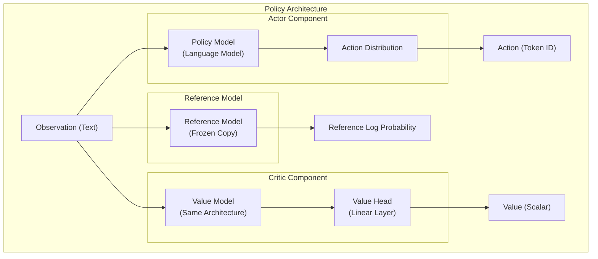
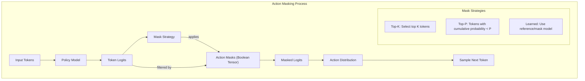
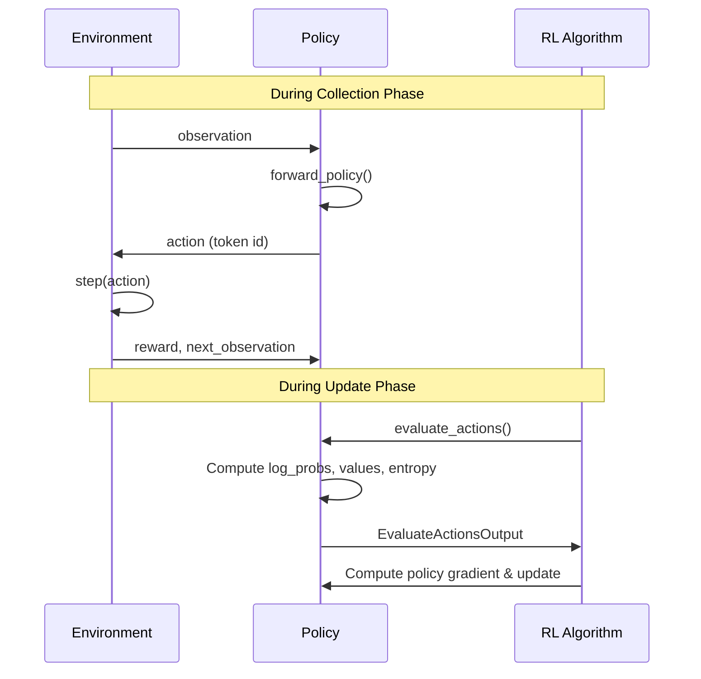
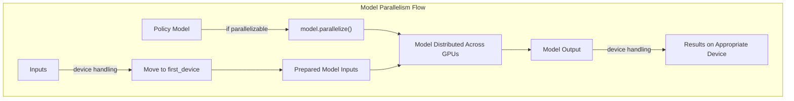

<!-- source: DeepWiki mcp.deepwiki.com · repo allenai/RL4LMs · page 2.3 Policies · fetched 2026-10-26 -->

# Policies

<details>
<summary>Relevant source files</summary>

The following files were used as context for generating this wiki page:

- [rl4lms/algorithms/common/maskable/logits_processor.py](rl4lms/algorithms/common/maskable/logits_processor.py)
- [rl4lms/algorithms/trpo/trpo.py](rl4lms/algorithms/trpo/trpo.py)
- [rl4lms/envs/text_generation/policy.py](rl4lms/envs/text_generation/policy.py)
- [rl4lms/envs/text_generation/policy/base_policy.py](rl4lms/envs/text_generation/policy/base_policy.py)
- [rl4lms/envs/text_generation/policy/causal_policy.py](rl4lms/envs/text_generation/policy/causal_policy.py)
- [rl4lms/envs/text_generation/policy/seq2seq_policy.py](rl4lms/envs/text_generation/policy/seq2seq_policy.py)
- [scripts/training/task_configs/synthetic_generate_increasing_numbers/t5_nlpo.yml](scripts/training/task_configs/synthetic_generate_increasing_numbers/t5_nlpo.yml)
- [scripts/training/task_configs/synthetic_generate_increasing_numbers/t5_ppo.yml](scripts/training/task_configs/synthetic_generate_increasing_numbers/t5_ppo.yml)

</details>


## Purpose and Scope

This document details the policy implementations in the RL4LMs framework. In reinforcement learning for language models, a policy is a function that maps an observation (text context) to a distribution over possible actions (next tokens). The RL4LMs framework implements various policy architectures optimized for different language model types, enabling reinforcement learning algorithms to efficiently train language models for text generation tasks.

For information about how policies interact with the RL environment, see [Environment](#2.2). For details on the reinforcement learning algorithms that use these policies, see [Reinforcement Learning Algorithms](#4).

## Policy Architecture Overview



The policy system extends the `BasePolicy` from Stable Baselines 3, tailoring it to work with language models. There are two main policy types, corresponding to the two main types of language models:

1. **Causal Language Models** (e.g., GPT-2): Generate text by predicting the next token based on all previous tokens.
2. **Sequence-to-Sequence Models** (e.g., T5, BART): Generate text by encoding the input and then decoding the output.

Each policy type has both standard and "maskable" variants, with the latter supporting action masking for improved exploration during reinforcement learning.

Sources: [rl4lms/envs/text_generation/policy/base_policy.py:17-40](). [rl4lms/envs/text_generation/policy/causal_policy.py:37-279](). [rl4lms/envs/text_generation/policy/seq2seq_policy.py:35-64]().

## Actor-Critic Design Pattern



RL4LMs policies follow the Actor-Critic architecture pattern, with:

1. **Actor** (`_policy_model`): Produces action probabilities (token distributions).
2. **Critic** (`_value_model`): Estimates value function (how good the current state is).
3. **Reference Model** (`_ref_model`): Frozen copy of the policy model used for computing KL divergence penalties.

Core methods include:
- `forward_policy()`: Computes action logits and probabilities from the policy model.
- `forward_value()`: Computes state values from the value model.
- `evaluate_actions()`: Evaluates actions by computing log probabilities, values, and entropy.
- `get_log_probs_ref_model()`: Gets log probabilities from the reference model for KL penalties.
- `generate()`: Generates complete text sequences during inference.

Sources: [rl4lms/envs/text_generation/policy/base_policy.py:102-167](). [rl4lms/envs/text_generation/policy/causal_policy.py:116-206](). [rl4lms/envs/text_generation/policy/seq2seq_policy.py:94-236]().

## Policy Implementation Details

### Base Policy Class

The `LMActorCriticPolicy` base class defines the common interface and shared functionality:

```python
class LMActorCriticPolicy(BasePolicy):
    def __init__(self, observation_space, action_space, lr_schedule, model_name, ...):
        # Initialize policy, value model, and reference model
        
    @abstractmethod
    def _build_model_heads(self, model_name):
        # Implemented by subclasses to initialize the specific model architecture
        
    @abstractmethod
    def forward_policy(self, obs, actions, past_model_kwargs=None):
        # Forward pass for the policy (actor)
        
    @abstractmethod
    def forward_value(self, obs, past_model_kwargs=None):
        # Forward pass for the value function (critic)
        
    @abstractmethod
    def evaluate_actions(self, obs, actions):
        # Evaluate actions (for training updates)
        
    @abstractmethod
    def get_log_probs_ref_model(self, obs, action, past_model_kwargs=None):
        # Get log probs from reference model (for KL divergence)
        
    @abstractmethod
    def get_policy_type(self):
        # Return policy type (CAUSAL or SEQ2SEQ)
```

The base class handles core functionality like optimizer setup, observation processing, and generation logic, while delegating model-specific operations to subclasses.

Sources: [rl4lms/envs/text_generation/policy/base_policy.py:102-368](). 

### Model-Specific Policy Classes

The framework provides implementations for different model architectures:

#### Causal Language Model Policies

For models like GPT-2 that generate text auto-regressively:

```python
class CausalLMActorCriticPolicy(LMActorCriticPolicy):
    def _build_model_heads(self, model_name):
        self._policy_model = AutoModelForCausalLM.from_pretrained(model_name)
        self._value_model = AutoModelForCausalLM.from_pretrained(model_name)
        self._ref_model = deepcopy(self._policy_model).eval()
        self._value_head = nn.Linear(self._value_model.config.hidden_size, 1, bias=False)
        # Apply model parallelism if available
```

The key feature is that these policies work with a single input context that gets extended with each generated token.

Sources: [rl4lms/envs/text_generation/policy/causal_policy.py:37-313](). 

#### Sequence-to-Sequence Model Policies

For encoder-decoder models like T5 and BART:

```python
class Seq2SeqLMActorCriticPolicy(LMActorCriticPolicy):
    def _build_model_heads(self, model_name):
        self._policy_model = AutoModelForSeq2SeqLM.from_pretrained(model_name)
        self._value_model = AutoModelForSeq2SeqLM.from_pretrained(model_name)
        self._ref_model = deepcopy(self._policy_model).eval()
        self._value_head = nn.Linear(self._value_model.config.hidden_size, 1, bias=False)
        # Apply model parallelism if available
```

These policies handle separate encoder inputs (prompts) and decoder inputs (the generated text so far).

Sources: [rl4lms/envs/text_generation/policy/seq2seq_policy.py:35-334](). 

## Action Masking



The maskable policy variants (`MaskedCausalLMActorCriticPolicy` and `MaskedSeq2SeqLMActorCriticPolicy`) implement action masking, which restricts the set of possible actions (tokens) to consider at each step. 

Key features of action masking:

1. **Mask Types**:
   - `learned_top_k`: Use a separate mask model to select top-k tokens
   - `learned_top_p`: Select tokens with cumulative probability below threshold p
   - `topk`: Select top-k tokens directly from scores

2. **Mask Model**:
   - Can be either the frozen reference model (`_ref_model`) or 
   - A separate model that gets periodically updated (`_mask_model`)

3. **Logits Processor**:
   - The masking is implemented via HuggingFace's `LogitsProcessor` interface
   - `MaskLogitsProcessorCasualLM` and `MaskLogitsProcessorSeq2SeqLM` handle the two model types

Action masking significantly improves exploration efficiency by restricting the action space to likely tokens, which is crucial given the massive vocabulary sizes of language models (typically 30k-50k tokens).

Sources: [rl4lms/envs/text_generation/policy/causal_policy.py:314-606](). [rl4lms/envs/text_generation/policy/seq2seq_policy.py:345-649](). [rl4lms/algorithms/common/maskable/logits_processor.py:13-302]().

## Reinforcement Learning Interface

The policies implement several key methods required by reinforcement learning algorithms:



Key interfaces for RL algorithms:

1. **Action Evaluation**:
   ```python
   def evaluate_actions(self, obs, actions):
       # Return values, log_probs, and entropy for the RL algorithm
       # to compute advantages and policy gradients
   ```

2. **KL Divergence Computation**:
   ```python
   def get_log_probs_ref_model(self, obs, action):
       # Return log probabilities from the reference model
       # Used to compute KL penalties during training
   ```

3. **Value Prediction**:
   ```python
   def predict_values(self, obs):
       # Return value estimates for given observations
       # Used to compute advantages
   ```

These methods are crucial for algorithms like PPO, TRPO, and NLPO to compute policy gradients and update the policy while maintaining stable learning.

Sources: [rl4lms/envs/text_generation/policy/base_policy.py:264-368](). [rl4lms/algorithms/trpo/trpo.py:171-231]().

## Model Parallelism Support



The policy implementations support model parallelism for large language models that don't fit on a single GPU:

1. The `_apply_model_parallel` flag controls whether to use model parallelism
2. If the model is parallelizable (determined by `model.is_parallelizable`), the policy calls `model.parallelize()`
3. Input tensors are moved to the appropriate device using `get_policy_first_device()`
4. Special handling ensures outputs are on the expected device for subsequent processing

This allows RL4LMs to work with larger models like GPT-2 XL, T5-large, or BART-large that exceed the memory capacity of a single GPU.

Sources: [rl4lms/envs/text_generation/policy/causal_policy.py:81-94](). [rl4lms/envs/text_generation/policy/seq2seq_policy.py:80-92](). [rl4lms/envs/text_generation/policy/causal_policy.py:256-263]().

## Usage in Configuration

Policies are configured in YAML files. Example configuration for a T5 model with NLPO:

```yaml
alg:
  id: nlpo
  args:
    n_steps: 128
    batch_size: 64
    learning_rate: 0.000002
  policy:
    id: maskable_seq2seq_lm_actor_critic_policy
    args:
      model_name: t5-base
      apply_model_parallel: True
      mask_type: "learned_top_p"
      top_mask: 0.9
      target_update_iterations: 20
      generation_kwargs:
        do_sample: True
        min_length: 20
        top_k: 200
        max_new_tokens: 20
```

The policies are registered in the framework's registry system, allowing them to be instantiated by ID in configurations. The policy ID maps to the corresponding policy class:

- `causal_lm_actor_critic_policy` → `CausalLMActorCriticPolicy`
- `seq2seq_lm_actor_critic_policy` → `Seq2SeqLMActorCriticPolicy`
- `maskable_causal_lm_actor_critic_policy` → `MaskedCausalLMActorCriticPolicy`
- `maskable_seq2seq_lm_actor_critic_policy` → `MaskedSeq2SeqLMActorCriticPolicy`

Sources: [scripts/training/task_configs/synthetic_generate_increasing_numbers/t5_nlpo.yml:38-50](). [scripts/training/task_configs/synthetic_generate_increasing_numbers/t5_ppo.yml:37-46]().

## Conclusion

The policy system in RL4LMs provides a flexible and powerful framework for applying reinforcement learning to various language model architectures. By supporting both causal and sequence-to-sequence models, along with action masking capabilities, it enables efficient exploration and stable training for text generation tasks.

The actor-critic architecture, combined with reference model tracking for KL divergence computation, implements the core components needed for modern RL algorithms like PPO, TRPO, and NLPO, while the model parallelism support ensures the framework can scale to larger language models.

---

