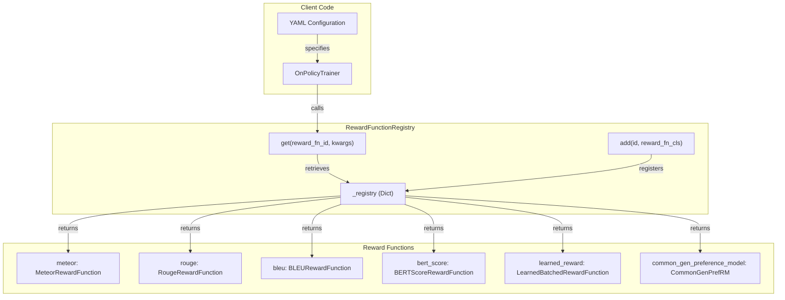
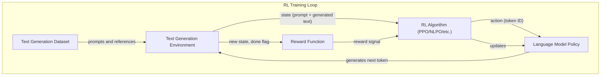

<!-- source: DeepWiki mcp.deepwiki.com · repo allenai/RL4LMs · page 3 Reward Functions · fetched 2026-10-26 -->

# Reward Functions

<details>
<summary>Relevant source files</summary>

The following files were used as context for generating this wiki page:

- [rl4lms/envs/text_generation/preference_reward.py](rl4lms/envs/text_generation/preference_reward.py)
- [rl4lms/envs/text_generation/registry.py](rl4lms/envs/text_generation/registry.py)
- [rl4lms/envs/text_generation/reward.py](rl4lms/envs/text_generation/reward.py)
- [scripts/training/task_configs/common_gen/t5_ppo_on_supervised.yml](scripts/training/task_configs/common_gen/t5_ppo_on_supervised.yml)

</details>


## Purpose and Overview

Reward functions are a critical component in the RL4LMs framework, providing the learning signal that guides the reinforcement learning process for language models. They evaluate the quality of generated text and return scalar reward values that help the model learn to generate better outputs.

This page explains the reward function architecture, available reward functions, and how to create and use custom reward functions in the RL4LMs framework. For information about using these rewards in training, see [Training Configuration](#6.1).

## Reward Function Architecture

```mermaid
classDiagram
    class RewardFunction {
        <<abstract>>
        +__call__(observation, action, next_observation, done, meta_info) float
    }
    
    class BatchedRewardFunction {
        <<abstract>>
        +__call__(prompt_texts, gen_texts, ref_texts, dones, meta_infos) List[float]
    }
    
    class MeteorRewardFunction {
        +_metric: MeteorMetric
        +_shaping_fn: RewardFunction
        +__call__() float
    }
    
    class RougeRewardFunction {
        +_metric: RougeMetric
        +_rouge_type: str
        +_shaping_fn: RewardFunction
        +__call__() float
    }
    
    class LearnedRewardFunction {
        +_metric_model: AutoModelForSequenceClassification
        +_metric_tokenizer: AutoTokenizer
        +__call__() float
    }
    
    class LearnedBatchedRewardFunction {
        +_metric_model: AutoModelForSequenceClassification
        +_metric_tokenizer: AutoTokenizer
        +__call__() List[float]
    }
    
    class CommonGenPrefRM {
        +_model_type: str
        +_device: str
        +_batch_size: int
        +__call__() List[float]
    }
    
    RewardFunction <|-- MeteorRewardFunction
    RewardFunction <|-- RougeRewardFunction
    RewardFunction <|-- BLEURewardFunction
    RewardFunction <|-- BERTScoreRewardFunction
    RewardFunction <|-- LearnedRewardFunction
    
    BatchedRewardFunction <|-- LearnedBatchedRewardFunction
    BatchedRewardFunction <|-- SpiderRewardFunction
    BatchedRewardFunction <|-- CommonGenPrefRM
```



Sources: [rl4lms/envs/text_generation/reward.py:23-45](), [rl4lms/envs/text_generation/reward.py:48-65]()

RL4LMs implements reward functions through two abstract base classes:

1. **`RewardFunction`**: Processes single examples, evaluating the reward after each action or at the end of an episode. The `__call__` method takes:
   - `current_observation`: The previous observation (state s)
   - `action`: The action performed at state s
   - `next_observation`: The observation after the action (state s')
   - `done`: Whether the episode is finished
   - `meta_info`: Additional information about the text sample

2. **`BatchedRewardFunction`**: Processes batches of examples simultaneously for efficiency. The `__call__` method takes lists of:
   - `prompt_texts`: Input prompts
   - `gen_texts`: Generated texts
   - `ref_texts`: Reference texts
   - `dones`: Flags indicating completed episodes
   - `meta_infos`: Additional information

## Registry System

The reward functions are managed through a registry pattern, allowing for easy retrieval and extension:



Sources: [rl4lms/envs/text_generation/registry.py:115-146]()

When initializing the training environment, the framework:
1. Reads the reward function configuration from the YAML config file
2. Retrieves the appropriate reward function class from the registry using its ID
3. Instantiates the reward function with the provided arguments
4. Uses the reward function to evaluate generated text during training

## Available Reward Functions

The framework provides several types of reward functions:

### 1. Text Quality Metrics

These reward functions evaluate text quality using standard metrics:

| Reward Function ID | Class | Description |
|-------------------|-------|-------------|
| `meteor` | `MeteorRewardFunction` | METEOR metric for text similarity |
| `rouge` | `RougeRewardFunction` | ROUGE metric with configurable type (rouge1, rouge2, rougeL) |
| `rouge_combined` | `RougeCombined` | Average of multiple ROUGE metrics |
| `bert_score` | `BERTScoreRewardFunction` | Semantic similarity using BERT embeddings |
| `bleu` | `BLEURewardFunction` | BLEU metric for text similarity |
| `bleurt` | `BLEURTRewardFunction` | BLEURT metric for improved text similarity |
| `sacre_bleu` | `SacreBleu` | SacreBLEU implementation for machine translation |
| `rouge_l_max` | `RougeLMaxRewardFunction` | ROUGE-L max variant |
| `ter` | `TER` | Translation Error Rate (inverted so higher is better) |
| `chrf` | `chrF` | Character n-gram F-score for translation evaluation |

Sources: [rl4lms/envs/text_generation/reward.py:126-164](), [rl4lms/envs/text_generation/reward.py:207-320](), [rl4lms/envs/text_generation/reward.py:486-605]()

### 2. Learned Reward Functions

These functions use pre-trained models to evaluate text quality:

| Reward Function ID | Class | Description |
|-------------------|-------|-------------|
| `learned_reward` | `LearnedBatchedRewardFunction` | Uses a pre-trained classifier to score text quality |

The `LearnedBatchedRewardFunction` takes a model name, label index, and whether to include the prompt in evaluation. It uses a pre-trained classifier to score text samples in batches.

Sources: [rl4lms/envs/text_generation/reward.py:318-367](), [rl4lms/envs/text_generation/reward.py:442-483]()

### 3. Preference-based Reward Functions

These reward functions are based on human preference data:

| Reward Function ID | Class | Description |
|-------------------|-------|-------------|
| `common_gen_preference_model` | `CommonGenPrefRM` | Uses a preference model trained on CommonGen data |

The `CommonGenPrefRM` reward function uses a T5-based model trained on human preferences for CommonGen texts. It scores text based on how well it aligns with human judgments.

Sources: [rl4lms/envs/text_generation/preference_reward.py:189-261]()

### 4. Task-specific Reward Functions

These reward functions are designed for specific text generation tasks:

| Reward Function ID | Class | Description |
|-------------------|-------|-------------|
| `spider` | `SpiderRewardFunction` | Combines SPICE and CIDEr metrics for image captioning |
| `parent` | `PARENTRewardFunction` | PARENT metric for table-to-text generation |
| `common_gen_repeat_penalty` | `CommonGenPenaltyShapingFunction` | Penalizes repetition in CommonGen tasks |
| `intent_accuracy` | `IntentAccuracy` | Evaluates intent preservation in dialog generation |

Sources: [rl4lms/envs/text_generation/reward.py:71-123](), [rl4lms/envs/text_generation/reward.py:371-434](), [rl4lms/envs/text_generation/reward.py:510-533](), [rl4lms/envs/text_generation/reward.py:608-659]()

## Integration with RL Training Loop



Sources: [rl4lms/envs/text_generation/registry.py:115-146]()

The reward function is a critical component in the RL training loop:

1. The environment provides the current state (prompt and generated text)
2. The agent, guided by the policy, selects the next token
3. The environment updates the state with the new token
4. The reward function evaluates the quality of the generated text
5. The agent uses the reward to update the policy

Most reward functions return zero for intermediate steps and only calculate the reward when `done=True` (at the end of a text generation episode).

## Creating Custom Reward Functions

To create a custom reward function:

1. Implement a class inheriting from `RewardFunction` or `BatchedRewardFunction`
2. Implement the `__call__` method with appropriate inputs and outputs
3. Register your reward function with the `RewardFunctionRegistry`

Example implementation:

```python
# 1. Define your reward function class
class CustomRewardFunction(RewardFunction):
    def __init__(self, param1, param2):
        self.param1 = param1
        self.param2 = param2
        
    def __call__(
        self,
        current_observation: Observation,
        action: int,
        next_observation: Observation,
        done: bool,
        meta_info: Dict[str, Any] = None,
    ) -> float:
        # Return 0 for intermediate steps
        if not done:
            return 0
            
        # Calculate reward for completed text
        generated_text = next_observation.context_text
        reference_texts = next_observation.target_or_reference_texts
        
        # Your custom reward logic here
        reward = your_reward_calculation(generated_text, reference_texts)
        return reward

# 2. Register your reward function
RewardFunctionRegistry.add("custom_reward", CustomRewardFunction)
```

Sources: [rl4lms/envs/text_generation/reward.py:23-45](), [rl4lms/envs/text_generation/registry.py:115-146]()

## Usage in Training Configuration

Reward functions are specified in YAML configuration files:

```yaml
reward_fn:
  id: common_gen_preference_model  # ID in RewardFunctionRegistry
  args:
    device: "cpu"                  # Arguments passed to the constructor
    batch_size: 5
    model_type: "11b"
```

You can also combine multiple reward functions using shaping functions:

```yaml
reward_fn:
  id: meteor
  args:
    shaping_fn: common_gen_repeat_penalty  # Additional reward component
```

The shaping function is applied in addition to the main reward function, allowing you to guide the model with multiple rewards simultaneously.

Sources: [scripts/training/task_configs/common_gen/t5_ppo_on_supervised.yml:7-31](), [rl4lms/envs/text_generation/reward.py:126-160]()

## Reward Function Selection Guidelines

Different reward functions are appropriate for different text generation tasks:

| Task | Recommended Reward Functions |
|------|------------------------------|
| Summarization | `rouge_combined`, `bert_score`, `learned_reward` |
| Machine Translation | `bleu`, `sacre_bleu`, `ter`, `chrf` |
| Dialog Generation | `intent_accuracy`, `bert_score` |
| Table-to-Text | `parent`, `bleu` |
| Image Captioning | `spider` (SPICE + CIDEr) |
| Creative Text Generation | `common_gen_preference_model` |

When selecting a reward function:
1. Consider the specific requirements of your task
2. Evaluate multiple reward functions on validation data
3. Use shaping functions to combine complementary rewards
4. Consider computational efficiency for large-scale training

---

