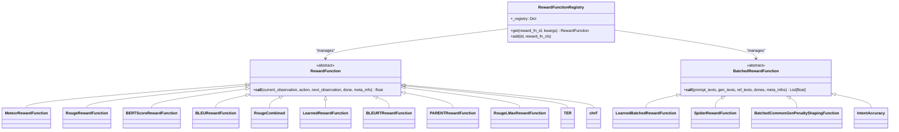
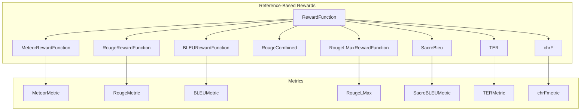
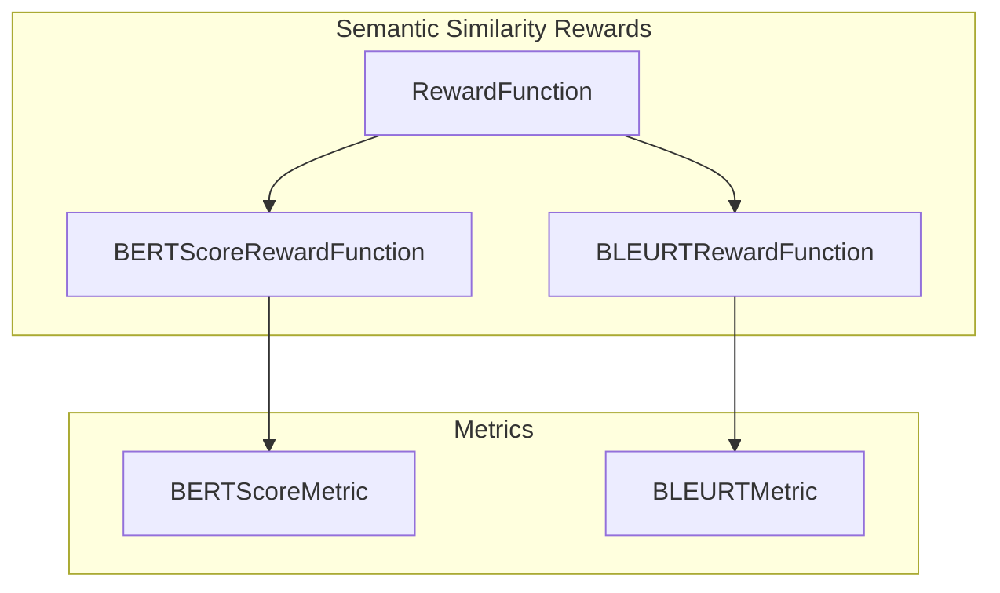
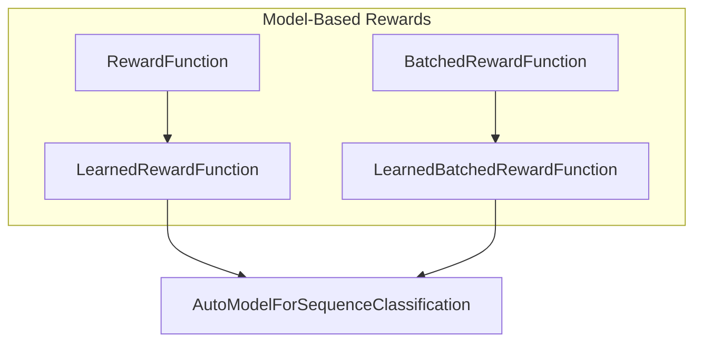
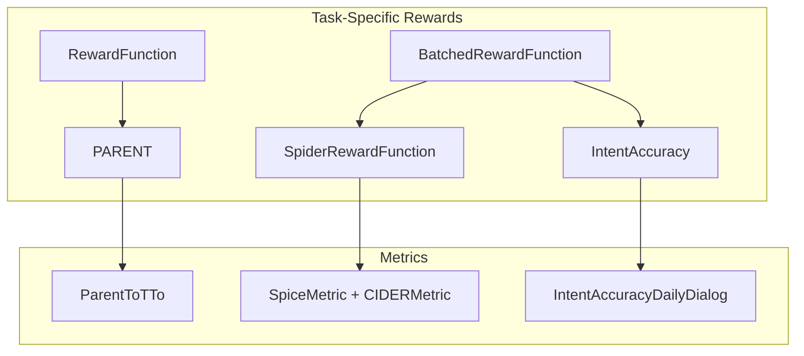
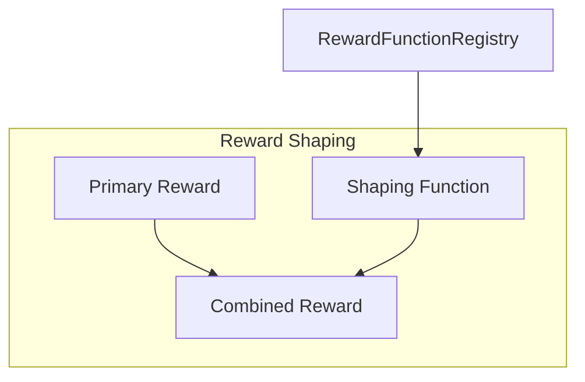

<!-- source: DeepWiki mcp.deepwiki.com · repo allenai/RL4LMs · page 3.1 Text Quality Rewards · fetched 2026-10-26 -->

# Text Quality Rewards

<details>
<summary>Relevant source files</summary>

The following files were used as context for generating this wiki page:

- [rl4lms/envs/text_generation/metric.py](rl4lms/envs/text_generation/metric.py)
- [rl4lms/envs/text_generation/registry.py](rl4lms/envs/text_generation/registry.py)
- [rl4lms/envs/text_generation/reward.py](rl4lms/envs/text_generation/reward.py)
- [scripts/reward-modeling/evaluate_intent_classifier.py](scripts/reward-modeling/evaluate_intent_classifier.py)
- [scripts/reward-modeling/train_intent_classifier.py](scripts/reward-modeling/train_intent_classifier.py)

</details>


This page documents the text quality reward functions available in RL4LMs, their implementations, and how they're used to train language models with reinforcement learning. Text quality rewards provide signals based on automated metrics that evaluate the quality of generated text against reference texts or other criteria.

For information about preference-based rewards, see [Preference Rewards](#3.2).

## Reward Function Architecture

RL4LMs provides a comprehensive framework for defining and using reward functions in reinforcement learning for text generation tasks. The framework is built around abstract base classes that define the interface for reward functions.



**Reward Function Interface**

The primary abstract classes are:

1. `RewardFunction`: Base class for all reward functions that operate on a per-step basis
2. `BatchedRewardFunction`: Base class for reward functions that operate on batches of text

Key components:

- `RewardFunction.__call__`: Computes a reward based on the current observation, action, next observation, and episode completion status
- `BatchedRewardFunction.__call__`: Computes rewards for multiple text generation instances at once
- `RewardFunctionRegistry`: Central registry that maps identifiers to reward function classes

Sources: [rl4lms/envs/text_generation/reward.py:23-45](), [rl4lms/envs/text_generation/reward.py:48-65](), [rl4lms/envs/text_generation/registry.py:115-146]()

## Text Quality Reward Functions

### Reference-Based Rewards

Reference-based reward functions compare the generated text with one or more reference texts using established NLP metrics.



#### METEOR Reward

METEOR (Metric for Evaluation of Translation with Explicit Ordering) is designed to address some of the weaknesses of BLEU by considering synonyms and stemming.

```python
def __call__(self, current_observation, action, next_observation, done, meta_info=None):
    # compute meteor at the end of episode
    if done:
        references = [next_observation.target_or_reference_texts]
        predicted = [next_observation.context_text]
        metric_dict = self._metric.compute(None, predicted, references)
        score = metric_dict["lexical/meteor"][1]
        
        if self._shaping_fn is not None:
            aux_score = self._shaping_fn(current_observation, action, next_observation, done, meta_info)
            score = score + aux_score
        return score
    return 0
```

Sources: [rl4lms/envs/text_generation/reward.py:126-160](), [rl4lms/envs/text_generation/metric.py:107-127]()

#### ROUGE Reward

ROUGE (Recall-Oriented Understudy for Gisting Evaluation) is a set of metrics used primarily for evaluating automatic summarization. It compares an automatically generated summary against a reference summary.

```python
def __call__(self, current_observation, action, next_observation, done, meta_info=None):
    if done:
        # Uses single or multiple references based on configuration
        if self._use_single_ref:
            references = [next_observation.target_or_reference_texts[0]]
        else:
            references = [next_observation.target_or_reference_texts]
        predicted = [next_observation.context_text]

        metric_results = self._metric.compute(
            predictions=predicted, references=references, use_stemmer=True
        )
        reward = metric_results[self._rouge_type].mid.fmeasure
        
        if self._shaping_fn is not None:
            aux_score = self._shaping_fn(current_observation, action, next_observation, done, meta_info)
            reward = reward + aux_score
        return reward
    return 0
```

Sources: [rl4lms/envs/text_generation/reward.py:163-205](), [rl4lms/envs/text_generation/metric.py:130-160]()

#### BLEU Reward

BLEU (Bilingual Evaluation Understudy) is a metric commonly used to evaluate machine translation quality. It compares n-grams in the generated text with those in reference texts.

```python
def __call__(self, current_observation, action, next_observation, done, meta_info=None):
    if done:
        references = [next_observation.target_or_reference_texts]
        predicted = [next_observation.context_text]
        metric_results = self._metric.compute(None, predicted, references)
        bleu_score = metric_results["lexical/bleu"][1]
        return bleu_score
    return 0
```

Sources: [rl4lms/envs/text_generation/reward.py:273-292](), [rl4lms/envs/text_generation/metric.py:193-224]()

#### Other Reference-Based Rewards

- **RougeCombined**: Combines ROUGE-1, ROUGE-2, and ROUGE-L scores
- **RougeLMaxRewardFunction**: Computes the maximum ROUGE-L score over multiple references
- **SacreBleu**: An improved BLEU implementation
- **TER**: Translation Error Rate, inverted to be a reward (1 - TER)
- **chrF**: Character n-gram F-score

Sources: [rl4lms/envs/text_generation/reward.py:208-248](), [rl4lms/envs/text_generation/reward.py:536-605](), [rl4lms/envs/text_generation/reward.py:295-316](), [rl4lms/envs/text_generation/reward.py:559-581](), [rl4lms/envs/text_generation/reward.py:584-605]()

### Semantic Similarity Rewards

Semantic similarity rewards evaluate the semantic equivalence between generated and reference texts, going beyond surface-level lexical matching.



#### BERTScore Reward

BERTScore leverages pre-trained BERT embeddings to compute the similarity between generated and reference texts at the token level.

```python
def __call__(self, current_observation, action, next_observation, done, meta_info=None):
    if done:
        references = [next_observation.target_or_reference_texts]
        predicted = [next_observation.context_text]
        metric_results = self._metric.compute(None, predicted, references)
        bert_score = metric_results["semantic/bert_score"][1]
        return bert_score
    return 0
```

Sources: [rl4lms/envs/text_generation/reward.py:251-270](), [rl4lms/envs/text_generation/metric.py:163-190]()

#### BLEURT Reward

BLEURT (Bilingual Evaluation Understudy with Representations from Transformers) is a learned metric based on BERT that evaluates the quality of machine translation outputs.

```python
def __call__(self, current_observation, action, next_observation, done, meta_info=None):
    if done:
        references = [next_observation.target_or_reference_texts]
        predicted = [next_observation.context_text]
        metric_results = self._metric.compute(
            predictions=predicted, references=references
        )
        score = metric_results["scores"][0]
        return score
    return 0
```

Sources: [rl4lms/envs/text_generation/reward.py:486-507](), [rl4lms/envs/text_generation/metric.py:227-246]()

### Model-Based Rewards

Model-based rewards use pre-trained models to evaluate text quality based on learned criteria.



#### Learned Reward Function

Uses a pre-trained classifier to score generated text. The model outputs a probability distribution over labels, and one of these labels is used as the reward signal.

```python
def __call__(self, current_observation, action, next_observation, done, meta_info=None):
    if done:
        generated_text = current_observation.prompt_or_input_text if self._include_prompt_for_eval else ""
        generated_text += next_observation.context_text

        with torch.no_grad():
            encoded = self._metric_tokenizer(generated_text, return_tensors="pt", truncation=True, padding=True)
            outputs = self._metric_model(
                input_ids=encoded.input_ids.to(self._device),
                attention_mask=encoded.attention_mask.to(self._device),
            )
            scores = torch.softmax(outputs.logits.flatten(), dim=0)
            score = scores[self._label_ix].item()
            return score
    return 0
```

Sources: [rl4lms/envs/text_generation/reward.py:442-483](), [rl4lms/envs/text_generation/metric.py:44-104]()

#### Learned Batched Reward Function

Similar to `LearnedRewardFunction` but processes multiple texts in a batch, which can be more efficient.

```python
def __call__(self, prompt_texts, gen_texts, ref_texts, dones, meta_infos=None):
    # collect generations at done steps
    gens = []
    indices_with_done = []
    rewards = torch.zeros(len(prompt_texts))
    for ix, (prompt, gen, ref, done) in enumerate(zip(prompt_texts, gen_texts, ref_texts, dones)):
        if done:
            generated_text = prompt if self._include_prompt_for_eval else ""
            generated_text += gen
            gens.append(generated_text)
            indices_with_done.append(ix)

    # compute rewards at once
    with torch.no_grad():
        encoded = self._metric_tokenizer(gens, return_tensors="pt", truncation=True, padding=True)
        outputs = self._metric_model(
            input_ids=encoded.input_ids.to(self._device),
            attention_mask=encoded.attention_mask.to(self._device),
        )
        scores = torch.softmax(outputs.logits, dim=1)
        scores = scores[:, self._label_ix].flatten().cpu()
        rewards[indices_with_done] = scores

    return rewards
```

Sources: [rl4lms/envs/text_generation/reward.py:318-367]()

### Task-Specific Rewards

Some reward functions are designed for specific text generation tasks, providing specialized evaluation criteria.



#### PARENT Reward

PARENT (Precision And Recall of Entities and N-grams for Table-to-text) is designed for table-to-text generation tasks, evaluating both content selection and surface realization.

```python
def __call__(self, current_observation, action, next_observation, done, meta_info=None):
    if done:
        generated_texts = [next_observation.context_text]
        meta_infos = [meta_info]
        scores = self._metric.compute(None, generated_texts, None, meta_infos)
        reward = scores["table_to_text/parent_overall_f_score"][0][0]
        return reward
    return 0
```

Sources: [rl4lms/envs/text_generation/reward.py:510-533](), [rl4lms/envs/text_generation/metric.py:486-525]()

#### SPIDER Reward

SPIDER combines SPICE (Semantic Propositional Image Caption Evaluation) and CIDEr (Consensus-based Image Description Evaluation) metrics, primarily used for image captioning tasks.

```python
def __call__(self, prompt_texts, gen_texts, ref_texts, dones, meta_info=None):
    prompts = []
    gens = []
    refs = []
    indices_with_done = []
    rewards = torch.zeros(len(prompt_texts))
    for ix, (prompt, gen, ref, done) in enumerate(zip(prompt_texts, gen_texts, ref_texts, dones)):
        if done:
            prompts.append(prompt)
            gens.append(gen)
            refs.append(ref)
            indices_with_done.append(ix)

    if len(indices_with_done) > 0:
        spice_scores = self._spice_metric.compute(prompts, gens, refs)["lexical/spice"][0]
        cider_scores = self._cider_metric.compute(prompts, gens, refs)["lexical/cider"][0]
        total_scores = self._spice_coeff * np.array(spice_scores) + self._cider_coeff * np.array(cider_scores)

        if self._shaping_fn is not None:
            aux_scores = self._shaping_fn(prompt_texts, gen_texts, ref_texts, dones)
        else:
            aux_scores = [0] * len(indices_with_done)

        for ind, score, aux_score in zip(indices_with_done, total_scores, aux_scores):
            rewards[ind] = score + aux_score

    return rewards
```

Sources: [rl4lms/envs/text_generation/reward.py:371-434](), [rl4lms/envs/text_generation/metric.py:276-330]()

#### Intent Accuracy

Specifically designed for dialogue generation tasks, this reward function evaluates how well the generated response matches the intended dialogue act.

```python
def __call__(self, prompt_texts, gen_texts, ref_texts, dones, meta_infos=None):
    if self._metric is None:
        self._metric = IntentAccuracyDailyDialog()

    # compute rewards for finished episodes only
    rewards = np.zeros(len(gen_texts))

    done_prompt_texts = []
    done_gen_texts = []
    done_ref_texts = []
    done_meta_infos = []
    done_ixs = []
    for ix, (prompt, gen, ref, meta_info, done) in enumerate(zip(prompt_texts, gen_texts, ref_texts, meta_infos, dones)):
        if done:
            done_prompt_texts.append(prompt)
            done_gen_texts.append(gen)
            done_ref_texts.append(ref)
            done_meta_infos.append(meta_info)
            done_ixs.append(ix)

            if self._shape:
                score = self._shaping_metric.compute(done_prompt_texts, done_gen_texts, done_ref_texts)
                rewards[ix] = self._auto_coeff * score["lexical/meteor"][1]

    scores = self._metric.compute(done_prompt_texts, done_gen_texts, done_ref_texts, done_meta_infos)["intent/accuracy"][0]
    rewards[done_ixs] += self._intent_coeff * np.array(scores)
    return rewards.tolist()
```

Sources: [rl4lms/envs/text_generation/reward.py:608-659](), [rl4lms/envs/text_generation/metric.py:663-719](), [scripts/reward-modeling/train_intent_classifier.py:1-96](), [scripts/reward-modeling/evaluate_intent_classifier.py:1-74]()

## Reward Shaping

Many reward functions in RL4LMs support reward shaping, which allows combining the primary reward with auxiliary rewards to guide learning. This is implemented through an optional `shaping_fn` parameter.



Example with METEOR + shaping:

```python
def __call__(self, current_observation, action, next_observation, done, meta_info=None):
    if done:
        # Primary reward computation
        references = [next_observation.target_or_reference_texts]
        predicted = [next_observation.context_text]
        metric_dict = self._metric.compute(None, predicted, references)
        score = metric_dict["lexical/meteor"][1]
        
        # Apply shaping if provided
        if self._shaping_fn is not None:
            aux_score = self._shaping_fn(current_observation, action, next_observation, done, meta_info)
            score = score + aux_score
        return score
    return 0
```

Sources: [rl4lms/envs/text_generation/reward.py:126-160](), [rl4lms/envs/text_generation/reward.py:163-205]()

## Registering and Using Reward Functions

The `RewardFunctionRegistry` provides a central location to register and retrieve reward functions by name. All built-in reward functions are pre-registered.

```python
class RewardFunctionRegistry:
    _registry = {
        "increasing_numbers": RewardIncreasingNumbers,
        "sentences_with_dates": RewardSentencesWithDates,
        "learned_reward": LearnedBatchedRewardFunction,
        "meteor": MeteorRewardFunction,
        "rouge": RougeRewardFunction,
        "bert_score": BERTScoreRewardFunction,
        "bleu": BLEURewardFunction,
        "bleurt": BLEURTRewardFunction,
        "rouge_combined": RougeCombined,
        "spider": SpiderRewardFunction,
        "common_gen_repeat_penalty": CommonGenPenaltyShapingFunction,
        "common_gen_repeat_penalty_batched": BatchedCommonGenPenaltyShapingFunction,
        "parent": PARENTRewardFunction,
        "sacre_bleu": SacreBleu,
        "rouge_l_max": RougeLMaxRewardFunction,
        "ter": TER,
        "chrf": chrF,
        "intent_accuracy": IntentAccuracy,
        "common_gen_preference_model": CommonGenPrefRM,
    }
```

To use a reward function in training, specify it in the configuration file:

```yaml
# Example configuration for ROUGE reward
reward:
  id: "rouge"
  args:
    rouge_type: "rougeL"  # Options: rouge1, rouge2, rougeL
    use_single_ref: true  # Whether to use only the first reference
    shaping_fn: null      # Optional shaping function
```

Sources: [rl4lms/envs/text_generation/registry.py:115-146]()

## Usage Example: Reinforcement Learning with METEOR Reward

Here's a complete example of how to configure a training run with METEOR reward:

```yaml
# train_meteor_reward.yaml
tokenizer:
  model_name: "gpt2"
  padding_side: "left"
  truncation_side: "left"
  pad_token_as_eos_token: False

datapool:
  id: "imdb"
  args:
    data_path: "imdb_samples.json"
    split: "train"
    max_samples: 500
  
reward:
  id: "meteor"
  args:
    shaping_fn: null

env:
  n_envs: 10
  args:
    max_prompt_length: 64
    max_episode_length: 48
    terminate_on_eos: True
    prompt_truncation_side: "left"
    context_start_token: null

alg:
  id: "ppo"
  args:
    n_steps: 512
    batch_size: 64
    verbose: 1
    learning_rate: 0.000001
    n_epochs: 5
    ent_coef: 0.0
```

When running training with this configuration, the system will:
1. Load the IMDB dataset
2. Set up a METEOR reward function
3. Create text generation environments
4. Train a policy with PPO using METEOR scores as rewards

Sources: [rl4lms/envs/text_generation/registry.py:115-146]()

---

