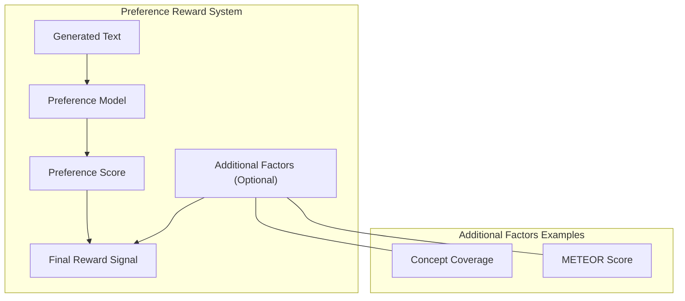
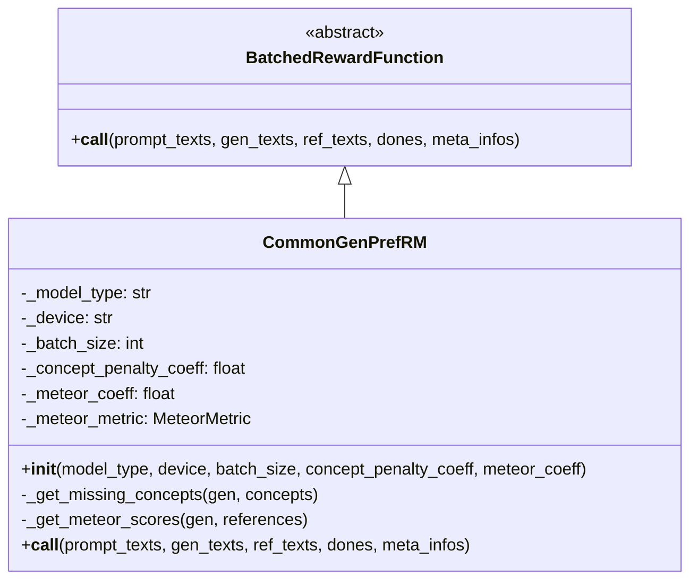
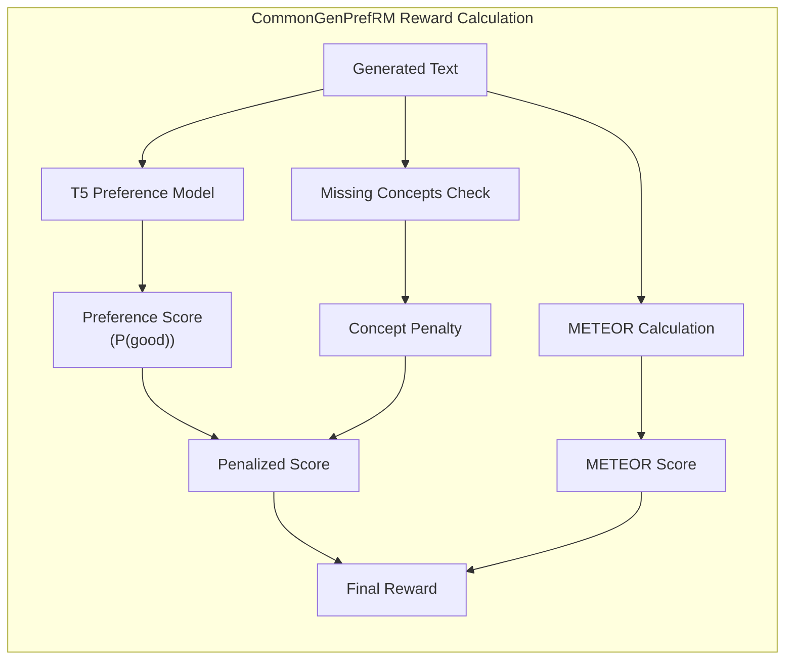
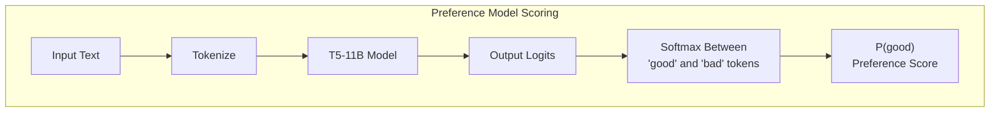
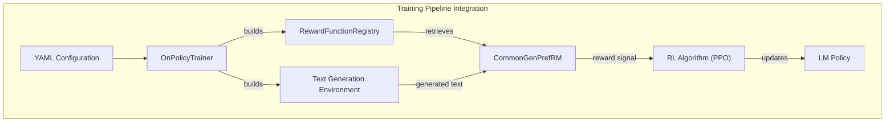

<!-- source: DeepWiki mcp.deepwiki.com · repo allenai/RL4LMs · page 3.2 Preference Rewards · fetched 2026-10-26 -->

# Preference Rewards

<details>
<summary>Relevant source files</summary>

The following files were used as context for generating this wiki page:

- [rl4lms/envs/text_generation/preference_reward.py](rl4lms/envs/text_generation/preference_reward.py)
- [scripts/training/task_configs/common_gen/t5_ppo_on_supervised.yml](scripts/training/task_configs/common_gen/t5_ppo_on_supervised.yml)

</details>


## Purpose and Scope

This page documents the preference-based reward functions in the RL4LMs framework. Preference rewards use trained models to evaluate text quality based on learned human preferences, rather than relying solely on fixed metrics like BLEU or ROUGE. This approach allows for more nuanced reward signals that better align with human judgments of text quality.

For information about other types of reward functions, see [Text Quality Rewards](#3.1) for metric-based rewards.

## Overview of Preference Rewards

Preference rewards represent a significant advancement in reinforcement learning for language models by replacing or supplementing traditional metrics with models that have learned human preferences. These rewards capture subjective aspects of text quality that are difficult to measure with conventional metrics.



Sources: [rl4lms/envs/text_generation/preference_reward.py:189-261](). [scripts/training/task_configs/common_gen/t5_ppo_on_supervised.yml:7-31]()

## Implementation in RL4LMs

The current implementation in RL4LMs provides a preference reward model specifically for the CommonGen task, which requires generating a coherent sentence that includes a given set of concepts.

### CommonGenPrefRM

The `CommonGenPrefRM` class inherits from `BatchedRewardFunction` and uses a pre-trained T5 model to score generated text.



Sources: [rl4lms/envs/text_generation/preference_reward.py:189-261]()

### Reward Calculation Process

The preference reward calculation involves multiple components that can be customized:

1. **Base Preference Score**: Probability that the generated text is "good" according to the trained model
2. **Concept Coverage Penalty**: Optional reduction in score based on missing concepts
3. **METEOR Component**: Optional addition of METEOR metric score



The final reward is calculated as:
```
reward = meteor_coeff * meteor_score + pref_score / (1 + concept_penalty_coeff * n_missing_concepts)
```

Sources: [rl4lms/envs/text_generation/preference_reward.py:218-261]()

## Pre-trained Preference Model

The implementation uses a T5-11B model fine-tuned on CommonGen preferences. The model predicts whether a given text is "good" or "bad" and returns the probability of being "good" as the score.



The model is automatically downloaded from a remote URL when first used and cached locally.

Sources: [rl4lms/envs/text_generation/preference_reward.py:32-152]()

## Usage and Configuration

To use the CommonGen preference reward in a training configuration, specify it in the YAML configuration file:

```yaml
reward_fn:
  id: common_gen_preference_model
  args:
    device: "cpu"
    batch_size: 5
    model_type: "11b"
    concept_penalty_coeff: 0.0  # Optional
    meteor_coeff: 0.0  # Optional
```

Configuration parameters:
- `model_type`: Currently only supports "11b" (T5-11B)
- `device`: Device to run the model on ("cpu", "cuda", etc.)
- `batch_size`: Batch size for inference
- `concept_penalty_coeff`: Weight for penalizing missing concepts (0.0 to disable)
- `meteor_coeff`: Weight for METEOR score component (0.0 to disable)

Sources: [scripts/training/task_configs/common_gen/t5_ppo_on_supervised.yml:7-31]()

## Integration with Training Pipeline

The preference reward function integrates with the RL4LMs training pipeline through the registry system. It's registered and can be referenced by ID in configuration files.



Sources: [scripts/training/task_configs/common_gen/t5_ppo_on_supervised.yml:1-98]()

## Implementation Details

When a batch of generated texts is passed to the reward function:

1. It processes only texts marked as "done" (complete generations)
2. For each complete generation:
   - Checks for missing concepts from the prompt
   - Calculates METEOR score if enabled
3. Sends all complete generations to the preference model for scoring
4. Computes the final reward combining preference scores, concept coverage, and METEOR

The reward function supports batched processing for efficiency.

Sources: [rl4lms/envs/text_generation/preference_reward.py:218-261]()

## Technical Notes

- The preference model implementation uses the HuggingFace Transformers library
- The model is downloaded once and cached for subsequent uses
- Inference is optimized for batch processing
- The system supports both CPU and GPU inference
- Only T5-11B is currently supported as the preference model architecture

Sources: [rl4lms/envs/text_generation/preference_reward.py:32-152]()

---

