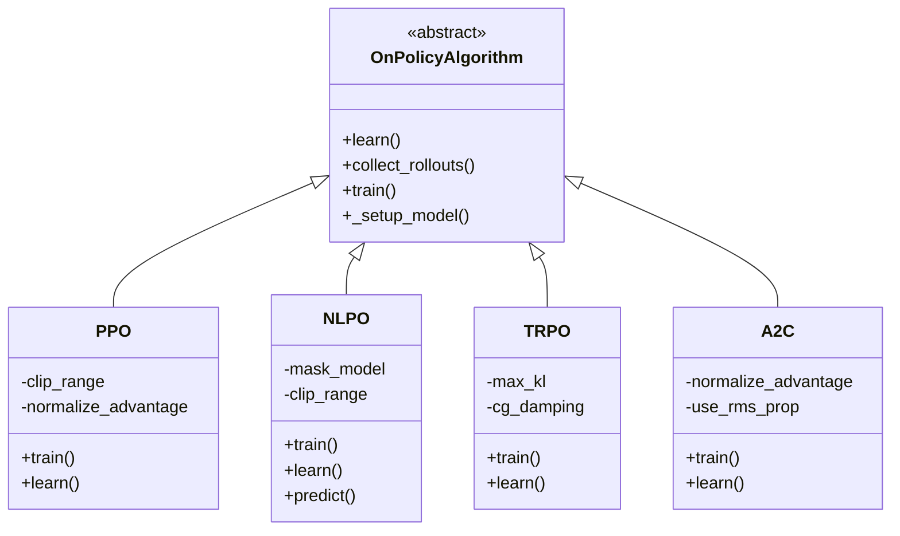
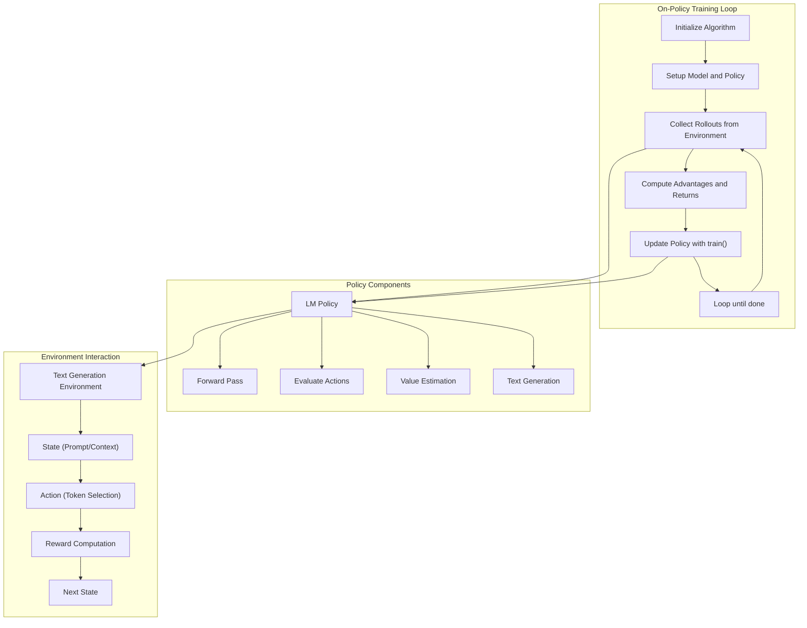
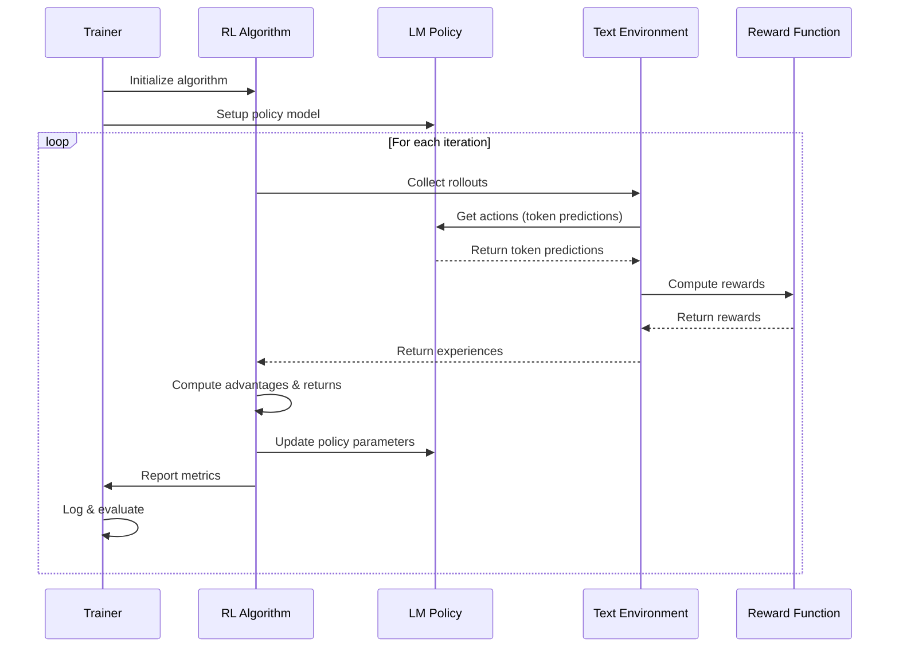
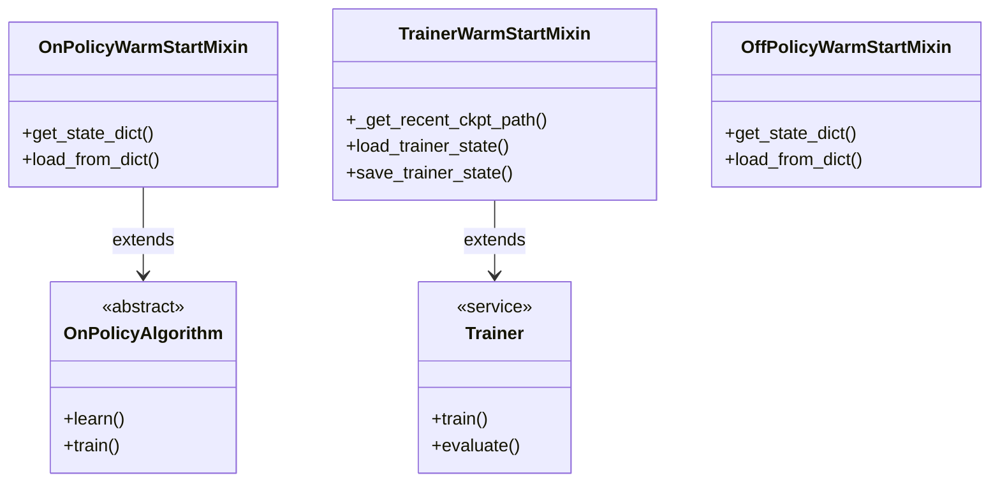
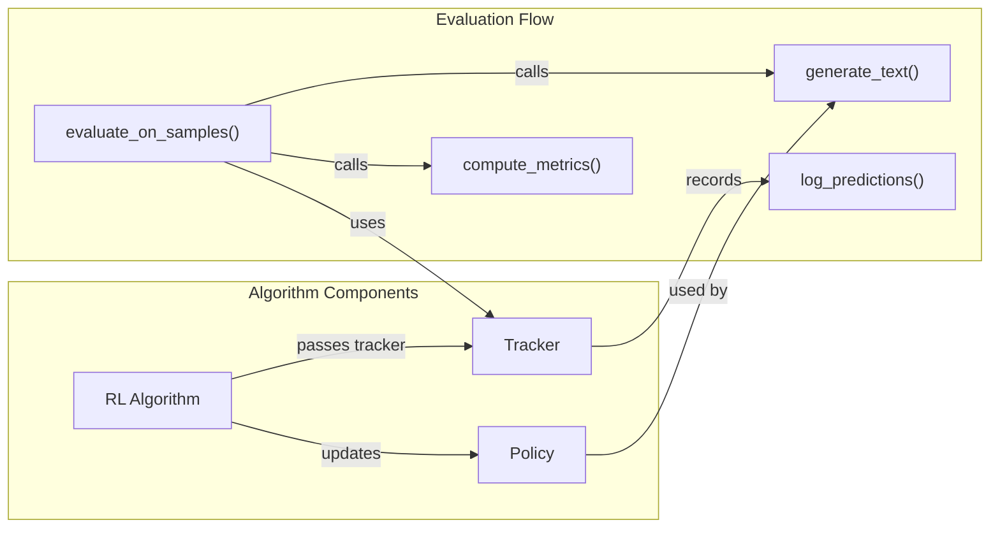

<!-- source: DeepWiki mcp.deepwiki.com · repo allenai/RL4LMs · page 4 Reinforcement Learning Algorithms · fetched 2026-10-26 -->

# Reinforcement Learning Algorithms

<details>
<summary>Relevant source files</summary>

The following files were used as context for generating this wiki page:

- [rl4lms/algorithms/a2c/a2c.py](rl4lms/algorithms/a2c/a2c.py)
- [rl4lms/algorithms/nlpo/nlpo.py](rl4lms/algorithms/nlpo/nlpo.py)
- [rl4lms/envs/text_generation/evaluation_utils.py](rl4lms/envs/text_generation/evaluation_utils.py)
- [rl4lms/envs/text_generation/policy/__init__.py](rl4lms/envs/text_generation/policy/__init__.py)
- [rl4lms/envs/text_generation/warm_start.py](rl4lms/envs/text_generation/warm_start.py)

</details>


This page provides a technical overview of the reinforcement learning algorithms implemented in the RL4LMs framework. These algorithms are specifically adapted for training language models with reinforcement learning techniques. For information about the policies that these algorithms use, see [Policies](#2.3).

## Overview

RL4LMs implements several on-policy reinforcement learning algorithms for training language models. All algorithms follow a common inheritance pattern from the `OnPolicyAlgorithm` base class and are adapted to work with language models through specialized policy classes.



Sources: [rl4lms/algorithms/nlpo/nlpo.py:12-27](), [rl4lms/algorithms/a2c/a2c.py:8-15]()

## Common Architecture

All reinforcement learning algorithms in RL4LMs share a common architecture and training flow:



Sources: [rl4lms/algorithms/nlpo/nlpo.py:454-518](), [rl4lms/algorithms/a2c/a2c.py:198-221]()

## Algorithm Implementations

### PPO (Proximal Policy Optimization)

PPO is an on-policy algorithm that uses a clipped objective function to prevent too large policy updates. In RL4LMs, PPO is adapted for language modeling tasks.

Key features:
- Clipped surrogate objective to constrain policy updates
- Value function clipping
- Multiple epochs of optimization on each batch of data
- Support for action masking (important for limiting vocabulary)
- Entropy bonus for exploration

### NLPO (Natural Language Policy Optimization)

NLPO extends PPO with specific enhancements for natural language processing tasks.

Key features:
- Invalid action masking support
- Specialized for discrete action spaces (token vocabularies)
- Policy updates with trust region constraints
- Support for advanced language model policies
- Target KL divergence early stopping

The following code snippet shows the core training loop in NLPO:

```python
# Key parts of the training loop from NLPO's train method
for epoch in range(self.n_epochs):
    approx_kl_divs = []
    for rollout_data in self.rollout_buffer.get(self.batch_size):
        values, log_prob, entropy = self.policy.evaluate_actions(...)
        
        # Compute policy loss with clipping
        ratio = th.exp(log_prob - rollout_data.old_log_prob)
        policy_loss_1 = advantages * ratio
        policy_loss_2 = advantages * th.clamp(ratio, 1 - clip_range, 1 + clip_range)
        policy_loss = -th.min(policy_loss_1, policy_loss_2).mean()
        
        # Value loss
        value_loss = F.mse_loss(rollout_data.returns, values_pred)
        
        # Entropy loss for exploration
        entropy_loss = -th.mean(entropy)
        
        # Combined loss
        loss = policy_loss + self.ent_coef * entropy_loss + self.vf_coef * value_loss
        
        # Optimization step with gradient clipping
        self.policy.optimizer.zero_grad()
        loss.backward()
        th.nn.utils.clip_grad_norm_(self.policy.parameters(), self.max_grad_norm)
        self.policy.optimizer.step()
```

Sources: [rl4lms/algorithms/nlpo/nlpo.py:27-137](), [rl4lms/algorithms/nlpo/nlpo.py:313-453]()

### TRPO (Trust Region Policy Optimization)

TRPO uses a trust region constraint through KL divergence to ensure stable policy updates. Instead of clipping like PPO, it uses a constraint optimization approach.

Key features:
- KL divergence constraint for policy updates
- Conjugate gradient method for computing update direction
- Line search for step size selection
- More computationally intensive than PPO
- Typically more stable learning dynamics

### A2C (Advantage Actor-Critic)

A2C is a synchronous version of the Asynchronous Advantage Actor-Critic (A3C) algorithm, which combines policy gradient with value function estimation.

Key features:
- Uses advantage estimates to reduce variance
- Simpler implementation than PPO/TRPO with no clipping or KL constraints
- Support for RMSProp or Adam optimizers
- Option to normalize advantages
- Lower sample efficiency but faster computation

The core training logic for A2C is shown below:

```python
# Main training loop from A2C's train method
for rollout_data in self.rollout_buffer.get(batch_size=None):
    actions = rollout_data.actions
    values, log_prob, entropy = self.policy.evaluate_actions(...)
    
    # Normalize advantage if needed
    advantages = rollout_data.advantages
    if self.normalize_advantage:
        advantages = (advantages - advantages.mean()) / (advantages.std() + 1e-8)
    
    # Policy gradient loss
    policy_loss = -(advantages * log_prob).mean()
    
    # Value loss
    value_loss = F.mse_loss(rollout_data.returns, values)
    
    # Entropy loss for exploration
    entropy_loss = -th.mean(entropy)
    
    # Combined loss
    loss = policy_loss + self.ent_coef * entropy_loss + self.vf_coef * value_loss
    
    # Optimization step
    self.policy.optimizer.zero_grad()
    loss.backward()
    th.nn.utils.clip_grad_norm_(self.policy.parameters(), self.max_grad_norm)
    self.policy.optimizer.step()
```

Sources: [rl4lms/algorithms/a2c/a2c.py:15-62](), [rl4lms/algorithms/a2c/a2c.py:127-196]()

## Training Process

The training process for all reinforcement learning algorithms in RL4LMs follows a similar pattern:



Sources: [rl4lms/algorithms/nlpo/nlpo.py:454-518](), [rl4lms/algorithms/a2c/a2c.py:198-221]()

## Warm-Starting and Checkpointing

RL4LMs provides mechanisms for warm-starting algorithms and policies to resume training from a checkpoint. This is important for long training runs and iterative experimentation.



Sources: [rl4lms/envs/text_generation/warm_start.py:64-90](), [rl4lms/envs/text_generation/warm_start.py:93-157]()

## Algorithm Selection and Configuration

When implementing a reinforcement learning solution with RL4LMs, algorithm selection depends on the specific requirements:

| Algorithm | Pros | Cons | Best Use Cases |
|-----------|------|------|---------------|
| PPO | Good sample efficiency, stable training | Requires careful hyperparameter tuning | General-purpose text generation |
| NLPO | Better exploration in large vocabularies, handles invalid actions | More complex implementation | When vocabulary control is important |
| TRPO | Very stable updates, less sensitive to step size | Computationally expensive | When stability is critical |
| A2C | Simple implementation, lower memory requirements | Lower sample efficiency | When computational resources are limited |

Sources: [rl4lms/algorithms/nlpo/nlpo.py:27-137](), [rl4lms/algorithms/a2c/a2c.py:15-62]()

## Evaluation Integration

The RL algorithms integrate with the evaluation system to track performance metrics during training:



Sources: [rl4lms/envs/text_generation/evaluation_utils.py:21-97](), [rl4lms/envs/text_generation/evaluation_utils.py:100-114]()

## Implementation Notes

1. All algorithms support customizable learning rates, which can be constant or scheduled to decay over time
2. Gradient clipping is used to prevent exploding gradients
3. The algorithms support various observation and action space types, though discrete action spaces are most common for text generation
4. Entropy coefficients can be tuned to encourage exploration
5. Value function coefficients control the emphasis on value prediction accuracy

Sources: [rl4lms/algorithms/nlpo/nlpo.py:72-139](), [rl4lms/algorithms/a2c/a2c.py:56-125]()

---

