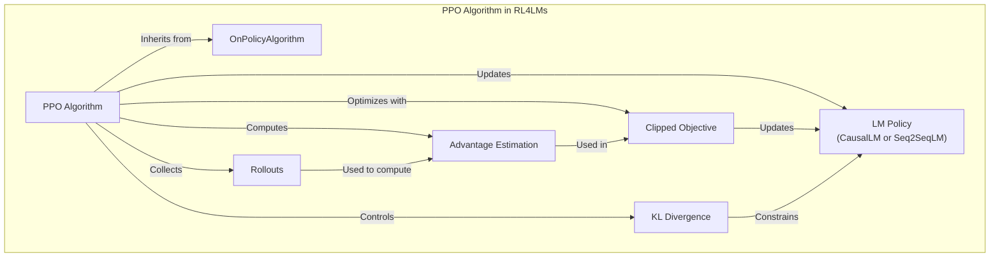
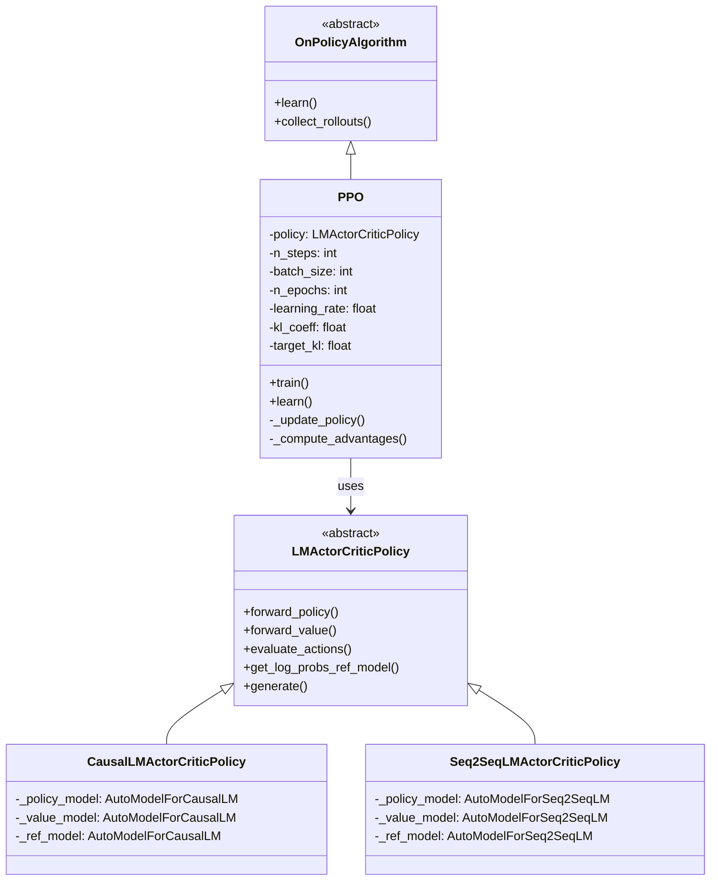
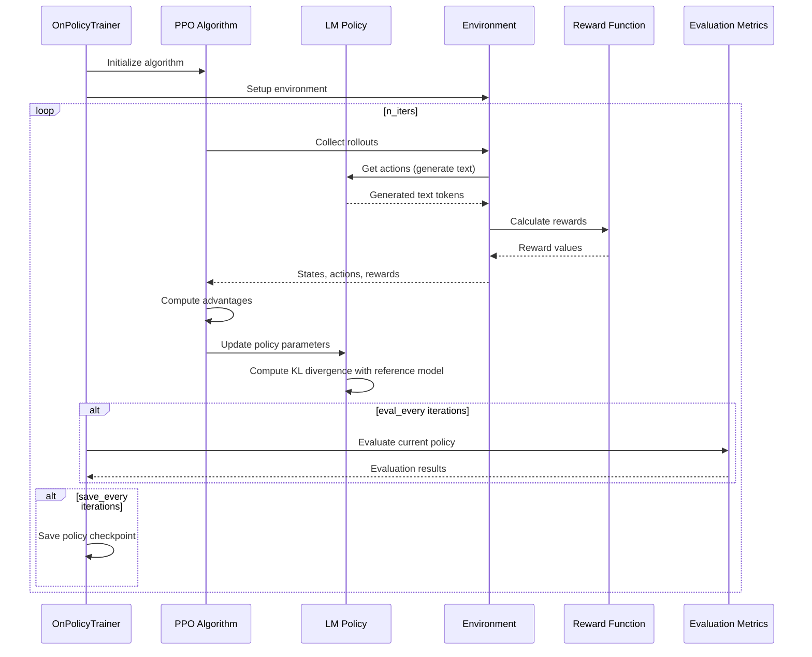

<!-- source: DeepWiki mcp.deepwiki.com · repo allenai/RL4LMs · page 4.1 PPO (Proximal Policy Optimization) · fetched 2026-10-26 -->

# PPO (Proximal Policy Optimization)

<details>
<summary>Relevant source files</summary>

The following files were used as context for generating this wiki page:

- [scripts/training/task_configs/dialog/gpt2_ppo.yml](scripts/training/task_configs/dialog/gpt2_ppo.yml)
- [scripts/training/task_configs/imdb_text_continuation/gpt2_ppo.yml](scripts/training/task_configs/imdb_text_continuation/gpt2_ppo.yml)

</details>


## Purpose and Scope

This document explains the implementation and usage of Proximal Policy Optimization (PPO) in the RL4LMs framework. PPO is one of the key reinforcement learning algorithms available in the codebase for fine-tuning language models on text generation tasks. This page focuses specifically on how PPO is implemented, configured, and integrated with other components in the system. For information about other reinforcement learning algorithms like NLPO, TRPO, or A2C, see [Other RL Algorithms](#4.3).

## PPO Overview

Proximal Policy Optimization (PPO) is an on-policy reinforcement learning algorithm that has been adapted in RL4LMs for language model fine-tuning. PPO aims to update policy parameters while preventing large policy changes that could lead to performance collapse, which is particularly important when working with language models.



Sources: scripts/training/task_configs/dialog/gpt2_ppo.yml, scripts/training/task_configs/imdb_text_continuation/gpt2_ppo.yml

## Implementation Architecture

In the RL4LMs framework, PPO is implemented as a class that inherits from the abstract `OnPolicyAlgorithm` base class. The PPO algorithm interacts with language model policies to update them based on rewards received from the environment.



Sources: scripts/training/task_configs/dialog/gpt2_ppo.yml, scripts/training/task_configs/imdb_text_continuation/gpt2_ppo.yml

## PPO Training Loop

The PPO training loop in RL4LMs follows a standard reinforcement learning process adapted specifically for text generation:

```mermaid
flowchart TD
    start["Start Training"] --> init["Initialize Policy\nand Environment"]
    init --> rollout["Collect Rollouts\n(Text Generation)"]
    rollout --> compute["Compute Advantages\nand Returns"]
    compute --> kl_check["Check Previous KL\nDivergence"]
    
    kl_check --> |"KL > target_kl"| reduce["Reduce KL Coefficient"]
    kl_check --> |"KL <= target_kl"| increase["Increase KL Coefficient"]
    
    reduce --> optimize["Optimize Policy\n(Multiple Epochs)"]
    increase --> optimize
    
    optimize --> eval["Evaluate Policy\n(if eval_every iterations)"]
    eval --> save["Save Policy\n(if save_every iterations)"]
    save --> check["Check if\nTraining Complete"]
    
    check --> |"No"| rollout
    check --> |"Yes"| end["End Training"]
```

Sources: scripts/training/task_configs/dialog/gpt2_ppo.yml, scripts/training/task_configs/imdb_text_continuation/gpt2_ppo.yml

## PPO Configuration Parameters

PPO in RL4LMs is highly configurable through YAML configuration files. Below are the key parameters that control the algorithm's behavior:

| Parameter | Description | Example Value |
|-----------|-------------|---------------|
| `n_steps` | Number of steps to run per update | 128 |
| `batch_size` | Mini-batch size for optimization | 64 |
| `verbose` | Verbosity level for logging | 1 |
| `learning_rate` | Learning rate for optimization | 0.000001 |
| `n_epochs` | Number of epochs to optimize on the same data | 5 |
| `kl_div.coeff` | Coefficient for KL divergence penalty | 0.1-0.2 |
| `kl_div.target_kl` | Target KL divergence threshold | 0.1-0.5 |

The configuration system allows for easy experimentation with different PPO parameters for various text generation tasks.

Sources: [scripts/training/task_configs/dialog/gpt2_ppo.yml:26-37](), [scripts/training/task_configs/imdb_text_continuation/gpt2_ppo.yml:26-37]()

## Integration with Policies

PPO in RL4LMs works with different language model policies, primarily:

1. **Causal Language Models** (e.g., GPT-2)
2. **Sequence-to-Sequence Models** (e.g., T5, BART)

The policy configuration specifies the model architecture, parameters for text generation, and other policy-specific settings:

```mermaid
graph TD
    subgraph "PPO Policy Configuration"
        alg["alg.id: ppo"]
        policy["alg.policy.id: causal_lm_actor_critic_policy"]
        model["alg.policy.args.model_name: gpt2/lvwerra/gpt2-imdb"]
        parallel["alg.policy.args.apply_model_parallel: True"]
        
        subgraph "Generation Parameters"
            do_sample["do_sample: True"]
            top_k["top_k: 20"]
            min_length["min_length: 2/48"]
            max_tokens["max_new_tokens: 20/48"]
        end
        
        alg --> policy
        policy --> model
        policy --> parallel
        policy --> Generation Parameters
    end
```

Sources: [scripts/training/task_configs/dialog/gpt2_ppo.yml:39-48](), [scripts/training/task_configs/imdb_text_continuation/gpt2_ppo.yml:39-48]()

## Example Use Cases

### Dialog Generation with PPO

For dialog generation, PPO is configured to optimize a GPT-2 model with a focus on intent accuracy:

```yaml
alg:
  id: ppo
  args: 
    n_steps: 128
    batch_size: 64
    verbose: 1
    learning_rate: 0.000001
    n_epochs: 5
    
  kl_div:
    coeff: 0.2
    target_kl: 0.5
 
  policy:
    id: causal_lm_actor_critic_policy
    args:
      model_name: gpt2
      apply_model_parallel: True
      generation_kwargs:
        do_sample: True
        top_k: 20
        min_length: 2
        max_new_tokens: 20
```

The reward function used is `intent_accuracy`, which evaluates how well the generated responses match the intended conversational goals.

Sources: [scripts/training/task_configs/dialog/gpt2_ppo.yml:26-48]()

### Text Continuation with PPO

For IMDB text continuation, PPO optimizes a pre-trained GPT-2 model to generate positive sentiment continuations:

```yaml
alg:
  id: ppo
  args: 
    n_steps: 128
    batch_size: 64
    verbose: 1
    learning_rate: 0.000001
    n_epochs: 5
    
  kl_div:
    coeff: 0.1
    target_kl: 0.1

  policy:
    id: causal_lm_actor_critic_policy
    args:
      model_name: lvwerra/gpt2-imdb
      apply_model_parallel: True
      generation_kwargs:
        do_sample: True
        min_length: 48
        max_new_tokens: 48
```

The reward function is a `learned_reward` based on a DistilBERT model fine-tuned on IMDB sentiment classification.

Sources: [scripts/training/task_configs/imdb_text_continuation/gpt2_ppo.yml:26-48]()

## PPO Training and Evaluation Process

The PPO training process in RL4LMs follows these main steps:



Sources: [scripts/training/task_configs/dialog/gpt2_ppo.yml:50-79](), [scripts/training/task_configs/imdb_text_continuation/gpt2_ppo.yml:49-66]()

## Evaluation Metrics

PPO training in RL4LMs monitors various metrics to assess the quality of generated text:

| Metric | Description | Application |
|--------|-------------|-------------|
| Intent Accuracy | Measures how well responses match intended conversational goals | Dialog |
| Learned Reward | Measures sentiment or other trained attributes | Text Continuation |
| Perplexity | Measures language model coherence | Both |
| Diversity | Measures n-gram diversity of generated texts | Both |
| METEOR/ROUGE/BLEU | Reference-based text similarity metrics | Dialog |
| BERT Score | Contextual similarity to reference text | Dialog |

The evaluation metrics are configured in the YAML files and automatically tracked during training.

Sources: [scripts/training/task_configs/dialog/gpt2_ppo.yml:55-74](), [scripts/training/task_configs/imdb_text_continuation/gpt2_ppo.yml:54-66]()

## Key Implementation Details

PPO in RL4LMs includes several important implementation details:

1. **Clipped Objective**: Limits the policy update to prevent large changes
2. **KL Divergence Penalty**: Prevents the fine-tuned model from diverging too far from the reference model
3. **Value Function**: Estimates the expected cumulative reward for state-action pairs
4. **Advantage Estimation**: Computes how much better an action is compared to the average
5. **Multi-Epoch Updates**: Performs multiple optimization passes over the same batch of data

These implementation details are crucial for stable training when applying PPO to language models.

Sources: [scripts/training/task_configs/dialog/gpt2_ppo.yml:26-37](), [scripts/training/task_configs/imdb_text_continuation/gpt2_ppo.yml:26-37]()

---

