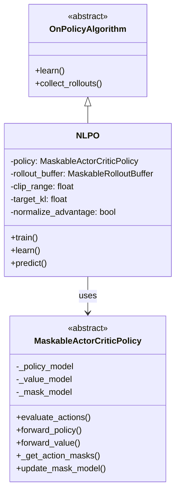
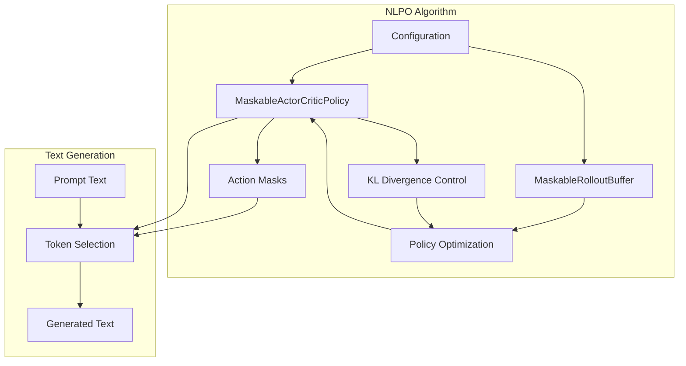
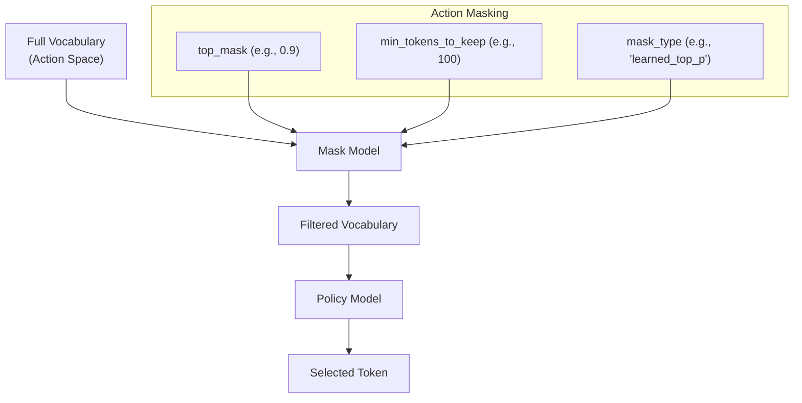
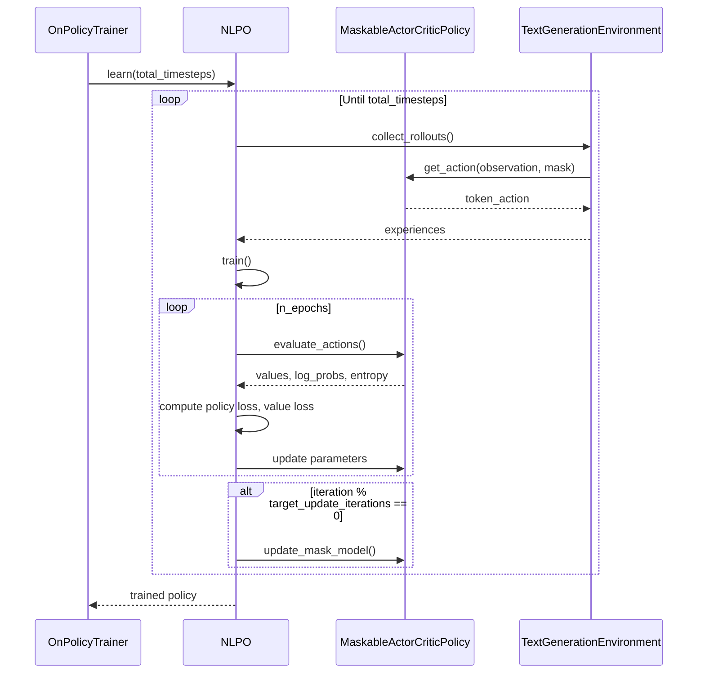
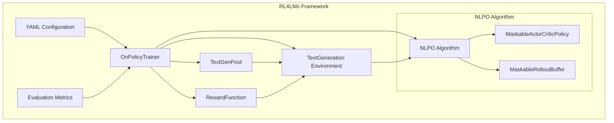
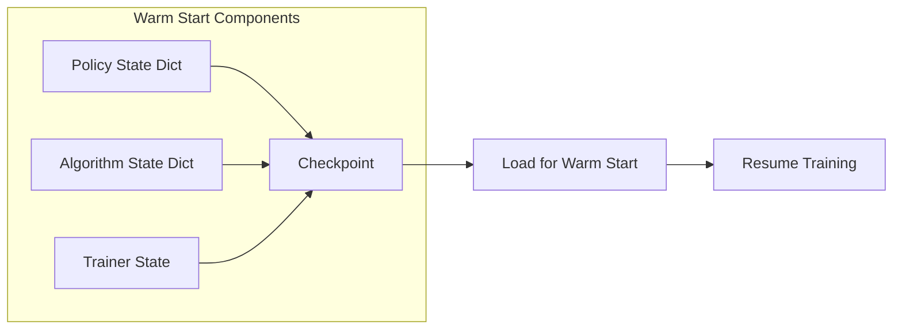

<!-- source: DeepWiki mcp.deepwiki.com · repo allenai/RL4LMs · page 4.2 NLPO (Natural Language Policy Optimization) · fetched 2026-10-26 -->

# NLPO (Natural Language Policy Optimization)

<details>
<summary>Relevant source files</summary>

The following files were used as context for generating this wiki page:

- [rl4lms/algorithms/a2c/a2c.py](rl4lms/algorithms/a2c/a2c.py)
- [rl4lms/algorithms/nlpo/nlpo.py](rl4lms/algorithms/nlpo/nlpo.py)
- [rl4lms/envs/text_generation/evaluation_utils.py](rl4lms/envs/text_generation/evaluation_utils.py)
- [rl4lms/envs/text_generation/policy/__init__.py](rl4lms/envs/text_generation/policy/__init__.py)
- [rl4lms/envs/text_generation/warm_start.py](rl4lms/envs/text_generation/warm_start.py)
- [scripts/training/task_configs/imdb_text_continuation/gpt2_nlpo.yml](scripts/training/task_configs/imdb_text_continuation/gpt2_nlpo.yml)
- [scripts/training/task_configs/imdb_text_continuation/gpt2_nlpo_on_supervised.yml](scripts/training/task_configs/imdb_text_continuation/gpt2_nlpo_on_supervised.yml)

</details>


## Overview

NLPO (Natural Language Policy Optimization) is an on-policy reinforcement learning algorithm specifically designed for text generation tasks. It extends the Proximal Policy Optimization (PPO) algorithm with Invalid Action Masking to improve exploration in the vast token space of language models. NLPO helps fine-tune language models on specific text generation tasks by allowing more efficient exploration of the language space.

For information about other reinforcement learning algorithms in RL4LMs, see [PPO (Proximal Policy Optimization)](#4.1) and [Other RL Algorithms (TRPO, A2C)](#4.3).

Sources: [rl4lms/algorithms/nlpo/nlpo.py:27-76]()

## Algorithm Architecture

NLPO is structured as an extension of the OnPolicyAlgorithm from Stable Baselines 3, adapted for text generation. It works with maskable policies that can selectively filter the action space (vocabulary tokens) during generation.



Sources: [rl4lms/algorithms/nlpo/nlpo.py:27-76](), [rl4lms/algorithms/nlpo/nlpo.py:143-180]()

## Key Components and Workflow

NLPO combines several key components to enable efficient text generation with reinforcement learning:



The workflow of NLPO includes:

1. **Setup Phase**: Initialize the policy, rollout buffer, and learning parameters
2. **Rollout Collection**: Collect experiences from the environment
3. **Mask Computation**: Determine which actions (tokens) to mask for each state
4. **Policy Update**: Train the policy using the PPO objective with masked actions
5. **Target Update**: Periodically update the mask model

Sources: [rl4lms/algorithms/nlpo/nlpo.py:143-180](), [rl4lms/algorithms/nlpo/nlpo.py:313-518]()

## Action Masking Mechanism

What makes NLPO unique is its action masking mechanism, which restricts the policy to consider only a subset of the vocabulary at each step. This is crucial for text generation since the vocabulary size can be very large (tens of thousands of tokens).



The masking approach can be configured with several parameters:
- `top_mask`: The proportion of the probability mass to keep (e.g., 0.9 keeps the top 90% tokens)
- `min_tokens_to_keep`: Minimum number of tokens to consider regardless of probability
- `mask_type`: Strategy for masking (e.g., 'learned_top_p')

Sources: [scripts/training/task_configs/imdb_text_continuation/gpt2_nlpo.yml:42-46]()

## Implementation Details

### NLPO Class Structure

The `NLPO` class extends `OnPolicyAlgorithm` and implements methods for training and learning:

| Method | Purpose |
|--------|---------|
| `__init__()` | Initialize NLPO with policy, environment, and hyperparameters |
| `_setup_model()` | Set up policy, buffer, and learning rate schedules |
| `train()` | Update policy using collected rollouts |
| `learn()` | Main learning loop that collects rollouts and trains policy |
| `predict()` | Generate actions (tokens) from observations |

Sources: [rl4lms/algorithms/nlpo/nlpo.py:78-139](), [rl4lms/algorithms/nlpo/nlpo.py:313-518]()

### Training Process

The training process in NLPO follows these steps:

1. Collect rollouts from the environment using the current policy
2. Calculate advantages and returns for the collected experiences
3. Update the policy using multiple epochs of optimization
4. Monitor KL divergence and stop training if it exceeds a threshold
5. Periodically update the mask model to adapt token filtering



Sources: [rl4lms/algorithms/nlpo/nlpo.py:313-518](), [rl4lms/algorithms/nlpo/nlpo.py:454-515]()

## Configuration Parameters

NLPO has several key configuration parameters that control its behavior:

| Parameter | Description | Typical Values |
|-----------|-------------|----------------|
| `n_steps` | Number of steps to run per update | 128 |
| `batch_size` | Minibatch size for optimization | 64 |
| `learning_rate` | Learning rate for optimizer | 1e-6 |
| `n_epochs` | Number of optimization epochs per update | 5 |
| `clip_range` | PPO clipping parameter | 0.2 |
| `top_mask` | Proportion of token probability mass to keep | 0.9 |
| `min_tokens_to_keep` | Minimum number of tokens to consider | 100 |
| `mask_type` | Strategy for masking actions | 'learned_top_p' |
| `target_update_iterations` | How often to update the mask model | 5 |
| `target_kl` | Target KL divergence threshold | 0.1 |

Sources: [scripts/training/task_configs/imdb_text_continuation/gpt2_nlpo.yml:26-47]()

## Example Configuration

Here's an example configuration for NLPO from the codebase for IMDB text continuation:

```yaml
alg:
  id: nlpo
  args:
    n_steps: 128
    batch_size: 64
    verbose: 1
    learning_rate: 0.000001
    n_epochs: 5

  kl_div:
    coeff: 0.1
    target_kl: 0.1

  policy:
    id: maskable_causal_lm_actor_critic_policy
    args:
      model_name: lvwerra/gpt2-imdb
      apply_model_parallel: True
      top_mask: 0.9
      min_tokens_to_keep: 100
      mask_type: 'learned_top_p'
      target_update_iterations: 5
      generation_kwargs:
        do_sample: True
        min_length: 48
        max_new_tokens: 48
```

Sources: [scripts/training/task_configs/imdb_text_continuation/gpt2_nlpo.yml:26-52]()

## Integration with RL4LMs Framework

NLPO is integrated into the RL4LMs framework as one of the supported reinforcement learning algorithms. It works with the registry system, environment, policies, and reward functions.



Sources: [rl4lms/algorithms/nlpo/nlpo.py:143-180](), [scripts/training/task_configs/imdb_text_continuation/gpt2_nlpo.yml:1-70]()

## Warm Starting and Checkpointing

NLPO supports warm starting from previous checkpoints to resume training:



For NLPO, the policy state includes:
- Policy model parameters
- Value model parameters
- Value head parameters
- Mask model parameters
- Optimizer state

Sources: [rl4lms/envs/text_generation/warm_start.py:44-62](), [rl4lms/envs/text_generation/warm_start.py:143-157]()

## Comparison with Other RL Algorithms

NLPO can be compared with other reinforcement learning algorithms in the RL4LMs framework:

| Algorithm | Key Features | Best Use Case |
|-----------|-------------|---------------|
| NLPO | Action masking, targeted exploration | Text generation with large vocabularies |
| PPO | Stable training, clipped objective | General RL for text generation |
| TRPO | Trust region constraint | When more precise policy updates are needed |
| A2C | Simpler architecture, faster training | When computational efficiency is important |

Sources: [rl4lms/algorithms/nlpo/nlpo.py:27-76](), [rl4lms/algorithms/a2c/a2c.py:15-76]()

## Conclusion

NLPO is a specialized reinforcement learning algorithm for text generation that enhances the standard PPO approach with action masking capabilities. It allows for more efficient exploration of the token space by focusing on promising tokens at each generation step. The algorithm is fully integrated with the RL4LMs framework, providing a powerful tool for fine-tuning language models on specific text generation tasks.

---

