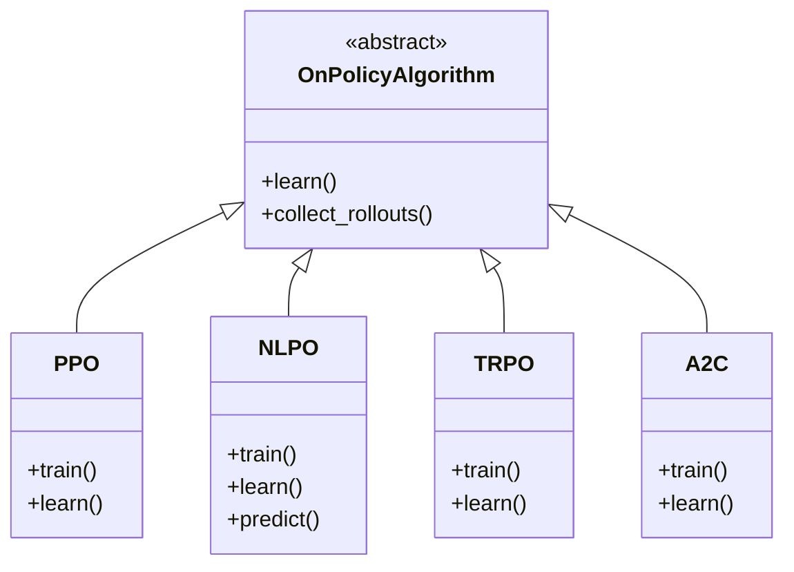
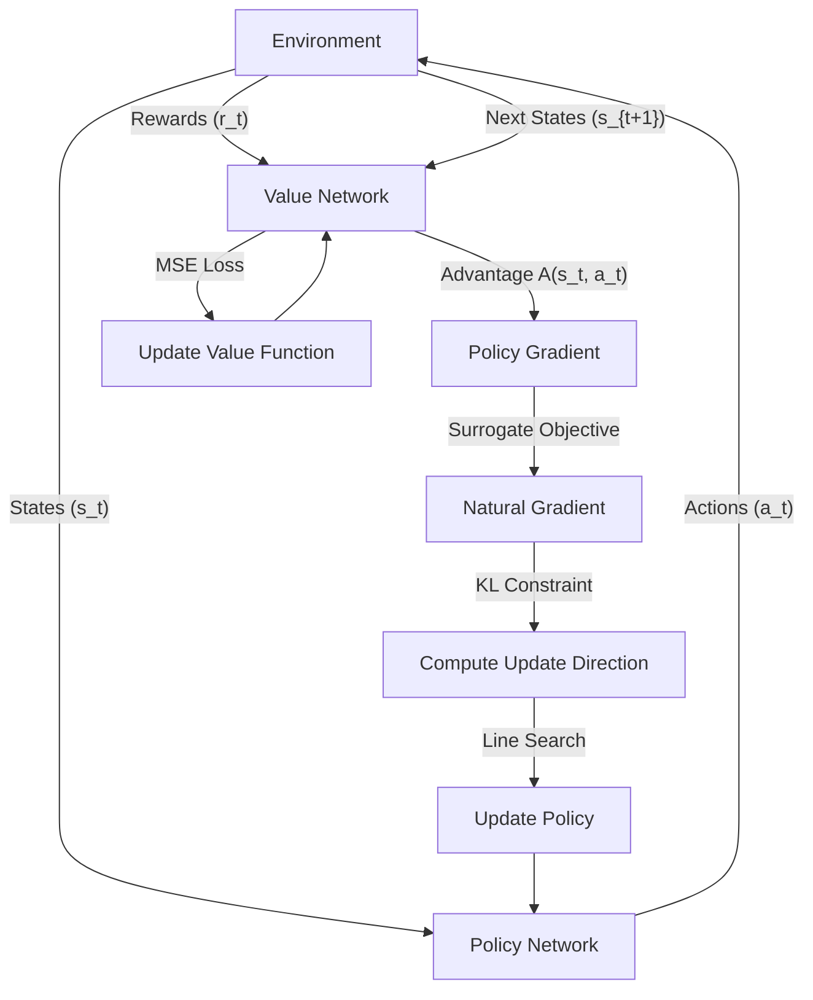
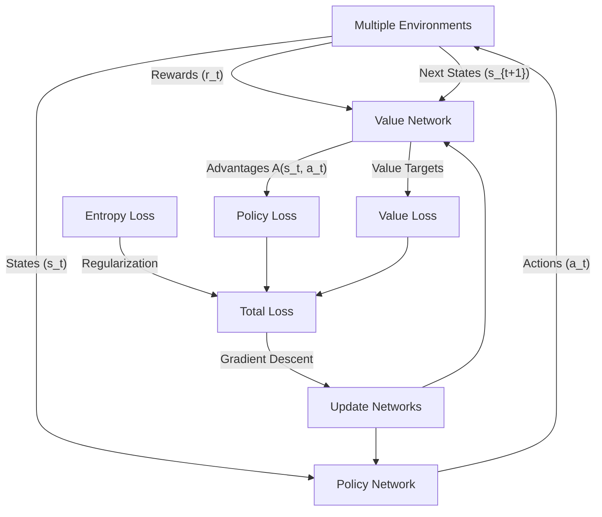
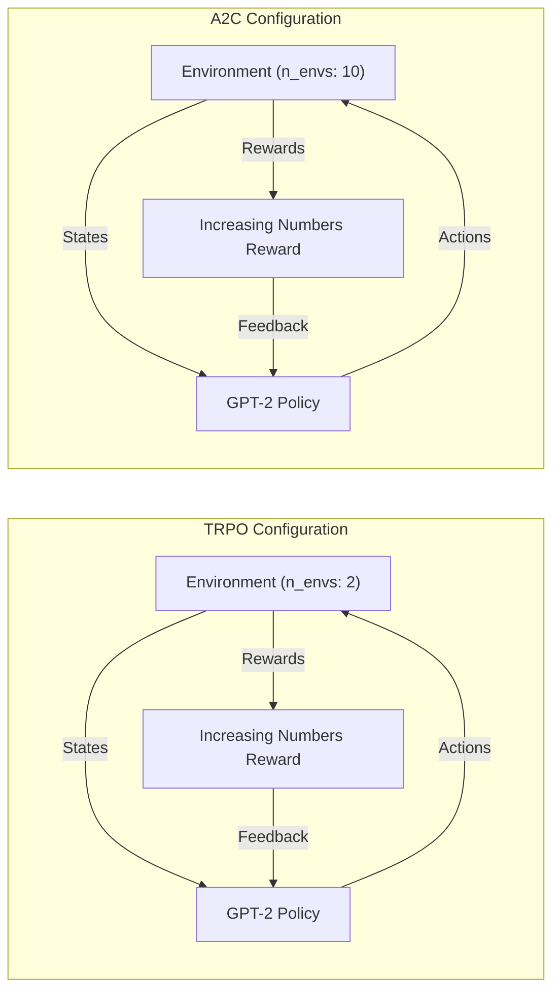
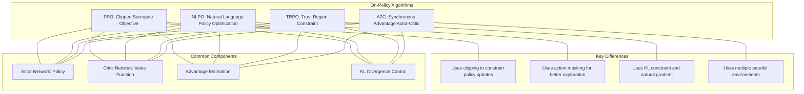

<!-- source: DeepWiki mcp.deepwiki.com · repo allenai/RL4LMs · page 4.3 Other RL Algorithms (TRPO, A2C) · fetched 2026-10-26 -->

# Other RL Algorithms (TRPO, A2C)

<details>
<summary>Relevant source files</summary>

The following files were used as context for generating this wiki page:

- [scripts/training/task_configs/imdb_text_continuation/gpt2_a2c.yml](scripts/training/task_configs/imdb_text_continuation/gpt2_a2c.yml)
- [scripts/training/task_configs/synthetic_generate_increasing_numbers/gpt2_a2c.yml](scripts/training/task_configs/synthetic_generate_increasing_numbers/gpt2_a2c.yml)
- [scripts/training/task_configs/synthetic_generate_increasing_numbers/gpt2_trpo.yml](scripts/training/task_configs/synthetic_generate_increasing_numbers/gpt2_trpo.yml)
- [scripts/training/task_configs/totto/t5_nlpo.yml](scripts/training/task_configs/totto/t5_nlpo.yml)
- [scripts/training/task_configs/totto/t5_nlpo_on_supervised.yml](scripts/training/task_configs/totto/t5_nlpo_on_supervised.yml)
- [scripts/training/task_configs/totto/t5_ppo.yml](scripts/training/task_configs/totto/t5_ppo.yml)
- [scripts/training/task_configs/totto/t5_ppo_on_supervised.yml](scripts/training/task_configs/totto/t5_ppo_on_supervised.yml)

</details>


This page documents Trust Region Policy Optimization (TRPO) and Advantage Actor-Critic (A2C) algorithms in the RL4LMs framework. These algorithms complement the PPO and NLPO implementations (covered in [PPO (Proximal Policy Optimization)](#4.1) and [NLPO (Natural Language Policy Optimization)](#4.2)), providing additional options for reinforcement learning-based training of language models.

## Algorithm Hierarchy

Within the RL4LMs framework, TRPO and A2C are implemented as extensions of the abstract `OnPolicyAlgorithm` class, alongside PPO and NLPO:



Sources:
- Configuration files in the repository

## Trust Region Policy Optimization (TRPO)

TRPO is designed to make consistent policy improvements by constraining the policy update to a "trust region" around the current policy. This is enforced through a constraint on the KL divergence between the old and new policies.

### Algorithm Flow

TRPO uses natural gradient to enforce a KL divergence constraint during policy updates:



Sources:
- Algorithm implementation inferred from configuration files

### Configuration

Here's an example configuration for TRPO with a GPT-2 model:

```yaml
alg:
  id: trpo
  args: 
    n_steps: 20
    verbose: 1
    learning_rate: 0.00001
  kl_div:
    coeff: 0.01
    target_kl: 2
  policy:
    id: causal_lm_actor_critic_policy
    args:
      model_name: gpt2
      apply_model_parallel: True
      generation_kwargs:
        do_sample: True
        max_new_tokens: 20
```

Sources:
- [scripts/training/task_configs/synthetic_generate_increasing_numbers/gpt2_trpo.yml:25-42]()

Key TRPO-specific parameters include:
- `kl_div.coeff`: Weight of the KL penalty term (typically 0.01-0.1)
- `kl_div.target_kl`: Target KL divergence threshold (typically 0.5-2)

## Advantage Actor-Critic (A2C)

A2C is a synchronous version of the Asynchronous Advantage Actor-Critic (A3C) algorithm. It uses multiple parallel environments to collect experiences and then updates the policy and value networks synchronously.

### Algorithm Flow

A2C uses multiple environments in parallel and an advantage function to guide policy updates:



Sources:
- Algorithm implementation inferred from configuration files

### Configuration

Here's an example configuration for A2C with a GPT-2 model:

```yaml
alg:
  id: a2c
  args: 
    n_steps: 20
    verbose: 1
    learning_rate: 0.00001
    ent_coef: 0.001
  kl_div:
    coeff: 0.02
    target_kl: 2
  policy:
    id: causal_lm_actor_critic_policy 
    args:
      model_name: gpt2
      apply_model_parallel: True
      generation_kwargs:
        do_sample: True
        max_new_tokens: 20
```

Sources:
- [scripts/training/task_configs/synthetic_generate_increasing_numbers/gpt2_a2c.yml:25-42]()

Key A2C-specific parameters include:
- `ent_coef`: Coefficient of the entropy regularization term (typically 0.001-0.01)
- `n_steps`: Number of steps to run in each environment per update
- `n_envs`: Number of parallel environments (specified in the `env` section)

## Use Cases

### Synthetic Task: Generating Increasing Numbers

Both TRPO and A2C can be used for synthetic tasks like generating sequences of increasing numbers:



Sources:
- [scripts/training/task_configs/synthetic_generate_increasing_numbers/gpt2_trpo.yml]()
- [scripts/training/task_configs/synthetic_generate_increasing_numbers/gpt2_a2c.yml]()

### IMDB Text Continuation

A2C can be used for text continuation tasks like continuing IMDB movie reviews with positive sentiment:

```yaml
alg:
  id: a2c
  args: 
    n_steps: 48
    verbose: 1
    learning_rate: 0.000001
  kl_div:
    coeff: 0.1
    target_kl: 0.5
  policy:
    id: causal_lm_actor_critic_policy
    args:
      model_name: lvwerra/gpt2-imdb
      apply_model_parallel: True
      generation_kwargs:
        do_sample: True
        min_length: 48
        max_new_tokens: 48
```

Sources:
- [scripts/training/task_configs/imdb_text_continuation/gpt2_a2c.yml:25-44]()

## Algorithm Comparison

This diagram shows the key differences between the four on-policy algorithms in RL4LMs:



Sources:
- Configuration files from the repository

## Parameter Comparison

| Algorithm | Update Mechanism | Key Hyperparameters | Advantages | When to Use |
|-----------|------------------|---------------------|------------|-------------|
| TRPO | KL-constrained natural gradient | `target_kl`, `kl_div.coeff` | More stable updates | When stability is critical |
| A2C | Multiple parallel environments | `n_envs`, `ent_coef` | Sample efficient | When computation is limited |
| PPO | Clipped surrogate objective | `clip_range`, `n_epochs` | Stable, easy to tune | General purpose, good first choice |
| NLPO | PPO with action masking | Same as PPO + masking parameters | Better exploration | When exploration is challenging |

Sources:
- [scripts/training/task_configs/synthetic_generate_increasing_numbers/gpt2_trpo.yml]()
- [scripts/training/task_configs/synthetic_generate_increasing_numbers/gpt2_a2c.yml]()
- [scripts/training/task_configs/imdb_text_continuation/gpt2_a2c.yml]()

## Tuning Guidelines

Both TRPO and A2C share several common parameters with other on-policy algorithms in RL4LMs:

| Parameter | Description | Typical Values | Tuning Guidelines |
|-----------|-------------|----------------|-------------------|
| `learning_rate` | Step size for optimizer | 1e-5 to 1e-6 | Start small, increase if progress is too slow |
| `n_steps` | Steps per update | 20-50 | Increase for more stable gradients |
| `kl_div.coeff` | KL penalty weight | 0.01-0.1 | Increase if updates are too large |
| `kl_div.target_kl` | KL threshold | 0.5-2 | Increase for more exploration |
| `ent_coef` (A2C) | Entropy bonus | 0.001-0.01 | Increase for more exploration |

Sources:
- [scripts/training/task_configs/synthetic_generate_increasing_numbers/gpt2_trpo.yml:27-33]()
- [scripts/training/task_configs/synthetic_generate_increasing_numbers/gpt2_a2c.yml:27-34]()
- [scripts/training/task_configs/imdb_text_continuation/gpt2_a2c.yml:27-34]()

Algorithm-specific tuning tips:
- For TRPO: Focus on tuning the `target_kl` parameter, which controls how much the policy can change in each update.
- For A2C: Tuning the number of environments (`n_envs`) and the entropy coefficient (`ent_coef`) is crucial for performance.

## Conclusion

TRPO and A2C provide additional options for reinforcement learning-based fine-tuning of language models in the RL4LMs framework:
- TRPO offers more stable updates through its trust region constraint
- A2C provides sample efficiency through parallel environment execution

Both algorithms can be configured through YAML files and integrated with the same policy architectures and reward functions as PPO and NLPO.

Sources:
- [scripts/training/task_configs/synthetic_generate_increasing_numbers/gpt2_trpo.yml]()
- [scripts/training/task_configs/synthetic_generate_increasing_numbers/gpt2_a2c.yml]()
- [scripts/training/task_configs/imdb_text_continuation/gpt2_a2c.yml]()

---

