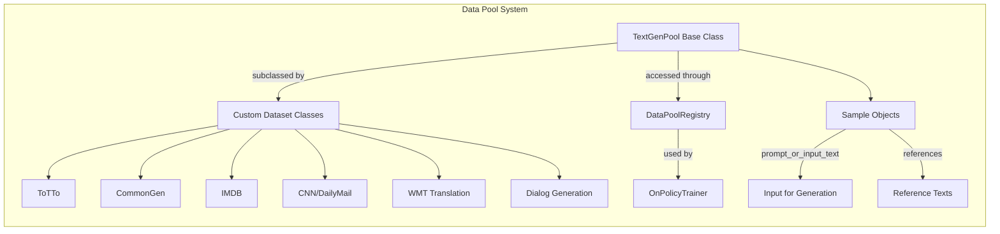
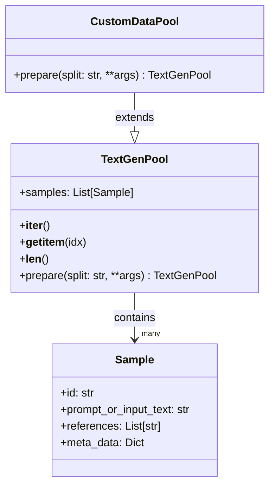
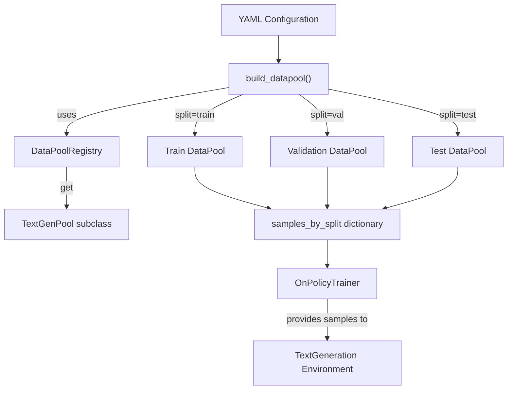
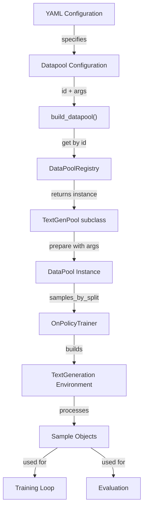

<!-- source: DeepWiki mcp.deepwiki.com · repo allenai/RL4LMs · page 5 Data Pools · fetched 2026-10-26 -->

# Data Pools

<details>
<summary>Relevant source files</summary>

The following files were used as context for generating this wiki page:

- [README.md](README.md)
- [rl4lms/algorithms/ppo/ppo.py](rl4lms/algorithms/ppo/ppo.py)
- [rl4lms/data_pools/custom_text_generation_pools.py](rl4lms/data_pools/custom_text_generation_pools.py)
- [rl4lms/envs/text_generation/training_utils.py](rl4lms/envs/text_generation/training_utils.py)
- [setup.py](setup.py)

</details>


## Purpose
This document explains the data pool system in RL4LMs, which provides a unified interface for accessing and managing text generation datasets. Data pools are a core component that supply training examples to the reinforcement learning environment. For information about how the environment uses this data, see [Environment](#2.2).

## Overview

Data pools in RL4LMs serve as the standardized containers for various text generation datasets, enabling the framework to work with different types of tasks such as summarization, translation, dialogue generation, and text continuation. Each data pool encapsulates samples with prompts (inputs) and references (ground truth outputs) that are used both for training language models and evaluating their performance.



Sources: [rl4lms/data_pools/custom_text_generation_pools.py:1-583](), [README.md:11-34]()

## TextGenPool and Sample Structure

At the heart of the data pool system is the `TextGenPool` class and its associated `Sample` class, which provide the foundation for all dataset implementations.

### Sample Class

Each `Sample` object represents a single training example with the following key attributes:

- `id`: A unique identifier for the sample
- `prompt_or_input_text`: The input text prompt for generation
- `references`: One or more reference texts (ground truth outputs)
- `meta_data`: Optional additional information about the sample

For example, in a summarization task, `prompt_or_input_text` might be a news article, and `references` would be the target summary.

### TextGenPool Class

The `TextGenPool` class is the base class for all dataset implementations and provides:

- Iteration over samples with optional weights
- Standardized access to dataset splits (train, validation, test)
- A `prepare` class method that must be implemented by subclasses to load specific datasets



Sources: [rl4lms/data_pools/custom_text_generation_pools.py:1-14](), [rl4lms/data_pools/text_generation_pool.py]()

## Building and Using Data Pools

Data pools are integrated into the training process through the `OnPolicyTrainer` class, which builds and manages them based on configuration settings.

### Data Pool Construction

The framework builds data pools through the `build_datapool` function in `training_utils.py`:



The function:
1. Takes a datapool configuration from the YAML file
2. Retrieves the appropriate pool class from the `DataPoolRegistry`
3. Creates separate pools for train, validation, and test splits
4. Returns a dictionary with samples from each split

Sources: [rl4lms/envs/text_generation/training_utils.py:58-76]()

### Configuration Example

Here's how a datapool is configured in the YAML configuration file:

```yaml
datapool:
  id: cnn_daily_mail
  args:
    prompt_prefix: "Summarize: "
```

This configuration specifies:
- The dataset ID (`cnn_daily_mail`) which is registered in the `DataPoolRegistry`
- Additional arguments passed to the `prepare` method, such as `prompt_prefix`

Sources: [README.md:81-88]()

## Available Data Pools

RL4LMs provides implementations for various datasets across different text generation tasks:

### Summarization Datasets

| Dataset | Class | Description | Key Features |
|---------|-------|-------------|-------------|
| CNN/DailyMail | `CNNDailyMail` | News articles with human-written summaries | Supports truncation, prompt prefixes |
| Xsum | `Xsum` | BBC news articles with single-sentence summaries | Extreme summarization task |

### Table-to-Text Datasets

| Dataset | Class | Description | Key Features |
|---------|-------|-------------|-------------|
| ToTTo | `ToTTo` | Tables with corresponding descriptions | Supports different table representations (subtable, fulltable) |

### Generative Reasoning Datasets

| Dataset | Class | Description | Key Features |
|---------|-------|-------------|-------------|
| CommonGen | `CommonGen` | Generation from concept sets | Customizable concept separators and prefixes |
| NarrativeQA | `NarrativeQA` | Question answering from narratives | Text normalization options |

### Text Continuation Datasets

| Dataset | Class | Description | Key Features |
|---------|-------|-------------|-------------|
| IMDB | `IMDB` | Movie reviews for sentiment-based continuation | Uses first 50% of text as prompt |
| IMDBForSeq2Seq | `IMDBForSeq2Seq` | Seq2seq format for IMDB | Support for positive ratio selection |

### Translation Datasets

| Dataset | Class | Description | Key Features |
|---------|-------|-------------|-------------|
| WMT | `WMT` | Machine translation datasets | Supports various language pairs |
| WMT14PreprocessedEnDe | `WMT14PreprocessedEnDe` | Pre-processed English-German dataset | Ready-to-use format |
| IWSLT2017EnDe | `IWSLT2017EnDe` | English-German translation dataset | Focus on spoken language |

### Dialogue Datasets

| Dataset | Class | Description | Key Features |
|---------|-------|-------------|-------------|
| CRD3DialogueGeneration | `CRD3DialogueGeneration` | Multi-turn dialogues | Configurable context size |
| DailyDialog | `DailyDialog` | Daily conversation dataset | Includes emotion and intent labels |

Sources: [rl4lms/data_pools/custom_text_generation_pools.py:15-582](), [README.md:17-25]()

## Implementation Details

Let's explore some of the key data pool implementations to understand how they work:

### CNN/DailyMail Summarization

The `CNNDailyMail` class loads the CNN/DailyMail dataset for summarization tasks:

```python
@classmethod
def prepare(cls,
            split: str,
            prompt_suffix: str = "",
            prompt_prefix: str = "",
            truncate_article: int = None,
            max_size: int = None):
    dataset = load_dataset("cnn_dailymail", "3.0.0")
    # ...
    for ix, item in tqdm(enumerate(dataset[dataset_split])):
        # Optionally truncate the article
        if truncate_article is not None:
            tokens = word_tokenize(item["article"])
            tokens = tokens[:truncate_article]
            item["article"] = " ".join(tokens)
        
        # Create sample object
        sample = Sample(id=f"{split}_{ix}",
                        prompt_or_input_text=prompt_prefix +
                        item["article"] + prompt_suffix,
                        references=[item["highlights"]]
                        )
        samples.append(sample)
    # ...
```

It offers options to:
- Add prefix/suffix text to the prompt
- Truncate articles to a specified length
- Limit the dataset size for faster experimentation

Sources: [rl4lms/data_pools/custom_text_generation_pools.py:175-206]()

### IMDB Text Continuation

The `IMDB` class provides a dataset for sentiment-based text continuation:

```python
@classmethod
def prepare(cls, split: str, seed: int):
    dataset = load_dataset("imdb", ignore_verifications=True)
    # ...
    for ix, text in enumerate(dataset_split["text"]):
        # Use 50% of tokens as prompt
        prompt_text = text.split(" ")
        prompt_text = " ".join(prompt_text[:int(len(prompt_text) * 0.5)])

        sample = Sample(id=f"{split}_{ix}",
                        prompt_or_input_text=prompt_text,
                        references=[text]
                        )
        samples.append(sample)
    # ...
```

This implementation:
- Splits each review into two parts
- Uses the first half as the prompt
- Uses the full text as the reference
- Allows setting a random seed for reproducibility

Sources: [rl4lms/data_pools/custom_text_generation_pools.py:209-238]()

### DailyDialog for Conversation

The `DailyDialog` class handles multi-turn dialogues:

```python
@classmethod
def prepare(cls, split: str, context_size: int):
    dataset = load_dataset("daily_dialog", split=split)
    samples = []
    utterance_id = 0
    for item in dataset:
        contexts = []
        for utterance, emotion, intent in zip(item["dialog"],
                                             item["emotion"],
                                             item["act"]):
            if len(contexts) >= context_size:
                context = DailyDialog.EOU_TOKEN.join(contexts[-context_size:]) 
                context += " " + DailyDialog.EOU_TOKEN
                target = utterance + DailyDialog.EOU_TOKEN
                sample = Sample(id=utterance_id, 
                               prompt_or_input_text=context, 
                               references=[target],
                               meta_data={
                                   "emotion": [emotion],
                                   "intent": [intent]
                               })
                samples.append(sample)
            contexts.append(utterance)
            utterance_id += 1
    # ...
```

This implementation:
- Maintains a context window of previous utterances
- Creates samples where the model must predict the next utterance
- Includes emotion and intent labels as metadata
- Uses end-of-utterance tokens to delineate dialogue turns

Sources: [rl4lms/data_pools/custom_text_generation_pools.py:553-582]()

## Data Pool Registry and Integration

Data pools are integrated into the RL4LMs framework through the registry system, which enables dynamic loading of different datasets based on configuration.



### DataPoolRegistry

The `DataPoolRegistry` class maintains a mapping of dataset IDs to their corresponding `TextGenPool` subclasses. When a data pool is requested:

1. The registry looks up the appropriate class based on the ID
2. It instantiates the class with the provided arguments
3. The `prepare` method loads the dataset for the specified split

This modular design makes it easy to add new datasets to the framework.

Sources: [rl4lms/envs/text_generation/registry.py](), [rl4lms/envs/text_generation/training_utils.py:58-76]()

## Creating Custom Data Pools

To add a new dataset to RL4LMs, you need to create a custom subclass of `TextGenPool` and register it. Here's a general pattern:

1. Subclass `TextGenPool` and implement the `prepare` class method
2. Load your dataset using Hugging Face's `datasets` library or custom loaders
3. Convert each example to a `Sample` object
4. Register your class with the `DataPoolRegistry`

Example simplified skeleton:

```python
from rl4lms.data_pools.text_generation_pool import TextGenPool, Sample
from datasets import load_dataset

class MyCustomDataPool(TextGenPool):
    @classmethod
    def prepare(cls, split: str, **args):
        # Load dataset
        dataset = load_dataset("my_dataset")[split]
        
        samples = []
        for ix, item in enumerate(dataset):
            # Create Sample object
            sample = Sample(id=f"{split}_{ix}",
                           prompt_or_input_text=item["input"],
                           references=[item["output"]])
            samples.append(sample)
            
        # Return pool instance
        pool_instance = cls(samples)
        return pool_instance
```

After creating your class, register it with the `DataPoolRegistry`:

```python
from rl4lms.envs.text_generation.registry import DataPoolRegistry

# Register your pool
DataPoolRegistry.add("my_custom_dataset", MyCustomDataPool)
```

Then you can use it in your configuration:

```yaml
datapool:
  id: my_custom_dataset
  args:
    # Your custom arguments
```

Sources: [README.md:189-213](), [rl4lms/data_pools/custom_text_generation_pools.py:15-582]()

## Summary

Data pools in RL4LMs provide:

1. A standardized interface for various text generation datasets
2. Easy configuration through the YAML-based system
3. Support for different task types (summarization, translation, dialogue, etc.)
4. Extensibility through custom dataset implementations
5. Integration with the reinforcement learning framework

They are a critical component that bridges natural language data to the reinforcement learning environment, enabling the training of language models on diverse text generation tasks.

Sources: [README.md:11-34](), [rl4lms/envs/text_generation/training_utils.py:58-76]()

---

