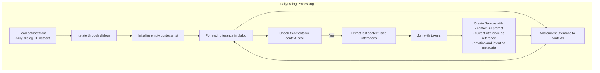
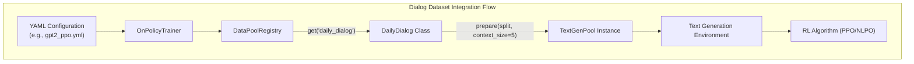
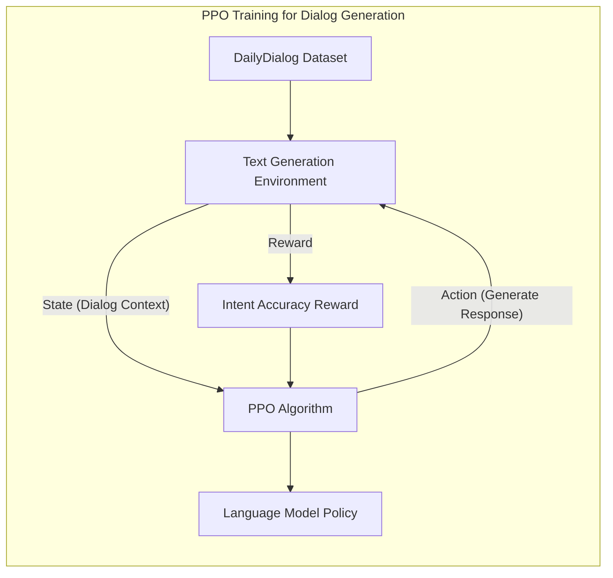
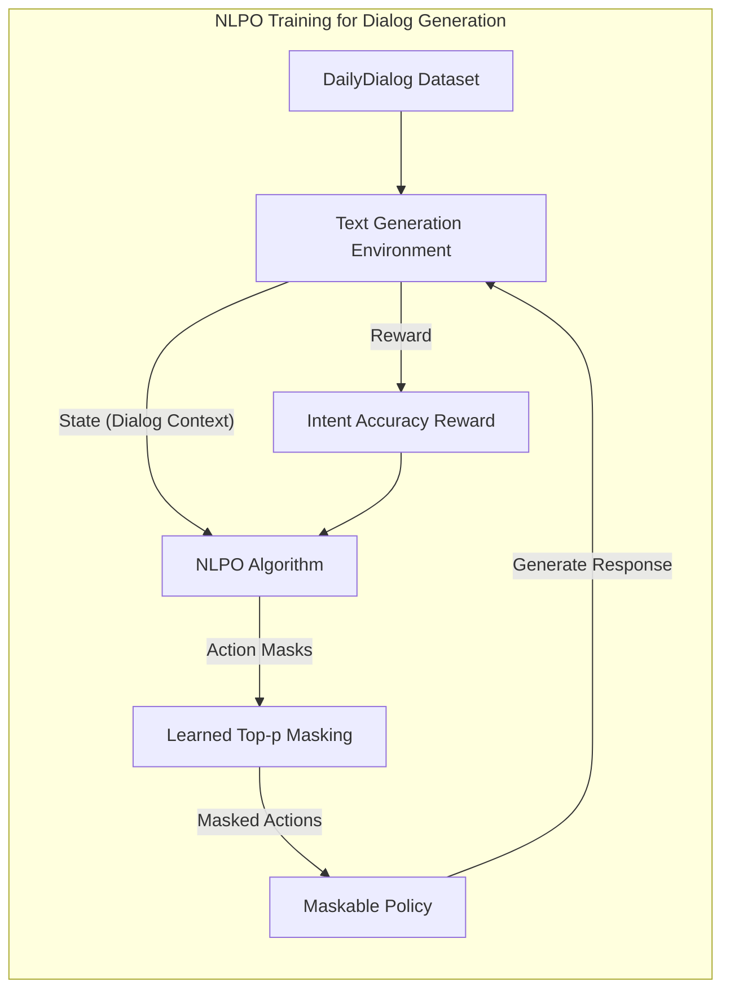
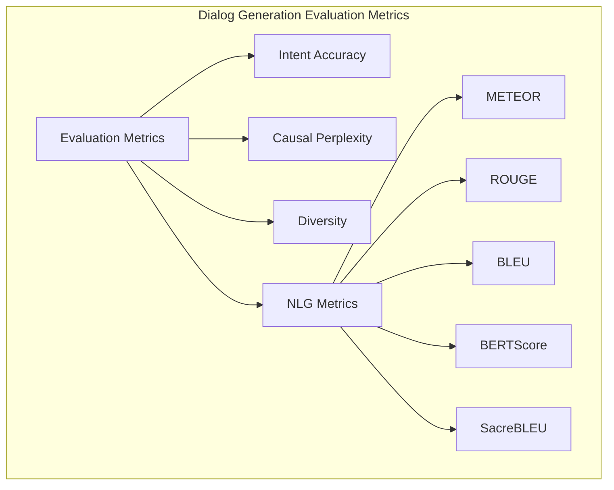

<!-- source: DeepWiki mcp.deepwiki.com · repo allenai/RL4LMs · page 5.1 Dialog Generation Datasets · fetched 2026-10-26 -->

# Dialog Generation Datasets

<details>
<summary>Relevant source files</summary>

The following files were used as context for generating this wiki page:

- [rl4lms/algorithms/ppo/ppo.py](rl4lms/algorithms/ppo/ppo.py)
- [rl4lms/data_pools/custom_text_generation_pools.py](rl4lms/data_pools/custom_text_generation_pools.py)
- [scripts/training/task_configs/dialog/gpt2_nlpo.yml](scripts/training/task_configs/dialog/gpt2_nlpo.yml)
- [scripts/training/task_configs/dialog/gpt2_nlpo_on_supervised.yml](scripts/training/task_configs/dialog/gpt2_nlpo_on_supervised.yml)
- [scripts/training/task_configs/dialog/gpt2_ppo.yml](scripts/training/task_configs/dialog/gpt2_ppo.yml)
- [scripts/training/task_configs/dialog/gpt2_ppo_on_supervised.yml](scripts/training/task_configs/dialog/gpt2_ppo_on_supervised.yml)

</details>


## Purpose and Scope

This page documents the dialog generation datasets available in the RL4LMs framework, their implementation details, and how they're integrated with the reinforcement learning training pipeline. Dialog datasets are particularly important for training language models to generate appropriate responses in conversational contexts, taking into account previous utterances and dialog-specific considerations like intent and emotion.

## Available Dialog Generation Datasets

The RL4LMs framework currently implements two primary dialog generation datasets: DailyDialog and CRD3DialogueGeneration. Both datasets are implemented as subclasses of the base `TextGenPool` class, which provides the foundational data structures for text generation tasks.

### DailyDialog Dataset

The DailyDialog dataset is a high-quality multi-turn dialog dataset implemented in the `DailyDialog` class. This dataset is widely used for conversation modeling tasks.

Key features:
- Multi-turn dialogs with emotion and intent annotations
- Clean, human-written conversations on everyday topics
- Loaded from the Hugging Face datasets library
- Each utterance has associated emotion and dialog act (intent) labels
- Configurable context size to control how many previous utterances to include

### CRD3 Dialog Generation Dataset

The CRD3 (Character-Relationship-Driven Dialog Dataset) contains dialogs from TV shows, implemented in the `CRD3DialogueGeneration` class.

Key features:
- Dialogs extracted from TV show transcripts
- Character names and utterances preserved in structured format
- Multi-turn conversations with character relationships
- Downloaded from the CRD3 GitHub repository
- Configurable context size for controlling conversation history length

Sources: [rl4lms/data_pools/custom_text_generation_pools.py:553-582](), [rl4lms/data_pools/custom_text_generation_pools.py:480-550]()

## Dataset Structure and Implementation

### Dialog Sample Structure

In RL4LMs, dialog generation datasets follow a common structure based on the `Sample` class. Each sample represents a single training instance for the RL agent.

```mermaid
classDiagram
    class "Sample" {
        +id: String
        +prompt_or_input_text: String
        +references: List[String]
        +meta_data: Dict
    }
    
    class "DailyDialogSample" {
        +id: "val_123"
        +prompt_or_input_text: "Hello, how are you?<EOU>I'm fine, thank you.<EOU>"
        +references: ["I'm doing great, how about you?<EOU>"]
        +meta_data: {"emotion": [0], "intent": [1]}
    }
    
    class "CRD3Sample" {
        +id: "train_ep_45_turn_7"
        +prompt_or_input_text: "Ross: I can't believe she'd do this.\nRachel: You okay?"
        +references: ["Yeah, I'll be fine."]
        +meta_data: {}
    }
    
    Sample <|-- DailyDialogSample
    Sample <|-- CRD3Sample
```

Sources: [rl4lms/data_pools/custom_text_generation_pools.py:1](), [rl4lms/data_pools/custom_text_generation_pools.py:570-577](), [rl4lms/data_pools/custom_text_generation_pools.py:540-543]()

### Implementation Architecture

Both dialog datasets inherit from the `TextGenPool` base class and implement a `prepare` class method to load and process the data.

```mermaid
classDiagram
    class "TextGenPool" {
        <<abstract>>
        +samples: List[Sample]
        +__getitem__(idx): Sample
        +__len__(): int
    }
    
    class "DailyDialog" {
        +EOU_TOKEN: String
        +prepare(split, context_size): TextGenPool
    }
    
    class "CRD3DialogueGeneration" {
        +SOURCE_URL: String
        +DEST_BASE_FOLDER: String
        +PATH_TO_CLEANED_DATA: String
        +prepare(split, max_context_size): TextGenPool
    }
    
    TextGenPool <|-- DailyDialog
    TextGenPool <|-- CRD3DialogueGeneration
```

Sources: [rl4lms/data_pools/custom_text_generation_pools.py:1-2](), [rl4lms/data_pools/custom_text_generation_pools.py:553-582](), [rl4lms/data_pools/custom_text_generation_pools.py:480-550]()

## Dialog Context Processing

A key aspect of dialog datasets is their handling of conversation context, which determines how much previous conversation history is provided to the model.

### DailyDialog Processing

The `DailyDialog` class processes dialogs as follows:

1. Loads the dataset using Hugging Face datasets library
2. Defines an End of Utterance (EOU) token (`<EOU>`)
3. For each dialog in the dataset:
   - Tracks the conversation context in a list
   - When enough context is available (based on `context_size`), creates a sample
   - Joins the context utterances with EOU tokens
   - Adds the current utterance as the target
   - Includes emotion and intent metadata



Sources: [rl4lms/data_pools/custom_text_generation_pools.py:554](), [rl4lms/data_pools/custom_text_generation_pools.py:557-582]()

The key processing code in `DailyDialog.prepare()`:

```python
if len(contexts) >= context_size:
    context = DailyDialog.EOU_TOKEN.join(contexts[-context_size:]) 
    context += " " + DailyDialog.EOU_TOKEN
    target = utterance + DailyDialog.EOU_TOKEN
    sample = Sample(id=utterance_id, 
                   prompt_or_input_text=context, 
                   references=[target],
                   meta_data={
                      "emotion": [emotion],
                      "intent": [intent]
                   })
    samples.append(sample)
```

### CRD3DialogueGeneration Processing

The `CRD3DialogueGeneration` class has a more complex process:

1. Downloads data from the CRD3 GitHub repository if not already available
2. Extracts the archive and navigates to the correct directory
3. Reads episode files containing dialog data in JSON format
4. For each episode and turn:
   - Tracks the conversation context (speaker and utterance)
   - Limits context to the specified maximum size
   - Creates samples with character names and utterances

```mermaid
flowchart TD
    subgraph "CRD3DialogueGeneration Processing"
        download["Download CRD3 data if needed"] --> read["Read episode file list"]
        read --> iterate["Iterate through episode files"]
        iterate --> load["Load episode JSON data"]
        load --> contexts["Initialize empty contexts list"]
        contexts --> loop["For each turn in episode"]
        
        loop --> check["Check if contexts > 1"]
        check --> |"Yes"| truncate["Truncate contexts to max_context_size"]
        truncate --> join["Join contexts with newlines"]
        join --> append["Append speaker name + colon"]
        append --> create["Create Sample with:\n- joined contexts as prompt\n- current utterance as reference"]
        
        loop --> update["Add 'name: utterance' to contexts"]
        create --> update
        update --> loop
    end
```



Sources: [rl4lms/data_pools/custom_text_generation_pools.py:480-550]()

## Integration with RL4LMs Framework

Dialog datasets integrate with the RL4LMs framework through the registry system, allowing them to be referenced by ID in configuration files.



Sources: System overview diagram from the original content

### Configuration in YAML Files

Dialog datasets are specified in the "datapool" section of configuration files. For example:

```yaml
datapool:
  id: "daily_dialog"
  args:
    context_size: 5
```

This configuration:
1. Specifies the dataset ID as "daily_dialog"
2. Sets the context size to 5 previous utterances
3. The `OnPolicyTrainer` will retrieve this dataset from the `DataPoolRegistry`
4. The dataset will be used to create the reinforcement learning environment

Sources: [scripts/training/task_configs/dialog/gpt2_ppo.yml:14-17]()

## Using Dialog Datasets for Training

### Training Dialog Generation with PPO

The most common configuration for dialog generation uses the DailyDialog dataset with Proximal Policy Optimization (PPO):



Key configuration elements in a typical dialog PPO setup:
- Dataset: DailyDialog with context_size=5
- Model: GPT-2
- Algorithm: PPO with KL divergence penalty
- Reward: Intent accuracy (75%) and automatic metrics (25%)
- Environment: Max prompt length of 128, max episode length of 20

Sources: [scripts/training/task_configs/dialog/gpt2_ppo.yml](), [rl4lms/algorithms/ppo/ppo.py:17-352]()

### Intent Accuracy Reward

A key component of dialog generation training is the `intent_accuracy` reward function, which evaluates whether the generated response maintains the correct dialog act (intent). This is specified in configuration files:

```yaml
reward_fn:
  id: "intent_accuracy"
  args:
    intent_coeff: 0.75
    auto_coeff: 0.25
```

This encourages the model to generate responses that fulfill the appropriate conversational function (question, statement, agreement, etc.) in the dialog context.

Sources: [scripts/training/task_configs/dialog/gpt2_ppo.yml:7-11]()

### Training with NLPO

An alternative configuration uses NLPO (Natural Language Policy Optimization) with the same DailyDialog dataset:



The key difference with NLPO is the use of action masking to improve exploration, implemented through a maskable policy:

```yaml
policy:
  id: maskable_causal_lm_actor_critic_policy
  args:
    model_name: gpt2
    top_mask: 0.9
    min_tokens_to_keep: 100
    mask_type: 'learned_top_p'
```

Sources: [scripts/training/task_configs/dialog/gpt2_nlpo.yml:25-50]()

### Fine-tuning Pre-trained Models

For better performance, RL4LMs supports fine-tuning models that have already been trained on dialog datasets:

```yaml
policy:
  id: causal_lm_actor_critic_policy
  args:
    model_name: rajkumarrrk/gpt2-fine-tuned-on-daily-dialog
```

This approach:
- Starts from a model already fine-tuned on DailyDialog
- Uses RL to further optimize for specific metrics like intent accuracy
- Can achieve better results with fewer training iterations

Sources: [scripts/training/task_configs/dialog/gpt2_ppo_on_supervised.yml:39-48]()

## Evaluation Metrics for Dialog Generation

When training with dialog datasets, several metrics are used to evaluate performance:



These metrics help evaluate different aspects of dialog generation:
- **Intent Accuracy**: Measures if the response maintains the correct dialog act
- **Perplexity**: Evaluates the fluency and coherence of generated text
- **Diversity**: Measures lexical diversity in the responses
- **Reference-based Metrics**: Compare generated responses to reference responses (BLEU, ROUGE, METEOR, BERTScore)

Sources: [scripts/training/task_configs/dialog/gpt2_ppo.yml:55-74]()

## Summary

The RL4LMs framework provides robust support for dialog generation through specialized datasets like DailyDialog and CRD3DialogueGeneration. These datasets can be configured with varying context sizes and seamlessly integrated with reinforcement learning algorithms like PPO and NLPO to train language models for high-quality dialog generation. The intent accuracy reward function and comprehensive evaluation metrics provide effective guidance for training models to generate appropriate conversational responses.

---

