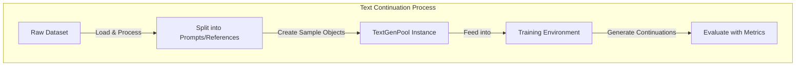
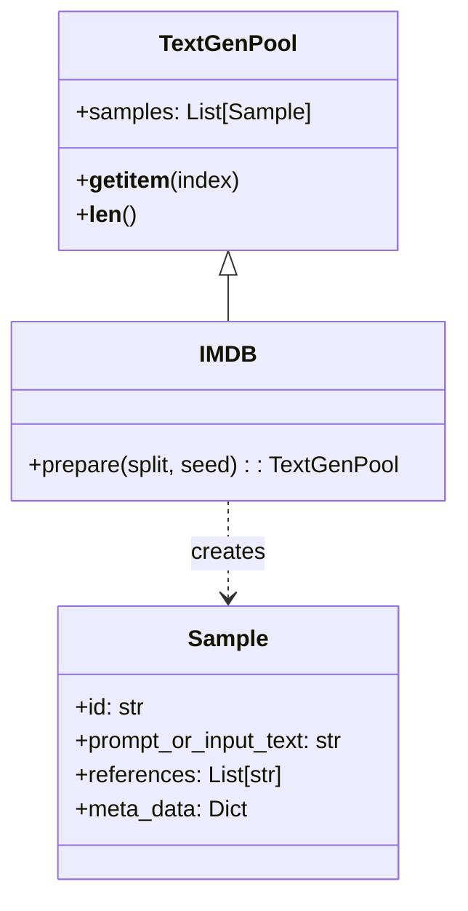
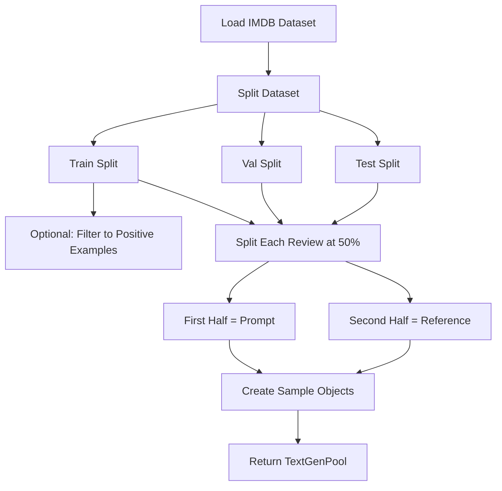
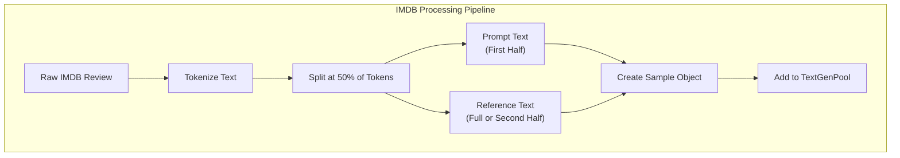
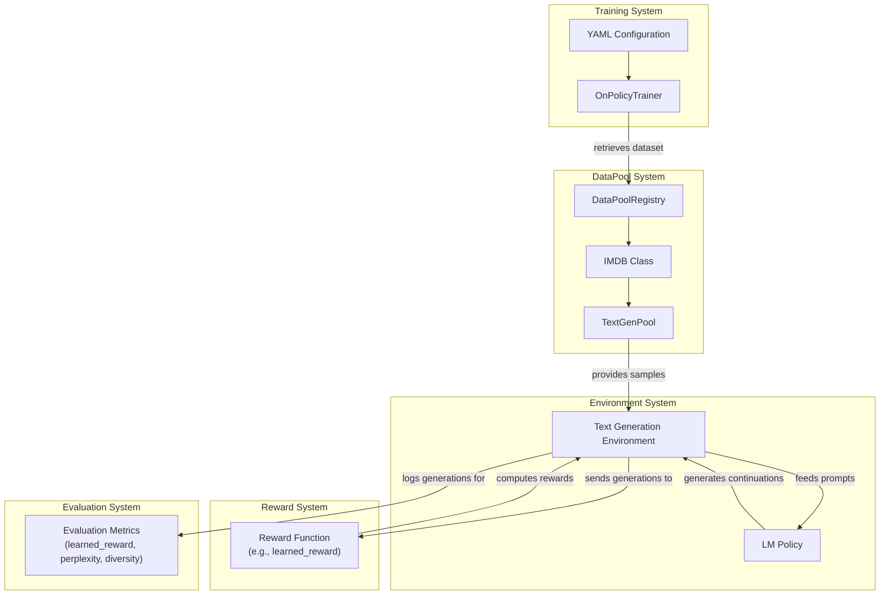

<!-- source: DeepWiki mcp.deepwiki.com · repo allenai/RL4LMs · page 5.2 Text Continuation Datasets · fetched 2026-10-26 -->

# Text Continuation Datasets

<details>
<summary>Relevant source files</summary>

The following files were used as context for generating this wiki page:

- [rl4lms/algorithms/ppo/ppo.py](rl4lms/algorithms/ppo/ppo.py)
- [rl4lms/data_pools/custom_text_generation_pools.py](rl4lms/data_pools/custom_text_generation_pools.py)
- [scripts/crowdworking_templates/likert/IMDB_sentiment_completion.html](scripts/crowdworking_templates/likert/IMDB_sentiment_completion.html)
- [scripts/training/task_configs/imdb_text_continuation/gpt2_nlpo.yml](scripts/training/task_configs/imdb_text_continuation/gpt2_nlpo.yml)
- [scripts/training/task_configs/imdb_text_continuation/gpt2_nlpo_on_supervised.yml](scripts/training/task_configs/imdb_text_continuation/gpt2_nlpo_on_supervised.yml)

</details>


This page documents the text continuation datasets available in the RL4LMs framework. Text continuation tasks involve generating coherent text that follows from a given prompt. In RL4LMs, these datasets are implemented as specialized data pools that prepare text samples for language model training and evaluation. For dialog generation datasets, see [Dialog Generation Datasets](#5.1).

## Overview of Text Continuation Tasks

Text continuation involves generating coherent text that continues from a given prompt. This is a fundamental language generation task that tests a model's ability to understand context and generate coherent, relevant, and fluent continuations. In the RL4LMs framework, text continuation datasets are implemented as part of the `TextGenPool` system.



Sources: [rl4lms/data_pools/custom_text_generation_pools.py:1-14]()

## IMDB Dataset Implementation

The primary text continuation dataset in RL4LMs is based on the IMDB movie reviews dataset. This dataset contains movie reviews with positive or negative sentiment, making it suitable for sentiment-aware text continuation tasks.

### IMDB Data Pool

The `IMDB` class implements a data pool for sentiment continuation tasks using the IMDB dataset:



The `IMDB.prepare()` method:
1. Loads the IMDB dataset using Hugging Face's datasets library
2. Splits the dataset appropriately based on the requested split:
   - For "train" and "val" splits, it shuffles the train set and divides it 80/20
   - For "test" split, it shuffles and limits to 5000 samples
3. For each review, splits the text at 50% of tokens:
   - First half becomes the prompt
   - The full original text is stored as the reference
4. Returns a `TextGenPool` instance containing all samples

Sources: [rl4lms/data_pools/custom_text_generation_pools.py:209-238]()

### IMDBForSeq2Seq Variant

A specialized variant called `IMDBForSeq2Seq` is provided for training supervised generators:



Key differences from the standard IMDB implementation:
- The reference is only the second half of the text, not the full text
- For the training set, it can filter to include only positive reviews (controlled by `positive_ratio` parameter)
- Includes the full original text in metadata

Sources: [rl4lms/data_pools/custom_text_generation_pools.py:241-283]()

## Sample Structure and Processing

The IMDB dataset is processed into `Sample` objects with the following structure:

| Field | Type | Description |
|-------|------|-------------|
| id | string | Unique identifier in format "{split}_{index}" |
| prompt_or_input_text | string | First half of the review text (truncated at 50% of tokens) |
| references | List[string] | The full original text (standard) or second half of text (Seq2Seq) |
| meta_data | Dict | Additional information (may include full reference) |



Sources: [rl4lms/data_pools/custom_text_generation_pools.py:226-236](), [rl4lms/data_pools/custom_text_generation_pools.py:261-276]()

## Integration with RL4LMs Framework

The IMDB text continuation dataset integrates with the broader RL4LMs framework as follows:



Sources: [rl4lms/data_pools/custom_text_generation_pools.py:209-238](), [scripts/training/task_configs/imdb_text_continuation/gpt2_nlpo.yml:14-17]()

## Configuration Examples

IMDB text continuation tasks can be configured through YAML files. Here's an overview of the key configuration sections:

### Dataset Configuration

```yaml
datapool:
  id: imdb
  args:
    seed: 42
```

This configuration loads the IMDB dataset with a random seed of 42 for reproducibility.

### Environment Configuration

```yaml
env:
  n_envs: 10
  args:
    max_prompt_length: 64
    max_episode_length: 48
    terminate_on_eos: True
```

This configures the environment to:
- Run 10 parallel environments
- Limit prompts to 64 tokens
- Generate up to 48 tokens per episode
- Terminate generation when reaching an end-of-sequence token

### Reward Function

```yaml
reward_fn:
  id: learned_reward
  args:
    model_name: lvwerra/distilbert-imdb
    label_ix: 1
    include_prompt_for_eval: True
```

This uses a sentiment classifier (DistilBERT fine-tuned on IMDB) as the reward function, rewarding positive sentiment (label index 1) in the generated text.

### Evaluation Metrics

```yaml
train_evaluation:
  eval_batch_size: 64
  n_iters: 50
  eval_every: 10
  save_every: 10
  metrics:
    - id: learned_reward
      args:
        model_name: lvwerra/distilbert-imdb
        label_ix: 1
        batch_size: 100
    - id: causal_perplexity
      args:
        tokenizer_id: gpt2
        stride: 512
        model_type: causal
    - id: diversity
      args: {}
```

This configures the evaluation to:
- Evaluate every 10 iterations
- Use three metrics: learned reward (sentiment), perplexity, and diversity

Sources: [scripts/training/task_configs/imdb_text_continuation/gpt2_nlpo.yml:1-70](), [scripts/training/task_configs/imdb_text_continuation/gpt2_nlpo_on_supervised.yml:1-70]()

## Human Evaluation

RL4LMs also provides templates for human evaluation of text continuations through crowdsourcing platforms. The evaluation focuses on two key dimensions:

1. **Coherence/Quality**: How well the generated text follows from the prompt, is grammatical, and makes sense
2. **Sentiment**: How positive or negative the generated text is

The evaluation uses a 5-point Likert scale for each dimension:

| Score | Coherence/Quality | Sentiment |
|-------|-------------------|-----------|
| 5 | Excellent: follows effortlessly from prompt, grammatical and fluent | Very positive: glowingly positive |
| 4 | Good: makes sense with minor errors or shifts | Mostly positive: positive with some imperfections |
| 3 | Okay: readable but with noticeable problems | Neutral: balanced or contains both positive and negative |
| 2 | Poor: partly makes sense but unnatural or hard to read | Mostly negative: predominantly negative |
| 1 | Terrible: contradicts prompt or has severe errors | Scathingly negative: strongly negative opinion |

Sources: [scripts/crowdworking_templates/likert/IMDB_sentiment_completion.html:96-151]()

## Other Text Continuation Datasets

While IMDB is the primary text continuation dataset in RL4LMs, the framework's design allows for easy integration of other datasets. Some additional text continuation datasets in the codebase include:

### CNNDailyMail

A news dataset that can be used for text continuation, though it's more commonly used for summarization tasks.

```python
CNNDailyMail.prepare(
    split: str,
    prompt_suffix: str = "",
    prompt_prefix: str = "",
    truncate_article: int = None,
    max_size: int = None
)
```

Sources: [rl4lms/data_pools/custom_text_generation_pools.py:175-206]()

### Xsum

A dataset of news articles and their summaries, adaptable for text continuation by using the article as a prompt.

```python
Xsum.prepare(split: str, prompt_suffix: str = "TL;DR:")
```

Sources: [rl4lms/data_pools/custom_text_generation_pools.py:158-172]()

## Extending with Custom Datasets

To implement a new text continuation dataset:

1. Create a new class inheriting from `TextGenPool`
2. Implement a `prepare` class method that:
   - Loads and processes the dataset
   - Creates `Sample` objects with prompts and references
   - Returns a `TextGenPool` instance
3. Register the new dataset in the `DataPoolRegistry`

This design makes the RL4LMs framework easily extensible to new text continuation datasets and tasks.

---

