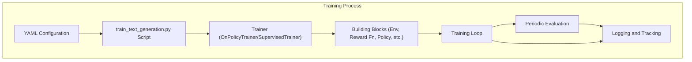
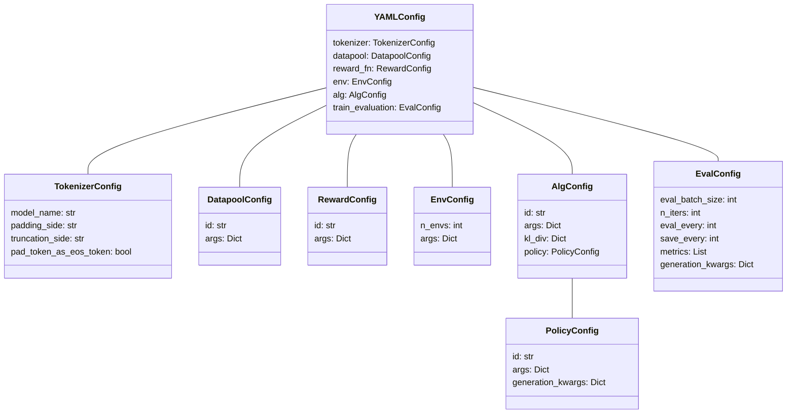
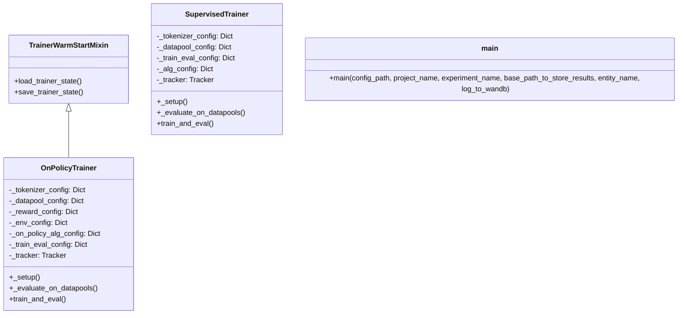
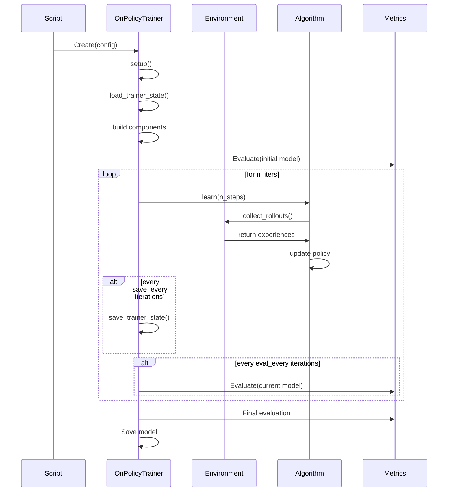
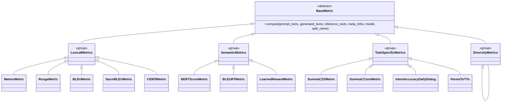
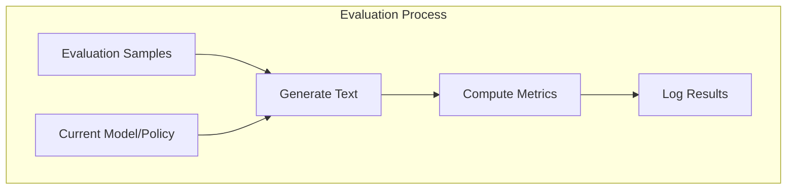

<!-- source: DeepWiki mcp.deepwiki.com · repo allenai/RL4LMs · page 6 Training and Evaluation · fetched 2026-10-26 -->

# Training and Evaluation

<details>
<summary>Relevant source files</summary>

The following files were used as context for generating this wiki page:

- [README.md](README.md)
- [rl4lms/envs/text_generation/metric.py](rl4lms/envs/text_generation/metric.py)
- [rl4lms/envs/text_generation/training_utils.py](rl4lms/envs/text_generation/training_utils.py)
- [scripts/reward-modeling/evaluate_intent_classifier.py](scripts/reward-modeling/evaluate_intent_classifier.py)
- [scripts/reward-modeling/train_intent_classifier.py](scripts/reward-modeling/train_intent_classifier.py)
- [scripts/training/task_configs/synthetic_generate_increasing_numbers/gpt2_nlpo.yml](scripts/training/task_configs/synthetic_generate_increasing_numbers/gpt2_nlpo.yml)
- [scripts/training/train_text_generation.py](scripts/training/train_text_generation.py)
- [setup.py](setup.py)

</details>


This page describes the training and evaluation pipelines in RL4LMs, providing a comprehensive guide to training language models using reinforcement learning and evaluating their performance. For information about specific reinforcement learning algorithms, see [Reinforcement Learning Algorithms](#4), and for details about reward functions, see [Reward Functions](#3).

## Overview of Training in RL4LMs

RL4LMs provides a streamlined workflow for training language models using reinforcement learning or supervised learning. The training process is configured using YAML files that specify all aspects of the training pipeline, from the dataset to the model architecture and training parameters.



Sources: [scripts/training/train_text_generation.py:1-91](), [README.md:66-187]()

## Configuration System

The training and evaluation pipeline is configured through a YAML file that specifies all components and parameters. The main sections of the configuration are:

- **Tokenizer**: Configures the tokenizer for the language model
- **Datapool**: Specifies the dataset for training
- **Reward Function**: Defines the reward function for reinforcement learning
- **Environment**: Configures the text generation environment
- **Algorithm**: Specifies the reinforcement learning algorithm and policy
- **Train Evaluation**: Configures the evaluation process during training



Sources: [README.md:77-187](), [scripts/training/task_configs/synthetic_generate_increasing_numbers/gpt2_nlpo.yml:1-61]()

## Training Pipelines

RL4LMs supports two main training pipelines:

1. **On-Policy Reinforcement Learning**: Trains models using reinforcement learning algorithms like PPO, NLPO, TRPO, and A2C
2. **Supervised Learning**: Trains models using traditional supervised learning

The training process is orchestrated by the `OnPolicyTrainer` or `SupervisedTrainer` classes, which set up the components, execute the training loop, and handle evaluation.



Sources: [rl4lms/envs/text_generation/training_utils.py:126-322](), [scripts/training/train_text_generation.py:13-91]()

### On-Policy Reinforcement Learning Training

The `OnPolicyTrainer` implements the reinforcement learning training loop, which consists of the following steps:

1. Setting up components (tokenizer, reward function, metrics, datapool, environment, algorithm)
2. Evaluating the model before training (to establish a baseline)
3. Training for a specified number of iterations, each involving:
   - Collecting rollouts (generating sequences and computing rewards)
   - Updating the policy based on the collected experiences
   - Periodically evaluating the model on the validation set
4. Final evaluation on the validation and test sets



Sources: [rl4lms/envs/text_generation/training_utils.py:126-224]()

### Supervised Training

The `SupervisedTrainer` implements the supervised learning training loop, which consists of:

1. Setting up the tokenizer, metrics, datapool, and model
2. Evaluating the model before training (to establish a baseline)
3. Training using Hugging Face's `Trainer`
4. Final evaluation on the validation and test sets

The supervised training is primarily used for warm-starting models before reinforcement learning or for benchmarking purposes.

Sources: [rl4lms/envs/text_generation/training_utils.py:225-322]()

## Evaluation System

The evaluation system in RL4LMs is designed to assess the quality of generated text using various metrics. Evaluation is performed periodically during training and at the end of training.

### Evaluation Metrics

RL4LMs provides a wide range of metrics for evaluating generated text, all extending the `BaseMetric` class:



Sources: [rl4lms/envs/text_generation/metric.py:20-778]()

Each metric computes both individual scores (per sample) and a corpus-level score (averaged across all samples). The `compute` method returns a dictionary with the metric name as the key and a tuple of (individual_scores, corpus_level_score) as the value.

### Evaluation Process

The evaluation process is performed by the `evaluate_on_samples` function, which:

1. Generates text using the current policy/model
2. Computes metrics on the generated text
3. Logs the results using the tracker

Evaluation is typically performed:
- Before training (to establish a baseline)
- Periodically during training (to monitor progress)
- After training (to assess the final model)



Sources: [rl4lms/envs/text_generation/training_utils.py:180-193](), [rl4lms/envs/text_generation/training_utils.py:244-257]()

## Tracking and Logging

RL4LMs provides a comprehensive tracking and logging system through the `Tracker` class, which:

1. Stores experiment artifacts (model checkpoints, configurations, predictions, metrics)
2. Optionally logs to Weights & Biases (wandb) for experiment tracking and visualization

The tracked information includes:
- Training metrics (loss, rewards, KL divergence)
- Validation metrics (at specified intervals)
- Rollout information (generated text, rewards)
- Model checkpoints

Sources: [scripts/training/train_text_generation.py:27-34](), [README.md:300-316]()

## Running a Training Job

To run a training job, you use the `train_text_generation.py` script with a configuration file:

```
python scripts/training/train_text_generation.py --config_path <PATH_TO_CONFIG_FILE>
```

Additional options include:
- `--experiment_name`: Name of the experiment
- `--base_path_to_store_results`: Path to store experiment results
- `--log_to_wandb`: Enable logging to Weights & Biases

Example configuration files for various tasks can be found in the `scripts/training/task_configs` directory.

Sources: [README.md:66-73](), [scripts/training/train_text_generation.py:58-90]()

## Configuration Reference Table

Below is a table of common configuration parameters for training and evaluation:

| Configuration Section | Parameter | Description |
|-----------------------|-----------|-------------|
| **tokenizer** | model_name | The pretrained tokenizer model name |
| | padding_side | The side for padding (left/right) |
| | truncation_side | The side for truncation (left/right) |
| | pad_token_as_eos_token | Whether to use EOS token as PAD token |
| **datapool** | id | Identifier for the dataset in DataPoolRegistry |
| | args | Dataset-specific arguments |
| **reward_fn** | id | Identifier for the reward function in RewardFunctionRegistry |
| | args | Reward function-specific arguments |
| **env** | n_envs | Number of parallel environments |
| | args.max_prompt_length | Maximum length of input prompts |
| | args.max_episode_length | Maximum length of generated text |
| | args.terminate_on_eos | Whether to terminate generation on EOS token |
| **alg** | id | Algorithm identifier (ppo, nlpo, a2c, trpo) |
| | args.n_steps | Number of steps per update |
| | args.batch_size | Batch size for training |
| | args.learning_rate | Learning rate |
| | kl_div.coeff | KL divergence coefficient |
| | kl_div.target_kl | Target KL divergence |
| | policy.id | Policy identifier |
| | policy.args.model_name | Pretrained model name |
| | policy.args.generation_kwargs | Arguments for text generation |
| **train_evaluation** | eval_batch_size | Batch size for evaluation |
| | n_iters | Number of training iterations |
| | eval_every | Evaluate every N iterations |
| | save_every | Save model every N iterations |
| | metrics | List of metrics for evaluation |
| | generation_kwargs | Arguments for text generation during evaluation |

Sources: [README.md:83-186](), [scripts/training/task_configs/synthetic_generate_increasing_numbers/gpt2_nlpo.yml:1-61]()

---

