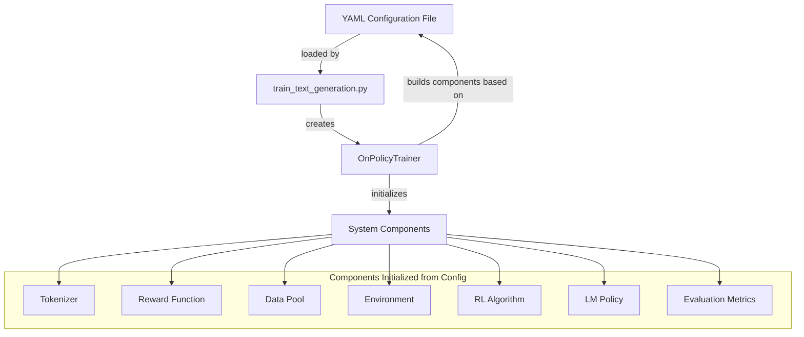
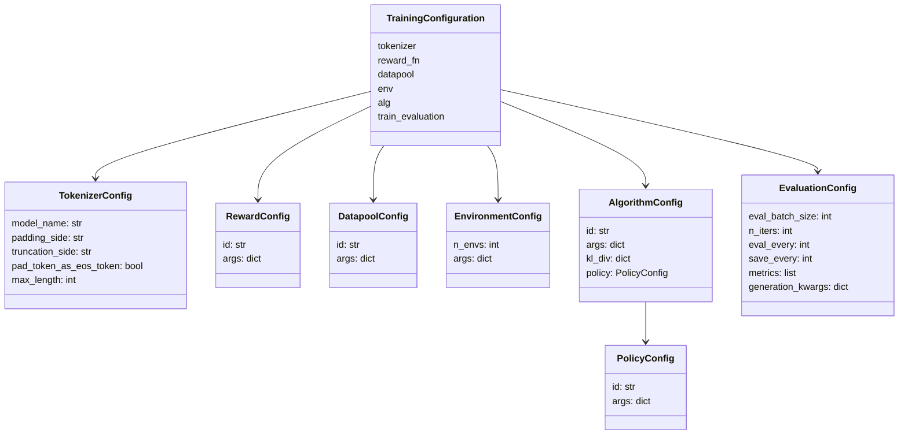
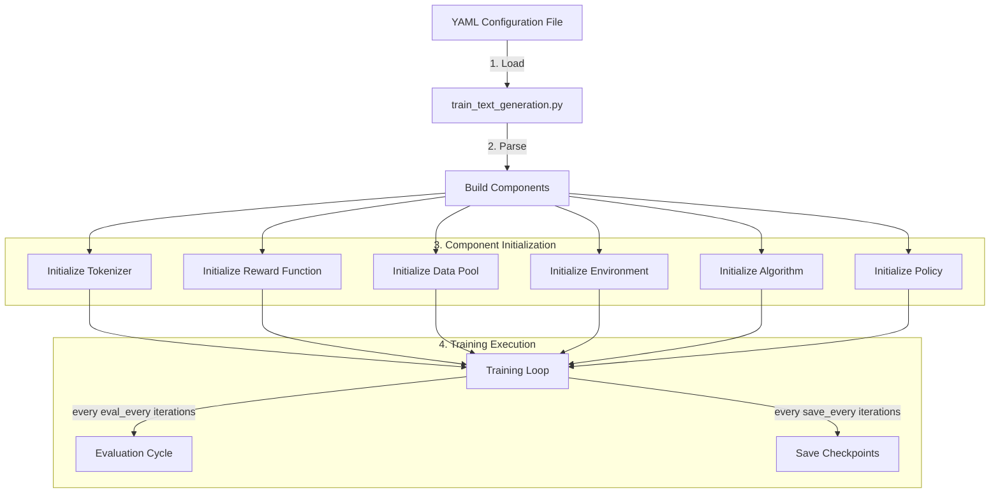

<!-- source: DeepWiki mcp.deepwiki.com · repo allenai/RL4LMs · page 6.1 Training Configuration · fetched 2026-10-26 -->

# Training Configuration

<details>
<summary>Relevant source files</summary>

The following files were used as context for generating this wiki page:

- [scripts/training/task_configs/dialog/gpt2_ppo.yml](scripts/training/task_configs/dialog/gpt2_ppo.yml)
- [scripts/training/task_configs/dialog/gpt2_supervised.yml](scripts/training/task_configs/dialog/gpt2_supervised.yml)
- [scripts/training/task_configs/imdb_text_continuation/gpt2_ppo_on_supervised.yml](scripts/training/task_configs/imdb_text_continuation/gpt2_ppo_on_supervised.yml)

</details>


The RL4LMs framework uses a YAML-based configuration system to define all aspects of the training process for reinforcement learning with language models. This page explains how to configure training pipelines through these YAML files, which serve as the central control mechanism for experiments.

For information about evaluation metrics that can be used in training configurations, see [Evaluation Metrics](#6.2).

## Overview of Configuration System

Training configurations in RL4LMs are defined in YAML files that specify all components and parameters needed for the training process. The configuration file serves as the single source of truth for an experiment, making it easy to reproduce results and systematically explore different settings.



Sources: [scripts/training/task_configs/dialog/gpt2_ppo.yml](), [scripts/training/task_configs/dialog/gpt2_supervised.yml]()

## Configuration Structure

A typical configuration file is organized into several major sections, each responsible for a different aspect of the training process:



Sources: [scripts/training/task_configs/dialog/gpt2_ppo.yml](), [scripts/training/task_configs/imdb_text_continuation/gpt2_ppo_on_supervised.yml]()

## Configuration Sections

### Tokenizer Configuration

This section defines the tokenizer to be used for processing text inputs and outputs.

```yaml
tokenizer:
  model_name: gpt2                # Model name or path for tokenizer
  padding_side: left              # Side to add padding tokens (left/right)
  truncation_side: left           # Side to truncate tokens (left/right)
  pad_token_as_eos_token: True    # Whether to use EOS token as padding token
  max_length: 128                 # Maximum sequence length
```

Sources: [scripts/training/task_configs/dialog/gpt2_supervised.yml:1-6]()

### Reward Function Configuration

Defines the reward function that provides feedback to the reinforcement learning algorithm.

```yaml
reward_fn:
  id: "intent_accuracy"           # ID of the reward function from registry
  args:                           # Arguments specific to the reward function
    intent_coeff: 0.75
    auto_coeff: 0.25
```

Sources: [scripts/training/task_configs/dialog/gpt2_ppo.yml:7-11](), [scripts/training/task_configs/imdb_text_continuation/gpt2_ppo_on_supervised.yml:7-12]()

### Data Pool Configuration

Specifies the dataset to be used for training and its parameters.

```yaml
datapool:
  id: "daily_dialog"              # ID of the dataset from registry
  args:                           # Dataset-specific parameters
    context_size: 5
```

Sources: [scripts/training/task_configs/dialog/gpt2_ppo.yml:14-17](), [scripts/training/task_configs/dialog/gpt2_supervised.yml:8-11]()

### Environment Configuration

Configures the reinforcement learning environment parameters.

```yaml
env:
  n_envs: 10                      # Number of parallel environments
  args:
    max_prompt_length: 128        # Maximum length of input prompts
    max_episode_length: 20        # Maximum length of generated text
    terminate_on_eos: True        # Whether to terminate when EOS token is generated
```

Sources: [scripts/training/task_configs/dialog/gpt2_ppo.yml:19-24](), [scripts/training/task_configs/imdb_text_continuation/gpt2_ppo_on_supervised.yml:19-24]()

### Algorithm Configuration

Defines the reinforcement learning or supervised learning algorithm and its hyperparameters.

```yaml
alg:
  id: ppo                         # Algorithm ID from registry (ppo, supervised, etc.)
  args:                           # Algorithm-specific parameters
    n_steps: 128                  # Number of steps per update
    batch_size: 64                # Batch size for updates
    verbose: 1                    # Verbosity level
    learning_rate: 0.000001       # Learning rate
    n_epochs: 5                   # Number of optimization epochs
    
  kl_div:                         # KL divergence settings (for RL algorithms)
    coeff: 0.2                    # KL penalty coefficient
    target_kl: 0.5                # Target KL divergence
```

Sources: [scripts/training/task_configs/dialog/gpt2_ppo.yml:26-37](), [scripts/training/task_configs/dialog/gpt2_supervised.yml:13-29]()

### Policy Configuration

Configures the policy model that will be trained.

```yaml
  policy:
    id: causal_lm_actor_critic_policy  # Policy ID from registry
    args:
      model_name: gpt2                 # Base model to use
      apply_model_parallel: True       # Whether to use model parallelism
      generation_kwargs:               # Parameters for text generation
        do_sample: True
        top_k: 20
        min_length: 2
        max_new_tokens: 20
```

Sources: [scripts/training/task_configs/dialog/gpt2_ppo.yml:39-48](), [scripts/training/task_configs/imdb_text_continuation/gpt2_ppo_on_supervised.yml:39-47]()

### Training Evaluation Configuration

Sets up evaluation during training, including metrics and evaluation frequency.

```yaml
train_evaluation:
  eval_batch_size: 32             # Batch size for evaluation
  n_iters: 50                     # Total number of training iterations
  eval_every: 5                   # Evaluate every N iterations
  save_every: 10                  # Save model every N iterations
  metrics:                        # List of evaluation metrics
    - id: intent_accuracy         # Metric ID from registry
    - id: causal_perplexity       # Another metric with arguments
      args:
        tokenizer_id: gpt2
        stride: 128
        model_type: causal
  generation_kwargs:              # Generation parameters for evaluation
    do_sample: True
    top_k: 20
    min_length: 2
    max_new_tokens: 20
```

Sources: [scripts/training/task_configs/dialog/gpt2_ppo.yml:50-79](), [scripts/training/task_configs/dialog/gpt2_supervised.yml:31-52]()

## Configuration Flow in Training Pipeline

This diagram illustrates how the configuration flows through the training process:



Sources: [scripts/training/task_configs/dialog/gpt2_ppo.yml](), [scripts/training/task_configs/imdb_text_continuation/gpt2_ppo_on_supervised.yml]()

## Configuration for Different Training Methods

### Supervised Learning Configuration

For supervised fine-tuning, the configuration differs slightly from RL training:

```yaml
alg:
  id: supervised
  training_args:
    per_device_train_batch_size: 32
    logging_steps: 300
    num_train_epochs: 20
    lr_scheduler_type: "constant"
    learning_rate: 0.00001
    save_total_limit: 1
  model_type: causal
  model_name: gpt2
  generation_kwargs:
    do_sample: True
    top_k: 20
    min_length: 2
    max_new_tokens: 20
    post_processing_fn: null
```

Sources: [scripts/training/task_configs/dialog/gpt2_supervised.yml:13-29]()

### Reinforcement Learning Configuration

For RL methods like PPO, the configuration includes specific RL parameters:

```yaml
alg:
  id: ppo
  args: 
    n_steps: 128
    batch_size: 64
    verbose: 1
    learning_rate: 0.000001
    n_epochs: 5
    
  kl_div:
    coeff: 0.2
    target_kl: 0.5
 
  policy:
    id: causal_lm_actor_critic_policy
    args:
      model_name: gpt2
      apply_model_parallel: True
      generation_kwargs:
        do_sample: True
        top_k: 20
        min_length: 2
        max_new_tokens: 20
```

Sources: [scripts/training/task_configs/dialog/gpt2_ppo.yml:26-49]()

## Configuration Options Reference

### Available Algorithm IDs

| Algorithm ID | Description |
|--------------|-------------|
| `ppo` | Proximal Policy Optimization |
| `nlpo` | Natural Language Policy Optimization |
| `trpo` | Trust Region Policy Optimization |
| `a2c` | Advantage Actor-Critic |
| `supervised` | Supervised Learning (not RL) |

Sources: [scripts/training/task_configs/dialog/gpt2_supervised.yml:14](), [scripts/training/task_configs/dialog/gpt2_ppo.yml:26]()

### Available Policy IDs

| Policy ID | Description |
|-----------|-------------|
| `causal_lm_actor_critic_policy` | Actor-Critic policy for causal language models (e.g., GPT-2) |
| `seq2seq_lm_actor_critic_policy` | Actor-Critic policy for sequence-to-sequence models (e.g., T5, BART) |
| `maskable_causal_lm_actor_critic_policy` | Maskable version of causal LM policy (for NLPO) |
| `maskable_seq2seq_lm_actor_critic_policy` | Maskable version of seq2seq LM policy (for NLPO) |

Sources: [scripts/training/task_configs/dialog/gpt2_ppo.yml:40](), [scripts/training/task_configs/imdb_text_continuation/gpt2_ppo_on_supervised.yml:40]()

## Configuration Examples

The RL4LMs repository provides several example configurations for different tasks:

### Dialog Generation

```yaml
# Example of PPO configuration for dialog generation
tokenizer:
  model_name: gpt2
  padding_side: left
  truncation_side: left
  pad_token_as_eos_token: True

reward_fn:
  id: "intent_accuracy"
  args:
    intent_coeff: 0.75
    auto_coeff: 0.25

datapool:
  id: "daily_dialog"
  args:
    context_size: 5
```

Sources: [scripts/training/task_configs/dialog/gpt2_ppo.yml:1-17]()

### Text Continuation

```yaml
# Example of PPO configuration for IMDB text continuation
tokenizer:
  model_name: lvwerra/gpt2-imdb
  padding_side: left
  truncation_side: left
  pad_token_as_eos_token: True 

reward_fn:
  id: learned_reward
  args: 
    model_name: lvwerra/distilbert-imdb
    label_ix: 1
    include_prompt_for_eval: True

datapool:
  id: imdb
  args:
    seed: 42
```

Sources: [scripts/training/task_configs/imdb_text_continuation/gpt2_ppo_on_supervised.yml:1-17]()

## Best Practices for Configuration

1. **Version Control**: Keep all configuration files under version control to ensure reproducibility
2. **Documentation**: Add comments to explain non-obvious parameter choices
3. **Hyperparameter Tuning**: Create systematic variations of configurations for hyperparameter tuning
4. **Start Simple**: Begin with provided example configurations and modify as needed
5. **KL Divergence**: Pay attention to KL divergence settings to prevent the model from deviating too far from initial behavior
6. **Evaluation Frequency**: Configure appropriate evaluation frequency based on dataset size and training time

Sources: [scripts/training/task_configs/dialog/gpt2_ppo.yml](), [scripts/training/task_configs/dialog/gpt2_supervised.yml](), [scripts/training/task_configs/imdb_text_continuation/gpt2_ppo_on_supervised.yml]()

---

