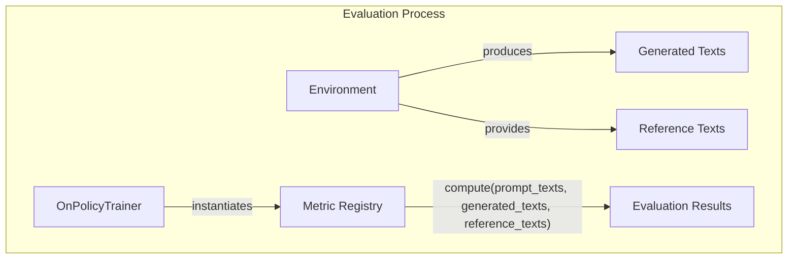
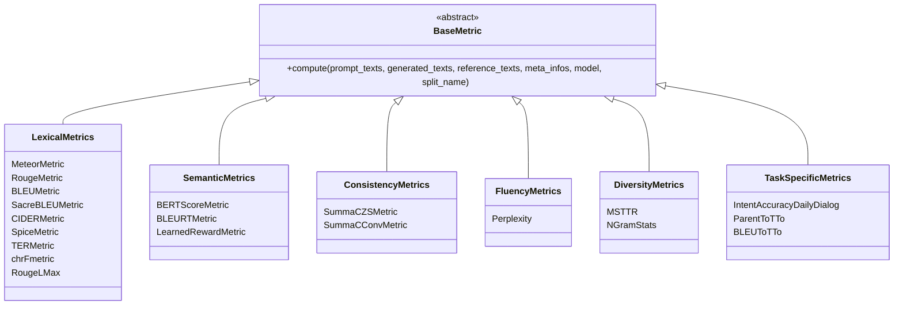
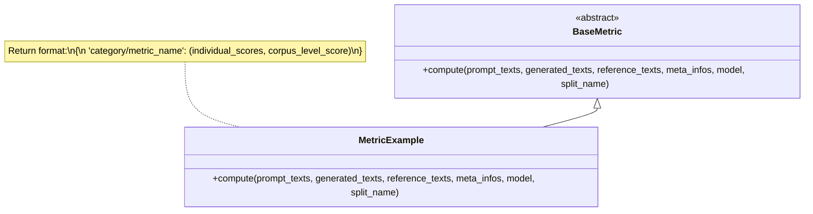
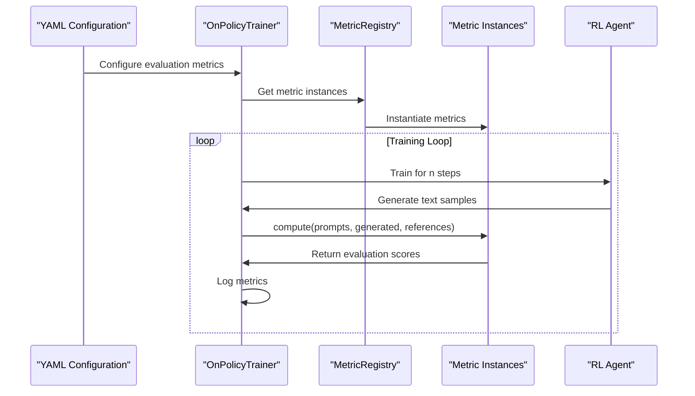
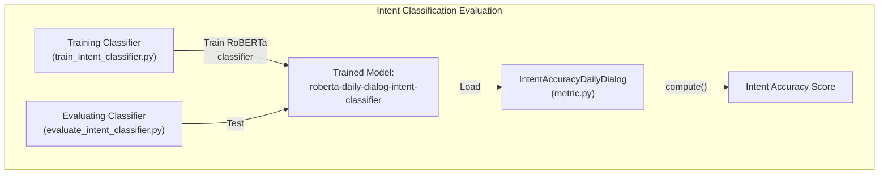

<!-- source: DeepWiki mcp.deepwiki.com · repo allenai/RL4LMs · page 6.2 Evaluation Metrics · fetched 2026-10-26 -->

# Evaluation Metrics

<details>
<summary>Relevant source files</summary>

The following files were used as context for generating this wiki page:

- [rl4lms/envs/text_generation/metric.py](rl4lms/envs/text_generation/metric.py)
- [scripts/reward-modeling/evaluate_intent_classifier.py](scripts/reward-modeling/evaluate_intent_classifier.py)
- [scripts/reward-modeling/train_intent_classifier.py](scripts/reward-modeling/train_intent_classifier.py)

</details>


This document provides a comprehensive overview of the evaluation metrics system in RL4LMs. Evaluation metrics are crucial for assessing the quality of text generated by language models during and after reinforcement learning training. This page details the available metrics, their organization, and how they integrate with the rest of the RL4LMs framework.

For information on training configuration, see [Training Configuration](#6.1). For information on how to use these metrics in specific use cases, see [Use Cases and Examples](#7).

## Metric System Overview

The RL4LMs framework includes a robust metrics system that evaluates generated text across multiple dimensions: lexical similarity, semantic equivalence, fluency, diversity, consistency, and task-specific criteria.



Sources: [rl4lms/envs/text_generation/metric.py:21-41]()

## Metric Hierarchy

All metrics in RL4LMs inherit from a common `BaseMetric` abstract class that defines the interface for computing metrics.



Sources: [rl4lms/envs/text_generation/metric.py:21-41]()

## Metric Types

### Lexical Metrics

Lexical metrics evaluate the lexical overlap between generated and reference texts. These metrics are particularly useful for tasks where exact wording or n-gram coverage is important.

| Metric | Description | Output Format |
|--------|-------------|---------------|
| MeteorMetric | Evaluates using the METEOR score (based on unigram precision and recall with synonym matching) | "lexical/meteor" |
| RougeMetric | Calculates ROUGE-1, ROUGE-2, ROUGE-L, and ROUGE-Lsum scores | "lexical/rouge_rouge1", "lexical/rouge_rouge2", etc. |
| BLEUMetric | Computes BLEU score based on n-gram precision | "lexical/bleu" |
| SacreBLEUMetric | A more standardized implementation of BLEU | "lexical/sacrebleu" |
| CIDERMetric | Consensus-based Image Description Evaluation (CIDEr) adapted for text | "lexical/cider" |
| SpiceMetric | Semantic Propositional Image Caption Evaluation (SPICE) adapted for text | "lexical/spice" |
| TERMetric | Translation Edit Rate (TER) | "lexical/ter" |
| chrFmetric | Character n-gram F-score (chrF) | "lexical/chrf" |
| RougeLMax | Maximum ROUGE-L score across multiple references | "lexical/rouge_l_max" |

Sources: [rl4lms/envs/text_generation/metric.py:107-614]()

### Semantic Metrics

Semantic metrics evaluate semantic similarity between generated and reference texts, often using embeddings or pre-trained models to capture meaning beyond surface form.

| Metric | Description | Output Format |
|--------|-------------|---------------|
| BERTScoreMetric | Uses BERT embeddings to compute semantic similarity | "semantic/bert_score" |
| BLEURTMetric | A learned evaluation metric based on BERT | "semantic/bleurt" |
| LearnedRewardMetric | Uses a custom pretrained classification model to evaluate quality | "semantic/learned_automodel_metric" |

Sources: [rl4lms/envs/text_generation/metric.py:44-246]()

### Consistency Metrics

Consistency metrics evaluate whether generated text is consistent with input text, particularly important for summarization.

| Metric | Description | Output Format |
|--------|-------------|---------------|
| SummaCZSMetric | Zero-shot summarization consistency evaluation | "consistency/summaczs" |
| SummaCConvMetric | Convolution-based summarization consistency evaluation | "consistency/summacconv" |

Sources: [rl4lms/envs/text_generation/metric.py:361-412]()

### Fluency Metrics

Fluency metrics evaluate how natural and grammatically correct the generated text is.

| Metric | Description | Output Format |
|--------|-------------|---------------|
| Perplexity | Calculates perplexity of generated text using a language model | "fluency_metrics/perplexity" |

Sources: [rl4lms/envs/text_generation/metric.py:415-483]()

### Diversity Metrics

Diversity metrics evaluate the lexical diversity and richness of generated text.

| Metric | Description | Output Format |
|--------|-------------|---------------|
| DiversityMetrics | Combines MSTTR (Mean Segmental Type-Token Ratio) and n-gram statistics | "diversity_metrics/*" |

Sources: [rl4lms/envs/text_generation/metric.py:333-358]()

### Task-Specific Metrics

Task-specific metrics are tailored to specific text generation tasks.

| Metric | Description | Output Format |
|--------|-------------|---------------|
| IntentAccuracyDailyDialog | Evaluates if generated dialogue responses match intended intents | "intent/accuracy" |
| ParentToTTo | Metrics for table-to-text generation (PARENT) | "table_to_text/parent_*" |
| BLEUToTTo | BLEU score adapted for table-to-text evaluation | "table_to_text/bleu_*" |

Sources: [rl4lms/envs/text_generation/metric.py:486-551](), [rl4lms/envs/text_generation/metric.py:663-718]()

## Metric Implementation Structure

Each metric implements a standardized interface for computation and follows a consistent pattern for returning results.



Sources: [rl4lms/envs/text_generation/metric.py:21-41]()

## Integration with Training Pipeline

Metrics are integrated into the RL4LMs training pipeline through the `OnPolicyTrainer` class, which evaluates model performance at specified intervals.



Sources: [rl4lms/envs/text_generation/metric.py:21-41]()

## Task-Specific Metric Example: Intent Classification

The IntentAccuracyDailyDialog metric demonstrates how task-specific metrics can be implemented. This metric evaluates whether generated dialogue responses match the intended dialogue acts in the DailyDialog dataset.



Sources: [rl4lms/envs/text_generation/metric.py:663-718](), [scripts/reward-modeling/train_intent_classifier.py](), [scripts/reward-modeling/evaluate_intent_classifier.py]()

## Creating Custom Metrics

To create a custom metric, users need to inherit from the `BaseMetric` class and implement the `compute` method. The compute method should take the required parameters and return a dictionary with metric names as keys and tuples of (individual_scores, corpus_level_score) as values.

Example template for a custom metric:

```python
class CustomMetric(BaseMetric):
    def __init__(self, custom_param):
        super().__init__()
        self._custom_param = custom_param
        
    def compute(
        self,
        prompt_texts: List[str],
        generated_texts: List[str],
        reference_texts: List[List[str]],
        meta_infos: List[Dict[str, Any]] = None,
        model: PreTrainedModel = None,
        split_name: str = None,
    ):
        # Calculate scores
        scores = [...]  # Implementation details
        corpus_score = np.mean(scores)
        
        # Return metrics in standardized format
        metric_dict = {
            "custom_category/custom_metric_name": (scores, corpus_score)
        }
        return metric_dict
```

Sources: [rl4lms/envs/text_generation/metric.py:21-41]()

## Using Metrics in Configuration

Metrics are specified in the training configuration YAML file. Multiple metrics can be combined to get a comprehensive evaluation of generated text.

Example configuration:

```yaml
metrics:
  - id: rouge
    args: {}
  - id: bleu
    args: {}
  - id: bert_score
    args:
      language: en
  - id: diversity
    args: {}
  - id: meteor
    args: {}
```

Sources: [rl4lms/envs/text_generation/metric.py:21-41]()

## Evaluation Process

The evaluation process in RL4LMs involves the following steps:

1. Generate text samples using the current policy
2. Compute all specified metrics on the generated samples
3. Log and track metrics over the course of training
4. Use metrics for model selection and performance reporting

This standardized process ensures consistent evaluation across different models and tasks.

---

