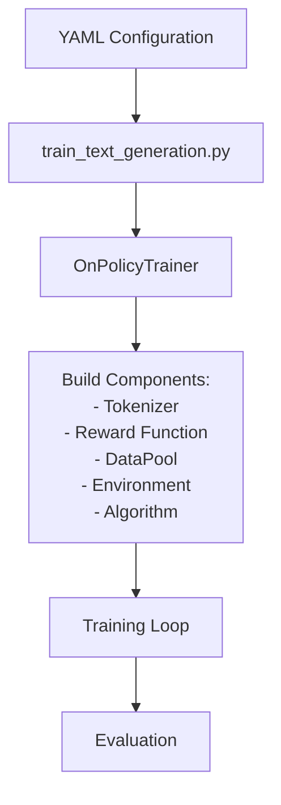
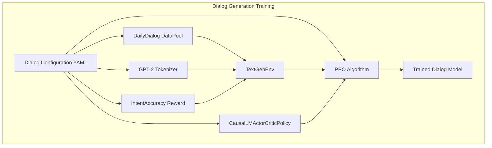
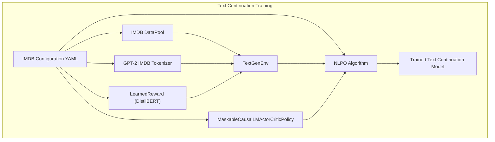
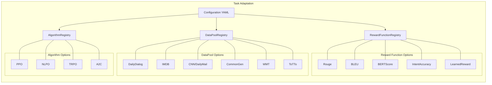
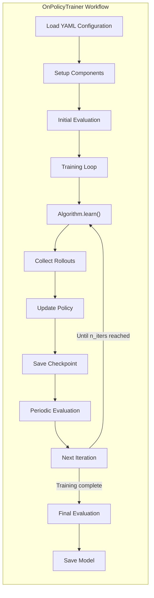
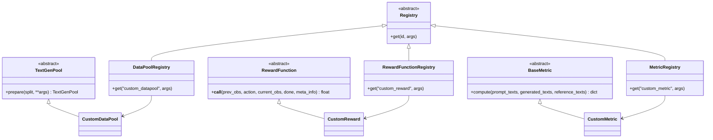

<!-- source: DeepWiki mcp.deepwiki.com · repo allenai/RL4LMs · page 7 Use Cases and Examples · fetched 2026-10-26 -->

# Use Cases and Examples

<details>
<summary>Relevant source files</summary>

The following files were used as context for generating this wiki page:

- [README.md](README.md)
- [rl4lms/envs/text_generation/training_utils.py](rl4lms/envs/text_generation/training_utils.py)
- [scripts/training/task_configs/dialog/gpt2_ppo.yml](scripts/training/task_configs/dialog/gpt2_ppo.yml)
- [scripts/training/task_configs/imdb_text_continuation/gpt2_nlpo.yml](scripts/training/task_configs/imdb_text_continuation/gpt2_nlpo.yml)
- [scripts/training/task_configs/imdb_text_continuation/gpt2_nlpo_on_supervised.yml](scripts/training/task_configs/imdb_text_continuation/gpt2_nlpo_on_supervised.yml)
- [setup.py](setup.py)

</details>


This page provides comprehensive examples of using RL4LMs for various text generation tasks. We'll cover practical applications including dialog generation and text continuation, and explain how to adapt these examples to other tasks. For information about the underlying architecture, see [System Architecture](#2), and for details on configuration options, see [Training Configuration](#6.1).

## General Workflow

Before diving into specific examples, let's understand the general workflow for training models with RL4LMs:



The process starts with defining your configuration in a YAML file, which is then loaded by the training script. The `OnPolicyTrainer` builds all necessary components and manages the training and evaluation process.

Sources: [README.md:66-77](), [rl4lms/envs/text_generation/training_utils.py:126-223]()

## Dialog Generation Example

Dialog generation is one of the key use cases for RL4LMs. This example demonstrates how to train a GPT-2 model with PPO to generate conversational responses that match specific intents using the DailyDialog dataset.



### Configuration Example

Here's a breakdown of the key components in the dialog generation configuration file:

| Component | Configuration | Purpose |
|-----------|--------------|---------|
| **Tokenizer** | GPT-2 with left padding/truncation | Processes input and output text |
| **Reward Function** | IntentAccuracy (0.75 intent, 0.25 coherence) | Measures conversational quality |
| **DataPool** | DailyDialog with context size of 5 | Provides conversational training data |
| **Environment** | 10 parallel envs, max length 20 tokens | Manages the training environment |
| **Algorithm** | PPO with learning rate 0.000001, KL coeff 0.2 | Updates the policy based on rewards |
| **Policy** | Causal LM Actor-Critic (GPT-2) | Generates text responses |
| **Evaluation** | Intent accuracy, perplexity, BLEU, ROUGE, etc. | Measures generation quality |

### Running the Dialog Example

To train a dialog generation model using the provided configuration:

```bash
python scripts/training/train_text_generation.py --config_path scripts/training/task_configs/dialog/gpt2_ppo.yml
```

Sources: [scripts/training/task_configs/dialog/gpt2_ppo.yml:1-79](), [README.md:17-25]()

## Text Continuation Example

The text continuation example shows how to train a language model to continue text with specific characteristics, in this case generating movie reviews with positive sentiment using the IMDB dataset.



### Configuration Details

The text continuation example uses NLPO (Natural Language Policy Optimization), a specialized algorithm for language generation:

| Component | Configuration | Purpose |
|-----------|--------------|---------|
| **Tokenizer** | lvwerra/gpt2-imdb with left padding/truncation | Processes movie review text |
| **Reward Function** | Learned reward (DistilBERT sentiment classifier) | Rewards positive sentiment |
| **DataPool** | IMDB dataset with seed 42 | Provides movie review data |
| **Environment** | 10 parallel envs, max length 48 tokens | Manages the training environment |
| **Algorithm** | NLPO with learning rate 0.000001, KL coeff 0.1 | Updates policy with action masking |
| **Policy** | Maskable Causal LM (GPT-2) with top-p 0.9 | Controls token selection during generation |
| **Evaluation** | Sentiment score, perplexity, diversity | Measures generation quality |

### Running the Text Continuation Example

To train a text continuation model:

```bash
python scripts/training/train_text_generation.py --config_path scripts/training/task_configs/imdb_text_continuation/gpt2_nlpo.yml
```

Sources: [scripts/training/task_configs/imdb_text_continuation/gpt2_nlpo.yml:1-70](), [README.md:21-22]()

## Adapting to Other Tasks

RL4LMs provides a modular architecture that can be adapted to various text generation tasks by modifying the configuration files. The diagram below shows how different components can be swapped for different tasks:



To adapt the examples to your own task:

1. **Select or create a DataPool**: Choose from existing datasets or create your own by subclassing `TextGenPool`
2. **Choose a reward function**: Pick from reference-based metrics (ROUGE, BLEU), learned rewards, or create a custom one
3. **Select an algorithm**: Choose PPO for general purposes, NLPO for improved sample efficiency, or other algorithms based on your requirements
4. **Configure the policy**: Select a causal LM for text continuation or a seq2seq LM for tasks like summarization
5. **Define evaluation metrics**: Select appropriate metrics for your task

Sources: [README.md:17-34](), [rl4lms/envs/text_generation/training_utils.py:34-124]()

## Training Process Workflow

This diagram illustrates the detailed training process used by `OnPolicyTrainer` when you run an example:



The trainer handles the entire process from initial setup through training iterations to final evaluation. At each step, it manages the interaction between the environment, policy, and algorithm components.

Sources: [rl4lms/envs/text_generation/training_utils.py:126-223]()

## Human Evaluation

For cases where automated metrics aren't sufficient, RL4LMs provides templates for human evaluation through crowdsourcing platforms. These can be used to:

1. Gather human judgments on model outputs
2. Collect training data for learned reward functions
3. Validate the performance of RL-trained models against baselines

The templates are located in the `scripts/crowdworking_templates` directory and can be adapted for different evaluation needs.

Sources: [README.md:294-296]()

## Creating Custom Components

To extend RL4LMs for new use cases, you can create custom components:



### Creating Custom Components:

1. **Custom DataPool**: Subclass `TextGenPool` and override the `prepare` method
2. **Custom Reward Function**: Subclass `RewardFunction` and implement the `__call__` method
3. **Custom Metric**: Subclass `BaseMetric` and implement the `compute` method
4. **Custom Algorithm**: Subclass `OnPolicyAlgorithm` and implement the `train` method
5. **Custom Policy**: Extend one of the existing policy classes

After creating your custom component, register it in the appropriate registry to make it available through the configuration system.

Sources: [README.md:190-293]()

## Logging and Experiment Tracking

RL4LMs supports WANDB logging for tracking experiments. When running examples, you can enable logging with:

```bash
WANDB_API_KEY=<YOUR-WANDB-API-KEY-HERE> python scripts/training/train_text_generation.py \
--config_path <PATH-TO-CONFIG-FILE> \
--experiment_name <EXPERIMENT-NAME> \
--base_path_to_store_results <PATH-TO-STORE-RESULTS> \
--log_to_wandb
```

This will track metrics, save checkpoints, and store generated text samples for analysis.

Sources: [README.md:300-315]()

---

