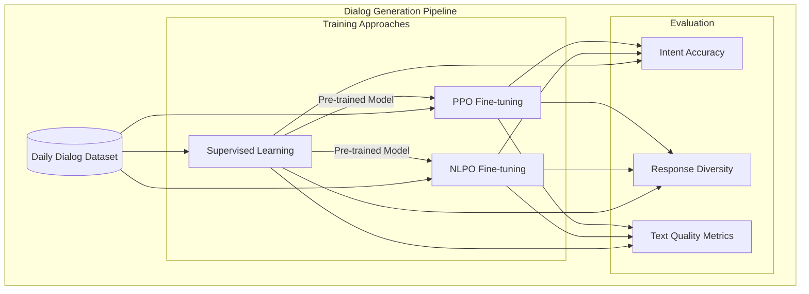
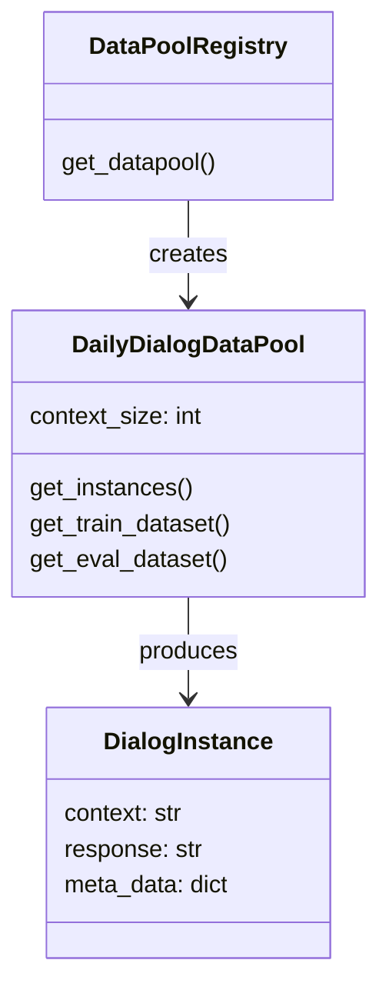
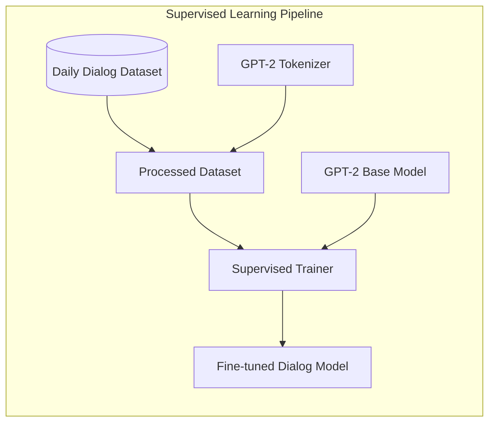
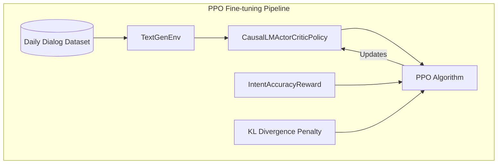
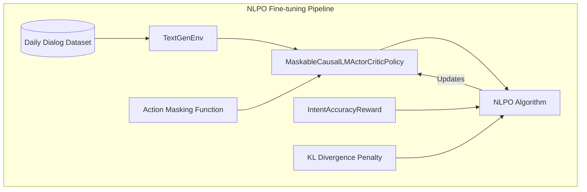
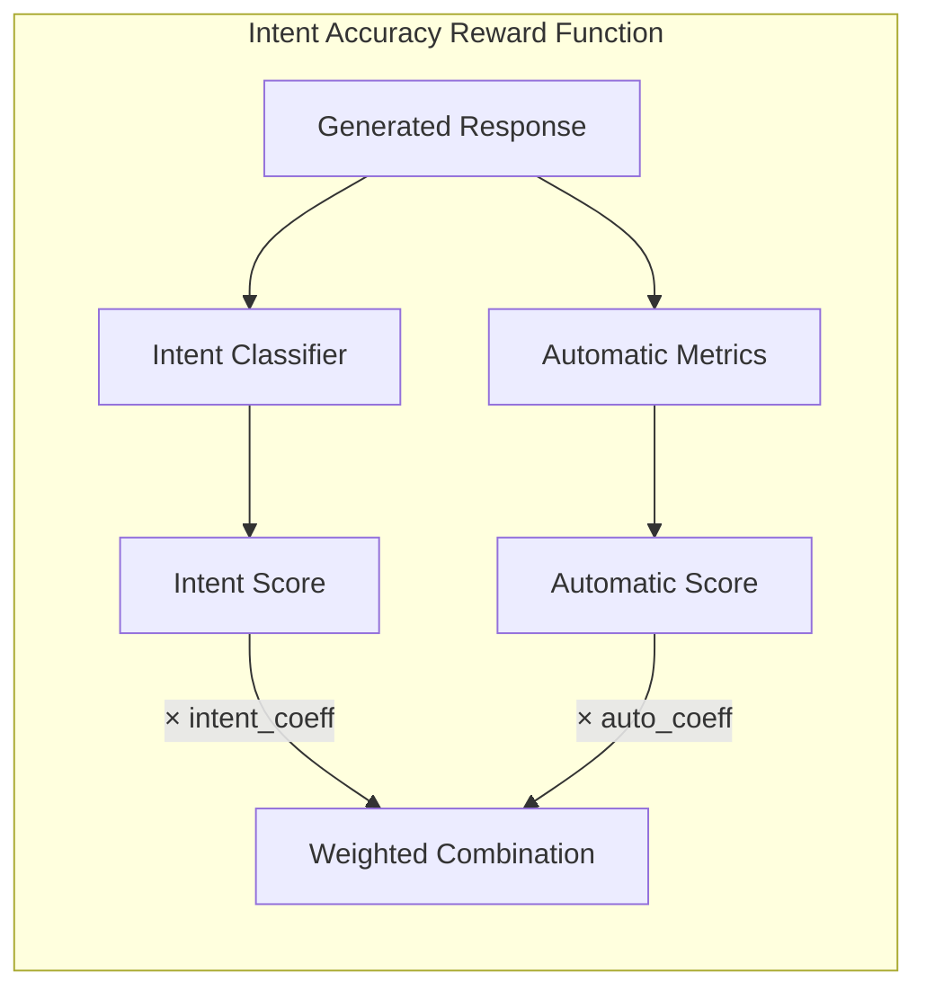
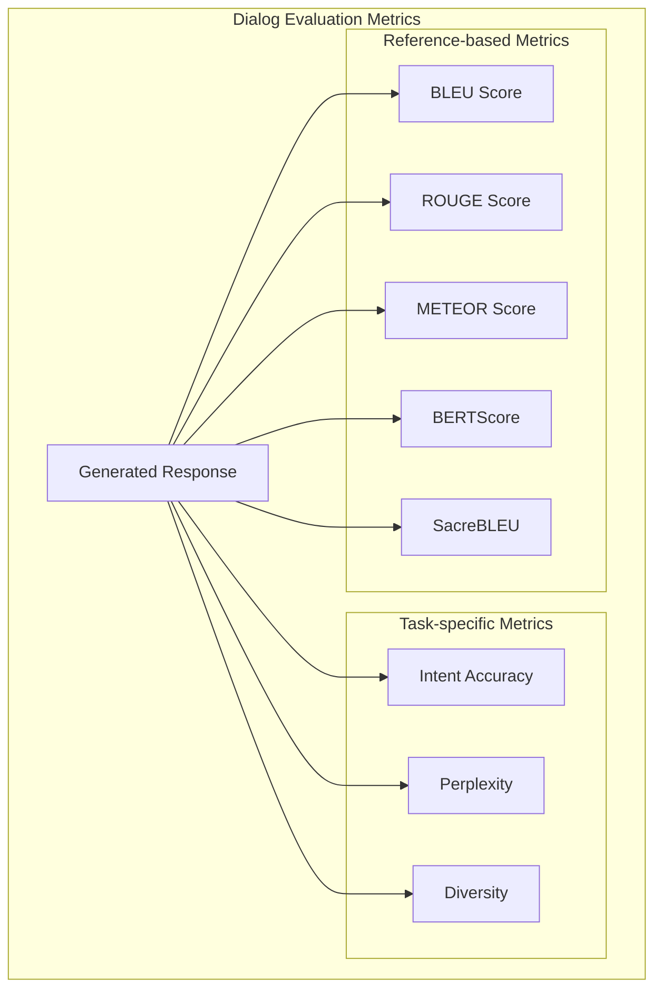
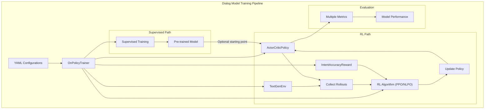

<!-- source: DeepWiki mcp.deepwiki.com · repo allenai/RL4LMs · page 7.1 Dialog Generation · fetched 2026-10-26 -->

# Dialog Generation

<details>
<summary>Relevant source files</summary>

The following files were used as context for generating this wiki page:

- [scripts/training/task_configs/dialog/gpt2_nlpo.yml](scripts/training/task_configs/dialog/gpt2_nlpo.yml)
- [scripts/training/task_configs/dialog/gpt2_nlpo_on_supervised.yml](scripts/training/task_configs/dialog/gpt2_nlpo_on_supervised.yml)
- [scripts/training/task_configs/dialog/gpt2_ppo.yml](scripts/training/task_configs/dialog/gpt2_ppo.yml)
- [scripts/training/task_configs/dialog/gpt2_ppo_on_supervised.yml](scripts/training/task_configs/dialog/gpt2_ppo_on_supervised.yml)
- [scripts/training/task_configs/dialog/gpt2_supervised.yml](scripts/training/task_configs/dialog/gpt2_supervised.yml)

</details>


## Purpose and Scope

This document provides a comprehensive guide for training and fine-tuning dialog generation models using the RL4LMs framework. It focuses specifically on conversational AI applications, demonstrating how to use both supervised learning and reinforcement learning techniques to improve dialog capabilities of language models. For related text generation tasks like story continuation, see [Text Continuation](#7.2).

## Overview of Dialog Generation in RL4LMs

Dialog generation involves training language models to produce contextually appropriate responses to conversation history. The RL4LMs framework supports training dialog models through:

1. **Supervised Fine-tuning**: Training on human-written dialogs
2. **Reinforcement Learning**: Further optimizing models using reward signals
3. **Combined Approaches**: Using RL to improve pre-trained supervised models



Sources:
- [scripts/training/task_configs/dialog/gpt2_supervised.yml:8-11]()
- [scripts/training/task_configs/dialog/gpt2_ppo.yml:14-17]()
- [scripts/training/task_configs/dialog/gpt2_nlpo.yml:13-16]()
- [scripts/training/task_configs/dialog/gpt2_ppo_on_supervised.yml:14-17]()

## Dialog Dataset Configuration

The RL4LMs framework uses the DailyDialog dataset for dialog generation tasks. This dataset contains multi-turn conversations on daily topics, making it suitable for training conversational agents.



In all dialog generation configurations, the dataset is set up with a context size of 5, meaning each conversation history includes up to 5 previous turns:

```yaml
datapool:
  id: "daily_dialog"
  args:
    context_size: 5
```

Sources:
- [scripts/training/task_configs/dialog/gpt2_supervised.yml:8-11]()
- [scripts/training/task_configs/dialog/gpt2_ppo.yml:14-17]()
- [scripts/training/task_configs/dialog/gpt2_nlpo.yml:13-16]()

## Training Approaches for Dialog Generation

### 1. Supervised Learning

The simplest approach is supervised fine-tuning of a language model on dialog data:



Key configuration parameters for supervised training:

| Parameter | Value | Description |
|-----------|-------|-------------|
| Model | gpt2 | Base causal language model |
| Batch Size | 32 | Samples per training batch |
| Learning Rate | 0.00001 | Constant learning rate |
| Epochs | 20 | Number of training epochs |
| Top-k | 20 | Number of tokens considered for sampling |
| Max Response Length | 20 tokens | Maximum length of generated responses |

Sources:
- [scripts/training/task_configs/dialog/gpt2_supervised.yml:1-29]()

### 2. PPO (Proximal Policy Optimization)

PPO is used to further optimize dialog models by maximizing a reward function that evaluates response quality:



Key configuration parameters for PPO training:

| Parameter | Value | Description |
|-----------|-------|-------------|
| Model | gpt2 or pre-trained | Either base or supervised model |
| Environment | 10 parallel envs | For collecting trajectories |
| KL Coefficient | 0.2 | Weight of KL penalty |
| Target KL | 0.5 | Target KL divergence level |
| Reward | Intent accuracy + auto | Dialog-specific reward function |
| Learning Rate | 0.000001 | For policy updates |

Sources:
- [scripts/training/task_configs/dialog/gpt2_ppo.yml:1-50]()
- [scripts/training/task_configs/dialog/gpt2_ppo_on_supervised.yml:1-49]()

### 3. NLPO (Natural Language Policy Optimization)

NLPO extends PPO with action masking to improve exploration in the large language model action space:



Key configuration parameters for NLPO training:

| Parameter | Value | Description |
|-----------|-------|-------------|
| Mask Type | learned_top_p | Method for determining action mask |
| Top Mask | 0.9 | Fraction of token probability mass to keep |
| Min Tokens | 100 | Minimum tokens to keep in the mask |
| Target Update | 20 iterations | Frequency of target network updates |

Sources:
- [scripts/training/task_configs/dialog/gpt2_nlpo.yml:25-51]()
- [scripts/training/task_configs/dialog/gpt2_nlpo_on_supervised.yml:25-51]()

## Dialog-Specific Reward Function

The RL4LMs framework uses a specialized reward function for dialog generation called `intent_accuracy`:



This reward function combines:
1. Intent accuracy - how well the response matches the expected conversation intent
2. Automatic metrics - standard NLP evaluation scores

The weighting between these components can be adjusted via coefficients:

| Configuration | Intent Coefficient | Auto Coefficient | Focus |
|---------------|-------------------|------------------|-------|
| PPO | 0.75 | 0.25 | More emphasis on intent |
| PPO on Supervised | 0.5 | 0.5 | Balanced approach |
| NLPO | 0.75 | 0.25 | More emphasis on intent |
| NLPO on Supervised | 0.25 | 0.75 | More emphasis on fluency |

Sources:
- [scripts/training/task_configs/dialog/gpt2_ppo.yml:7-11]()
- [scripts/training/task_configs/dialog/gpt2_ppo_on_supervised.yml:7-11]()
- [scripts/training/task_configs/dialog/gpt2_nlpo.yml:7-11]()
- [scripts/training/task_configs/dialog/gpt2_nlpo_on_supervised.yml:7-11]()

## Evaluation Metrics for Dialog Generation

Dialog models are evaluated using a comprehensive set of metrics to assess different aspects of response quality:



The evaluation metrics used for dialog generation include:

| Metric | Purpose | Description |
|--------|---------|-------------|
| Intent Accuracy | Task-specific | Evaluates if response matches expected conversation intent |
| Perplexity | Fluency | Measures how well the model predicts the text |
| Diversity | Variety | Assesses lexical richness and variety in responses |
| BLEU/SacreBLEU | Precision | Measures n-gram overlap with reference responses |
| ROUGE | Recall | Focuses on recall of n-grams from reference responses |
| METEOR | Alignment | Evaluates word alignment with references, handling synonyms |
| BERTScore | Semantic | Uses BERT embeddings to measure semantic similarity |

Sources:
- [scripts/training/task_configs/dialog/gpt2_supervised.yml:31-52]()
- [scripts/training/task_configs/dialog/gpt2_ppo.yml:50-74]()
- [scripts/training/task_configs/dialog/gpt2_nlpo.yml:52-76]()

## Environment Configuration for RL Training

For reinforcement learning training (PPO and NLPO), the environment needs to be configured properly:

```yaml
env:
  n_envs: 10
  args:
    max_prompt_length: 128
    max_episode_length: 20
    terminate_on_eos: True
```

This configuration:
- Creates 10 parallel environments for faster data collection
- Limits prompt (context) length to 128 tokens
- Limits responses to 20 tokens
- Terminates generation when EOS token is produced

Sources:
- [scripts/training/task_configs/dialog/gpt2_ppo.yml:19-24]()
- [scripts/training/task_configs/dialog/gpt2_nlpo.yml:18-23]()

## Training Pipeline Diagram

The full training pipeline for dialog generation with RL4LMs:



Sources:
- [scripts/training/task_configs/dialog/gpt2_supervised.yml]()
- [scripts/training/task_configs/dialog/gpt2_ppo.yml]()
- [scripts/training/task_configs/dialog/gpt2_nlpo.yml]()
- [scripts/training/task_configs/dialog/gpt2_ppo_on_supervised.yml]()
- [scripts/training/task_configs/dialog/gpt2_nlpo_on_supervised.yml]()

## Recommended Training Workflow

For optimal dialog generation results, the following workflow is recommended:

1. **Start with supervised learning**:
   ```bash
   python train_text_generation.py --config scripts/training/task_configs/dialog/gpt2_supervised.yml
   ```

2. **Fine-tune with PPO or NLPO**:
   - Use the supervised model as a starting point
   - Choose PPO for standard RL optimization
   - Choose NLPO if you want better exploration with action masking
   ```bash
   python train_text_generation.py --config scripts/training/task_configs/dialog/gpt2_ppo_on_supervised.yml
   ```
   
3. **Adjust reward function weights** based on your priorities:
   - Higher intent coefficient (0.75) for more intent-focused responses
   - Higher auto coefficient (0.75) for more natural, fluent responses

4. **Evaluate extensively** using the comprehensive metrics to understand model strengths and weaknesses

Sources:
- [scripts/training/task_configs/dialog/gpt2_supervised.yml]()
- [scripts/training/task_configs/dialog/gpt2_ppo_on_supervised.yml]()
- [scripts/training/task_configs/dialog/gpt2_nlpo_on_supervised.yml]()

## Conclusion

This page has detailed the process of training dialog generation models using the RL4LMs framework. By following the configurations provided, you can train models that generate contextually appropriate, diverse, and high-quality dialog responses. The framework's flexibility allows for different training approaches and reward function customizations to suit specific dialog generation needs.

---

