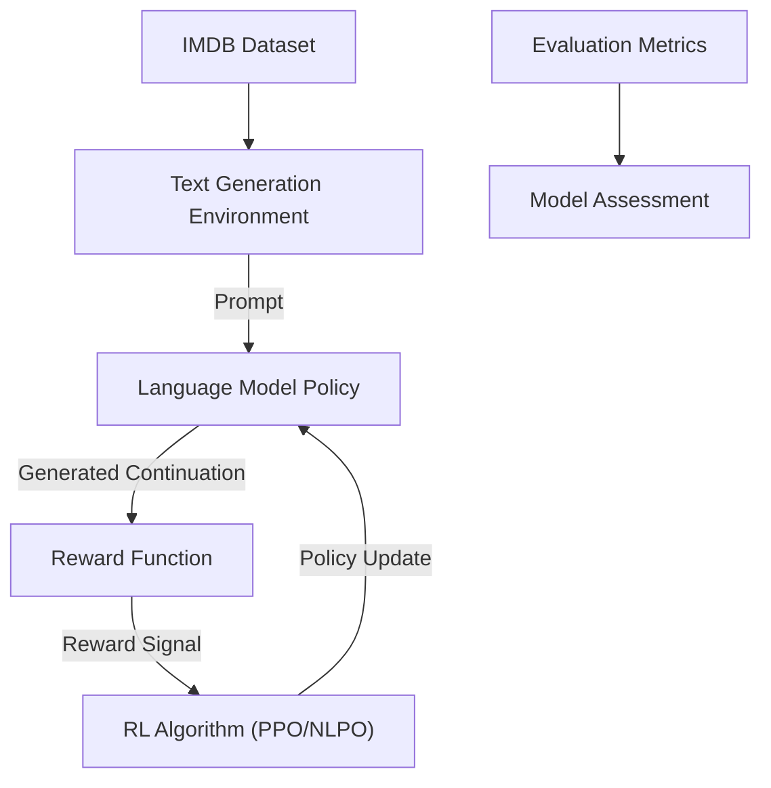
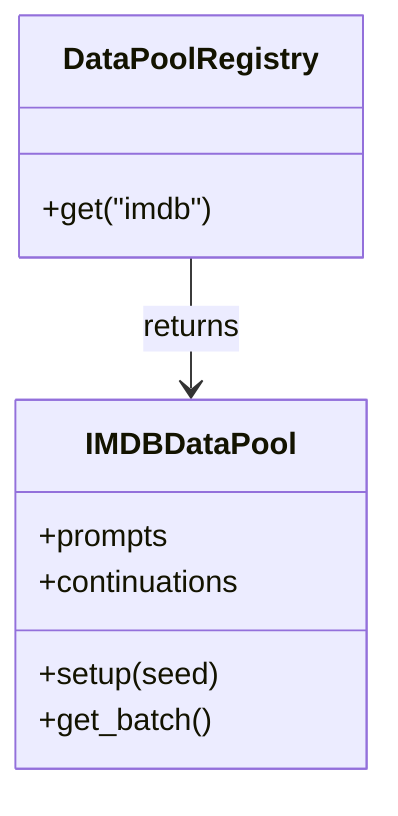
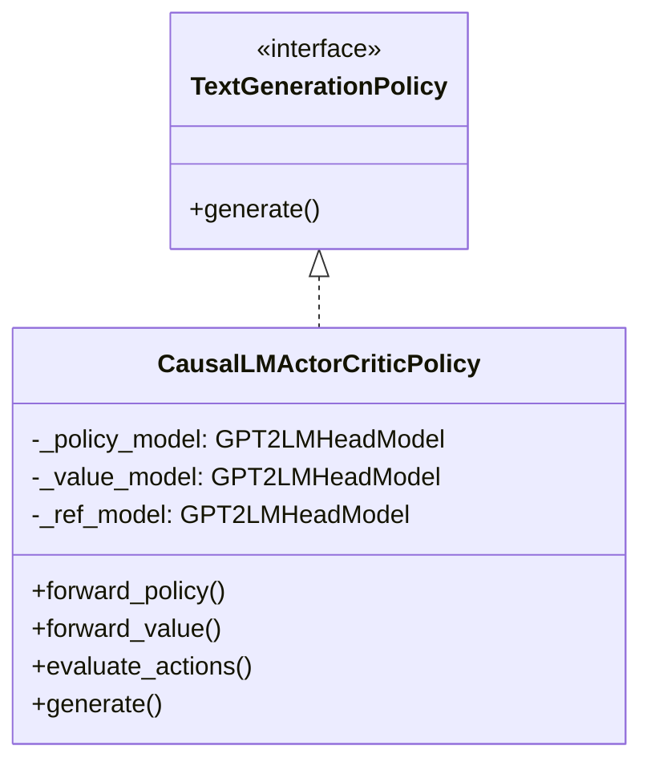
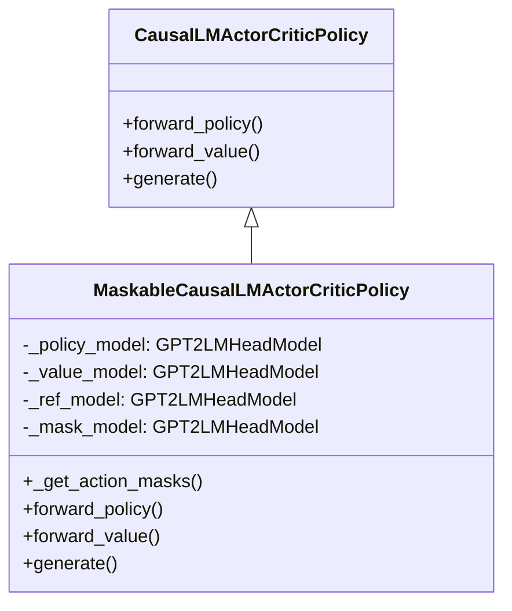
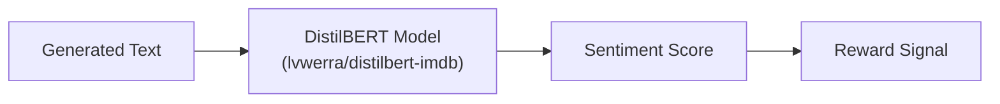
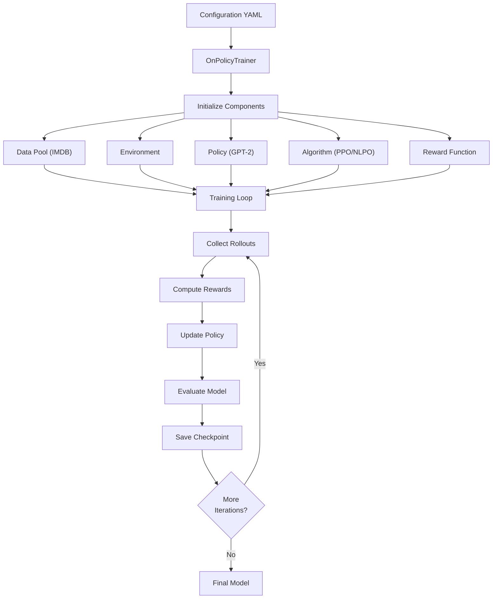

<!-- source: DeepWiki mcp.deepwiki.com · repo allenai/RL4LMs · page 7.2 Text Continuation · fetched 2026-10-26 -->

# Text Continuation

<details>
<summary>Relevant source files</summary>

The following files were used as context for generating this wiki page:

- [scripts/training/task_configs/imdb_text_continuation/gpt2_nlpo.yml](scripts/training/task_configs/imdb_text_continuation/gpt2_nlpo.yml)
- [scripts/training/task_configs/imdb_text_continuation/gpt2_nlpo_on_supervised.yml](scripts/training/task_configs/imdb_text_continuation/gpt2_nlpo_on_supervised.yml)
- [scripts/training/task_configs/imdb_text_continuation/gpt2_ppo.yml](scripts/training/task_configs/imdb_text_continuation/gpt2_ppo.yml)
- [scripts/training/task_configs/imdb_text_continuation/gpt2_ppo_on_supervised.yml](scripts/training/task_configs/imdb_text_continuation/gpt2_ppo_on_supervised.yml)

</details>


## Purpose and Scope

This document explains how to use the RL4LMs framework for text continuation tasks. Text continuation involves generating coherent and contextually appropriate text that follows a given prompt. The RL4LMs framework enables fine-tuning language models for this task using reinforcement learning techniques. This page focuses specifically on implementing text continuation with the IMDB dataset, using both PPO and NLPO algorithms.

For information about dialog generation, see [Dialog Generation](#7.1).

## Overview of Text Continuation in RL4LMs

Text continuation in RL4LMs involves training a language model to generate text that continues from a given prompt while optimizing for a specific reward function. For the IMDB dataset, models are typically optimized to generate positive movie reviews.



Sources: [scripts/training/task_configs/imdb_text_continuation/gpt2_ppo.yml](), [scripts/training/task_configs/imdb_text_continuation/gpt2_nlpo.yml]()

## Setting Up Text Continuation Tasks

### Dataset Configuration

The IMDB dataset is used for text continuation tasks, providing movie reviews that can be split into prompts and desired continuations. The dataset is configured with a fixed random seed for reproducibility.



Sources: [scripts/training/task_configs/imdb_text_continuation/gpt2_ppo.yml:14-17]()

### Environment Configuration

The text generation environment is configured with specific parameters for the IMDB continuation task:

```
env:
  n_envs: 10
  args:
    max_prompt_length: 64
    max_episode_length: 48
    terminate_on_eos: True
```

These settings define:
- 10 parallel environments for efficient sampling
- Maximum prompt length of 64 tokens
- Maximum generated continuation length of 48 tokens
- Generation terminates when an end-of-sequence token is produced

Sources: [scripts/training/task_configs/imdb_text_continuation/gpt2_ppo.yml:19-24](), [scripts/training/task_configs/imdb_text_continuation/gpt2_nlpo.yml:19-24]()

## Text Continuation Using PPO

Proximal Policy Optimization (PPO) is one of the reinforcement learning algorithms implemented in RL4LMs for text continuation tasks.

### PPO Configuration

The PPO algorithm is configured with specific hyperparameters for text continuation:

```
alg:
  id: ppo
  args: 
    n_steps: 128
    batch_size: 64
    verbose: 1
    learning_rate: 0.000001
    n_epochs: 5
    
  kl_div:
    coeff: 0.1
    target_kl: 0.1
```

This configuration specifies:
- 128 steps per rollout
- Batch size of 64 for training
- Learning rate of 10^-6
- 5 epochs per iteration
- KL divergence coefficient and target to prevent the model from deviating too far from the original policy

Sources: [scripts/training/task_configs/imdb_text_continuation/gpt2_ppo.yml:26-37]()

### Policy Configuration for PPO

The policy for PPO uses a causal language model actor-critic architecture:



The policy is configured with the following settings:
- Base model: `lvwerra/gpt2-imdb` (GPT-2 fine-tuned on IMDB)
- Generation parameters: sampling with minimum length of 48 tokens and maximum of 48 new tokens

Sources: [scripts/training/task_configs/imdb_text_continuation/gpt2_ppo.yml:39-47]()

## Text Continuation Using NLPO

Natural Language Policy Optimization (NLPO) is an alternative RL algorithm specifically designed for language generation tasks. It extends PPO with action masking to improve exploration.

### NLPO Configuration

The NLPO configuration is similar to PPO, with the same core hyperparameters:

```
alg:
  id: nlpo
  args:
    n_steps: 128
    batch_size: 64
    verbose: 1
    learning_rate: 0.000001
    n_epochs: 5
```

Sources: [scripts/training/task_configs/imdb_text_continuation/gpt2_nlpo.yml:26-33]()

### Policy Configuration for NLPO

The key difference is in the policy type used with NLPO:



NLPO uses a maskable policy with these specific parameters:
- `top_mask: 0.9`: Controls the percentage of tokens to keep in the action space
- `min_tokens_to_keep: 100`: Ensures a minimum number of tokens in the action space
- `mask_type: 'learned_top_p'`: Uses a learned mechanism to select tokens
- `target_update_iterations: 5`: Controls how often the target network is updated

Sources: [scripts/training/task_configs/imdb_text_continuation/gpt2_nlpo.yml:39-51]()

## Reward Functions for Text Continuation

### Sentiment-Based Reward Function

For the IMDB text continuation task, a learned reward function based on sentiment analysis is used:



The reward function is configured as:
```
reward_fn:
  id: learned_reward
  args:
    model_name: lvwerra/distilbert-imdb
    label_ix: 1
    include_prompt_for_eval: True
```

The `learned_reward` function uses:
- `lvwerra/distilbert-imdb`: A DistilBERT model fine-tuned on IMDB for sentiment classification
- `label_ix: 1`: Targets the positive sentiment class (index 1)
- `include_prompt_for_eval: True`: Evaluates the combined prompt and generated text

Sources: [scripts/training/task_configs/imdb_text_continuation/gpt2_ppo.yml:7-12](), [scripts/training/task_configs/imdb_text_continuation/gpt2_nlpo.yml:7-12]()

## Evaluation Metrics

The performance of text continuation models is evaluated using several metrics:

### Reward-Based Metric

The same sentiment model used for training is also used as an evaluation metric:

```
metrics:
  - id: learned_reward
    args: 
      model_name: lvwerra/distilbert-imdb
      label_ix: 1
      batch_size: 100
```

This measures how well the model has learned to optimize for the target sentiment.

### Language Quality Metrics

```
metrics:
  - id: causal_perplexity
    args:
      tokenizer_id: gpt2
      stride: 512
      model_type: causal
  - id: diversity
    args: {}
```

- **Perplexity**: Measures the fluency of the generated text using a base GPT-2 model
- **Diversity**: Evaluates the lexical diversity of the generated text

Sources: [scripts/training/task_configs/imdb_text_continuation/gpt2_ppo.yml:54-66](), [scripts/training/task_configs/imdb_text_continuation/gpt2_nlpo.yml:58-70]()

## Training Workflow

The training process for text continuation follows this workflow:



The training is configured to run for 50 iterations, with evaluation and model saving every 10 iterations:

```
train_evaluation:
  eval_batch_size: 64
  n_iters: 50
  eval_every: 10
  save_every: 10
```

Sources: [scripts/training/task_configs/imdb_text_continuation/gpt2_ppo.yml:49-53](), [scripts/training/task_configs/imdb_text_continuation/gpt2_nlpo.yml:53-57]()

## Using Pre-trained Models

### Starting from Supervised Models

RL4LMs supports starting the reinforcement learning training from a model already fine-tuned using supervised learning. This is configured in the `*_on_supervised.yml` files.

For PPO:
```
policy:
  id: causal_lm_actor_critic_policy
  args:
    model_name: rajkumarrrk/gpt2-fine-tuned-on-imdb-positive-reviews
```

For NLPO:
```
policy:
  id: maskable_causal_lm_actor_critic_policy
  args:
    model_name: rajkumarrrk/gpt2-fine-tuned-on-imdb-positive-reviews
```

Using a supervised pre-trained model can provide a better starting point for reinforcement learning, potentially leading to faster convergence and better results.

Sources: [scripts/training/task_configs/imdb_text_continuation/gpt2_ppo_on_supervised.yml:39-47](), [scripts/training/task_configs/imdb_text_continuation/gpt2_nlpo_on_supervised.yml:39-51]()

## Comparison of Training Approaches

This table summarizes the different training approaches for text continuation:

| Approach | Base Model | Algorithm | Policy Type | Key Advantage |
|----------|------------|-----------|------------|---------------|
| Standard PPO | `lvwerra/gpt2-imdb` | PPO | `causal_lm_actor_critic_policy` | Standard RL approach |
| NLPO | `lvwerra/gpt2-imdb` | NLPO | `maskable_causal_lm_actor_critic_policy` | Better exploration through action masking |
| PPO from Supervised | `rajkumarrrk/gpt2-fine-tuned-on-imdb-positive-reviews` | PPO | `causal_lm_actor_critic_policy` | Better starting point |
| NLPO from Supervised | `rajkumarrrk/gpt2-fine-tuned-on-imdb-positive-reviews` | NLPO | `maskable_causal_lm_actor_critic_policy` | Combined benefits of supervised start and better exploration |

---

