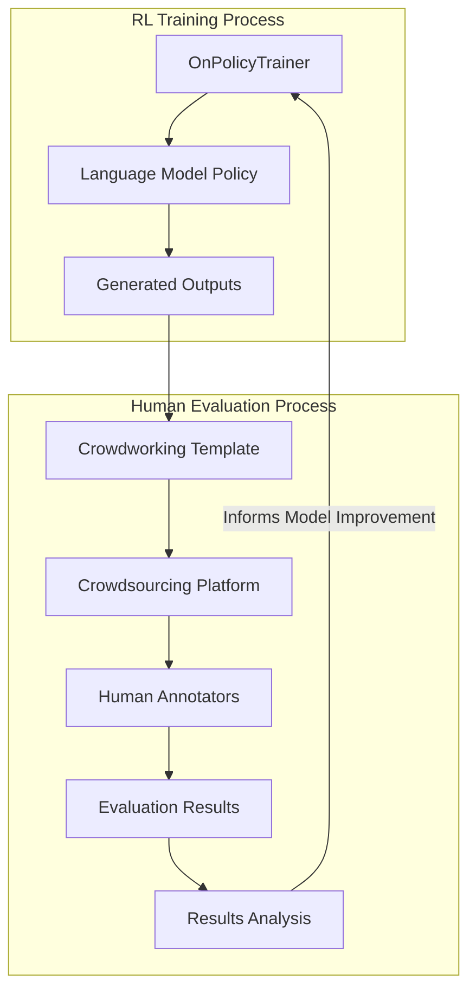
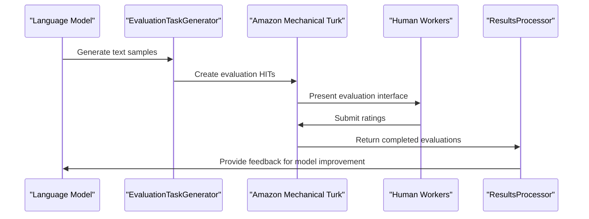
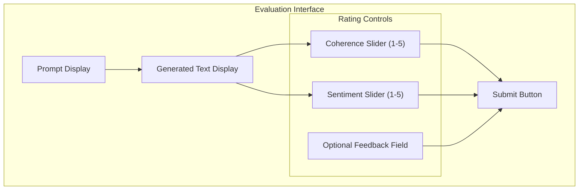

<!-- source: DeepWiki mcp.deepwiki.com · repo allenai/RL4LMs · page 7.3 Human Evaluation · fetched 2026-10-26 -->

# Human Evaluation

<details>
<summary>Relevant source files</summary>

The following files were used as context for generating this wiki page:

- [scripts/crowdworking_templates/likert/IMDB_sentiment_completion.html](scripts/crowdworking_templates/likert/IMDB_sentiment_completion.html)

</details>


This document describes the human evaluation components and workflow in the RL4LMs framework. Human evaluation provides critical feedback on the quality of text generated by language models, serving as a complement to automated metrics and helping to assess whether reinforcement learning training has successfully improved model outputs according to human preferences.

## Purpose and Scope

The human evaluation system in RL4LMs is designed to:
- Collect human judgments on text generated by language models
- Support multiple evaluation dimensions (coherence, relevance, sentiment, etc.)
- Facilitate crowdsourcing through platforms like Amazon Mechanical Turk
- Enable systematic comparison of different model variants and training approaches

For information about automated evaluation metrics, see [Evaluation Metrics](#6.2).

## Human Evaluation Workflow



Sources: [scripts/crowdworking_templates/likert/IMDB_sentiment_completion.html:1-472]()

## Template-Based Evaluation System

RL4LMs uses HTML templates to create standardized evaluation interfaces for crowdworkers. These templates define:
1. Instructions for evaluators
2. Examples to calibrate judgments
3. Rating scales and dimensions 
4. Data presentation format

```mermaid
classDiagram
    class "CrowdworkingTemplate" {
        instructions
        examples
        ratingScales
        dataFields
        javascriptLogic()
    }

    class "LikertTemplate" {
        scaleRange: 1-5
        ratingDimensions
        scaleLabels
        updateUIOnInput()
    }

    class "IMDBSentimentTemplate" {
        promptField
        machineCompletionField
        coherenceScale
        sentimentScale
        feedbackField
    }

    "CrowdworkingTemplate" <|-- "LikertTemplate"
    "LikertTemplate" <|-- "IMDBSentimentTemplate"
```

Sources: [scripts/crowdworking_templates/likert/IMDB_sentiment_completion.html:1-472]()

## Evaluation Dimensions and Scales

Human evaluators are asked to rate generated text on multiple dimensions using Likert scales. Each dimension has clearly defined criteria to ensure consistent ratings.

### Example: IMDB Sentiment Completion Template

This template evaluates text completions for IMDB movie reviews on two dimensions:

| Dimension | Purpose | Scale Range | Scale Definition |
|-----------|---------|-------------|------------------|
| Coherence/Quality | Assess grammaticality, readability, and logical continuation | 1-5 | 1: Terrible (contradicts input, severe errors)<br>3: Okay (readable but has problems)<br>5: Excellent (flows naturally, grammatical) |
| Sentiment | Evaluate the emotional tone of the completion | 1-5 | 1: Very negative<br>3: Neutral<br>5: Very positive |

Sources: [scripts/crowdworking_templates/likert/IMDB_sentiment_completion.html:95-152]()

## Evaluation Process



Sources: [scripts/crowdworking_templates/likert/IMDB_sentiment_completion.html:271-352]()

## Template Components

### Instructions Section

The template includes detailed instructions that:
- Explain the task and evaluation criteria
- Define rating scales with clear examples of each point on the scale
- Provide calibration examples showing different quality levels

Sources: [scripts/crowdworking_templates/likert/IMDB_sentiment_completion.html:88-152]()

### Examples Section

To calibrate worker judgments, the template shows:
- Sample prompts and completions
- Suggested ratings for each example
- Explanations of why those ratings are appropriate

This ensures more consistent evaluation across different workers.

Sources: [scripts/crowdworking_templates/likert/IMDB_sentiment_completion.html:155-267]()

### Evaluation Interface

The core evaluation interface consists of:
1. A prompt (input text)
2. The system-generated completion to be evaluated
3. Rating sliders for each dimension
4. Dynamic feedback that updates as ratings change
5. Optional feedback field for worker comments



Sources: [scripts/crowdworking_templates/likert/IMDB_sentiment_completion.html:270-352]()

## Interactive Elements

The template includes JavaScript functionality that:
- Dynamically updates descriptions as users adjust rating sliders
- Tracks time spent on the task
- Manages visibility of instructional sections
- Validates inputs before submission

Sources: [scripts/crowdworking_templates/likert/IMDB_sentiment_completion.html:374-469]()

## Setting Up Human Evaluations

To implement human evaluation for generated text:

1. Select or adapt an appropriate template based on your task
2. Prepare prompts and model-generated completions
3. Define the evaluation dimensions and rating scales
4. Set up the task on a crowdsourcing platform like Amazon Mechanical Turk
5. Process and analyze the resulting human judgments

## Results Analysis and Application

Human evaluation results can be used to:
- Compare different model variants
- Assess the effectiveness of reinforcement learning strategies
- Identify specific strengths and weaknesses in generated text
- Correlate human judgments with automated metrics
- Guide further model improvements

Sources: [scripts/crowdworking_templates/likert/IMDB_sentiment_completion.html:1-472]()

## Integration with RL4LMs Training

While human evaluations are typically conducted offline (after model training), the results inform future training by:
- Validating the effectiveness of automated reward functions
- Guiding the development of better reward models
- Providing ground truth for comparing different approaches
- Identifying aspects of text quality that require additional focus

Human evaluation is essential for verifying that improvements measured by automated metrics align with actual human preferences.